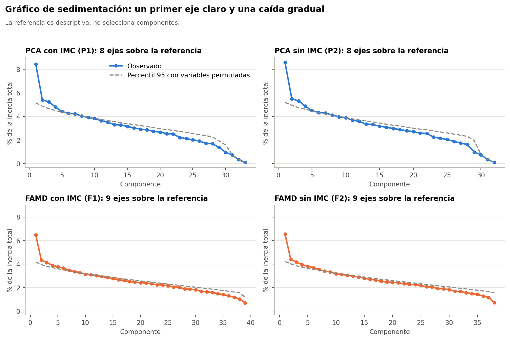
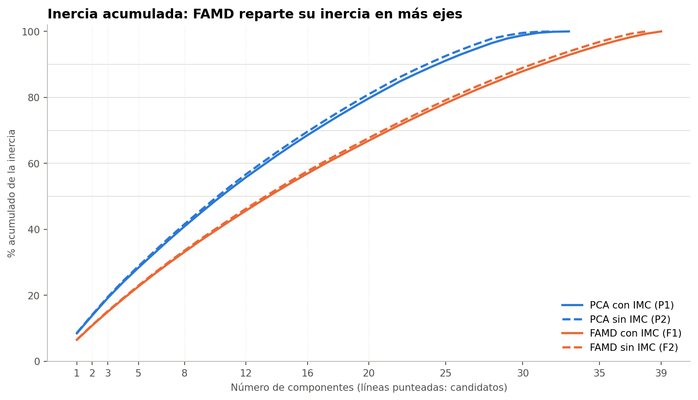
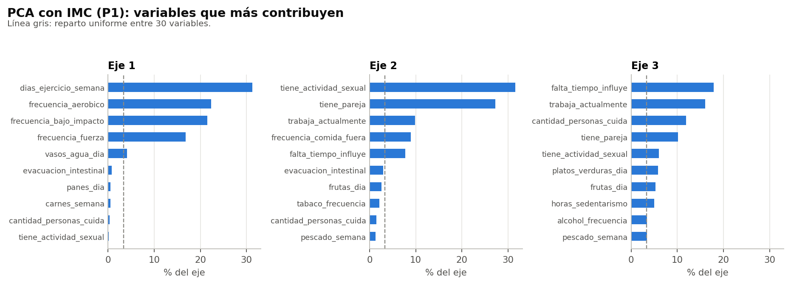
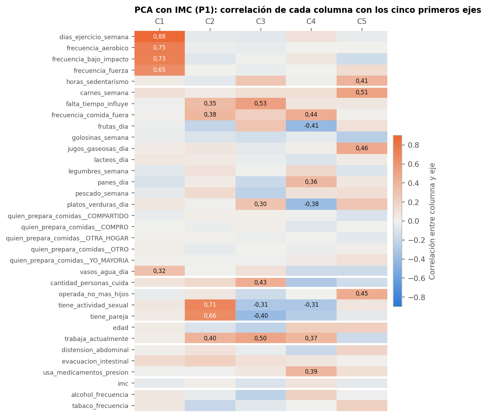
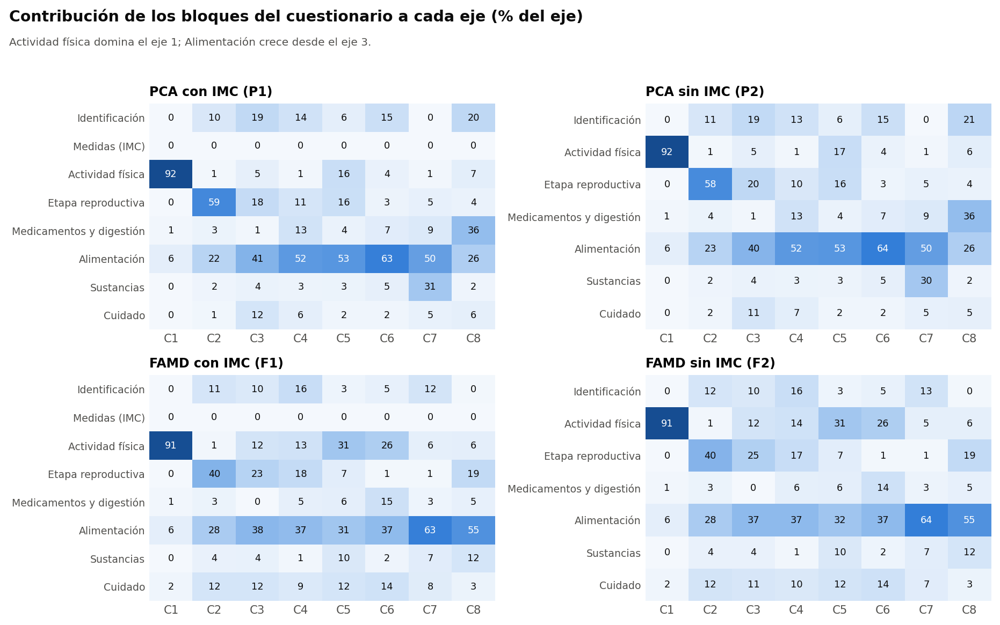
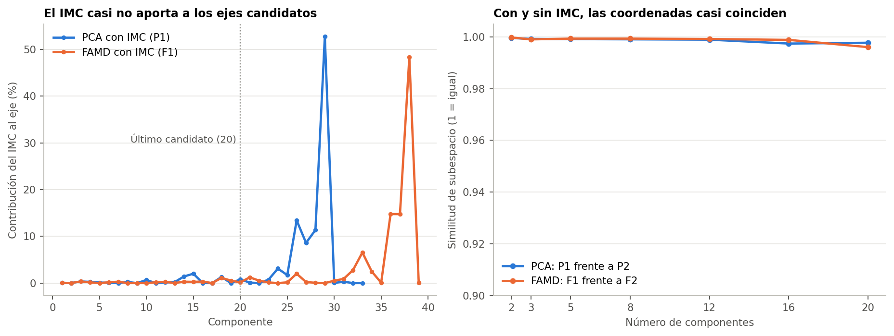
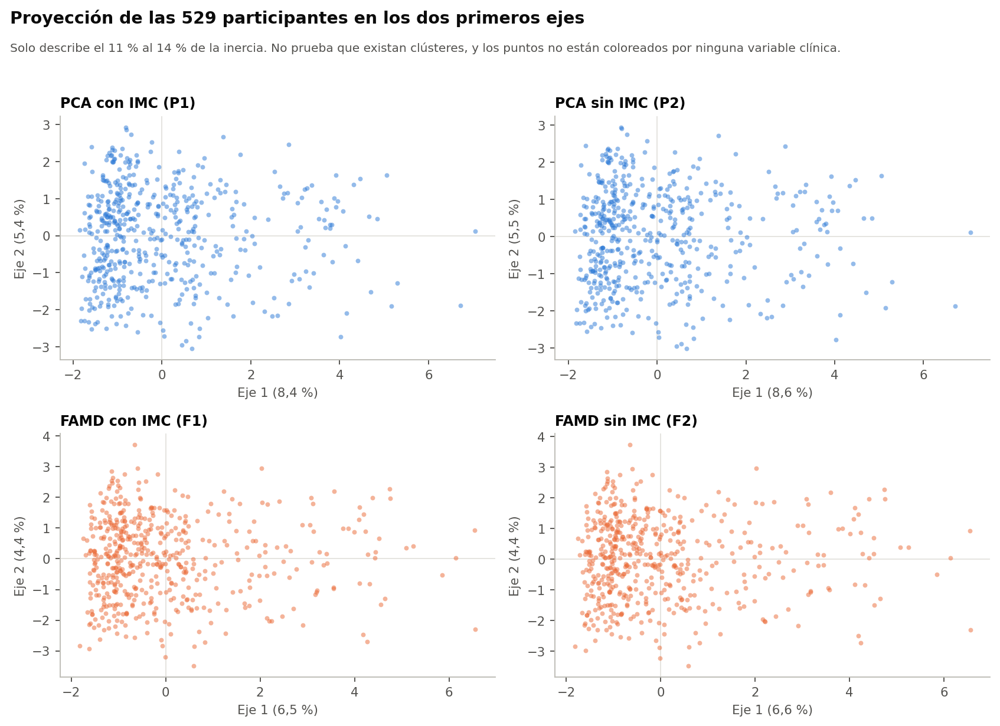

# 1. Qué se hizo

Se aplicó análisis de componentes principales a las dos matrices de la Fase 36: P1, con IMC, y P2, sin IMC. Todo el análisis usa el conjunto sintético de usuarias (N = 529). Los resultados describen ese conjunto y no permiten afirmar nada sobre mujeres reales. Esta fase solo resume las variables en dimensiones: no forma grupos ni usa el MRS.

- **Entrada:** P1 tiene 529 filas y 34 columnas, con inercia 29,5047. P2 tiene 529 filas y 33 columnas, con inercia 29,0. El IMC pesa menos en P1 porque tiene una varianza de 0,5047, en lugar de 1, según lo fijado en la Fase 36.
- **Cálculo:** scikit-learn con `svd_solver='full'`, sin ningún escalado nuevo. Los valores propios usan la convención 1/n (`explained_variance_ × 528/529`), para que sumen la inercia indicada.
- **Rango:** P1 tiene 33 componentes y P2 tiene 32. Hay un eje menos que columnas porque las cinco indicadoras de `quien_prepara_comidas` suman una constante, lo que genera una dependencia lineal.

# 2. Varianza por componente

| Eje | P1: λ | P2: λ | P1: % | P2: % |
|---|---|---|---|---|
| 1 | 2,493 | 2,492 | 8,45 | 8,59 |
| 2 | 1,597 | 1,596 | 5,41 | 5,50 |
| 3 | 1,548 | 1,544 | 5,25 | 5,33 |
| 4 | 1,417 | 1,415 | 4,80 | 4,88 |
| 5 | 1,305 | 1,304 | 4,42 | 4,50 |
| 6 | 1,259 | 1,258 | 4,27 | 4,34 |
| 7 | 1,245 | 1,245 | 4,22 | 4,29 |
| 8 | 1,195 | 1,194 | 4,05 | 4,12 |
| 9 | 1,154 | 1,154 | 3,91 | 3,98 |
| 10 | 1,132 | 1,128 | 3,84 | 3,89 |
| 11 | 1,071 | 1,071 | 3,63 | 3,69 |
| 12 | 1,038 | 1,037 | 3,52 | 3,58 |

**Lectura.** El primer eje destaca (8,4 % en P1). Desde el segundo la caída es muy gradual: los ejes 2 a 12 van de 5,4 % a 3,5 %, sin un quiebre claro. Es lo esperable en un conjunto con asociaciones débiles entre variables.

**Varianza acumulada por candidato:**

| Escenario | k = 2 | k = 3 | k = 5 | k = 8 | k = 12 | k = 16 | k = 20 |
|---|---|---|---|---|---|---|---|
| P1 (PCA con IMC) | 13,9 % | 19,1 % | 28,3 % | 40,9 % | 55,8 % | 68,5 % | 79,7 % |
| P2 (PCA sin IMC) | 14,1 % | 19,4 % | 28,8 % | 41,5 % | 56,7 % | 69,6 % | 81,0 % |

**Componentes necesarios para cada porcentaje** (referencia descriptiva, no un criterio):

| Escenario | Rango | 50 % | 60 % | 70 % | 80 % | 90 % |
|---|---|---|---|---|---|---|
| P1 (PCA con IMC) | 33 | 11 | 14 | 17 | 21 | 25 |
| P2 (PCA sin IMC) | 32 | 11 | 13 | 17 | 20 | 24 |

# 3. Referencia frente al ruido

Esta comparación es una **adición mía**: el encargo no la pide y es solo descriptiva. Permuta cada variable por separado 200 veces y obtiene el percentil 95 de cada valor propio.

| Eje | P1: λ / p95 | P2: λ / p95 |
|---|---|---|
| 1 | 2,493 / 1,524 | 2,492 / 1,507 |
| 2 | 1,597 / 1,439 | 1,596 / 1,436 |
| 3 | 1,548 / 1,377 | 1,544 / 1,378 |
| 4 | 1,417 / 1,328 | 1,415 / 1,340 |
| 5 | 1,305 / 1,296 | 1,304 / 1,295 |
| 6 | 1,259 / 1,258 | 1,258 / 1,255 |
| 7 | 1,245 / 1,225 | 1,245 / 1,220 |
| 8 | 1,195 / 1,193 | 1,194 / 1,190 |
| 9 | 1,154 / 1,163 | 1,154 / 1,161 |
| 10 | 1,132 / 1,134 | 1,128 / 1,130 |

Ocho ejes superan esa referencia en P1 y P2, pero por márgenes muy pequeños después de los primeros. En P1, el eje 6 obtiene 1,259 frente a 1,258, y el eje 8 obtiene 1,195 frente a 1,193. Por eso, solo el primer eje se separa con claridad. Los ejes con valores propios casi iguales pueden intercambiarse con cambios pequeños en los datos, lo que explica parte de las variaciones vistas en las sensibilidades.

# 4. Qué describe cada eje

Cada eje se describe solo por sus características. Los nombres de esta sección son rótulos descriptivos.

| Eje | % del eje | Variables con mayor contribución (%) |
|---|---|---|
| 1 | 8,45 % | dias_ejercicio_semana 31,3; frecuencia_aerobico 22,3; frecuencia_bajo_impacto 21,5; frecuencia_fuerza 16,9; vasos_agua_dia 4,1 |
| 2 | 5,41 % | tiene_actividad_sexual 31,5; tiene_pareja 27,3; trabaja_actualmente 9,8; frecuencia_comida_fuera 8,9; falta_tiempo_influye 7,7 |
| 3 | 5,25 % | falta_tiempo_influye 17,9; trabaja_actualmente 16,1; cantidad_personas_cuida 11,9; tiene_pareja 10,1; tiene_actividad_sexual 6,0 |
| 4 | 4,80 % | frecuencia_comida_fuera 13,5; frutas_dia 11,8; usa_medicamentos_presion 10,5; platos_verduras_dia 10,3; trabaja_actualmente 9,9 |
| 5 | 4,42 % | carnes_semana 19,9; jugos_gaseosas_dia 16,2; operada_no_mas_hijos 15,3; horas_sedentarismo 12,7; platos_verduras_dia 5,9 |

- **Eje 1, actividad física.** Lo forman los días de ejercicio y las tres frecuencias de ejercicio: el bloque aporta 92 %.
- **Eje 2, pareja y actividad sexual,** con aporte menor de trabajo y comida fuera de casa.
- **Eje 3, tiempo, trabajo y cuidado.**
- **Ejes 4 y 5, alimentación,** mezclada con otras variables: presión en el eje 4, y operación y sedentarismo en el eje 5.

**Contribución por bloque en P1 (% de cada eje):**

| Bloque | Eje 1 | Eje 2 | Eje 3 | Eje 4 | Eje 5 |
|---|---|---|---|---|---|
| Actividad física | 92,1 | 0,7 | 5,4 | 0,9 | 16,0 |
| Alimentación | 5,9 | 22,5 | 40,5 | 51,6 | 53,2 |
| Cuidado de otras personas | 0,3 | 1,5 | 11,9 | 6,1 | 1,8 |
| Etapa reproductiva y salud ginecológica | 0,4 | 59,1 | 17,8 | 11,3 | 15,9 |
| Identificación | 0,1 | 10,5 | 19,2 | 13,6 | 5,9 |
| Medicamentos y digestión | 0,8 | 3,5 | 1,1 | 13,0 | 3,7 |
| Medidas autodeclaradas | 0,1 | 0,0 | 0,4 | 0,3 | 0,1 |
| Sustancias | 0,4 | 2,2 | 3,7 | 3,1 | 3,3 |

**Contribución acumulada por bloque en P1, con los ejes ponderados por su valor propio (%):**

| Bloque | k = 2 | k = 3 | k = 5 | k = 8 | k = 12 | k = 16 | k = 20 |
|---|---|---|---|---|---|---|---|
| Actividad física | 56,4 | 42,4 | 31,2 | 22,9 | 18,2 | 16,4 | 15,3 |
| Alimentación | 12,4 | 20,1 | 30,6 | 35,5 | 41,8 | 42,6 | 44,6 |
| Cuidado de otras personas | 0,8 | 3,8 | 3,9 | 3,9 | 4,0 | 3,5 | 3,1 |
| Etapa reproductiva y salud ginecológica | 23,3 | 21,8 | 19,1 | 14,4 | 11,7 | 11,4 | 10,5 |
| Identificación | 4,2 | 8,3 | 8,8 | 9,7 | 8,0 | 7,0 | 6,6 |
| Medicamentos y digestión | 1,9 | 1,7 | 3,9 | 8,0 | 9,1 | 11,5 | 11,6 |
| Medidas autodeclaradas | 0,1 | 0,1 | 0,2 | 0,1 | 0,2 | 0,3 | 0,3 |
| Sustancias | 1,1 | 1,8 | 2,3 | 5,5 | 7,0 | 7,2 | 7,9 |

La alimentación gana peso al sumar ejes, y llega a 44,6 % con k = 20. Esto refleja en parte que el bloque tiene muchas variables: no significa que sea más importante.

# 5. Influencia del IMC

**Contribución del IMC a cada eje (%):**

| Escenario | Eje 1 | Eje 2 | Eje 3 | Eje 4 | Eje 5 | Máximo |
|---|---|---|---|---|---|---|
| P1 (PCA con IMC) | 0,1 | 0,0 | 0,4 | 0,3 | 0,1 | 52,8 % en el eje 29 |

El IMC casi no participa en los ejes iniciales. Su aporte aparece en ejes tardíos, que no están entre los candidatos. La similitud entre P1 y P2 es de al menos 0,997 en todos los candidatos, de modo que incluir o no el IMC casi no cambia las coordenadas. Esto es consecuencia, al menos en parte, de su peso reducido y de que su asociación con las demás variables es débil.

# 6. Coordenadas y participantes nuevas

Se guardaron coordenadas para k = 2, 3, 5, 8, 12, 16 y 20 en `coordenadas/P1` y `coordenadas/P2`. Las coordenadas de cada candidato son los primeros k ejes del conjunto de 20. Se comprobó la transformación de una participante nueva: Transformador de la Fase 36 y luego `(Z − media) · V`, sin recalcular nada. El resultado no depende de las demás filas y coincide con las coordenadas guardadas.

# 7. Limitaciones

- **Datos sintéticos.** Las relaciones entre variables provienen de la generación del conjunto. Una dimensión de este análisis no es un hallazgo sobre la población.
- **El signo de un eje es arbitrario.** Un valor alto o bajo no significa más o menos de algo sin mirar las cargas, y ningún eje mide severidad ni riesgo clínico.
- **El porcentaje no indica utilidad.** Un eje con varianza alta puede resumir bien una característica sin que eso sirva para formar perfiles.
- **Esta fase no prueba que existan grupos.** Una nube de puntos en dos ejes no demuestra ni descarta clústeres.

# 8. Referencias

- Horn, J. L. (1965). A rationale and test for the number of factors in factor analysis. Psychometrika, 30(2), 179-185.
- Jolliffe, I. T. (2002). Principal Component Analysis (2.ª ed.). Springer.
- Pagès, J. (2014). Multiple Factor Analysis by Example Using R. CRC Press.

> Referencias citadas de memoria, sin consulta en línea: conviene verificarlas antes de usarlas en la tesis.
