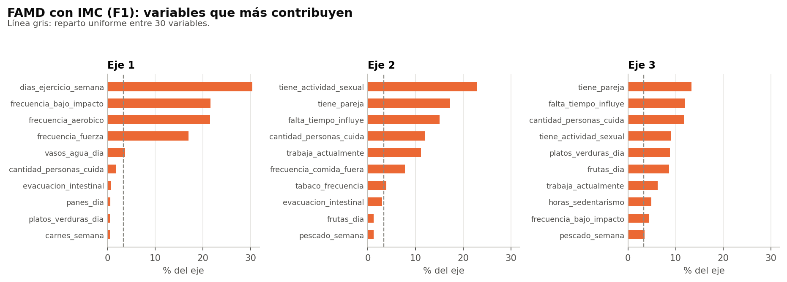
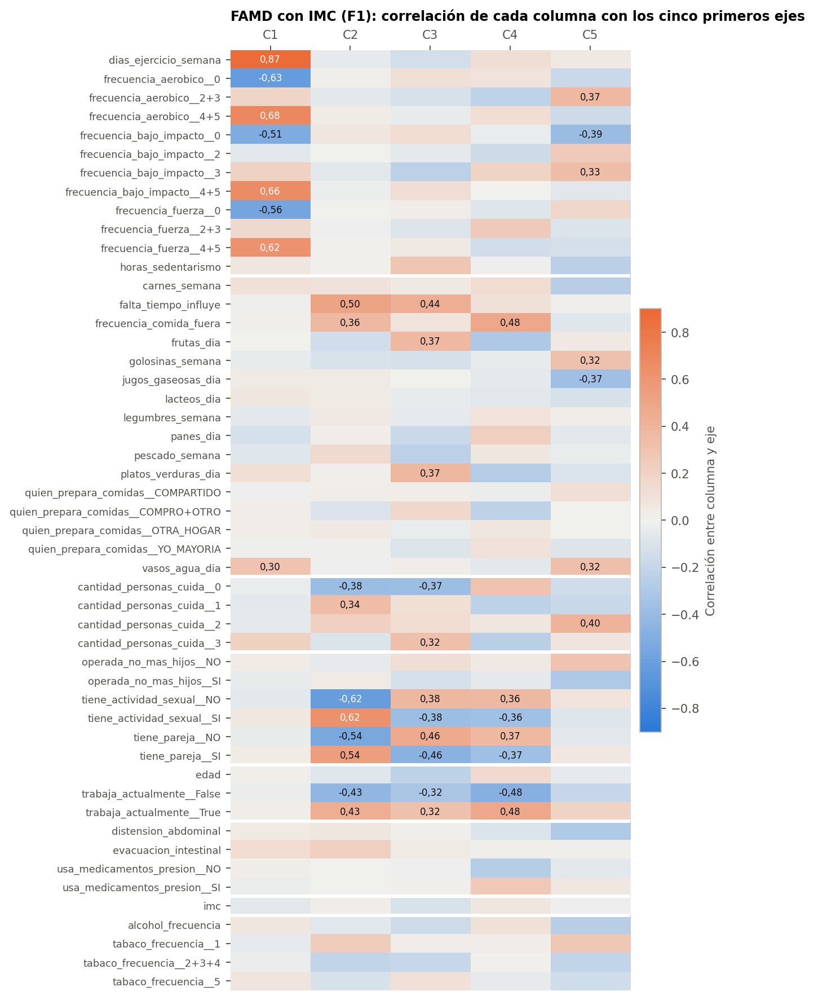
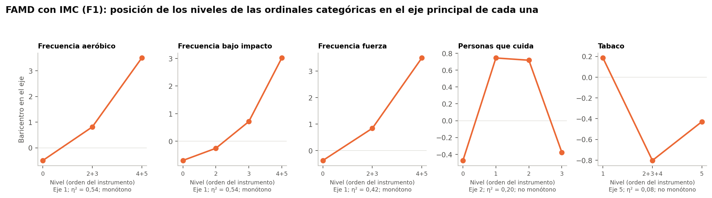

# 1. Qué se hizo

Se aplicó el análisis factorial de datos mixtos a F1, con IMC, y F2, sin IMC. Todo el análisis usa el conjunto sintético de usuarias (N = 529). Los resultados describen ese conjunto y no permiten afirmar nada sobre mujeres reales. Esta fase no forma grupos ni usa el MRS.

- **Entrada:** F1 tiene 529 filas y 50 columnas, con inercia 38,5047. F2 tiene 529 filas y 49 columnas, con inercia 38,0.
- **Cálculo:** las matrices ya traen la transformación de FAMD validada en la Fase 36. Por eso se aplica la misma descomposición en valores singulares, sin normalizar las categorías de nuevo. No se usa `prince` para proyectar participantes ni se recalculan proporciones.
- **Inercia:** la suma de valores propios es 38,5047 y 38,0, con el factor 528/529. El rango es 39 en F1 y 38 en F2.

# 2. Valores propios e inercia

| Eje | F1: λ | F2: λ | F1: % | F2: % |
|---|---|---|---|---|
| 1 | 2,491 | 2,490 | 6,47 | 6,55 |
| 2 | 1,675 | 1,675 | 4,35 | 4,41 |
| 3 | 1,589 | 1,585 | 4,13 | 4,17 |
| 4 | 1,504 | 1,503 | 3,91 | 3,95 |
| 5 | 1,451 | 1,451 | 3,77 | 3,82 |
| 6 | 1,409 | 1,407 | 3,66 | 3,70 |
| 7 | 1,344 | 1,341 | 3,49 | 3,53 |
| 8 | 1,293 | 1,293 | 3,36 | 3,40 |
| 9 | 1,269 | 1,268 | 3,29 | 3,34 |
| 10 | 1,204 | 1,204 | 3,13 | 3,17 |
| 11 | 1,190 | 1,189 | 3,09 | 3,13 |
| 12 | 1,161 | 1,160 | 3,02 | 3,05 |

| Escenario | k = 2 | k = 3 | k = 5 | k = 8 | k = 12 | k = 16 | k = 20 |
|---|---|---|---|---|---|---|---|
| F1 (FAMD con IMC) | 10,8 % | 14,9 % | 22,6 % | 33,1 % | 45,7 % | 56,9 % | 66,9 % |
| F2 (FAMD sin IMC) | 11,0 % | 15,1 % | 22,9 % | 33,5 % | 46,2 % | 57,6 % | 67,7 % |

| Escenario | Rango | 50 % | 60 % | 70 % | 80 % | 90 % |
|---|---|---|---|---|---|---|
| F1 (FAMD con IMC) | 39 | 14 | 18 | 22 | 26 | 32 |
| F2 (FAMD sin IMC) | 38 | 14 | 17 | 21 | 26 | 31 |

**Referencia frente al ruido** (adición mía, descriptiva):

| Eje | F1: λ / p95 | F2: λ / p95 |
|---|---|---|
| 1 | 2,491 / 1,609 | 2,490 / 1,602 |
| 2 | 1,675 / 1,522 | 1,675 / 1,529 |
| 3 | 1,589 / 1,467 | 1,585 / 1,466 |
| 4 | 1,504 / 1,425 | 1,503 / 1,421 |
| 5 | 1,451 / 1,389 | 1,451 / 1,390 |
| 6 | 1,409 / 1,350 | 1,407 / 1,353 |
| 7 | 1,344 / 1,322 | 1,341 / 1,323 |
| 8 | 1,293 / 1,280 | 1,293 / 1,285 |
| 9 | 1,269 / 1,258 | 1,268 / 1,259 |
| 10 | 1,204 / 1,231 | 1,204 / 1,230 |

Nueve ejes superan la referencia en F1 y F2, con márgenes pequeños desde el cuarto. Como en PCA, solo el primero se separa con claridad.

# 3. Variables y categorías

| Eje | % del eje | Variables con mayor contribución (%) |
|---|---|---|
| 1 | 6,47 % | dias_ejercicio_semana 30,3; frecuencia_bajo_impacto 21,6; frecuencia_aerobico 21,5; frecuencia_fuerza 17,0; vasos_agua_dia 3,6 |
| 2 | 4,35 % | tiene_actividad_sexual 22,9; tiene_pareja 17,3; falta_tiempo_influye 15,0; cantidad_personas_cuida 12,0; trabaja_actualmente 11,2 |
| 3 | 4,13 % | tiene_pareja 13,3; falta_tiempo_influye 11,9; cantidad_personas_cuida 11,7; tiene_actividad_sexual 9,0; platos_verduras_dia 8,8 |
| 4 | 3,91 % | frecuencia_comida_fuera 15,3; trabaja_actualmente 15,0; cantidad_personas_cuida 9,4; tiene_pareja 9,1; tiene_actividad_sexual 8,6 |
| 5 | 3,77 % | frecuencia_bajo_impacto 14,7; cantidad_personas_cuida 12,1; frecuencia_aerobico 10,2; jugos_gaseosas_dia 9,4; vasos_agua_dia 7,0 |

- **Eje 1:** actividad física, igual que en PCA; el bloque aporta 90,6 %.
- **Eje 2:** actividad sexual y pareja, con más presencia de falta de tiempo, personas a cargo y trabajo que en PCA.
- **Ejes 3 a 5:** mezclas de cuidado, tiempo, pareja y alimentación. Son menos fáciles de nombrar que en PCA.

**Categorías con mayor contribución:**

| Eje | Categorías con mayor contribución (%), con su correlación con el eje |
|---|---|
| 1 | frecuencia_aerobico__4+5 17,2 (r 0,68); frecuencia_bajo_impacto__4+5 15,5 (r 0,66); frecuencia_fuerza__4+5 14,1 (r 0,62); frecuencia_bajo_impacto__0 4,5 (r -0,51); frecuencia_aerobico__0 3,1 (r -0,63); frecuencia_fuerza__0 1,9 (r -0,56) |
| 2 | tiene_actividad_sexual__SI 12,0 (r 0,62); tiene_pareja__NO 11,6 (r -0,54); tiene_actividad_sexual__NO 10,9 (r -0,62); trabaja_actualmente__False 6,5 (r -0,43); tiene_pareja__SI 5,7 (r 0,54); cantidad_personas_cuida__1 5,1 (r 0,34) |
| 3 | tiene_pareja__NO 8,9 (r 0,46); cantidad_personas_cuida__3 6,0 (r 0,32); tiene_actividad_sexual__SI 4,7 (r -0,38); tiene_pareja__SI 4,3 (r -0,46); tiene_actividad_sexual__NO 4,3 (r 0,38); cantidad_personas_cuida__0 4,2 (r -0,37) |

**Contribución por bloque en F1 (% de cada eje):**

| Bloque | Eje 1 | Eje 2 | Eje 3 | Eje 4 | Eje 5 |
|---|---|---|---|---|---|
| Actividad física | 90,6 | 0,8 | 12,1 | 13,4 | 31,3 |
| Alimentación | 6,0 | 27,9 | 38,4 | 36,5 | 31,4 |
| Cuidado de otras personas | 1,8 | 12,0 | 11,7 | 9,4 | 12,1 |
| Etapa reproductiva y salud ginecológica | 0,3 | 40,4 | 23,2 | 18,0 | 6,8 |
| Identificación | 0,0 | 11,5 | 9,5 | 16,4 | 2,6 |
| Medicamentos y digestión | 0,9 | 3,3 | 0,2 | 5,2 | 6,0 |
| Medidas autodeclaradas | 0,1 | 0,0 | 0,4 | 0,2 | 0,0 |
| Sustancias | 0,4 | 4,1 | 4,5 | 0,8 | 9,8 |

**Contribución acumulada por bloque en F1 (%):**

| Bloque | k = 2 | k = 3 | k = 5 | k = 8 | k = 12 | k = 16 | k = 20 |
|---|---|---|---|---|---|---|---|
| Actividad física | 54,5 | 42,8 | 35,8 | 28,6 | 25,2 | 22,4 | 23,5 |
| Alimentación | 14,8 | 21,3 | 25,6 | 33,8 | 36,1 | 39,1 | 39,2 |
| Cuidado de otras personas | 5,9 | 7,5 | 8,6 | 8,5 | 8,0 | 7,4 | 7,9 |
| Etapa reproductiva y salud ginecológica | 16,4 | 18,3 | 16,3 | 13,2 | 10,7 | 9,1 | 8,5 |
| Identificación | 4,6 | 6,0 | 7,2 | 6,8 | 6,3 | 5,8 | 5,5 |
| Medicamentos y digestión | 1,8 | 1,4 | 2,8 | 4,3 | 6,4 | 7,9 | 7,7 |
| Medidas autodeclaradas | 0,1 | 0,1 | 0,1 | 0,1 | 0,1 | 0,1 | 0,2 |
| Sustancias | 1,9 | 2,6 | 3,5 | 4,6 | 7,2 | 8,1 | 7,5 |

# 4. ¿Se conserva el orden de las cinco ordinales?

FAMD trata estas cinco variables como categorías, por lo que no sabe que sus niveles tienen orden. Se comprobó si ese orden reaparece en los baricentros, con la regla fijada en el protocolo.

| Variable | Eje principal | η² | Monótona (grupos) | Monótona (niveles originales) | Ejes 1-5 monótonos |
|---|---|---|---|---|---|
| frecuencia_aerobico | 1 | 0,536 | Sí | Sí | 1 |
| frecuencia_bajo_impacto | 1 | 0,537 | Sí | Sí | 1 |
| frecuencia_fuerza | 1 | 0,423 | Sí | Sí | 1, 5 |
| cantidad_personas_cuida | 2 | 0,202 | No | No | 3 |
| tabaco_frecuencia | 5 | 0,078 | No | No | Ninguno |

- **Frecuencia de aeróbico, bajo impacto y fuerza:** el orden se conserva en el eje 1, donde tienen η² alto. FAMD recupera el gradiente sin que se le indique.
- **Personas que cuida:** en su eje principal, el 2, no hay un orden: 0: -0,47 (n=278); 1: 0,74 (n=136); 2: 0,72 (n=67); 3: -0,38 (n=48). Ese eje separa a quienes cuidan a una o dos personas de quienes no cuidan o cuidan a tres o más. El eje 3 sí es monótono: 0: -0,45 (n=278); 1: 0,24 (n=136); 2: 0,44 (n=67); 3: 1,29 (n=48).
- **Tabaco:** su η² principal es solo 0,078, y no es monótona en ningún eje de los cinco primeros. Está mal representada en estos ejes, así que no se puede afirmar nada sobre su orden.

Estos resultados se informan y no se corrigen.

# 5. Influencia del IMC

| Escenario | Eje 1 | Eje 2 | Eje 3 | Eje 4 | Eje 5 | Máximo |
|---|---|---|---|---|---|---|
| F1 (FAMD con IMC) | 0,1 | 0,0 | 0,4 | 0,2 | 0,0 | 48,3 % en el eje 38 |

La similitud entre F1 y F2 es de al menos 0,996 en todos los candidatos. El IMC casi no influye en los ejes candidatos.

# 6. Coordenadas y participantes nuevas

Hay coordenadas para los siete candidatos en `coordenadas/F1` y `coordenadas/F2`. La proyección usa las proporciones y los parámetros guardados, sin recalcularlos, y se comprobó con filas reconstruidas desde sus respuestas originales y con un caso inventado.

# 7. Limitaciones

- **Datos sintéticos.** Las relaciones entre variables provienen de la generación del conjunto. Una dimensión de este análisis no es un hallazgo sobre la población.
- **El signo de un eje es arbitrario.** Un valor alto o bajo no significa más o menos de algo sin mirar las cargas, y ningún eje mide severidad ni riesgo clínico.
- **El porcentaje no indica utilidad.** Un eje con varianza alta puede resumir bien una característica sin que eso sirva para formar perfiles.
- **Esta fase no prueba que existan grupos.** Una nube de puntos en dos ejes no demuestra ni descarta clústeres.
- **Más rango no significa más información.** FAMD reparte la inercia en más dimensiones, por lo que sus porcentajes son menores. Esto no permite compararlo directamente con PCA.

# 8. Referencias

- Horn, J. L. (1965). A rationale and test for the number of factors in factor analysis. Psychometrika, 30(2), 179-185.
- Jolliffe, I. T. (2002). Principal Component Analysis (2.ª ed.). Springer.
- Pagès, J. (2014). Multiple Factor Analysis by Example Using R. CRC Press.

> Referencias citadas de memoria, sin consulta en línea: conviene verificarlas antes de usarlas en la tesis.
