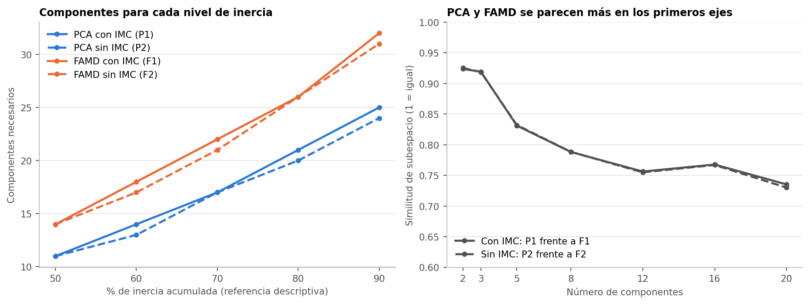
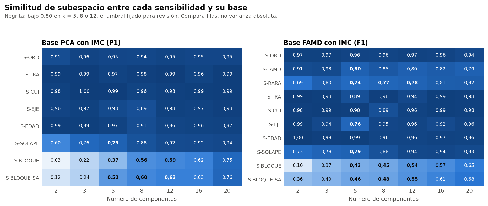

# 1. Conclusión preliminar

**Este informe no elige un método.** PCA y FAMD coinciden en los dos o tres primeros ejes y se van separando después. Todo el análisis usa el conjunto sintético de usuarias (N = 529). Los resultados describen ese conjunto y no permiten afirmar nada sobre mujeres reales.

# 2. Distribución de la inercia

| Escenario | k = 2 | k = 3 | k = 5 | k = 8 | k = 12 | k = 16 | k = 20 |
|---|---|---|---|---|---|---|---|
| P1 (PCA con IMC) | 13,9 % | 19,1 % | 28,3 % | 40,9 % | 55,8 % | 68,5 % | 79,7 % |
| P2 (PCA sin IMC) | 14,1 % | 19,4 % | 28,8 % | 41,5 % | 56,7 % | 69,6 % | 81,0 % |
| F1 (FAMD con IMC) | 10,8 % | 14,9 % | 22,6 % | 33,1 % | 45,7 % | 56,9 % | 66,9 % |
| F2 (FAMD sin IMC) | 11,0 % | 15,1 % | 22,9 % | 33,5 % | 46,2 % | 57,6 % | 67,7 % |

| Escenario | Rango | 50 % | 60 % | 70 % | 80 % | 90 % |
|---|---|---|---|---|---|---|
| P1 (PCA con IMC) | 33 | 11 | 14 | 17 | 21 | 25 |
| P2 (PCA sin IMC) | 32 | 11 | 13 | 17 | 20 | 24 |
| F1 (FAMD con IMC) | 39 | 14 | 18 | 22 | 26 | 32 |
| F2 (FAMD sin IMC) | 38 | 14 | 17 | 21 | 26 | 31 |

FAMD necesita más ejes para cada porcentaje porque reparte la inercia en un espacio de mayor rango. **Esa diferencia no indica que PCA sea mejor:** cada método representa las variables categóricas de otra forma, por lo que sus inercias totales no son comparables.

# 3. Cuánto coinciden

La similitud de subespacio es la media de cos² de los ángulos principales entre las coordenadas de las filas. Vale 1 si ambos generan el mismo subespacio.

| Comparación | k = 2 | k = 3 | k = 5 | k = 8 | k = 12 | k = 16 | k = 20 |
|---|---|---|---|---|---|---|---|
| PCA frente a FAMD, con IMC | 0,924 | 0,919 | 0,831 | 0,788 | 0,756 | 0,768 | 0,735 |
| PCA frente a FAMD, sin IMC | 0,925 | 0,918 | 0,832 | 0,788 | 0,755 | 0,767 | 0,730 |
| Con y sin IMC, PCA | 1,000 | 0,999 | 0,999 | 0,999 | 0,999 | 0,997 | 0,998 |
| Con y sin IMC, FAMD | 1,000 | 0,999 | 0,999 | 0,999 | 0,999 | 0,999 | 0,996 |

**Correspondencia eje a eje entre P1 y F1:**

| Eje de P1 | Eje de F1 más parecido | \|r\| |
|---|---|---|
| 1 | 1 | 0,984 |
| 2 | 2 | 0,937 |
| 3 | 3 | 0,918 |
| 4 | 4 | 0,872 |
| 5 | 5 | 0,727 |

# 4. Diferencias de contenido

| Aspecto | PCA | FAMD |
|---|---|---|
| Tratamiento de las cinco ordinales | Como escala numérica | Como categorías, con baricentros |
| Eje 1 | Actividad física | Actividad física |
| Eje 2 | Actividad sexual 31,5 %, pareja 27,3 % | Actividad sexual 22,9 %, pareja 17,3 %, más tiempo y cuidado |
| Alimentación acumulada, k = 20 | 44,6 % | 39,2 % |
| Actividad física acumulada, k = 20 | 15,3 % | 23,5 % |
| Interpretación | Más directa: una variable numérica, una columna | Más detalle por categoría, ejes 3 a 5 más mezclados |
| Niveles poco frecuentes | Influyen según su distancia numérica | La regla de la Fase 36 agrupó los raros; S-RARA estudia ese agrupamiento |

# 5. Influencia del IMC

| Escenario | Eje 1 | Eje 2 | Eje 3 | Eje 4 | Eje 5 | Máximo |
|---|---|---|---|---|---|---|
| P1 (PCA con IMC) | 0,1 | 0,0 | 0,4 | 0,3 | 0,1 | 52,8 % en el eje 29 |
| F1 (FAMD con IMC) | 0,1 | 0,0 | 0,4 | 0,2 | 0,0 | 48,3 % en el eje 38 |

En ambos métodos, el IMC aporta 0,4 % o menos a los cinco primeros ejes. Las versiones con y sin IMC son casi iguales en todos los candidatos, por lo que esta comparación aportará poco en la Fase 37B.

# 6. Sensibilidades

No se compara la varianza absoluta entre variantes. La tabla muestra la similitud con el escenario base, sin usar el MRS.

**Base P1:**

| Variante | k = 2 | k = 3 | k = 5 | k = 8 | k = 12 | k = 16 | k = 20 |
|---|---|---|---|---|---|---|---|
| S-ORD | 0,909 | 0,961 | 0,948 | 0,942 | 0,955 | 0,947 | 0,948 |
| S-TRA | 0,991 | 0,993 | 0,965 | 0,982 | 0,992 | 0,963 | 0,991 |
| S-CUI | 0,976 | 0,997 | 0,995 | 0,962 | 0,980 | 0,987 | 0,992 |
| S-EJE | 0,960 | 0,973 | 0,927 | 0,895 | 0,976 | 0,967 | 0,981 |
| S-EDAD | 0,992 | 0,986 | 0,968 | 0,909 | 0,956 | 0,962 | 0,966 |
| S-SOLAPE | 0,604 | 0,756 | 0,793 | 0,876 | 0,919 | 0,923 | 0,937 |
| S-BLOQUE | 0,032 | 0,216 | 0,368 | 0,565 | 0,592 | 0,618 | 0,755 |
| S-BLOQUE-SA | 0,124 | 0,241 | 0,521 | 0,597 | 0,629 | 0,628 | 0,764 |

**Base F1:**

| Variante | k = 2 | k = 3 | k = 5 | k = 8 | k = 12 | k = 16 | k = 20 |
|---|---|---|---|---|---|---|---|
| S-ORD | 0,973 | 0,973 | 0,958 | 0,956 | 0,966 | 0,959 | 0,935 |
| S-FAMD | 0,914 | 0,928 | 0,796 | 0,847 | 0,800 | 0,822 | 0,794 |
| S-RARA | 0,691 | 0,799 | 0,743 | 0,768 | 0,785 | 0,813 | 0,819 |
| S-TRA | 0,993 | 0,985 | 0,893 | 0,981 | 0,936 | 0,987 | 0,980 |
| S-CUI | 0,984 | 0,992 | 0,983 | 0,892 | 0,965 | 0,986 | 0,979 |
| S-EJE | 0,986 | 0,937 | 0,764 | 0,949 | 0,956 | 0,923 | 0,959 |
| S-EDAD | 0,997 | 0,984 | 0,987 | 0,956 | 0,956 | 0,968 | 0,963 |
| S-SOLAPE | 0,731 | 0,775 | 0,789 | 0,882 | 0,940 | 0,943 | 0,930 |
| S-BLOQUE | 0,097 | 0,371 | 0,427 | 0,454 | 0,536 | 0,571 | 0,648 |
| S-BLOQUE-SA | 0,362 | 0,400 | 0,463 | 0,475 | 0,547 | 0,615 | 0,677 |

**Variantes señaladas para revisión** (similitud bajo 0,80 en k = 5, 8 o 12; orientativo):

| Variante | Escenarios y candidatos bajo 0,80 |
|---|---|
| S-FAMD | F1: k=5 (0,796); F2: k=5 (0,798), k=12 (0,800) |
| S-RARA | F1: k=5 (0,743), k=8 (0,768), k=12 (0,785); F2: k=5 (0,744), k=8 (0,768), k=12 (0,786) |
| S-EJE | F1: k=5 (0,764); F2: k=5 (0,766) |
| S-SOLAPE | P1: k=5 (0,793); P2: k=5 (0,792); F1: k=5 (0,789); F2: k=5 (0,789) |
| S-BLOQUE | P1: k=5 (0,368), k=8 (0,565), k=12 (0,592); P2: k=5 (0,521), k=8 (0,596), k=12 (0,628); F1: k=5 (0,427), k=8 (0,454), k=12 (0,536); F2: k=5 (0,463), k=8 (0,475), k=12 (0,547) |
| S-BLOQUE-SA | P1: k=5 (0,521), k=8 (0,597), k=12 (0,629); F1: k=5 (0,463), k=8 (0,475), k=12 (0,547) |

- **S-ORD:** usar ridit en lugar de códigos consecutivos casi no cambia la representación.
- **S-FAMD y S-RARA:** son las codificaciones que más cambian a F1. S-FAMD pasa las cinco ordinales a cuantitativas y S-RARA deja de agrupar categorías raras. El cambio de S-RARA es el mayor con pocos ejes (similitud 0,691 con k = 2). Esto confirma que la codificación es una decisión con consecuencias.
- **S-TRA, S-CUI y S-EJE:** ajustan en otra población (507, 508 y 454 filas) y proyectan al resto con parámetros congelados. La similitud suele ser alta. La baja de S-EJE en F1 con k = 5 (0,764) no se mantiene con k = 8 (0,949), lo que sugiere un intercambio entre ejes contiguos y no un cambio general. Parte de cualquier cambio puede deberse a la población y no al método.
- **S-EDAD:** quitar la edad casi no cambia el resultado.
- **S-SOLAPE:** quita `tiene_actividad_sexual` y `distension_abdominal`. Es de las que más cambian con pocos ejes, porque `tiene_actividad_sexual` es la principal contribuyente del eje 2. Sin ella, ese eje pasa a depender sobre todo de trabajo en P1 y de falta de tiempo en F1.
- **S-BLOQUE:** confirma la amplificación del IMC: en F1, el IMC llega a 97,7 % del eje 1.
- **S-BLOQUE-SA:** quita esa amplificación, pero igualar los bloques sigue amplificando a los de pocas variables: en P1, personas que cuida llega a 94,2 % del eje 1. **Esta ponderación cambia la pregunta, por lo que no sirve como prueba de robustez.** Una ponderación por bloques más elaborada, como la del análisis factorial múltiple, sería una alternativa futura que no se ejecutó aquí.

**Proyección de las participantes excluidas.** Desplazamiento de filas proyectadas / filas de ajuste, relativo a su dispersión:

| Variante | Base | Proyectadas | k = 5 | k = 8 | k = 12 |
|---|---|---|---|---|---|
| S-TRA | P1 | 22 | 0,209 / 0,170 | 0,173 / 0,123 | 0,092 / 0,080 |
| S-TRA | F1 | 22 | 0,381 / 0,320 | 0,151 / 0,129 | 0,302 / 0,250 |
| S-CUI | P1 | 21 | 0,093 / 0,068 | 0,214 / 0,181 | 0,141 / 0,126 |
| S-CUI | F1 | 21 | 0,156 / 0,121 | 0,331 / 0,349 | 0,228 / 0,174 |
| S-EJE | P1 | 75 | 0,275 / 0,251 | 0,341 / 0,318 | 0,150 / 0,144 |
| S-EJE | F1 | 75 | 0,517 / 0,540 | 0,243 / 0,216 | 0,197 / 0,197 |

Las filas proyectadas se desplazan en magnitudes parecidas a las de ajuste, por lo que no se comportan de forma anómala frente al resto.

# 7. Qué falta por saber

Esta comparación no dice qué método forma mejores perfiles. Eso depende de la estabilidad, los tamaños y la calidad de los grupos en la Fase 37B.
