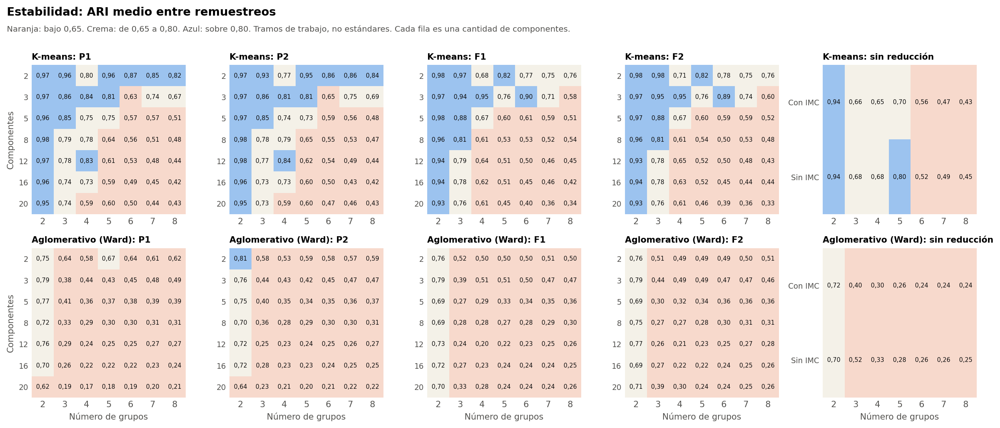
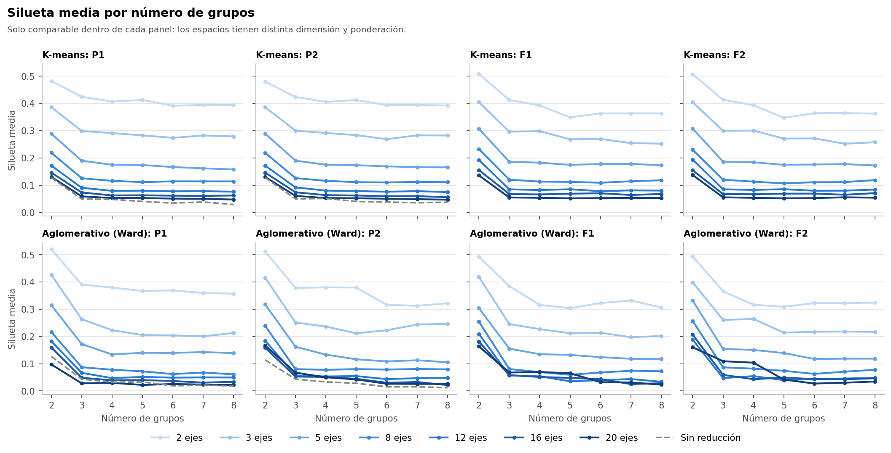

# 1. Conclusión

**K-means forma particiones reproducibles con 2 a 4 grupos, pero con separación modesta.** Sus grupos se parecen al repetir el análisis en otras muestras. No hay señales de grupos naturales bien separados. Todo el análisis usa el conjunto sintético de usuarias (N = 529). Sus asociaciones vienen de una simulación, por lo que los resultados no permiten afirmar nada sobre mujeres reales.

# 2. Qué se hizo

Se ajustaron 210 configuraciones: 4 espacios × 7 cantidades de componentes × 7 valores de k, más 14 sin reducción. Los parámetros son `n_init = 50`, `random_state = 42` y el algoritmo estándar de scikit-learn, sin escalado adicional. Las 210 convergieron, con 49 iteraciones como máximo.

**Silueta:** compara, para cada persona, qué tan cerca está de su grupo y del grupo vecino. Cerca de 1, grupos bien separados; cerca de 0, personas en la frontera; negativa, más cerca de otro grupo.

**ARI:** compara dos agrupaciones sin importar cómo se llamen sus grupos. 1 es coincidencia total y 0 es lo esperable por azar.

**Referencia nula:** se mezclan al azar los valores de cada variable por separado. Así desaparece cualquier relación entre variables, y se ve hasta dónde llega el algoritmo sin esa relación.

# 3. Resultados por número de grupos

| k | Silueta mediana | ARI entre remuestreos, mediana | ARI alto (> 0,80) | Intermedio | Bajo (< 0,65) | Con grupo bajo 27 | Cumplen la regla |
|---|---|---|---|---|---|---|---|
| 2 | 0,219 | 0,96 | 30 | 0 | 0 | 0 | 30 |
| 3 | 0,120 | 0,79 | 14 | 16 | 0 | 0 | 24 |
| 4 | 0,113 | 0,69 | 6 | 14 | 10 | 0 | 12 |
| 5 | 0,109 | 0,61 | 7 | 5 | 18 | 0 | 6 |
| 6 | 0,110 | 0,55 | 4 | 2 | 24 | 0 | 3 |
| 7 | 0,112 | 0,52 | 2 | 6 | 22 | 5 | 1 |
| 8 | 0,113 | 0,47 | 2 | 4 | 24 | 6 | 4 |

**En palabras simples:** cuantos más grupos se piden, menos se repiten. Con 2 grupos la solución es casi la misma en todas las muestras; con 7 u 8, solo en una minoría de las configuraciones.

# 4. Resultados por número de componentes

| Componentes | Silueta mediana | ARI entre remuestreos, mediana | ARI alto | Cumplen la regla |
|---|---|---|---|---|
| 2 | 0,394 | 0,84 | 18 | 13 |
| 3 | 0,283 | 0,81 | 16 | 16 |
| 5 | 0,175 | 0,64 | 8 | 14 |
| 8 | 0,114 | 0,58 | 6 | 10 |
| 12 | 0,081 | 0,57 | 6 | 10 |
| 16 | 0,067 | 0,56 | 4 | 9 |
| 20 | 0,053 | 0,55 | 4 | 6 |
| Sin reducción | 0,040 | 0,66 | 3 | 2 |

La silueta baja al sumar componentes, en buena parte porque las distancias se parecen más entre sí en más dimensiones. Por eso **no sirve para comparar entre espacios**.

# 5. Mejores valores

**Mayor estabilidad:**

| Configuración | Silueta | ARI frente al completo | ARI entre remuestreos | Percentil 5 | Grupo menor | Peso del eje 1 |
|---|---|---|---|---|---|---|
| F1_c02_km_k2 | 0,508 | 0,99 | 0,98 | 0,94 | 92 | 1,00 |
| F2_c02_km_k3 | 0,413 | 0,98 | 0,98 | 0,95 | 83 | 0,65 |
| F2_c02_km_k2 | 0,507 | 0,98 | 0,98 | 0,94 | 93 | 1,00 |
| P1_c08_km_k2 | 0,219 | 0,99 | 0,98 | 0,93 | 94 | 0,98 |
| F1_c05_km_k2 | 0,307 | 0,98 | 0,98 | 0,94 | 89 | 0,99 |
| P2_c12_km_k2 | 0,172 | 0,98 | 0,98 | 0,94 | 94 | 0,98 |
| P2_c08_km_k2 | 0,219 | 0,98 | 0,98 | 0,93 | 94 | 0,98 |
| P1_c12_km_k2 | 0,172 | 0,98 | 0,97 | 0,92 | 94 | 0,98 |
| F1_c03_km_k2 | 0,404 | 0,98 | 0,97 | 0,93 | 93 | 1,00 |
| P1_c03_km_k2 | 0,386 | 0,98 | 0,97 | 0,83 | 93 | 1,00 |

**Mayor silueta:**

| Configuración | Silueta | ARI frente al completo | ARI entre remuestreos | Percentil 5 | Grupo menor | Peso del eje 1 |
|---|---|---|---|---|---|---|
| F1_c02_km_k2 | 0,508 | 0,99 | 0,98 | 0,94 | 92 | 1,00 |
| F2_c02_km_k2 | 0,507 | 0,98 | 0,98 | 0,94 | 93 | 1,00 |
| P1_c02_km_k2 | 0,482 | 0,98 | 0,97 | 0,84 | 94 | 1,00 |
| P2_c02_km_k2 | 0,480 | 0,98 | 0,97 | 0,83 | 96 | 1,00 |
| P1_c02_km_k3 | 0,424 | 0,98 | 0,96 | 0,89 | 82 | 0,63 |
| P2_c02_km_k3 | 0,424 | 0,94 | 0,93 | 0,85 | 81 | 0,63 |
| F2_c02_km_k3 | 0,413 | 0,98 | 0,98 | 0,95 | 83 | 0,65 |
| P1_c02_km_k5 | 0,413 | 0,97 | 0,96 | 0,91 | 51 | 0,67 |
| F1_c02_km_k3 | 0,413 | 0,98 | 0,97 | 0,92 | 83 | 0,65 |
| P2_c02_km_k5 | 0,412 | 0,97 | 0,95 | 0,85 | 51 | 0,68 |

Ambas listas están dominadas por k = 2 o por 2 componentes, por las razones de la sección 6.

# 6. Dos advertencias sobre los valores altos

**Con k = 2, los grupos dividen sobre todo por el eje 1,** que describe la actividad física. Las 57 configuraciones con k = 2 de la lista tienen un peso del eje 1 de 0,80 o más. Son estables, pero no forman grupos integrales.

**Con 2 componentes, la estabilidad dice poco, porque la nula también es alta.** Con k = 3, P1:

| Componentes | Silueta observada | Nula: media (máx.) | ARI entre observado | Nula: media (máx.) |
|---|---|---|---|---|
| 2 | 0,424 | 0,344 (0,363) | 0,96 | 0,79 (0,93) |
| 3 | 0,299 | 0,232 (0,242) | 0,86 | 0,57 (0,78) |
| 5 | 0,190 | 0,141 (0,149) | 0,85 | 0,38 (0,53) |
| 8 | 0,125 | 0,091 (0,098) | 0,79 | 0,29 (0,55) |
| 12 | 0,091 | 0,064 (0,072) | 0,78 | 0,23 (0,41) |
| 16 | 0,073 | 0,054 (0,064) | 0,74 | 0,21 (0,35) |
| 20 | 0,059 | 0,046 (0,052) | 0,74 | 0,21 (0,37) |

Con 2 ejes, la nula ya obtiene un ARI medio de 0,79: K-means divide un plano de forma repetible aunque no exista estructura. Además, 2 ejes retienen solo cerca del 11 al 14 % de la inercia. La diferencia frente a la nula es más informativa desde 3 o 5 ejes.

# 7. Inicializaciones

Repetir K-means con otra semilla da soluciones muy parecidas con pocos grupos, pero no con muchos. ARI mediano frente a la semilla alternativa:

| k | 2 | 3 | 4 | 5 | 6 | 7 | 8 |
|---|---|---|---|---|---|---|---|
| ARI | 1,00 | 0,98 | 0,97 | 0,92 | 0,77 | 0,66 | 0,57 |

Con k = 6 o más, 50 inicializaciones no bastan para llegar a una misma solución en muchas configuraciones. 66 de las 210 quedan bajo 0,80. Esto indica un paisaje con varias soluciones casi equivalentes.

# 8. Tamaños de los grupos

11 de las 210 configuraciones tienen algún grupo bajo 27, y el menor tiene 20 participantes. Todas ellas tienen k = 7 u 8. No se eliminó ningún grupo.

# 9. Sensibilidades

Mediana del ARI de ajuste, por número de grupos, sin las variantes de ponderación:

| Variante | k = 2 | k = 3 | k = 4 | k = 5 | k = 6 | k = 7 | k = 8 |
|---|---|---|---|---|---|---|---|
| S-ORD | 0,27 | 0,45 | 0,70 | 0,54 | 0,50 | 0,46 | 0,43 |
| S-FAMD | 0,83 | 0,79 | 0,41 | 0,41 | 0,38 | 0,35 | 0,29 |
| S-RARA | 0,91 | 0,84 | 0,56 | 0,36 | 0,37 | 0,35 | 0,32 |
| S-TRA | 0,98 | 0,93 | 0,85 | 0,77 | 0,66 | 0,57 | 0,51 |
| S-CUI | 0,98 | 0,91 | 0,85 | 0,85 | 0,70 | 0,59 | 0,58 |
| S-EJE | 0,96 | 0,80 | 0,76 | 0,66 | 0,56 | 0,49 | 0,52 |
| S-EDAD | 1,00 | 0,94 | 0,90 | 0,80 | 0,68 | 0,60 | 0,56 |
| S-SOLAPE | 0,98 | 0,24 | 0,35 | 0,33 | 0,35 | 0,32 | 0,32 |

- **Población y edad:** con k = 2 a 4 el acuerdo es alto o intermedio, y baja desde k = 6.
- **S-SOLAPE:** con k = 2 no afecta (0,98), pero con k = 3 cae a 0,24. El tercer grupo depende de `tiene_actividad_sexual` o `distension_abdominal`, que esa variante quita.
- **S-ORD:** con k = 2 baja a 0,27, incluso cambiando mucho los tamaños (P1 con 5 ejes: de cerca de 93 frente a 436 a 225 frente a 304). La división por el eje 1 depende de cómo se codifiquen las ordinales.

# 10. Limitaciones

- **Datos sintéticos.** Todo el análisis usa el conjunto sintético de usuarias (N = 529). Sus asociaciones vienen de una simulación, por lo que los resultados no permiten afirmar nada sobre mujeres reales.
- **No son diagnósticos.** Los grupos no equivalen a niveles de riesgo, y su número no indica un orden.
- **La nula solo descarta independencia.** Un conjunto con variables correlacionadas puede superarla sin tener grupos naturales. Tampoco es una prueba sobre la población.
- **La reducción no se recalculó en los remuestreos.** Se ajustó con las 529, así que la estabilidad evalúa solo el agrupamiento.
- **Pocas réplicas.** Con 20 réplicas, `p` no baja de 0,048.
