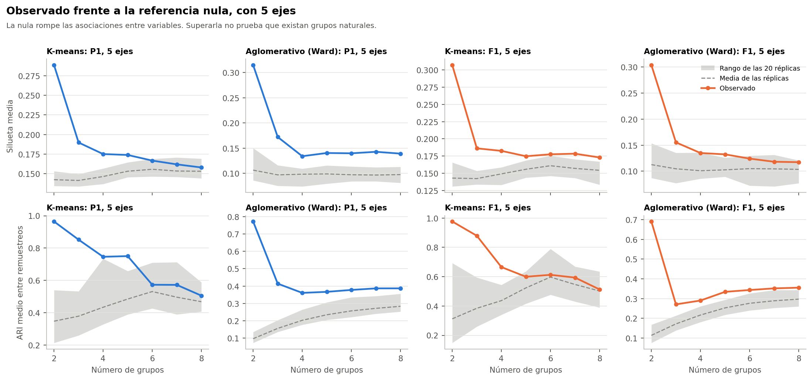
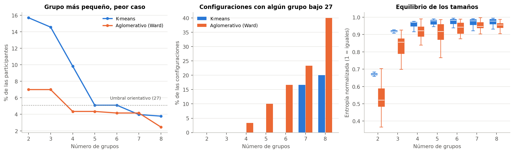

# 1. Conclusión

**El método aglomerativo con Ward es inestable en casi todas las configuraciones con k = 3 o más.** Solo 1 de 210 supera un ARI de 0,80 entre remuestreos, y 181 quedan bajo 0,65. Todo el análisis usa el conjunto sintético de usuarias (N = 529). Sus asociaciones vienen de una simulación, por lo que los resultados no permiten afirmar nada sobre mujeres reales.

# 2. Qué se hizo

Se ajustaron 210 configuraciones con `AgglomerativeClustering`, enlace Ward y distancia euclidiana. El algoritmo no tiene `predict`, así que se ajustó de nuevo en cada remuestreo.

**Silueta:** compara, para cada persona, qué tan cerca está de su grupo y del grupo vecino. Cerca de 1, grupos bien separados; cerca de 0, personas en la frontera; negativa, más cerca de otro grupo.

**ARI:** compara dos agrupaciones sin importar cómo se llamen sus grupos. 1 es coincidencia total y 0 es lo esperable por azar.

**Referencia nula:** se mezclan al azar los valores de cada variable por separado. Así desaparece cualquier relación entre variables, y se ve hasta dónde llega el algoritmo sin esa relación.

# 3. Resultados por número de grupos

| k | Silueta mediana | ARI entre remuestreos, mediana | ARI alto (> 0,80) | Intermedio | Bajo (< 0,65) | Con grupo bajo 27 | Cumplen la regla |
|---|---|---|---|---|---|---|---|
| 2 | 0,228 | 0,72 | 1 | 27 | 2 | 0 | 27 |
| 3 | 0,084 | 0,33 | 0 | 0 | 30 | 0 | 0 |
| 4 | 0,078 | 0,29 | 0 | 0 | 30 | 1 | 0 |
| 5 | 0,068 | 0,28 | 0 | 1 | 29 | 3 | 1 |
| 6 | 0,062 | 0,29 | 0 | 0 | 30 | 5 | 0 |
| 7 | 0,069 | 0,30 | 0 | 0 | 30 | 7 | 0 |
| 8 | 0,067 | 0,30 | 0 | 0 | 30 | 12 | 0 |

**En palabras simples:** Ward fusiona de a pares y nunca deshace una fusión. Cambiar unas pocas personas puede alterar muchas fusiones posteriores. Por eso sus grupos cambian bastante entre muestras, aun cuando su silueta sea parecida a la de K-means.

# 4. Resultados por número de componentes

| Componentes | Silueta mediana | ARI entre remuestreos, mediana | ARI alto | Cumplen la regla |
|---|---|---|---|---|
| 2 | 0,358 | 0,57 | 1 | 5 |
| 3 | 0,223 | 0,47 | 0 | 4 |
| 5 | 0,137 | 0,36 | 0 | 4 |
| 8 | 0,078 | 0,30 | 0 | 3 |
| 12 | 0,049 | 0,25 | 0 | 4 |
| 16 | 0,044 | 0,24 | 0 | 4 |
| 20 | 0,033 | 0,24 | 0 | 2 |
| Sin reducción | 0,030 | 0,27 | 0 | 2 |

# 5. Mejores valores

**Mayor estabilidad:**

| Configuración | Silueta | ARI frente al completo | ARI entre remuestreos | Percentil 5 | Grupo menor | Peso del eje 1 |
|---|---|---|---|---|---|---|
| P2_c02_ward_k2 | 0,512 | 0,80 | 0,81 | 0,51 | 63 | 0,99 |
| F2_c03_ward_k2 | 0,399 | 0,79 | 0,79 | 0,61 | 79 | 0,99 |
| F1_c03_ward_k2 | 0,418 | 0,66 | 0,79 | 0,58 | 60 | 0,98 |
| P1_c03_ward_k2 | 0,426 | 0,83 | 0,79 | 0,55 | 60 | 1,00 |
| P1_c05_ward_k2 | 0,315 | 0,78 | 0,77 | 0,60 | 64 | 0,99 |
| F2_c12_ward_k2 | 0,188 | 0,75 | 0,77 | 0,58 | 75 | 0,93 |
| P1_c12_ward_k2 | 0,183 | 0,82 | 0,76 | 0,62 | 75 | 0,95 |
| F2_c02_ward_k2 | 0,494 | 0,75 | 0,76 | 0,47 | 79 | 0,98 |
| F1_c02_ward_k2 | 0,493 | 0,80 | 0,76 | 0,51 | 99 | 1,00 |
| P2_c03_ward_k2 | 0,416 | 0,77 | 0,76 | 0,27 | 57 | 1,00 |

**Mayor silueta:**

| Configuración | Silueta | ARI frente al completo | ARI entre remuestreos | Percentil 5 | Grupo menor | Peso del eje 1 |
|---|---|---|---|---|---|---|
| P1_c02_ward_k2 | 0,520 | 0,81 | 0,75 | 0,12 | 58 | 1,00 |
| P2_c02_ward_k2 | 0,512 | 0,80 | 0,81 | 0,51 | 63 | 0,99 |
| F2_c02_ward_k2 | 0,494 | 0,75 | 0,76 | 0,47 | 79 | 0,98 |
| F1_c02_ward_k2 | 0,493 | 0,80 | 0,76 | 0,51 | 99 | 1,00 |
| P1_c03_ward_k2 | 0,426 | 0,83 | 0,79 | 0,55 | 60 | 1,00 |
| F1_c03_ward_k2 | 0,418 | 0,66 | 0,79 | 0,58 | 60 | 0,98 |
| P2_c03_ward_k2 | 0,416 | 0,77 | 0,76 | 0,27 | 57 | 1,00 |
| F2_c03_ward_k2 | 0,399 | 0,79 | 0,79 | 0,61 | 79 | 0,99 |
| P1_c02_ward_k3 | 0,390 | 0,70 | 0,64 | 0,30 | 58 | 0,62 |
| F1_c02_ward_k3 | 0,385 | 0,54 | 0,52 | 0,24 | 99 | 0,67 |

Incluso en estas configuraciones, el percentil 5 del ARI suele estar bajo 0,65: algunas repeticiones son muy inestables, por lo que estas medias altas no se pueden llamar robustas. La mayor silueta, en P1 con 2 ejes y k = 2, tiene un percentil 5 de 0,12.

# 6. Frente a la referencia nula

Con k = 5, F1:

| Componentes | Silueta observada | Nula: media (máx.) | ARI entre observado | Nula: media (máx.) |
|---|---|---|---|---|
| 2 | 0,304 | 0,281 (0,300) | 0,50 | 0,43 (0,49) |
| 3 | 0,212 | 0,185 (0,212) | 0,51 | 0,35 (0,41) |
| 5 | 0,132 | 0,103 (0,126) | 0,33 | 0,25 (0,29) |
| 8 | 0,059 | 0,058 (0,068) | 0,27 | 0,18 (0,23) |
| 12 | 0,035 | 0,043 (0,057) | 0,22 | 0,16 (0,22) |
| 16 | 0,048 | 0,036 (0,056) | 0,24 | 0,16 (0,21) |
| 20 | 0,065 | 0,044 (0,065) | 0,24 | 0,20 (0,27) |

Ward queda a menudo por encima de la nula en ARI, pero con valores bajos: es «menos inestable que el azar», no estable. Y en silueta queda varias veces dentro del rango de la nula.

# 7. Tamaños de los grupos

28 de las 210 configuraciones tienen algún grupo bajo 27, y el menor tiene 13 participantes. Ward produce tamaños menos equilibrados que K-means. No se eliminó ningún grupo.

# 8. Sensibilidades

Mediana del ARI de ajuste, sin las variantes de ponderación:

| Variante | k = 2 | k = 3 | k = 4 | k = 5 | k = 6 | k = 7 | k = 8 |
|---|---|---|---|---|---|---|---|
| S-ORD | 0,36 | 0,19 | 0,25 | 0,26 | 0,28 | 0,28 | 0,28 |
| S-FAMD | 0,64 | 0,29 | 0,25 | 0,22 | 0,21 | 0,23 | 0,22 |
| S-RARA | 0,68 | 0,27 | 0,23 | 0,19 | 0,19 | 0,19 | 0,20 |
| S-TRA | 0,75 | 0,40 | 0,32 | 0,27 | 0,32 | 0,33 | 0,31 |
| S-CUI | 0,79 | 0,24 | 0,25 | 0,30 | 0,30 | 0,30 | 0,33 |
| S-EJE | 0,69 | 0,33 | 0,26 | 0,26 | 0,25 | 0,26 | 0,27 |
| S-EDAD | 0,73 | 0,31 | 0,34 | 0,32 | 0,32 | 0,33 | 0,33 |
| S-SOLAPE | 0,76 | 0,19 | 0,22 | 0,20 | 0,20 | 0,22 | 0,21 |

Ward es sensible a todo, salvo en k = 2. Esto coincide con su baja estabilidad en los remuestreos: como los grupos ya cambian con la muestra, no se puede atribuir ese cambio a la variante.

# 9. Asignación de participantes nuevas

Ward no tiene `predict`. Se evaluó el centroide más cercano de los grupos formados. **Esa regla no equivale a la asignación jerárquica.**

| k | Aglomerativo: coincidencia mediana | K-means: ARI fuera de muestra | Aglomerativo: ARI fuera de muestra |
|---|---|---|---|
| 2 | 95,8 % | 0,97 | 0,73 |
| 3 | 86,5 % | 0,84 | 0,36 |
| 4 | 83,7 % | 0,78 | 0,31 |
| 5 | 81,9 % | 0,67 | 0,30 |
| 6 | 80,2 % | 0,58 | 0,29 |
| 7 | 79,4 % | 0,55 | 0,28 |
| 8 | 79,2 % | 0,48 | 0,29 |

La coincidencia con sus etiquetas va de 70,9 % a 98,1 %. Una participante del conjunto puede quedar en otro grupo al aplicar la regla, y el ARI fuera de muestra es bajo desde k = 3.

# 10. Limitaciones

- **Datos sintéticos.** Todo el análisis usa el conjunto sintético de usuarias (N = 529). Sus asociaciones vienen de una simulación, por lo que los resultados no permiten afirmar nada sobre mujeres reales.
- **No son diagnósticos.** Los grupos no equivalen a niveles de riesgo, y su número no indica un orden.
- **La nula solo descarta independencia.** Un conjunto con variables correlacionadas puede superarla sin tener grupos naturales. Tampoco es una prueba sobre la población.
- **La reducción no se recalculó en los remuestreos.** Se ajustó con las 529, así que la estabilidad evalúa solo el agrupamiento.
- **Pocas réplicas.** Con 20 réplicas, `p` no baja de 0,048.
