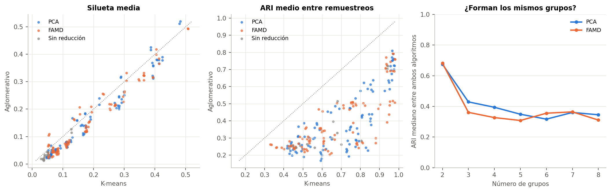
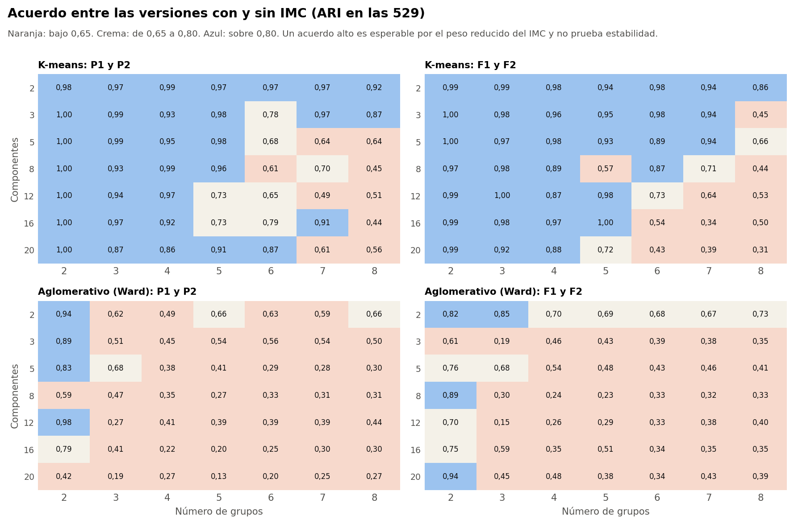
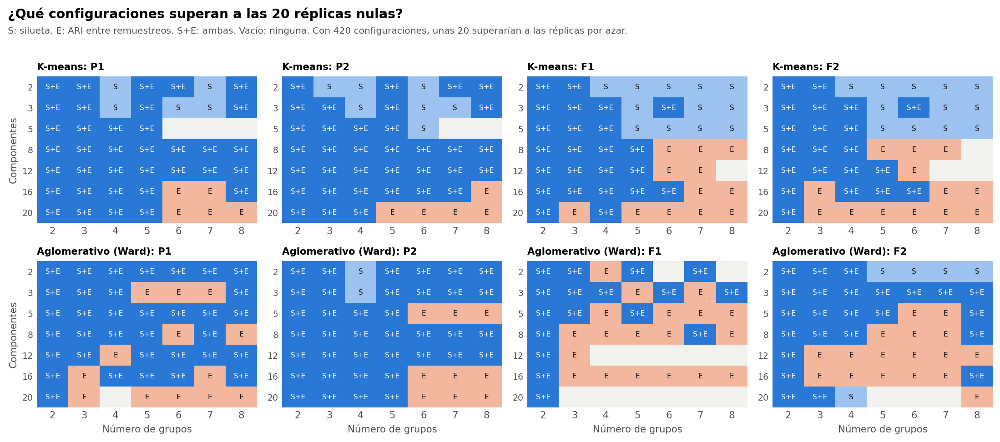
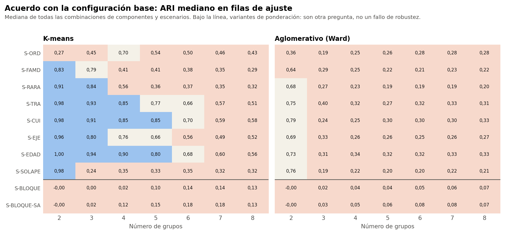
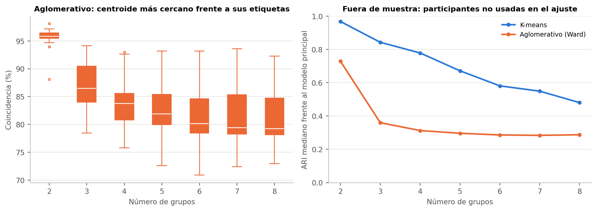
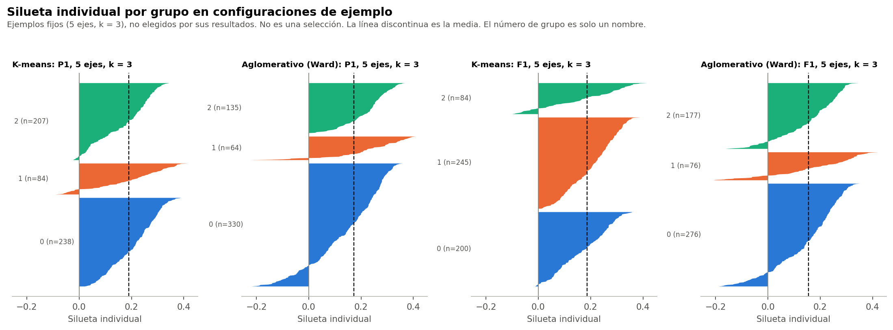
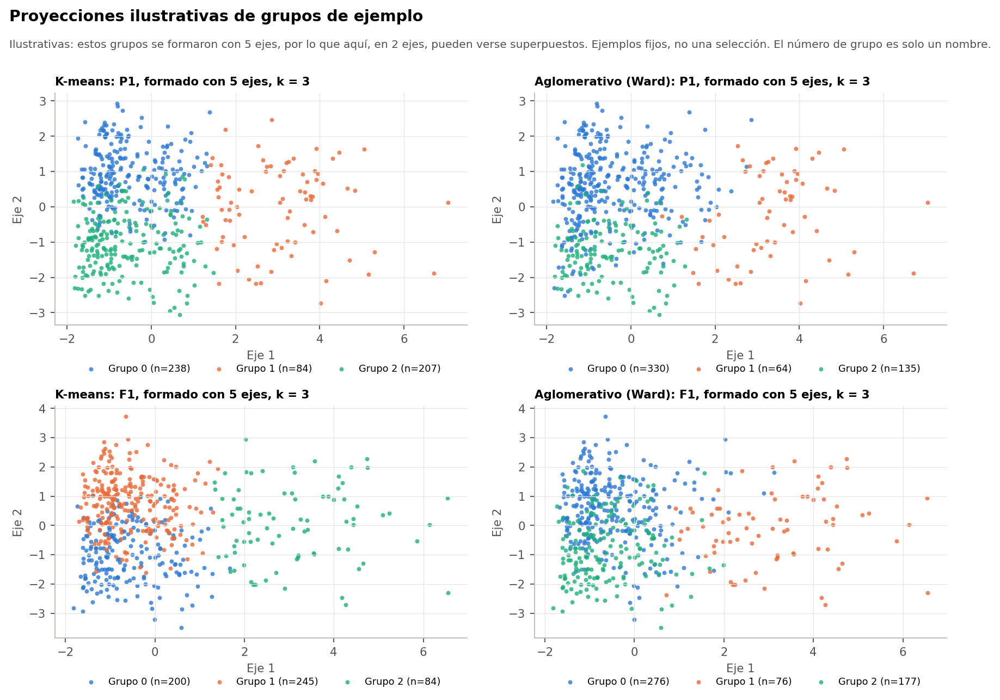

# 1. Conclusión preliminar

**Hay particiones reproducibles con K-means, sobre todo con 2 a 4 grupos, pero no hay evidencia de grupos naturales claramente diferenciados.** Este informe no elige un modelo. Todo el análisis usa el conjunto sintético de usuarias (N = 529). Sus asociaciones vienen de una simulación, por lo que los resultados no permiten afirmar nada sobre mujeres reales.

- **Separación:** la silueta es baja cuando se usan varios ejes (con 5 ejes y k = 3, cerca de 0,19).
- **Estabilidad:** K-means es muy superior a Ward.
- **Referencia nula:** se supera ampliamente, lo que muestra que las variables no son independientes. No demuestra que existan grupos.
- **Sensibilidad:** las agrupaciones resisten cambios de población, pero dependen de decisiones de codificación y de ciertas variables.

# 2. K-means y aglomerativo

| Medida | K-means | Aglomerativo |
|---|---|---|
| Silueta mediana | 0,120 | 0,087 |
| ARI entre remuestreos, mediana | 0,68 | 0,32 |
| ARI entre remuestreos, mediana con k ≥ 3 | 0,62 | 0,29 |
| Configuraciones con ARI alto (> 0,80) | 65 | 1 |
| Configuraciones con ARI bajo (< 0,65) | 98 | 181 |
| Con algún grupo bajo 27 | 11 | 28 |
| Cumplen la regla del protocolo | 80 | 28 |

La silueta es parecida, pero la estabilidad no. Los dos algoritmos tampoco forman los mismos grupos: su ARI mediano es 0,37.

# 3. Comparaciones entre configuraciones

| Comparación | Algoritmo | ARI mediano en las 529 | Rango | ARI mediano en las 267 con IMC observado |
|---|---|---|---|---|
| Con y sin IMC, PCA | K-means | 0,93 | 0,44 a 1,00 | 0,92 |
| Con y sin IMC, PCA | Aglomerativo | 0,41 | 0,13 a 0,98 | 0,43 |
| Con y sin IMC, FAMD | K-means | 0,94 | 0,31 a 1,00 | 0,94 |
| Con y sin IMC, FAMD | Aglomerativo | 0,43 | 0,15 a 0,94 | 0,42 |
| Con y sin IMC, sin reducción | K-means | 0,91 | 0,47 a 0,98 | 0,93 |
| Con y sin IMC, sin reducción | Aglomerativo | 0,53 | 0,36 a 0,73 | 0,49 |
| PCA y FAMD, con IMC | K-means | 0,41 | 0,17 a 0,86 | 0,41 |
| PCA y FAMD, con IMC | Aglomerativo | 0,23 | 0,08 a 0,75 | 0,23 |
| PCA y FAMD, sin IMC | K-means | 0,45 | 0,14 a 0,86 | 0,43 |
| PCA y FAMD, sin IMC | Aglomerativo | 0,23 | 0,07 a 0,76 | 0,24 |
| K-means y aglomerativo | Ambos | 0,37 | 0,06 a 0,90 | No aplica |

**PCA y FAMD** coinciden bastante con K-means en k = 2 y 3 (ARI mediano de 0,83 y 0,79), y poco desde k = 4 (de 0,30 a 0,41). Con Ward coinciden poco, salvo en parte con k = 2 (0,58). No se usa la inercia ni la silueta para preferir uno: sus espacios no son comparables.

**Con y sin IMC:** con K-means casi no hay diferencia (ARI mediano cerca de 0,93). Con Ward el ARI baja a cerca de 0,41, aunque quitar el IMC casi no cambia las coordenadas (similitud de al menos 0,996 en la Fase 37A). **Eso refleja la fragilidad de Ward, no un efecto del IMC.**

**IMC imputado por grupo:** en los escenarios con IMC va de 25,8 % a 66,7 %, con mediana 50,0 %. El global es 49,5 %. Los valores extremos aparecen en grupos de 21 a 53 participantes, con 2 componentes.

# 4. Referencia nula y búsqueda múltiple

| Medida | Superan a las 20 réplicas | En las réplicas: mediana (máx.) | Mayor z observado | En las réplicas: mediana (máx.) | p |
|---|---|---|---|---|---|
| Silueta | 277 | 18,5 (48) | 39,7 | 3,5 (8,9) | 0,048 |
| Davies-Bouldin | 279 | 18,0 (64) | 37,1 | 4,1 (16,8) | 0,048 |
| Calinski-Harabasz | 420 | 14,5 (101) | 35,7 | 3,0 (5,4) | 0,048 |
| ARI frente al completo | 289 | 18,0 (65) | 24,1 | 4,0 (7,7) | 0,048 |
| ARI entre remuestreos | 349 | 18,5 (60) | 64,6 | 4,7 (9,7) | 0,048 |
| ARI fuera de muestra | 287 | 16,5 (73) | 21,9 | 3,9 (7,1) | 0,048 |

Bajo independencia se esperarían unas 20 configuraciones por medida. Se observan muchas más, y el mayor z queda por encima de todas las réplicas. **Lo que esto descarta es la independencia entre variables,** un resultado esperable por lo visto en la Fase 37A. No indica cuál configuración es buena ni que existan grupos. Calinski-Harabasz supera a todas las réplicas en las 420, lo que probablemente refleja la mayor varianza del primer eje.

# 5. Sensibilidades

| Variante | Familia | K-means: ARI de ajuste | Aglomerativo: ARI de ajuste | ARI de proyectadas |
|---|---|---|---|---|
| S-ORD | Codificación | 0,47 | 0,26 | No aplica |
| S-FAMD | Codificación | 0,42 | 0,25 | No aplica |
| S-RARA | Codificación | 0,40 | 0,22 | No aplica |
| S-TRA | Población | 0,80 | 0,36 | K-means 0,71; Aglomerativo 0,33 |
| S-CUI | Población | 0,81 | 0,32 | K-means 0,83; Aglomerativo 0,39 |
| S-EJE | Población | 0,68 | 0,29 | K-means 0,63; Aglomerativo 0,29 |
| S-EDAD | Variables | 0,82 | 0,35 | No aplica |
| S-SOLAPE | Variables | 0,34 | 0,22 | No aplica |
| S-BLOQUE | Ponderación | 0,08 | 0,04 | No aplica |
| S-BLOQUE-SA | Ponderación | 0,13 | 0,06 | No aplica |

- **Población:** resultados altos con K-means. Parte del cambio puede deberse a la población, y las proyectadas se informan aparte.
- **Codificación:** S-ORD cambia las particiones con frecuencia, incluida la de k = 2.
- **Variables:** S-EDAD casi no cambia nada. S-SOLAPE afecta desde k = 3.
- **Ponderación:** S-BLOQUE y S-BLOQUE-SA dan grupos casi sin relación con la base. **Son otra pregunta, no un fallo de robustez.**

También aparecieron grupos pequeños nuevos en 321 de los 3332 ajustes de sensibilidad.

# 6. Asignación de participantes nuevas

| Algoritmo | Coincidencia con sus etiquetas | ARI con sus etiquetas | ARI fuera de muestra, mediana | Margen mediano |
|---|---|---|---|---|
| K-means | 100,0 % (100,0 a 100,0) | 1,00 | 0,75 | 0,21 |
| Aglomerativo | 83,8 % (70,9 a 98,1) | 0,60 | 0,33 | 0,18 |

K-means dispone de una regla directa, con coincidencia de 100 % por construcción. Con Ward, la regla de prototipos cambia de grupo a parte de las participantes. **En viabilidad de asignación, K-means queda mejor,** aunque en k altos también pierde acuerdo fuera de muestra.

# 7. Ilustración

# 8. Limitaciones

- **Datos sintéticos.** Todo el análisis usa el conjunto sintético de usuarias (N = 529). Sus asociaciones vienen de una simulación, por lo que los resultados no permiten afirmar nada sobre mujeres reales.
- **No son diagnósticos.** Los grupos no equivalen a niveles de riesgo, y su número no indica un orden.
- **La nula solo descarta independencia.** Un conjunto con variables correlacionadas puede superarla sin tener grupos naturales. Tampoco es una prueba sobre la población.
- **La reducción no se recalculó en los remuestreos.** Se ajustó con las 529, así que la estabilidad evalúa solo el agrupamiento.
- **Pocas réplicas.** Con 20 réplicas, `p` no baja de 0,048.
