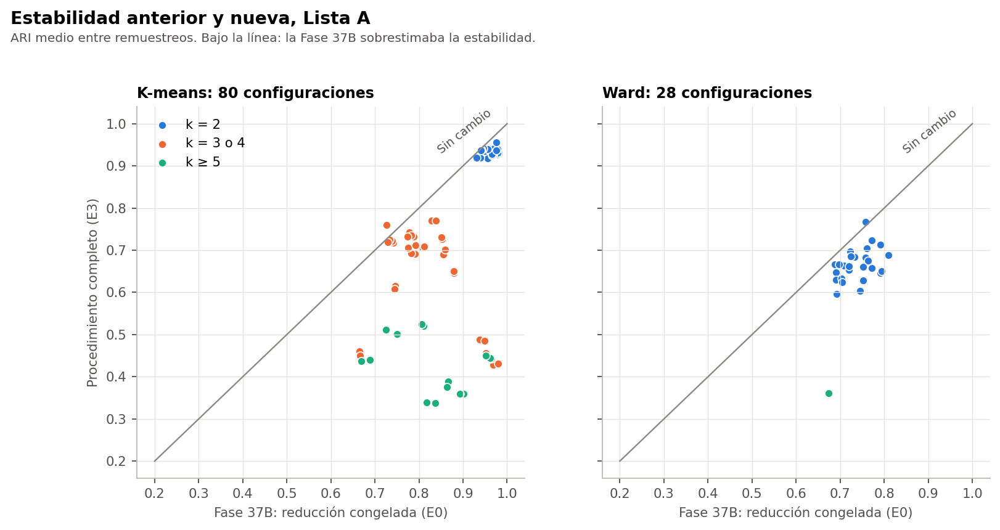
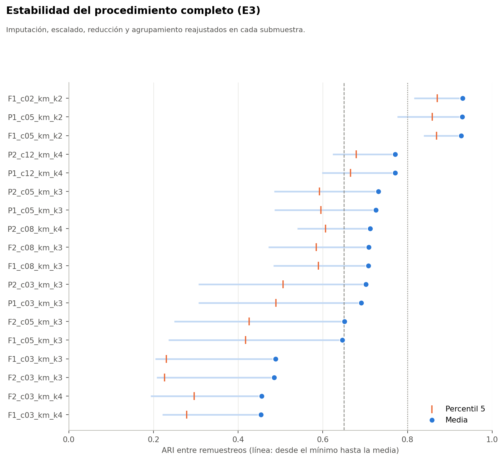

# Pregunta

La Fase 37B midió la estabilidad con la reducción, el escalado y la imputación congelados. Aquí se comprueba qué pasa cuando esos pasos también se reajustan dentro de cada submuestra.

Todo el análisis usa el conjunto sintético de usuarias (N = 529). Sus asociaciones vienen de una simulación, por lo que los resultados no permiten afirmar nada sobre mujeres reales.

# Diseño

- Cuatro niveles: **E0** (37B, solo agrupamiento), **E1** (más reducción), **E2** (más escalado) y **E3** (más imputación en memoria). E3 es el nivel de decisión.
- Las mismas 30 submuestras de 423 participantes de la Fase 37B, sobre 127 configuraciones. 360 lotes válidos.
- Medida principal: ARI entre pares de remuestreos sobre las participantes compartidas (`ari_entre`, 435 pares). Bandas de trabajo: bajo 0,65, entre 0,65 y 0,80, y sobre 0,80.
- Ni siquiera E3 recalibra la limpieza, la selección de las 30 variables, la agrupación de categorías raras de FAMD, los códigos ordinales del instrumento ni los valores de c y k. Por eso E3 sigue siendo optimista.

# Resultado general: la estabilidad baja

| Lista A | E0 | E1 | E2 | E3 |
|---|---|---|---|---|
| Media ≥ 0,65 | 108 | 79 | 79 | 73 |
| Media ≥ 0,65 y p05 ≥ 0,50 | 88 | 57 | 56 | 53 |
| Media > 0,80 | 58 | 31 | 30 | 30 |

Casi toda la caída ocurre al pasar de E0 a E1. Reajustar el escalado y la imputación agrega poco.

| k | K-means E0 | K-means E3 | Ward E0 | Ward E3 |
|---|---|---|---|---|
| 2 | 0,96 | 0,93 | 0,73 | 0,66 |
| 3 | 0,80 | 0,71 | 0,38 | 0,27 |
| 4 | 0,75 | 0,71 | 0,28 | 0,23 |
| 5 | 0,81 | 0,51 | 0,67 | 0,36 |
| 6 | 0,89 | 0,36 | n/a | n/a |
| 7 | 0,86 | 0,38 | n/a | n/a |
| 8 | 0,75 | 0,39 | n/a | n/a |

Medianas por k. Con k alto, la estabilidad aparente de la Fase 37B era en gran parte efecto de congelar la reducción.

# Configuraciones de referencia

| Configuración | E0 | E1 | E3 | E3 p05 | E3 fuera | E3 fuera p05 |
|---|---|---|---|---|---|---|
| F2_c03_km_k3 | 0,95 | 0,54 | 0,49 | 0,23 | 0,58 | 0,30 |
| F1_c03_km_k4 | 0,95 | 0,50 | 0,45 | 0,28 | 0,54 | 0,26 |
| F2_c02_km_k3 | 0,98 | 0,48 | 0,43 | 0,21 | 0,53 | 0,18 |
| P2_c12_km_k4 | 0,84 | 0,73 | 0,77 | 0,68 | 0,83 | 0,73 |
| P1_c12_km_k4 | 0,83 | 0,74 | 0,77 | 0,67 | 0,81 | 0,72 |
| P2_c08_km_k4 | 0,79 | 0,68 | 0,71 | 0,61 | 0,77 | 0,64 |
| P1_c05_km_k3 | 0,85 | 0,75 | 0,73 | 0,60 | 0,75 | 0,61 |
| F1_c05_km_k2 | 0,98 | 0,92 | 0,93 | 0,87 | 0,95 | 0,82 |
| F1_c02_km_k2 | 0,98 | 0,92 | 0,93 | 0,87 | 0,96 | 0,87 |

# Hallazgos adicionales

- La similitud entre subespacios de reducción, con la submuestra frente a la muestra completa, tiene mediana 0,92 y mínimo 0,49. Los subespacios se parecen en general, pero pequeñas rotaciones bastan para mover fronteras en un continuo.
- **Anomalía sin explicar:** `R0P1_cTodas_km_k4`, sin reducción, sube de 0,65 en E0 a 0,79 en E3, con p05 0,43. No se investigó su causa y no influye en la decisión, porque R0 no tiene sensibilidades en la Fase 37B y no puede ser finalista.
- La imputación reestimada no siempre coincide con la original: en las 30 submuestras `tiene_actividad_sexual` queda en «SI» 18 veces y en «NO» 12; `cuida_otras_personas` en «SI» 4 veces; y `frecuencia_fuerza` en el valor 4 9 veces.

# Límite

`ari_fuera` compara con las etiquetas de la Fase 37B, que usaron a esas mismas participantes. Por eso se conserva además `ari_fuera_pares`, sin contaminación, con unas 21 participantes por par: es más limpia y más ruidosa.
