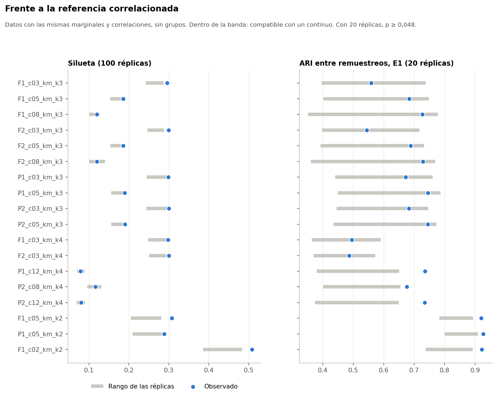

# Pregunta

¿Las particiones observadas se distinguen de lo que produciría un conjunto **sin grupos**, pero con las mismas marginales y correlaciones? Si no se distinguen, son compatibles con cortes arbitrarios de un continuo.

Todo el análisis usa el conjunto sintético de usuarias (N = 529). Sus asociaciones vienen de una simulación, por lo que los resultados no permiten afirmar nada sobre mujeres reales.

# Construcción

Cópula gaussiana con marginales empíricas exactas por asignación de rangos, Spearman calibrado de forma iterativa, IMC con su indicador de ausencia, la variable nominal con regresión logística multinomial regularizada y las madres derivadas de sus hijas.

# Enmienda 1: contracción

Sin contracción, la cópula **no cumplió su criterio sellado**: el error del segundo valor propio fue 11,9 % en PCA, sobre un límite de 10 %. No se ajustó el criterio. Se selló una enmienda separada que añade contracción `R' = (1 − α)R + αI` y elige el menor α de la grilla que cumple todos los criterios.

| α | Spearman máx. | Valor propio PCA | Valor propio FAMD | ¿Cumple? |
|---|---|---|---|---|
| 0,025 | 0,034 | 11,1 % | 9,3 % | No |
| 0,050 | 0,041 | 9,8 % | 8,2 % | Sí |
| 0,075 | 0,058 | 8,9 % | 7,2 % | No |
| 0,100 | 0,077 | 8,1 % | 6,6 % | No |
| 0,125 | 0,096 | 7,4 % | 5,9 % | No |
| 0,150 | 0,112 | 8,0 % | 7,2 % | No |
| 0,200 | 0,149 | 11,2 % | 10,1 % | No |

Se usó **α = 0,05**, con margen estrecho. Es una elección **exploratoria**, hecha después de conocer el fallo. La falla original queda en `propiedades_alpha_0.json`.

# Propiedades y controles

- Marginales exactas y lógica de salto íntegra. Spearman: error máximo de la media 0,041; dentro de una sola réplica, mediana del máximo 0,14 (error de muestreo).
- V de Cramér medio: observado 0,089, réplicas 0,093.
- Controles sintéticos: sin grupos no se supera la referencia, salvo un empate con p = 0,048 en `F2_c03`. Con grupos plantados se supera con claridad. **La potencia frente a grupos débiles no se evaluó.** Tabla: `controles_sinteticos.csv`.

# Control de búsqueda múltiple

100 réplicas para separación y 20 para estabilidad. Con 20 réplicas, el menor p posible es 0,048.

| Métrica | Superan a todas (obs.) | Réplicas: máximo | z máx. obs. | z máx. réplicas | p |
|---|---|---|---|---|---|
| silueta | 15 | 5 | 4,21 | 6,10 | 0,079 |
| davies_bouldin | 9 | 14 | 3,57 | 5,36 | 0,050 |
| calinski_harabasz | 36 | 14 | 4,48 | 3,46 | 0,010 |
| E0_ari_entre_media | 23 | 14 | 4,26 | 8,47 | 0,095 |
| E0_ari_completo_media | 19 | 15 | 3,67 | 4,76 | 0,143 |
| E1_ari_entre_media | 17 | 19 | 4,13 | 5,15 | 0,095 |
| E1_ari_completo_media | 13 | 20 | 3,57 | 3,58 | 0,095 |

Ninguna finalista lo pasa en silueta y estabilidad a la vez. **Silueta y estabilidad no superan el control, pero Calinski-Harabasz sí (p = 0,010) y Davies-Bouldin queda en el límite (p = 0,050).** Por tanto, los datos no son idénticos a la referencia. Esa diferencia no demuestra que haya grupos: también puede venir de dependencias que la cópula no reproduce, y estas medidas tienden a favorecer particiones con grupos compactos.

# Configuraciones destacadas

| Configuración | Silueta | Nula media | Nula máx. | p | E1 | Nula media | Nula máx. | p |
|---|---|---|---|---|---|---|---|---|
| P2_c12_km_k4 | 0,080 | 0,078 | 0,090 | 0,238 | 0,73 | 0,50 | 0,65 | 0,048 |
| P1_c12_km_k4 | 0,079 | 0,078 | 0,089 | 0,347 | 0,74 | 0,51 | 0,65 | 0,048 |
| P2_c08_km_k4 | 0,116 | 0,109 | 0,131 | 0,069 | 0,68 | 0,52 | 0,65 | 0,048 |
| P2_c05_km_k3 | 0,190 | 0,173 | 0,189 | 0,010 | 0,75 | 0,63 | 0,77 | 0,143 |
| P2_c03_km_k3 | 0,300 | 0,270 | 0,296 | 0,010 | 0,68 | 0,60 | 0,75 | 0,190 |
| F2_c03_km_k3 | 0,300 | 0,268 | 0,288 | 0,010 | 0,54 | 0,54 | 0,72 | 0,476 |
| F1_c02_km_k2 | 0,508 | 0,432 | 0,483 | 0,010 | 0,92 | 0,84 | 0,89 | 0,048 |
| F1_c05_km_k2 | 0,307 | 0,239 | 0,281 | 0,010 | 0,92 | 0,84 | 0,89 | 0,048 |

# Lectura

- **Un ARI alto no implica grupos.** Datos sin grupos alcanzan ARI altos: en k = 2, la media nula de E1 es 0,84.
- `P2_c12_km_k4` tiene una silueta igual a la nula (0,080 frente a 0,078). No hay separación mayor que la de un continuo correlacionado. Su estabilidad E1 sí supera a las 20 réplicas (0,73 frente a un máximo de 0,65), aunque sin pasar el control de búsqueda múltiple.
- La referencia nunca descarta una configuración: solo da una advertencia. Esta conclusión no cambia con α = 0: `P2_c12_km_k4` tampoco supera a la nula en silueta allí. Ese contraste se rotula «No válida según el criterio; solo informativa».
