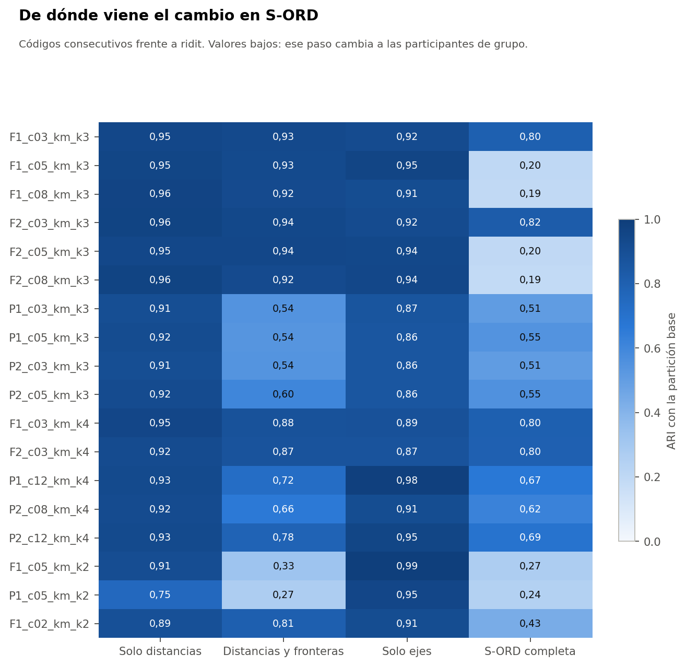

# Pregunta

La Fase 37B encontró que tratar las ordinales como ridit, en lugar de códigos consecutivos, cambiaba mucho varias particiones. Aquí se separa de dónde viene ese cambio.

Todo el análisis usa el conjunto sintético de usuarias (N = 529). Sus asociaciones vienen de una simulación, por lo que los resultados no permiten afirmar nada sobre mujeres reales.

# Descomposición

- **H1:** cambian solo las distancias, con los centroides de la partición base.
- **H2:** cambian distancias y fronteras.
- **H3:** cambian solo los ejes de la reducción.
- **H4:** S-ORD completa.

| Configuración | Subespacio | H1 | H2 | H3 | H4 | Cambian | AUC margen | % en cuartil de menor margen |
|---|---|---|---|---|---|---|---|---|
| P2_c12_km_k4 | 0,95 | 0,93 | 0,78 | 0,95 | 0,69 | 13,6 % | 0,82 | 64 % |
| P1_c12_km_k4 | 0,95 | 0,93 | 0,72 | 0,98 | 0,67 | 14,6 % | 0,79 | 60 % |
| P2_c08_km_k4 | 0,94 | 0,92 | 0,66 | 0,91 | 0,62 | 16,6 % | 0,82 | 61 % |
| P2_c05_km_k3 | 0,95 | 0,92 | 0,60 | 0,86 | 0,55 | 18,9 % | 0,74 | 51 % |
| P2_c03_km_k3 | 0,96 | 0,91 | 0,54 | 0,86 | 0,51 | 20,8 % | 0,76 | 55 % |
| F2_c03_km_k3 | 0,97 | 0,96 | 0,94 | 0,92 | 0,82 | 6,8 % | 0,89 | 81 % |
| F1_c02_km_k2 | 0,97 | 0,89 | 0,81 | 0,91 | 0,43 | 16,1 % | 0,83 | 65 % |
| F1_c05_km_k2 | 0,96 | 0,91 | 0,33 | 0,99 | 0,27 | 23,6 % | 0,81 | 58 % |

# Lectura

- El subespacio casi no cambia. Las participantes se mueven poco: el cambio aparece cuando el agrupamiento se reajusta sobre esas distancias apenas distintas. Es lo esperable en un continuo: las fronteras no están sostenidas por huecos en los datos.
- En k = 2, S-ORD es muy baja porque el grupo pequeño depende de la distancia entre los niveles de `dias_ejercicio_semana`: el ARI cambiando solo esa variable es 0,26 en `F1_c05_km_k2`.
- Las variables con mayor cambio de distancia son `dias_ejercicio_semana`, `alcohol_frecuencia`, `platos_verduras_dia`.
- Las configuraciones con 8 componentes FAMD combinan S-ORD cercano a 0,19 con cambios que no se concentran en la frontera: son frágiles según la regla 6.3.

# Representaciones comparadas

| Configuración | Cons.-ridit | Cons.-normal | Ridit-normal | E3 cons. (p05) | E3 ridit (p05) | E3 normal (p05) |
|---|---|---|---|---|---|---|
| P2_c12_km_k4 | 0,69 | 0,91 | 0,71 | 0,77 (0,68) | 0,53 (0,36) | 0,74 (0,61) |
| P2_c08_km_k4 | 0,62 | 0,91 | 0,65 | 0,71 (0,61) | 0,56 (0,37) | 0,68 (0,55) |
| P2_c05_km_k3 | 0,55 | 0,73 | 0,59 | 0,73 (0,59) | 0,71 (0,56) | 0,72 (0,59) |
| P2_c03_km_k3 | 0,51 | 0,82 | 0,62 | 0,70 (0,51) | 0,68 (0,49) | 0,66 (0,47) |
| F1_c02_km_k2 | 0,43 | 0,86 | 0,53 | 0,93 (0,87) | 0,77 (0,55) | 0,82 (0,63) |

# Decisión por la regla 6.3

- `P2_c12_km_k4`: ARI consecutiva-ridit 0,69, sobre 0,65: **se mantiene con limitaciones aceptables**.
- `P2_c08_km_k4`: 0,62, entre 0,40 y 0,65, con AUC 0,82: **se mantiene con limitaciones aceptables**.
- Ninguna representación alternativa cumple las tres condiciones para reemplazar a la consecutiva. La codificación principal no cambia, y no se generó ninguna versión nueva.

**Limitación importante:** la estabilidad depende de la representación. Con ridit, `P2_c12_km_k4` baja a 0,53 (p05 0,36), que sería crítica si ridit fuera la codificación principal.
