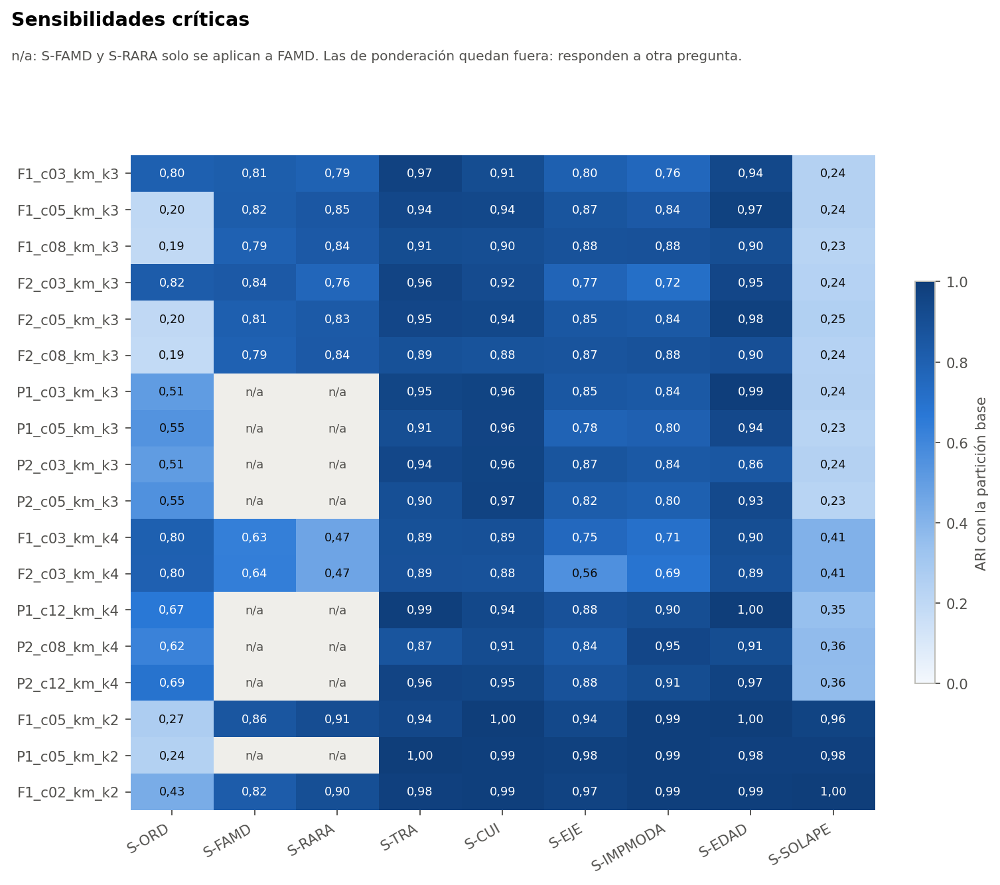

# Pregunta

¿Cuánto cambia cada partición al modificar la codificación, la población analizada o las variables que entran?

Todo el análisis usa el conjunto sintético de usuarias (N = 529). Sus asociaciones vienen de una simulación, por lo que los resultados no permiten afirmar nada sobre mujeres reales.

# Resultados

ARI de reajuste frente a la partición base.

| Configuración | S-ORD | S-FAMD | S-RARA | S-TRA | S-CUI | S-EJE | S-IMPMODA | S-EDAD | S-SOLAPE | S-BLOQUE |
|---|---|---|---|---|---|---|---|---|---|---|
| P2_c12_km_k4 | 0,69 | n/a | n/a | 0,96 | 0,95 | 0,88 | 0,91 | 0,97 | 0,36 | 0,14 |
| P1_c12_km_k4 | 0,67 | n/a | n/a | 0,99 | 0,94 | 0,88 | 0,90 | 1,00 | 0,35 | 0,00 |
| P2_c08_km_k4 | 0,62 | n/a | n/a | 0,87 | 0,91 | 0,84 | 0,95 | 0,91 | 0,36 | 0,12 |
| P2_c05_km_k3 | 0,55 | n/a | n/a | 0,90 | 0,97 | 0,82 | 0,80 | 0,93 | 0,23 | -0,00 |
| P2_c03_km_k3 | 0,51 | n/a | n/a | 0,94 | 0,96 | 0,87 | 0,84 | 0,86 | 0,24 | 0,02 |
| F2_c03_km_k3 | 0,82 | 0,84 | 0,76 | 0,96 | 0,92 | 0,77 | 0,72 | 0,95 | 0,24 | 0,13 |
| F1_c02_km_k2 | 0,43 | 0,82 | 0,90 | 0,98 | 0,99 | 0,97 | 0,99 | 0,99 | 1,00 | -0,03 |
| F1_c05_km_k2 | 0,27 | 0,86 | 0,91 | 0,94 | 1,00 | 0,94 | 0,99 | 1,00 | 0,96 | -0,02 |

# Lo que más afecta a las elegibles

- **S-SOLAPE (sin `tiene_actividad_sexual` ni `distension_abdominal`):** 0,36 en `P2_c12_km_k4` y 0,36 en `P2_c08_km_k4`. Es crítica. La partición de 4 grupos descansa en esas dos variables. La regla V le impide ser A; no le impide por sí sola ser B, pero se declara como condición de uso.
- **S-BLOQUE:** 0,14 en `P2_c12_km_k4`. Dar a cada bloque temático el mismo peso produce otra partición. El protocolo la deja fuera de las reglas porque responde a otra pregunta, pero indica que los grupos dependen de cuántas columnas aporta cada tema.
- **S-ORD:** 0,69, ver el informe 06.
- **S-EJE:** 0,88, advertencia leve.

# S-IMPMODA: un hallazgo nuevo

Las 30 celdas imputadas de `tiene_actividad_sexual` valen «NO», aunque la moda en las 529 es «SI» (251 frente a 248). La moda se calculó sobre 546 filas, antes de un filtro posterior, según el informe de limpieza. **No se corrigió.** Se evaluó su efecto con S-IMPMODA: 0,91 en `P2_c12_km_k4`, sobre el umbral de advertencia. La diferencia entre ambas modas es de 3 participantes, así que no se puede afirmar cuál es mejor. Queda como punto a revisar por la responsable.

# Con y sin IMC, K-means y Ward, PCA y FAMD

| Configuración | Con/sin IMC | K-means/Ward | PCA/FAMD |
|---|---|---|---|
| P2_c12_km_k4 | 0,97 | 0,33 | 0,40 |
| P1_c12_km_k4 | 0,97 | 0,39 | 0,39 |
| P2_c08_km_k4 | 0,99 | 0,28 | 0,38 |
| P2_c05_km_k3 | 0,99 | 0,55 | 0,79 |
| P2_c03_km_k3 | 0,99 | 0,53 | 0,84 |
| F2_c03_km_k3 | 0,98 | 0,34 | 0,84 |
| F1_c02_km_k2 | 0,99 | 0,90 | 0,82 |
| F1_c05_km_k2 | 1,00 | 0,79 | 0,86 |

El IMC casi no influye. En cambio, con k = 4 el algoritmo y el método de reducción sí importan: **la partición no es independiente del método**, lo que también apunta a un continuo.
