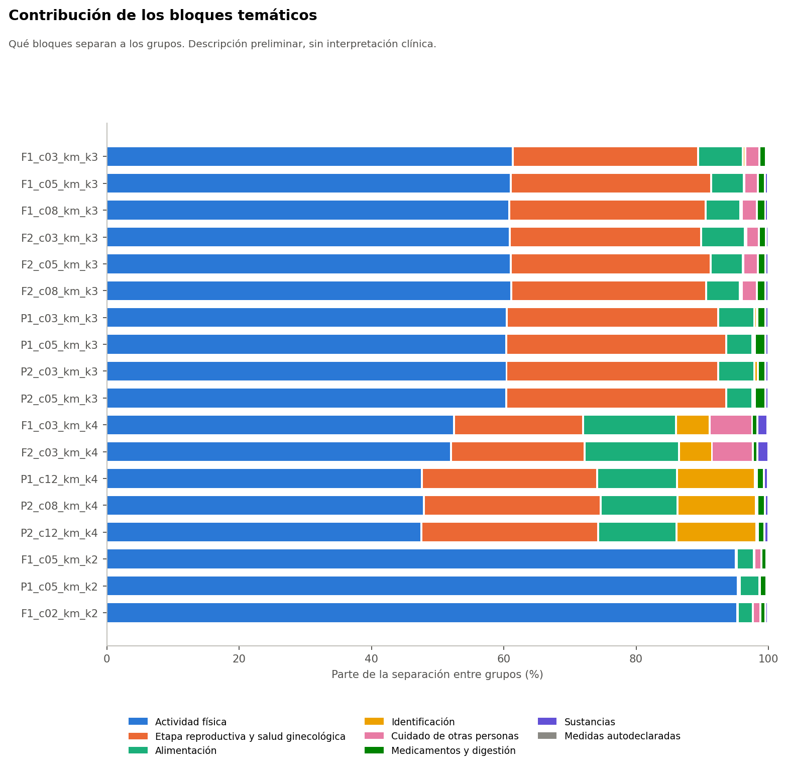

# Alcance

Descripción preliminar con las 30 variables generales, sin MRS, sin nombres de grupos y sin lectura clínica. La caracterización corresponde a la Fase 37D, que no se inició.

Todo el análisis usa el conjunto sintético de usuarias (N = 529). Sus asociaciones vienen de una simulación, por lo que los resultados no permiten afirmar nada sobre mujeres reales.

# Clases del conjunto priorizado

| Clase | Configuraciones |
|---|---|
| Principalmente gradiente de ejercicio | 32 |
| Segmentación multivariable | 15 |
| Dominada por pocas variables | 3 |

# Configuraciones destacadas

| Configuración | Clase | Actividad física (% SSB) | Variable mayor (%) | Variables con efecto ≥ 0,06 | Bloques | N.º efectivo | Recon. 1 | Recon. 2 |
|---|---|---|---|---|---|---|---|---|
| P2_c12_km_k4 | Segmentación multivariable | 48 | tiene_pareja (18) | 9 | 4 | 8,5 | 0,31 | 0,55 |
| P1_c12_km_k4 | Segmentación multivariable | 48 | tiene_pareja (18) | 9 | 4 | 8,6 | 0,30 | 0,54 |
| P2_c08_km_k4 | Segmentación multivariable | 48 | tiene_pareja (18) | 9 | 4 | 8,5 | 0,30 | 0,53 |
| P2_c05_km_k3 | Principalmente gradiente de ejercicio | 60 | dias_ejercicio_semana (21) | 6 | 2 | 6,6 | 0,40 | 0,61 |
| P2_c03_km_k3 | Principalmente gradiente de ejercicio | 60 | dias_ejercicio_semana (21) | 6 | 2 | 6,7 | 0,36 | 0,55 |
| F2_c03_km_k3 | Principalmente gradiente de ejercicio | 61 | dias_ejercicio_semana (20) | 6 | 2 | 7,3 | 0,36 | 0,57 |
| F1_c02_km_k2 | Principalmente gradiente de ejercicio | 95 | dias_ejercicio_semana (30) | 4 | 1 | 4,3 | 0,75 | 0,77 |
| F1_c05_km_k2 | Principalmente gradiente de ejercicio | 95 | dias_ejercicio_semana (30) | 4 | 1 | 4,3 | 0,78 | 0,82 |

# Variables que más separan en `P2_c12_km_k4`

| Variable | Bloque | Efecto | % SSB | Grupo 0 | Grupo 1 | Grupo 2 | Grupo 3 |
|---|---|---|---|---|---|---|---|
| tiene_pareja | Etapa reproductiva y salud ginecológica | 0,65 | 18 | 0,09 | 0,70 | 0,97 | 0,95 |
| dias_ejercicio_semana | Actividad física | 0,56 | 16 | 1,33 | 3,36 | 1,34 | 1,42 |
| frecuencia_aerobico | Actividad física | 0,51 | 14 | 0,17 | 2,36 | 0,17 | 0,18 |
| trabaja_actualmente | Identificación | 0,43 | 12 | 0,60 | 0,58 | 0,09 | 0,95 |
| frecuencia_fuerza | Actividad física | 0,37 | 10 | 0,13 | 1,79 | 0,12 | 0,16 |
| tiene_actividad_sexual | Etapa reproductiva y salud ginecológica | 0,30 | 8 | 0,05 | 0,51 | 0,70 | 0,66 |
| frecuencia_bajo_impacto | Actividad física | 0,26 | 7 | 0,56 | 2,25 | 0,57 | 0,65 |
| frecuencia_comida_fuera | Alimentación | 0,17 | 5 | 1,85 | 2,01 | 1,54 | 2,40 |
| falta_tiempo_influye | Alimentación | 0,10 | 3 | 2,75 | 2,62 | 2,29 | 3,09 |

Medias de los códigos del instrumento, sin nombres de grupos. La numeración de los grupos es arbitraria.

# ¿Qué tan multivariables son?

- **k = 2:** no lo son. La actividad física aporta cerca de 95 % de la separación, y una sola variable, `dias_ejercicio_semana`, reconstruye la partición con ARI 0,78. Preguntarla directamente es más simple.
- **k = 3:** son un gradiente de ejercicio, con la actividad física cerca de 60 %, algunas justo en el límite de la clase.
- **`P2_c12_km_k4`:** clase multivariable según la regla sellada, con 9 variables con efecto de al menos 0,06, 4 bloques y 8,5 variables efectivas. Con dos variables la reconstrucción llega a 0,55, bajo el umbral de 0,65.

# Comprobación exploratoria con tres variables

El protocolo solo mide 1 y 2 variables. Al ver los perfiles se añadió esta comprobación, fuera del protocolo. **No cambia la clase sellada.**

| Configuración | Mejor trío | ARI con 3 | ARI con 4 |
|---|---|---|---|
| P2_c12_km_k4 | trabaja_actualmente + tiene_pareja + dias_ejercicio_semana | 0,68 | 0,67 |
| P2_c08_km_k4 | trabaja_actualmente + tiene_pareja + dias_ejercicio_semana | 0,66 | 0,65 |

Tres preguntas directas reconstruyen `P2_c12_km_k4` con ARI 0,68. La cuarta no mejora. Es decir, «multivariable» es correcto respecto de la regla, pero la partición se aproxima bastante con tres preguntas simples. Es una alternativa que debe compararse antes de usar los grupos.
