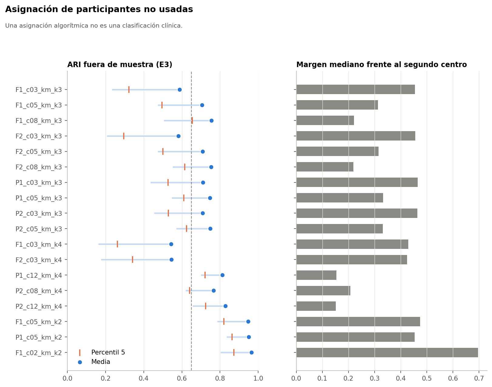

# Pregunta

¿Se puede asignar a una participante nueva sin reajustar nada, y es consistente esa asignación? Una asignación algorítmica **no es una clasificación clínica**.

Todo el análisis usa el conjunto sintético de usuarias (N = 529). Sus asociaciones vienen de una simulación, por lo que los resultados no permiten afirmar nada sobre mujeres reales.

# Diseño

Con las 30 submuestras de E3, el flujo se aplica a las 106 participantes no usadas: transformador, proyección y centroide más cercano. Se compara con la partición de referencia. Comprobado además que la asignación de una participante no depende de las demás. Las Ward no tienen centroides propios: se aproximan por prototipos y se rotulan como aproximación.

# Resultados

| Configuración | ARI fuera | p05 | Mínimo | Desacuerdo | Margen mediano |
|---|---|---|---|---|---|
| P2_c12_km_k4 | 0,83 | 0,73 | 0,66 | 6,4 % | 0,15 |
| P1_c12_km_k4 | 0,81 | 0,72 | 0,70 | 6,9 % | 0,15 |
| P2_c08_km_k4 | 0,77 | 0,64 | 0,62 | 9,0 % | 0,21 |
| P2_c05_km_k3 | 0,75 | 0,62 | 0,57 | 8,1 % | 0,33 |
| P2_c03_km_k3 | 0,71 | 0,53 | 0,45 | 9,4 % | 0,46 |
| F2_c03_km_k3 | 0,58 | 0,30 | 0,21 | 15,4 % | 0,46 |
| F1_c02_km_k2 | 0,96 | 0,87 | 0,80 | 0,7 % | 0,70 |
| F1_c05_km_k2 | 0,95 | 0,82 | 0,78 | 1,0 % | 0,47 |

Las de k = 2 son las más consistentes porque casi solo miran el ejercicio, pero no son elegibles por eso mismo.

# Mecanismo de incertidumbre en `P2_c12_km_k4`

El margen es `1 − d1/d2`: cerca de 0, la participante está casi a la misma distancia de dos centros.

| Señal | Señaladas | Desacuerdo señaladas | Desacuerdo resto |
|---|---|---|---|
| Margen < 0,05 | 17,1 % | 28,6 % | 1,9 % |
| Margen < 0,10 | 32,5 % | 18,1 % | 0,7 % |
| Margen < 0,15 | 49,5 % | 12,4 % | 0,3 % |
| Margen < 0,20 | 66,0 % | 9,5 % | 0,2 % |
| Margen < 0,30 | 88,1 % | 7,2 % | 0,0 % |
| Distancia sobre p90 | 5,6 % | 8,4 % | 6,2 % |
| Distancia sobre p95 | 2,7 % | 9,6 % | 6,3 % |
| Distancia sobre p99 | 0,7 % | 0,0 % | 6,4 % |

- **El margen discrimina bien.** Casi todo el desacuerdo está en las participantes cerca de una frontera.
- **El costo es alto:** la mitad de las participantes tiene un margen bajo 0,15, porque en un continuo muchas quedan cerca de una frontera. En la muestra completa, 30,6 % tiene margen bajo 0,10.
- **La distancia casi no predice el desacuerdo.** Sirve para señalar participantes atípicas, no asignaciones dudosas.

**No se fijan umbrales definitivos.** La grilla muestra el compromiso; fijarlos corresponde a una fase posterior y con datos que no se hayan usado para esto.
