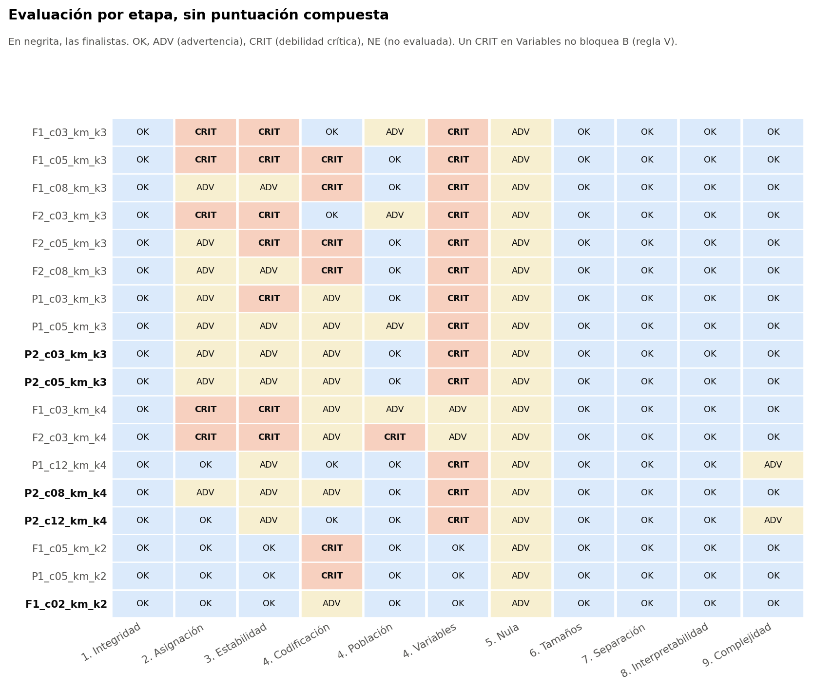
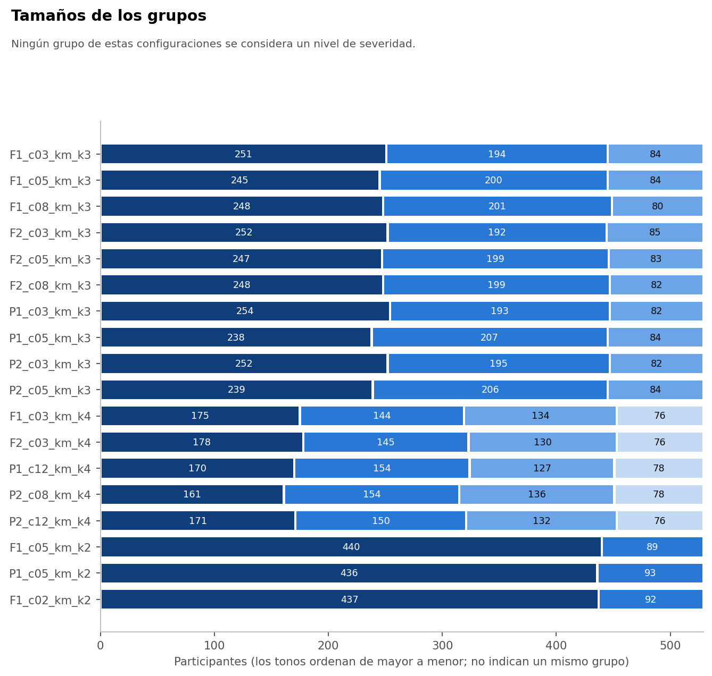
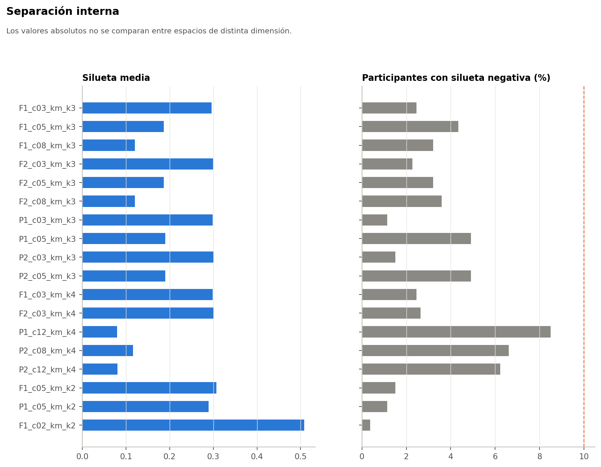

# Finalistas

Pasan quienes no tienen CRIT en las etapas 1 a 3, ni en codificación, ni en población e imputación. Las casi idénticas (ARI ≥ 0,95) cuentan como una sola. R0 queda fuera por no tener sensibilidades en la Fase 37B.

Todo el análisis usa el conjunto sintético de usuarias (N = 529). Sus asociaciones vienen de una simulación, por lo que los resultados no permiten afirmar nada sobre mujeres reales.

| Configuración | Representa a | Clase | ADV | CRIT | Elegible para |
|---|---|---|---|---|---|
| F1_c02_km_k2 | F1_c02_km_k2 | Principalmente gradiente de ejercicio | 2 | — | No elegible |
| P2_c12_km_k4 | P2_c12_km_k4, P1_c12_km_k4 | Segmentación multivariable | 4 | S-SOLAPE | B |
| P2_c03_km_k3 | P2_c03_km_k3 | Principalmente gradiente de ejercicio | 7 | S-SOLAPE | No elegible |
| P2_c05_km_k3 | P2_c05_km_k3, P1_c05_km_k3 | Principalmente gradiente de ejercicio | 7 | S-SOLAPE | No elegible |
| P2_c08_km_k4 | P2_c08_km_k4 | Segmentación multivariable | 7 | S-SOLAPE | B |

# Comparación

| Medida | F1_c02_km_k2 | P2_c12_km_k4 | P2_c03_km_k3 | P2_c05_km_k3 | P2_c08_km_k4 |
|---|---|---|---|---|---|
| Silueta | 0,508 | 0,080 | 0,300 | 0,190 | 0,116 |
| Silueta frente a la nula, p | 0,010 | 0,238 | 0,010 | 0,010 | 0,069 |
| E3 entre | 0,93 | 0,77 | 0,70 | 0,73 | 0,71 |
| E3 entre, p05 | 0,87 | 0,68 | 0,51 | 0,59 | 0,61 |
| E3 fuera | 0,96 | 0,83 | 0,71 | 0,75 | 0,77 |
| E3 fuera, p05 | 0,87 | 0,73 | 0,53 | 0,62 | 0,64 |
| S-ORD | 0,43 | 0,69 | 0,51 | 0,55 | 0,62 |
| S-SOLAPE | 1,00 | 0,36 | 0,24 | 0,23 | 0,36 |
| Actividad física, % SSB | 95 | 48 | 60 | 60 | 48 |
| Reconstrucción con 2 variables | 0,77 | 0,55 | 0,55 | 0,61 | 0,53 |
| Margen mediano | 0,65 | 0,15 | 0,47 | 0,31 | 0,21 |

# K-means frente al método aglomerativo

K-means mantiene sus ventajas: todas las finalistas son K-means. Las Ward caen en estabilidad y sus homólogas de la Lista B quedan entre 0,20 y 0,35 en E3. Además, K-means asigna de forma directa, mientras que Ward necesita una aproximación por prototipos. Esto no prueba que K-means descubra grupos reales: favorece fronteras sencillas y funciona igual en un continuo.

# Las dos elegibles para B

| Criterio | P2_c12_km_k4 | P2_c08_km_k4 |
|---|---|---|
| Advertencias | 4 | 7 |
| E3 entre, p05 | 0,68 | 0,61 |
| Componentes | 12 | 8 |
| ARI entre ellas | 0,91 | 0,91 |

Por la regla 10.2 (menos ADV, luego mayor p05, luego menor complejidad) se propone `P2_c12_km_k4`. Su única desventaja es que usa 12 componentes. La diferencia práctica es pequeña: comparten casi toda la partición.

# Familia

Configuraciones k = 4 que pasan el cribado, incluidas las no priorizadas:

| Configuración | ¿Priorizada? | ARI con la propuesta | E3 entre | S-ORD | S-SOLAPE |
|---|---|---|---|---|---|
| P2_c12_km_k4 | Sí | 1,00 | 0,77 | 0,69 | 0,36 |
| P1_c12_km_k4 | Sí | 0,97 | 0,77 | 0,67 | 0,35 |
| P2_c16_km_k4 | No | 0,92 | 0,76 | 0,74 | 0,38 |
| P2_c08_km_k4 | Sí | 0,91 | 0,71 | 0,62 | 0,36 |
| P1_c08_km_k4 | No | 0,90 | 0,71 | 0,59 | 0,35 |
| P1_c16_km_k4 | No | 0,89 | 0,76 | 0,59 | 0,38 |

`P2_c16_km_k4` y `P1_c16_km_k4` no se evaluaron por completo: no están priorizadas. Son variantes cercanas, y `P2_c16_km_k4` incluso tiene S-ORD mayor. No cambian la conclusión, pero la elección entre 8, 12 y 16 componentes no está resuelta por los datos.
