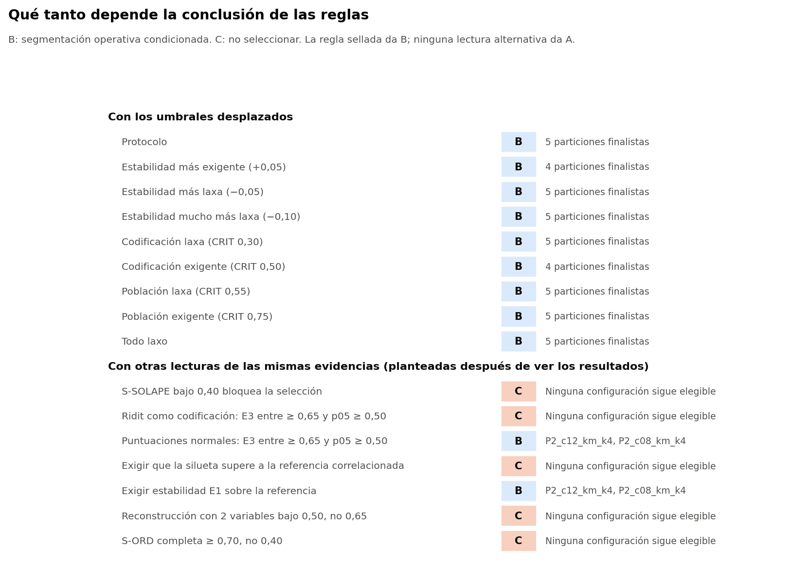

# Decisión

**Conclusión B: segmentación operativa condicionada.** Configuración propuesta: **`P2_c12_km_k4`** (PCA, sin IMC, 12 componentes, K-means, k = 4). Alternativa elegible: `P2_c08_km_k4`.

Lo que aquí se propone es provisional. La decisión final queda en manos de la responsable del proyecto.

Todo el análisis usa el conjunto sintético de usuarias (N = 529). Sus asociaciones vienen de una simulación, por lo que los resultados no permiten afirmar nada sobre mujeres reales.

# Explicación en lenguaje sencillo

**¿Qué se quería saber?** Si las 529 participantes del conjunto sintético se dividen en grupos que existan de verdad en los datos, o si solo se puede repartirlas de forma práctica.

**¿Qué se encontró?** No hay evidencia suficiente de grupos naturales. Los resultados son compatibles con un continuo: en separación, la división propuesta no se distingue de un conjunto sin grupos con las mismas correlaciones. Algunas medidas sí muestran diferencias con ese conjunto, pero no bastan para afirmar que existan grupos. Imagine dividir a las personas por estatura en «bajas», «medianas» y «altas»: la división puede servir, pero nadie cree que existan tres tipos de personas.

**¿Qué se propone?** Una división práctica en 4 segmentos, `P2_c12_km_k4`, como herramienta de trabajo provisional. No es un diagnóstico, ni una clasificación clínica, ni un modelo validado.

**¿Por qué esa y no otras?**

- Las divisiones en 2 grupos son las más estables, pero casi solo separan según cuántos días hace ejercicio la participante. Para eso basta con preguntarlo.
- Las divisiones en 3 grupos son básicamente un gradiente de ejercicio.
- Las que parecían mejores en la fase anterior, con 3 componentes, caen al repetir todo el procedimiento.
- Esta división de 4 segmentos es la que mejor resiste entre las que combinan varios temas: ejercicio, pareja, trabajo y alimentación.

**¿Qué tan firme es?** No mucho. Es lo que las reglas fijadas de antemano permiten, no una conclusión sólida:

- Si se quitan dos preguntas (`tiene_actividad_sexual` y `distension_abdominal`), la división cambia bastante.
- Cerca de la mitad de las participantes queda cerca de la frontera entre dos segmentos.
- Tres preguntas directas (trabajo, pareja y días de ejercicio) reproducen buena parte de la división.
- Se probaron 7 criterios alternativos, planteados después de ver los resultados y no como reglas de decisión. Con 5 de ellos, la conclusión habría sido no seleccionar nada.

**¿Qué falta?** Datos reales e independientes. Todo esto se hizo con datos simulados y nada de esto describe a mujeres reales.

# Justificación técnica

- **No A:** tiene un CRIT en S-SOLAPE, no supera el control de búsqueda múltiple y su silueta es igual a la de la nula (p = 0,238).
- **Sí B:** cumple los cuatro requisitos sellados. Es finalista sin CRIT en las etapas 1 a 3, codificación ni población; es de clase multivariable; tiene un mecanismo de incertidumbre evaluado (margen); y la regla V queda declarada. B no exige superar a la nula: admite un continuo.
- **Por qué no las demás finalistas:** `F1_c02_km_k2`, `P2_c03_km_k3` y `P2_c05_km_k3` son gradientes de ejercicio. El protocolo dice que no se eligen como modelo, y se informan como alternativa simple.

# Parámetros

| Parámetro | Valor |
|---|---|
| Reducción | PCA |
| Escenario de IMC | Sin IMC |
| Componentes | 12 |
| Algoritmo | K-means, n_init 50, semilla 42 |
| k | 4 |
| Tamaños | 150 / 76 / 132 / 171 |
| E3 entre, media y p05 | 0,77 y 0,68 |
| E3 fuera, media y p05 | 0,83 y 0,73 |
| Silueta y nula | 0,080 y 0,078 |
| E1 y máximo nulo | 0,73 y 0,65 |
| S-ORD / S-SOLAPE | 0,69 / 0,36 |
| Desacuerdo fuera de muestra | 6,4 % |
| Margen mediano | 0,15 |

Artefactos: `seleccion/artefactos_provisionales/P2_c12_km_k4/`, que cita por huella los transformadores de la Fase 36 y el modelo de la Fase 37A, sin copiarlos. Registro: `seleccion/decision_final_37C.json`.

# Advertencias de la propuesta

| Etapa | Criterio | Estado |
|---|---|---|
| 3. Estabilidad | E3 ari_entre media | ADV |
| 4. Variables | S-SOLAPE | CRIT |
| 5. Nula correlacionada | Silueta supera a todas | ADV |
| 5. Nula correlacionada | Supera control de búsqueda múltiple | ADV |
| 9. Complejidad | Componentes | ADV |

# Condiciones de uso

1. Presentarla como cortes de un continuo, nunca como tipos naturales ni clínicos.
2. Declarar que depende de `tiene_actividad_sexual` y `distension_abdominal` (regla V). Esto importa especialmente en la Fase 37D, porque esas variables se relacionan con síntomas: compararlos con los grupos tendría riesgo de circularidad.
3. Acompañar cada asignación con su margen y señalar a las cercanas a una frontera.
4. Compararla con la regla simple de tres preguntas antes de usar los grupos.
5. Declarar que depende de la codificación ordinal consecutiva.

# Qué tanto depende de las reglas

La conclusión es estable al mover los umbrales: da B en los 9 escenarios. Pero **es sensible a la forma de leer la evidencia**, que es lo que más hay que tener presente:

| Otra lectura | Conclusión | Siguen elegibles |
|---|---|---|
| S-SOLAPE bajo 0,40 bloquea la selección | C | Ninguna |
| Ridit como codificación: E3 entre ≥ 0,65 y p05 ≥ 0,50 | C | Ninguna |
| Puntuaciones normales: E3 entre ≥ 0,65 y p05 ≥ 0,50 | B | P2_c12_km_k4, P2_c08_km_k4 |
| Exigir que la silueta supere a la referencia correlacionada | C | Ninguna |
| Exigir estabilidad E1 sobre la referencia | B | P2_c12_km_k4, P2_c08_km_k4 |
| Reconstrucción con 2 variables bajo 0,50, no 0,65 | C | Ninguna |
| S-ORD completa ≥ 0,70, no 0,40 | C | Ninguna |

Estas lecturas no sustituyen a las reglas selladas y no se aplicaron para decidir. **Se plantearon en esta fase, después de ver los resultados, y el conteo no es una probabilidad:** otra lista daría otro conteo. Se muestran porque **en 5 de 7 la conclusión pasaría a C**, lo que indica que B descansa en decisiones concretas del protocolo, en especial la regla V. Por eso, no seleccionar nada también es defendible, y es una opción que la responsable debería considerar. Ninguna lectura lleva a A.

# Limitaciones

- Datos sintéticos, sin conjunto independiente: ninguna selección queda validada.
- El protocolo se selló conociendo los resultados de la Fase 37B: nada es confirmatorio en sentido estricto.
- Enmienda 1 con margen estrecho y elección posterior al fallo. Con 20 réplicas, p mínimo 0,048. Potencia frente a grupos débiles sin evaluar.
- E3 no recalibra la limpieza, la selección de variables, las categorías raras, los códigos ordinales, ni c y k.
- `ari_fuera` es algo optimista. `ari_fuera_pares` es limpia, pero ruidosa.
- 14 configuraciones que pasan el cribado no se evaluaron por completo, según el protocolo.
- Sigue abierta la imputación de `tiene_actividad_sexual` (S-IMPMODA).
- Sensibilidad a la ponderación por bloques (S-BLOQUE 0,14), al algoritmo (Ward 0,33) y al método de reducción (FAMD 0,40).
- Falta una regla de asignación con umbrales definitivos.
