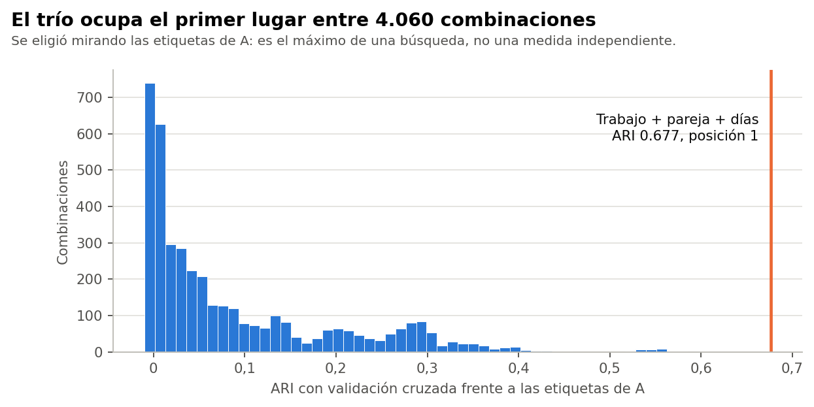

# Conclusión

**Sí se reprodujo:** ARI 0,6768, idéntico al guardado en la Fase 37C (diferencia 0,0000), con el mismo trío en primer lugar. Pero ese valor es el máximo de una búsqueda hecha con las propias etiquetas del Modelo A. No indica equivalencia, y un ARI de 0,68 **no significa 68 % de aciertos**.

Todo el análisis usa el conjunto sintético de usuarias (N = 529). Sus asociaciones vienen de una simulación, por lo que los resultados no permiten afirmar nada sobre mujeres reales.

Comprobación exploratoria y posterior al cierre técnico de la Fase 37C. No cambia la conclusión B, no elige un modelo definitivo y no inicia la Fase 37D. La decisión queda en manos de la responsable del proyecto.

# Cómo se construyó

La Fase 37C, en `revision_decision_37c.py`, probó las 4.060 combinaciones de tres entre las 30 variables generales. Para cada una formó celdas con las respuestas, asignó a cada celda el segmento de A más frecuente con cuatro pliegues y predijo el quinto. Las variables cuantitativas se partieron en cuartiles. `dias_ejercicio_semana` es ordinal y conserva sus cinco códigos: no hubo cuartiles ni puntos de corte en el trío evaluado.

# Posición del trío

| Posición | Combinación | ARI con validación cruzada |
|---|---|---|
| 1 | trabaja_actualmente + tiene_pareja + dias_ejercicio_semana | 0,677 |
| 2 | trabaja_actualmente + tiene_pareja + frecuencia_aerobico | 0,607 |
| 3 | trabaja_actualmente + tiene_pareja + frecuencia_fuerza | 0,584 |
| 4 | trabaja_actualmente + tiene_pareja + frecuencia_bajo_impacto | 0,572 |
| 5 | trabaja_actualmente + tiene_pareja + pescado_semana | 0,552 |

La mediana de las 4.060 combinaciones es 0,04 y el percentil 95 es 0,30. La mejor combinación sin trabajo llega a 0,46, sin pareja a 0,39 y sin ejercicio a 0,61. Las tres preguntas aportan algo, y pareja y trabajo pesan más que ejercicio.

# Fuentes de optimismo

- **Selección:** el trío se eligió mirando las etiquetas con todos los datos. Para medirlo, se repitió la búsqueda dentro de cada entrenamiento: salió el mismo trío en 30 de 30 repeticiones. Este optimismo es casi nulo aquí; el trío es muy estable.
- **Etiquetas:** las etiquetas de A se ajustaron también con las participantes de cada pliegue de evaluación. Fuera de muestra, con A reajustado solo en el entrenamiento, el ARI medio baja a 0,62.

# En lenguaje sencillo

El resultado anterior era cierto, pero describe lo bien que tres preguntas imitan a un modelo en los mismos datos que ayudaron a elegirlas. Fuera de muestra sigue siendo bueno, aunque algo menor.
