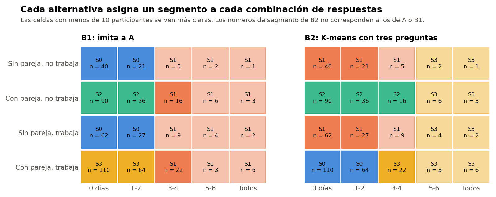

# Conclusión

B1 y B2 **no son intercambiables**. B1 aproxima al Modelo A. B2 agrupa las tres preguntas sin mirar sus etiquetas. Ambas usan solo `trabaja_actualmente`, `tiene_pareja` y `dias_ejercicio_semana`.

Todo el análisis usa el conjunto sintético de usuarias (N = 529). Sus asociaciones vienen de una simulación, por lo que los resultados no permiten afirmar nada sobre mujeres reales.

Comprobación exploratoria y posterior al cierre técnico de la Fase 37C. No cambia la conclusión B, no elige un modelo definitivo y no inicia la Fase 37D. La decisión queda en manos de la responsable del proyecto.

# B1: reproducción del modelo complejo

Cada una de las 20 celdas posibles recibe el segmento de A más frecuente entre las participantes de entrenamiento. Empates: el segmento más grande y luego el de menor número. Celda vacía: el segmento más grande. **Usa las etiquetas de A como objetivo: es una aproximación, no una validación independiente.**

Con las 529, la tabla se puede leer como una regla de cuatro pasos. La forma no se fijó de antemano: se comprobó contra la tabla, celda por celda.

| Paso | Condición | Segmento | Participantes |
|---|---|---|---|
| 1 | Hace ejercicio 3 días o más a la semana | S1 | 79 |
| 2 | Si no, no tiene pareja | S0 | 150 |
| 3 | Si no, tiene pareja y no trabaja | S2 | 126 |
| 4 | Si no, tiene pareja y trabaja | S3 | 174 |

El corte de 3 días no se impuso: salió de las etiquetas de A. Son cortes operativos sobre las respuestas, no tipos de personas. En 17 de las 30 repeticiones la tabla es idéntica; en las demás cambian 1 o 2 celdas, siempre con pocas participantes.

# B2: agrupación con las tres preguntas

K-means con k = 4 sobre las tres columnas en puntuación z de la matriz P2, con los parámetros de la Fase 37B. Como las respuestas son discretas, equivale a una tabla de 20 celdas: se comprobó que nunca separa a quienes responden igual. B2 no usa las etiquetas de A, pero tampoco es del todo independiente: el trío se eligió antes porque era el que mejor reproducía a A.

Su tamaño queda en 174, 164, 142, 49. Separa pareja y trabajo, y su grupo de ejercicio alto empieza en 5-6 días (en algunas celdas, 3-4), así que es más pequeño que S1.

# ¿Cuántos segmentos?

| k | Silueta (tres columnas) | Tamaños | ARI con A |
|---|---|---|---|
| 2 | 0,42 | 356, 173 | 0,31 |
| 3 | 0,53 | 151, 173, 205 | 0,55 |
| 4 | 0,58 | 174, 164, 142, 49 | 0,64 |
| 5 | 0,68 | 65, 174, 66, 98, 126 | 0,59 |
| 6 | 0,74 | 43, 110, 98, 126, 86, 66 | 0,48 |
| 7 | 0,78 | 52, 86, 98, 66, 90, 27, 110 | 0,41 |
| 8 | 0,81 | 90, 110, 40, 23, 66, 86, 62, 52 | 0,38 |

La silueta sube sin parar con k porque los grupos se acercan a las celdas: no marca una cantidad natural de grupos, y **no se puede comparar con la silueta de A (0,08)**, porque mide datos discretos en otro espacio. k = 4 se usa como comparación principal, no porque los datos lo indiquen. B1 produce 4 segmentos en todas las repeticiones sin forzarlo.

# B2-C: cruce simple (secundario)

Pareja × trabajo × ejercicio bajo o alto, con el corte de ejercicio obtenido solo en el entrenamiento (2,41 en código, es decir, entre 1-2 y 3-4 días). Da 8 segmentos, de 8 a 174 participantes. El más pequeño baja a 4 en algunos entrenamientos: **una regla simple no da grupos utilizables con 8 segmentos**, así que queda como referencia.

Definición exacta y centros: `definiciones/definicion_B1_B2.json` y `definiciones/tabla_de_celdas.csv`.
