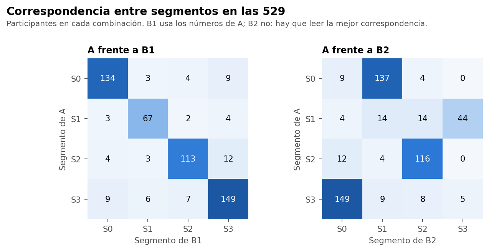

# Conclusión

En las 529, B1 reproduce buena parte de A (ARI 0,68 con validación cruzada; 87 % de coincidencia tras alinear) y sus tamaños casi coinciden (A: 150, 76, 132 y 171; B1: 150, 79, 126, 174). B2 se parece algo menos y su grupo de ejercicio queda más pequeño. **Un ARI y una coincidencia no miden lo mismo**, y estas cifras usan las mismas participantes con las que se definió A.

Todo el análisis usa el conjunto sintético de usuarias (N = 529). Sus asociaciones vienen de una simulación, por lo que los resultados no permiten afirmar nada sobre mujeres reales.

Comprobación exploratoria y posterior al cierre técnico de la Fase 37C. No cambia la conclusión B, no elige un modelo definitivo y no inicia la Fase 37D. La decisión queda en manos de la responsable del proyecto.

# Asignaciones

| Alternativa | Rótulo | Segmentos | Tamaños | ARI con A | Coincidencia alineada | Discrepan |
|---|---|---|---|---|---|---|
| B1 | Doble uso | 4 | 150, 79, 126, 174 | 0,69 | 87,5 % | 66 |
| B1 (CV) | Validación cruzada | 4 | 150, 76, 126, 177 | 0,68 | 87,0 % | 69 |
| B2 | Sin etiquetas de A | 4 | 174, 164, 142, 49 | 0,64 | 84,3 % | 83 |
| B2-C | Sin etiquetas de A | 8 | 61, 8, 126, 25, 89, 15, 174, 31 | 0,58 | 69,4 % | 162 |

## A frente a B1

| Segmento de A | S0 | S1 | S2 | S3 | Total |
|---|---|---|---|---|---|
| S0 | 134 | 3 | 4 | 9 | 150 |
| S1 | 3 | 67 | 2 | 4 | 76 |
| S2 | 4 | 3 | 113 | 12 | 132 |
| S3 | 9 | 6 | 7 | 149 | 171 |

## A frente a B2

| Segmento de A | S0 | S1 | S2 | S3 | Total |
|---|---|---|---|---|---|
| S0 | 9 | 137 | 4 | 0 | 150 |
| S1 | 4 | 14 | 14 | 44 | 76 |
| S2 | 12 | 4 | 116 | 0 | 132 |
| S3 | 149 | 9 | 8 | 5 | 171 |

En B2, la mejor correspondencia solo se ve tras alinear. Por grupo de A, la coincidencia va de 58 % (S1, el grupo de ejercicio) a 91 % (S0). En B1 va de 84 % a 89 %.

# ¿Dónde están los desacuerdos?

Se concentran cerca de las fronteras de A: esas participantes ya tenían una asignación poco firme.

| Alternativa | Margen de A < 0,10 | 0,10 a 0,20 | ≥ 0,20 | AUC del margen |
|---|---|---|---|---|
| B1 (CV) | 29 % | 8 % | 4 % | 0,78 |
| B2 | 29 % | 10 % | 10 % | 0,69 |
| B2-C | 43 % | 26 % | 24 % | 0,61 |

Quienes discrepan de B1 tienen un margen mediano de 0,06, frente a 0,16 en quienes coinciden. Quién discrepa, participante por participante: `asignaciones/etiquetas_alternativas.csv`.
