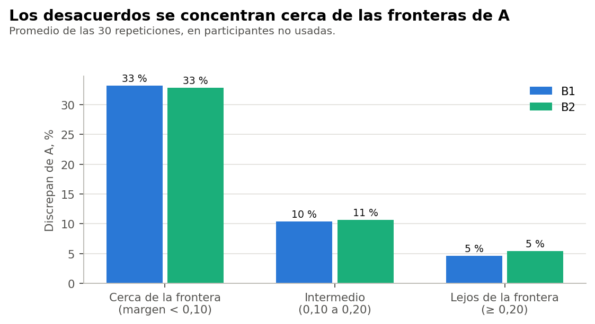

# Conclusión

Fuera de muestra, B1 y B2 coinciden con el Modelo A de su misma repetición en un 84 % tras alinear, con ARI medio de 0,62 y percentil 5 de 0,49. La concordancia es sustancial, no una equivalencia. Tampoco es exactitud clínica: solo compara dos particiones.

Todo el análisis usa el conjunto sintético de usuarias (N = 529). Sus asociaciones vienen de una simulación, por lo que los resultados no permiten afirmar nada sobre mujeres reales.

Comprobación exploratoria y posterior al cierre técnico de la Fase 37C. No cambia la conclusión B, no elige un modelo definitivo y no inicia la Fase 37D. La decisión queda en manos de la responsable del proyecto.

# Procedimiento

Las mismas 30 submuestras de 423 de las Fases 37B y 37C, con 106 de evaluación. En cada una, imputación, escalado, PCA, K-means, tabla de B1 y centroides de B2 salen solo del entrenamiento y se congelan. A reproduce exactamente los lotes E3 de la Fase 37C en las 30 repeticiones.

# Concordancia en las participantes no usadas

| Alternativa | ARI con A_r: media | Mediana | P05 | Mínimo a máximo | Coincidencia | ARI con A oficial |
|---|---|---|---|---|---|---|
| B1 | 0,62 | 0,62 | 0,49 | 0,48 a 0,77 | 84 % | 0,67 |
| B1 con búsqueda anidada | 0,62 | 0,62 | 0,49 | 0,48 a 0,77 | 84 % | 0,67 |
| B2 | 0,61 | 0,62 | 0,49 | 0,49 a 0,79 | 84 % | 0,67 |
| B2-C | 0,52 | 0,53 | 0,40 | 0,28 a 0,68 | 66 % | 0,57 |

A_r es el Modelo A ajustado en esa repetición: es la comparación limpia. Las etiquetas oficiales incluyen a esas participantes en su ajuste.

**Techo de referencia.** El propio A, reajustado, llega a un ARI de 0,83 frente a sus etiquetas oficiales y de 0,76 entre repeticiones. Sirve de referencia: ni el propio A coincide plenamente consigo mismo.

# Búsqueda anidada

Al repetir la búsqueda entre las 4.060 combinaciones dentro de cada entrenamiento, salió el mismo trío en 30 de 30 repeticiones. Por eso B1 anidada es idéntica a B1. **El trío no parece ser producto del azar de la selección dentro de este conjunto**, aunque esto no lo valida fuera de él.

# Tres aspectos distintos

- **Qué tan bien imita a A:** ARI 0,62 en la misma repetición.
- **Qué tan estable es la regla:** 1,00 entre repeticiones. Ver informe 06.
- **Qué tan estable es A:** 0,77. Imitar con exactitud una partición frágil no sería una mejora.

# Tamaños y equilibrio en el entrenamiento

| Alternativa | Segmentos | Grupo menor: peor caso | Grupo menor: mediana | Equilibrio medio |
|---|---|---|---|---|
| A | 4 a 4 | 49 | 62,5 | 0,97 |
| B1 | 4 a 4 | 58 | 63,0 | 0,97 |
| B2 | 4 a 4 | 47 | 53,5 | 0,96 |
| B2C | 8 a 8 | 4 | 7,0 | 0,84 |

# Desacuerdos frente a la frontera

Con margen bajo 0,10, B1 discrepa de A en el 33 %; con 0,20 o más, en el 5 %. El AUC es 0,76.

# En lenguaje sencillo

Con participantes que no intervinieron en el ajuste, tres preguntas ponen a más de 8 de cada 10 en el mismo grupo que el modelo complejo. Discrepan sobre todo con quienes el modelo ya ubicaba con poca seguridad.
