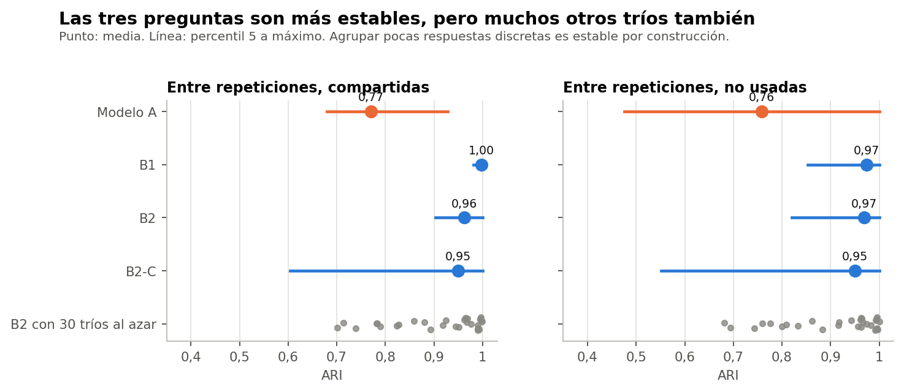

# Conclusión

**La más estable es B1** (0,998 entre repeticiones), seguida de B2 (0,963) y B2-C (0,949), todas por encima de A (0,771). Pero **esa ventaja es en gran parte estructural**: quienes responden igual siempre caen juntas. No es evidencia de grupos reales.

Todo el análisis usa el conjunto sintético de usuarias (N = 529). Sus asociaciones vienen de una simulación, por lo que los resultados no permiten afirmar nada sobre mujeres reales.

Comprobación exploratoria y posterior al cierre técnico de la Fase 37C. No cambia la conclusión B, no elige un modelo definitivo y no inicia la Fase 37D. La decisión queda en manos de la responsable del proyecto.

# Resultados

Las medidas de la Fase 37C. `entre`: pares de repeticiones con participantes compartidas. `fuera_pares`: solo participantes que ningún par usó. `completo` y `fuera`: frente a la partición de las 529.

| Alternativa | Entre: media | P05 | Mínimo | Fuera pares: media | P05 | Completo | Fuera |
|---|---|---|---|---|---|---|---|
| Modelo A | 0,77 | 0,68 | 0,62 | 0,76 | 0,48 | 0,83 | 0,83 |
| B1 | 1,00 | 0,98 | 0,96 | 0,97 | 0,85 | 1,00 | 0,98 |
| B2 | 0,96 | 0,90 | 0,87 | 0,97 | 0,82 | 0,93 | 0,94 |
| B2-C | 0,95 | 0,60 | 0,58 | 0,95 | 0,55 | 0,97 | 0,97 |

# ¿Es mérito de estas preguntas?

B2 repetido con 30 tríos al azar da una estabilidad media de 0,91, con mediana 0,96 y un rango de 0,70 a 1,00. B2 con el trío evaluado (0,96) supera al 53 % de ellos. Es decir, **agrupar tres respuestas discretas suele ser estable, sean cuales sean**. La estabilidad no distingue a este trío; lo que lo distingue es que reproduce a A.

# ¿Y si cambia el objetivo o la codificación?

La regla congelada de B1 no cambia con la codificación de días, porque usa los códigos directamente. Pero si se reconstruye imitando a A con otra codificación, cambia (informe 08). B2 es sensible a cómo se codifica y pondera el ejercicio: ARI de 0,69 con ridit y 0,33 con el doble de peso.

# En lenguaje sencillo

Una regla de tres preguntas casi no cambia al variar la muestra, porque deja poco margen para cambiar. Eso es útil en la práctica, pero no demuestra que los grupos existan.
