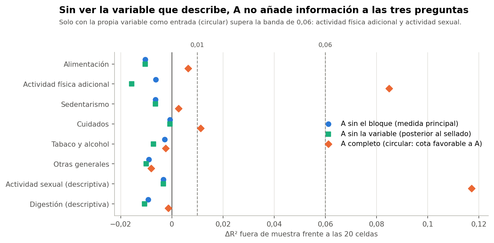
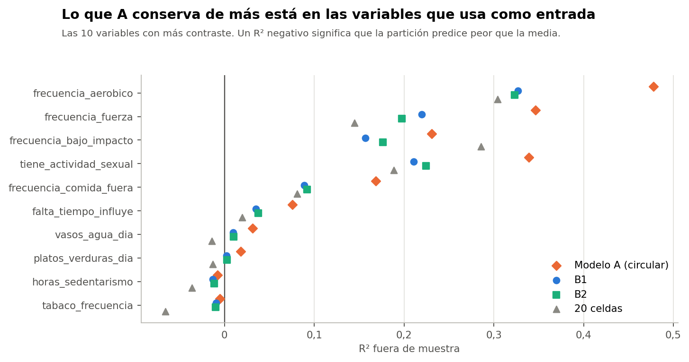

# Conclusión

**Con la medida principal, A no añade información a las tres preguntas en ningún bloque:** ΔR² entre -0,010 y -0,001, en la banda despreciable. A solo conserva más en las variables que usa como entrada: ejercicio aeróbico y de fuerza, actividad sexual y comida fuera. Eso es circular: para ubicar a alguien, el modelo ya necesita esas respuestas, así que se pueden consultar directamente.

Todo el análisis usa el conjunto sintético de usuarias (N = 529). Sus asociaciones vienen de una simulación, por lo que los resultados no permiten afirmar nada sobre mujeres reales.

Comprobación exploratoria y posterior al cierre técnico de la Fase 37C. No cambia la conclusión B, no elige un modelo definitivo y no inicia la Fase 37D. La decisión queda en manos de la responsable del proyecto.

# Por qué no basta comparar diferencias entre grupos

A usa casi todas estas variables, de modo que diferenciará sus propios grupos en ellas. Eso no demuestra validez externa. Por eso la medida principal, **A−X**, quita el bloque, rehace PCA y K-means, y mide qué tanto describe a ese bloque que ya no vio, igual que le ocurre a B. Se usa R² fuera de muestra: cuánto mejora la predicción frente a la media, en participantes no usadas. Solo cuentan respuestas observadas, sin imputadas. Un valor algo negativo equivale en la práctica a cero: la partición predice peor que la media por el ruido de sus parámetros.

# Resultados por bloque

R² fuera de muestra. ΔR² compara celdas + A−X frente a solo celdas. Bandas descriptivas: < 0,01 despreciable; 0,01 a 0,06 pequeña; ≥ 0,06 moderada. El percentil 5 no es un intervalo de confianza. Los dos últimos bloques son solo descriptivos y no son criterio.

| Bloque | Var. | A (circular) | A−X | B1 | B2 | Celdas | ΔR² A−X | P05 | ΔR² A (circular) |
|---|---|---|---|---|---|---|---|---|---|
| Alimentación | 13 | 0,017 | -0,008 | 0,005 | 0,005 | -0,034 | -0,010 | -0,021 | 0,006 |
| Actividad física adicional | 3 | 0,352 | -0,011 | 0,235 | 0,232 | 0,245 | -0,006 | -0,026 | 0,085 |
| Sedentarismo | 1 | -0,008 | -0,010 | -0,013 | -0,011 | -0,036 | -0,006 | -0,042 | 0,003 |
| Cuidados | 1 | -0,011 | -0,012 | -0,014 | -0,014 | -0,068 | -0,001 | -0,034 | 0,011 |
| Tabaco y alcohol | 2 | -0,008 | -0,008 | -0,012 | -0,012 | -0,080 | -0,003 | -0,017 | -0,002 |
| Otras generales | 3 | -0,015 | -0,013 | -0,010 | -0,011 | -0,043 | -0,009 | -0,035 | -0,008 |
| Actividad sexual (descriptiva) | 1 | 0,339 | -0,007 | 0,211 | 0,224 | 0,189 | -0,003 | -0,034 | 0,117 |
| Digestión (descriptiva) | 2 | 0,001 | -0,006 | -0,004 | -0,007 | -0,052 | -0,009 | -0,032 | -0,001 |

# Variables con más contraste

Magnitudes en las 529 (η² o V²; diferencia máxima en desviaciones estándar) y R² fuera de muestra. A−v es la comprobación posterior al sellado.

| Variable | A | B1 | B2 | Celdas | Dif. A | Dif. B1 | R² A | R² B1 | ΔR² A−v |
|---|---|---|---|---|---|---|---|---|---|
| frecuencia_aerobico | 0,53 | 0,41 | 0,32 | 0,47 | 2,07 | 1,82 | 0,478 | 0,327 | -0,015 |
| frecuencia_fuerza | 0,38 | 0,29 | 0,14 | 0,36 | 1,75 | 1,53 | 0,347 | 0,220 | -0,016 |
| frecuencia_bajo_impacto | 0,27 | 0,21 | 0,20 | 0,46 | 1,52 | 1,30 | 0,231 | 0,157 | -0,016 |
| tiene_actividad_sexual | 0,33 | 0,23 | 0,26 | 0,28 | 1,38 | 1,11 | 0,339 | 0,211 | -0,003 |
| frecuencia_comida_fuera | 0,19 | 0,10 | 0,10 | 0,16 | 1,12 | 0,86 | 0,168 | 0,089 | -0,003 |
| falta_tiempo_influye | 0,11 | 0,05 | 0,06 | 0,11 | 0,88 | 0,60 | 0,076 | 0,035 | -0,014 |
| vasos_agua_dia | 0,04 | 0,03 | 0,02 | 0,09 | 0,55 | 0,49 | 0,031 | 0,009 | -0,009 |
| platos_verduras_dia | 0,03 | 0,02 | 0,00 | 0,06 | 0,45 | 0,35 | 0,018 | 0,002 | -0,009 |
| frutas_dia | 0,03 | 0,00 | 0,00 | 0,02 | 0,39 | 0,17 | 0,007 | -0,007 | 0,007 |

# Qué aporta cada bloque

- **Alimentación:** A casi no describe la dieta. R² medio de 0,017, circular. La diferencia se concentra en `frecuencia_comida_fuera` y `falta_tiempo_influye`, que se relacionan con trabajar (ρ de 0,35 y 0,26). Frutas, verduras, carnes, lácteos y demás quedan en valores cercanos a 0 para todas las alternativas.
- **Actividad física adicional:** es lo que más conserva A: 0,352 frente a 0,235 en B1. Es una diferencia moderada, pero circular. B1 y B2 conservan una parte reconocible porque días y frecuencias se correlacionan (ρ hasta 0,68).
- **Sedentarismo, cuidados, tabaco y alcohol, y otras generales:** ninguna partición los describe. R² cercano a 0 o negativo en todas.
- **Actividad sexual (solo descriptiva):** A 0,339 frente a B1 0,211. Se relaciona con tener pareja (ρ 0,53).

# ¿Siguen dominados por trabajo, pareja y ejercicio?

Sí. De la separación entre grupos de A, el 46 % viene de las tres preguntas y otro 32 % de las frecuencias de ejercicio. Con actividad sexual (8 %) suman 86 %. Sin las tres preguntas, A deja de parecerse a sí mismo (ARI 0,15).

# Una objeción y su comprobación

En los bloques grandes, A−X se parece poco a A: ARI de 0,34 sin alimentación, 0,52 sin actividad física y 0,36 sin actividad sexual. Podría ser injusto con A. En los bloques pequeños no hay ese problema (ARI de 0,90 a 0,95).

**Comprobación posterior al sellado, rotulada como tal:** quitar solo la variable evaluada (A−v). El ARI medio con A sube a 0,85 en alimentación y a 0,83 en actividad física, pero el aporte sigue siendo nulo: ΔR² de -0,010 y -0,016. En actividad sexual, A−v sigue lejos de A (ARI 0,37). Esta comprobación refuerza la lectura, pero no estaba en el protocolo.

**Control de que la medida puede detectar:** quitadas las tres preguntas, A−X aún predice `dias_ejercicio_semana` con R² de 0,39, por sus correlaciones con las frecuencias. Y al inyectar información en una prueba, ΔR² la detecta. Por tanto, el cero observado no es una incapacidad de la medida.

# Lo que esta medida no puede ver

- Mide cada variable por separado. Una ventaja de A en combinaciones conjuntas no se vería aquí. En la varianza multivariable, A conserva un 7,5 % de lo que no es el trío, frente a 5,2 % de B1, pero eso es circular y en las mismas participantes.
- No evalúa ninguna variable externa. Por encargo, no se usa el MRS ni otros síntomas para elegir. Si A o B se relacionan de forma distinta con resultados externos, esta comprobación no lo sabe.

# En lenguaje sencillo

Para saber si el modelo complejo «sabe» algo más que las tres preguntas, se le ocultó cada tema y se vio si podía describirlo. No pudo: lo que parecía información adicional era en su mayoría lo mismo que se le había entregado.
