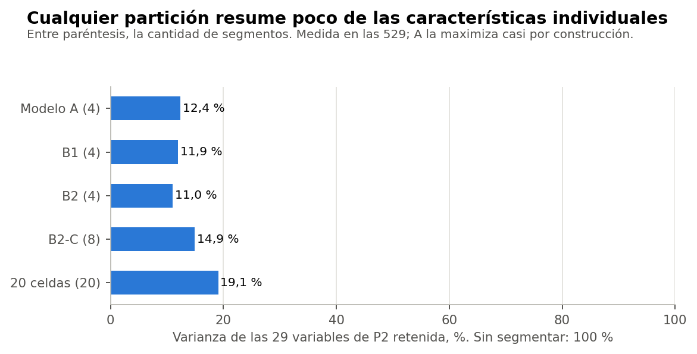

# Conclusión

**Continuar sin segmentación es razonable.** Cualquier partición deja fuera cerca de 88 % de la varianza de las variables, y los bloques temáticos se relacionan muy poco entre sí: no hay un perfil conjunto amplio que resumir. Lo que se perdería es practicidad, no información demostrada.

Todo el análisis usa el conjunto sintético de usuarias (N = 529). Sus asociaciones vienen de una simulación, por lo que los resultados no permiten afirmar nada sobre mujeres reales.

Comprobación exploratoria y posterior al cierre técnico de la Fase 37C. No cambia la conclusión B, no elige un modelo definitivo y no inicia la Fase 37D. La decisión queda en manos de la responsable del proyecto.

# Lo que retiene cada partición

| Partición | Segmentos | Varianza retenida (29 variables) | Sin las tres preguntas | Queda fuera |
|---|---|---|---|---|
| Modelo A | 4 | 12,4 % | 7,5 % | 87,6 % |
| B1 | 4 | 11,9 % | 5,2 % | 88,1 % |
| B2 | 4 | 11,0 % | 4,2 % | 89,0 % |
| B2-C | 8 | 14,9 % | 6,3 % | 85,1 % |
| 20 celdas | 20 | 19,1 % | 9,7 % | 80,9 % |

Medida en las 529. A maximiza justamente esta cantidad, y aun así solo le saca 0,5 puntos a B1.

# Por qué hay poco que resumir

Entre bloques, la correlación absoluta media es de 0,01 a 0,09 (Spearman, solo pares observados). Las excepciones esperables son días de ejercicio con frecuencias (hasta 0,68) y pareja con actividad sexual (0,53). Esta independencia podría ser una propiedad del simulador, y no tiene por qué repetirse en datos reales.

# Qué se gana y qué se pierde

| Aspecto | Usar segmentos | Usar las variables directamente |
|---|---|---|
| Información individual | Se reduce a un grupo | Se conserva |
| Fronteras | Crean casos dudosos: 31 % con margen bajo 0,10 en A | No existen |
| Estabilidad | Depende de la partición | No aplica: no hay asignación |
| Imputaciones | Afectan a la asignación | Afectan solo a esa variable |
| Comunicación | Un resumen breve | Más detalle y más difícil de resumir |
| Comparaciones | Pocos grupos | Muchas variables: más comparaciones y más riesgo de hallazgos casuales |
| Plan del proyecto | Compatible con reglas desde grupos | Requeriría ajustar ese plan |

No se desarrolló ningún sistema de recomendaciones, y no se usó el MRS ni otros resultados clínicos.

# En lenguaje sencillo

Decir «esta participante está en el segmento 3» da menos información que decir «trabaja, tiene pareja y hace poco ejercicio». Los grupos solo se justifican si hace falta un resumen o si un paso posterior del proyecto los necesita.
