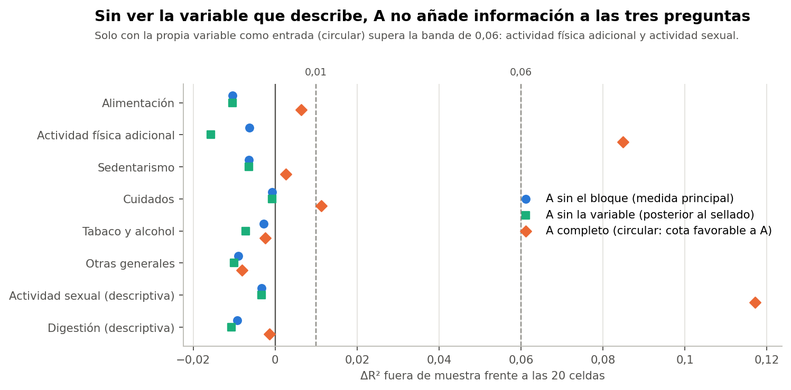

# Conclusión

**Recomendación no vinculante: opción B, estudiar la regla de tres preguntas como alternativa principal. La opción C, no segmentar, es igual de defendible si no hay un uso concreto de los grupos. Esta evidencia no respalda mantener los cuatro segmentos de `P2_c12_km_k4` como opción principal.**

La razón central: en estos datos, el modelo completo no añadió información comprobable a las tres preguntas en ningún bloque temático, y las tres preguntas lo reproducen en buena parte con mucho menos.

Comprobación exploratoria y posterior al cierre técnico de la Fase 37C. No cambia la conclusión B, no elige un modelo definitivo y no inicia la Fase 37D. La decisión queda en manos de la responsable del proyecto.

Todo el análisis usa el conjunto sintético de usuarias (N = 529). Sus asociaciones vienen de una simulación, por lo que los resultados no permiten afirmar nada sobre mujeres reales.

# Explicación en lenguaje sencillo

**¿Qué se quería saber?** Si el modelo de cuatro grupos, que usa 29 respuestas y varios pasos técnicos, dice algo que tres preguntas no digan: si trabaja, si tiene pareja y cuántos días hace ejercicio.

**¿Qué se encontró?**

- Tres preguntas ubican a más de 8 de cada 10 participantes en el mismo grupo que el modelo, incluso con personas que no intervinieron en el ajuste. Los desacuerdos están sobre todo donde el modelo ya dudaba.
- Al ocultarle un tema al modelo, no pudo describirlo mejor que las tres preguntas. Lo que parecía información adicional era en su mayoría lo mismo que había recibido como entrada.
- El sedentarismo, los cuidados, el consumo de tabaco y alcohol y la mayor parte de la alimentación casi no se diferencian entre grupos, sea cual sea la alternativa.
- Tres preguntas son muy estables, pero eso no las hace correctas: muchos otros grupos de tres preguntas también lo son.

**¿Qué significa?** Los cuatro grupos se pueden describir casi por completo así: hace ejercicio 3 días o más; si no, no tiene pareja; si no, tiene pareja y no trabaja; si no, tiene pareja y trabaja. Son cortes prácticos, no tipos de personas, ni una clasificación clínica.

**¿Qué no se puede afirmar?** Que las tres preguntas sean «mejores» o válidas, ni que esto valga para mujeres reales. Todo son datos simulados, y no se probó ningún resultado externo, por encargo.

# Evaluación con la guía sellada

| Opción | Condición | Resultado |
|---|---|---|
| A: mantener los cuatro segmentos | A−X añade ≥ 0,06 en un bloque, o ≥ 0,01 en tres, con P05 > 0 | **No se cumple.** ΔR² máximo -0,001; ningún bloque llega a 0,01 |
| B: estudiar las tres preguntas | Aporte de A despreciable o pequeño; B1 o B2 igual de estables; conservan una parte reconocible | **Se cumple.** Estabilidad 1,00 y 0,96 frente a 0,77; R² de 0,235 en actividad física |
| C: sin segmentación | Las particiones retienen muy poco de los otros bloques y las preguntas dicen lo mismo que los segmentos | **Se cumple en gran parte.** R² cercano a 0 en cinco de seis bloques; las celdas igualan a B1 en los que sí tienen señal (0,245 frente a 0,235) |

# Por qué B y no C, y qué cambiaría esta recomendación

- **B antes que C solo por compatibilidad:** el plan metodológico acordado llega a reglas desde grupos. Si esos pasos se mantienen, la regla de cuatro pasos es la forma más simple de tener grupos. En términos de información, B y C casi coinciden.
- **A podría recuperar terreno** si en datos reales o con un criterio externo muestra diferencias que las tres preguntas no capten, o si el plan exige PCA y K-means por razones ajenas a estos datos. En ese caso, conviene presentarlo con la regla de tres preguntas como comparación.
- **Las tres preguntas perderían terreno** si con datos reales el trío deja de ser el mejor, o si los grupos no sirven para el uso previsto.

# Respuestas a las preguntas del encargo

## 1. ¿Se reprodujo el resultado exploratorio de tres preguntas?

Sí, exactamente: ARI 0,6768, primero entre 4.060 combinaciones. Es el máximo de una búsqueda con las etiquetas de A.

## 2. ¿Cómo se construyeron exactamente B1 y B2?

B1: mayoría del segmento de A en cada una de las 20 celdas; se lee en cuatro pasos (3 días o más de ejercicio; si no, sin pareja; si no, con pareja sin trabajo; si no, con pareja y trabajo). B2: K-means con k = 4 sobre las tres columnas z, sin etiquetas de A. B2 no usa las etiquetas de A, pero tampoco es del todo independiente: el trío se eligió antes porque era el que mejor reproducía a A.

## 3. ¿Qué tan parecidas son sus asignaciones al Modelo A?

En las 529, con validación cruzada: B1 con ARI 0,68 y 87 % de coincidencia. B2 con ARI 0,64 y 84 %. Los desacuerdos se concentran cerca de las fronteras de A.

## 4. ¿Qué sucede fuera de muestra?

B1 alcanza ARI 0,62 con A de la misma repetición (P05 0,49) y 84 % de coincidencia; B2, 0,61 y 84 %. El mismo trío salió en las 30 búsquedas anidadas.

## 5. ¿Qué alternativa es más estable?

B1 (0,998), luego B2 (0,963), B2-C (0,949) y A (0,771). Es en gran parte estructural: tríos al azar dan una mediana de 0,96.

## 6. ¿Qué información adicional aporta la segmentación completa?

Sin ver la variable que describe, ninguna: ΔR² de -0,010 a -0,001. Con esa variable como entrada, conserva más de ejercicio aeróbico y fuerza, actividad sexual y comida fuera (R² aeróbico 0,48 frente a 0,33), pero eso es circular.

## 7. ¿Cuántos segmentos aparecen y qué tamaños tienen?

A: 150, 76, 132 y 171. B1: 4 (150, 79, 126, 174), sin forzar. B2: 4 (174, 164, 142, 49). B2-C: 8, el menor con 8. Las tres preguntas no indican una cantidad natural de grupos.

## 8. ¿Qué ventajas operativas tiene cada alternativa?

A: usa más variables y sigue el método PCA + K-means. B1: 3 respuestas, regla legible, sin transformador, sin PCA. B2: no imita a A, pero es menos clara y más sensible a la codificación. C: sin fronteras ni casos dudosos, con toda la información.

## 9. ¿Se justifica conservar 12 componentes y K-means?

No por información adicional. Con 8 y 16 componentes la partición casi no cambia (ARI 0,91 y 0,92), y K-means frente a Ward da 0,33. Solo se justifican si el proyecto decide mantener A por otra razón.

## 10. ¿La segmentación de cuatro grupos aporta algo sustancial frente a utilizar tres preguntas?

No se encontró evidencia de ello en estos datos. A retiene 12,4 % de la varianza frente a 11,9 % de B1. Esto no descarta un aporte en combinaciones de variables o en resultados externos, que no se evaluaron.

## 11. ¿Continuar sin segmentación es una alternativa razonable?

Sí. Toda partición deja fuera cerca de 88 % de la varianza y los bloques casi no se relacionan entre sí. Lo que se pierde es un resumen breve, y requeriría ajustar los pasos del plan que parten de grupos.

## 12. ¿Qué riesgos metodológicos permanecen?

Datos sintéticos, análisis no ciego, B2 no independiente de A, ningún criterio externo, una comprobación posterior al sellado, medida por variable, cortes operativos sobre un continuo e imputación en 15,5 % de participantes en las tres preguntas. Detalle en el informe 10.

## 13. ¿Qué pruebas se ejecutaron y cuáles pasaron?

23 de 23 pruebas superadas y 25 de 25 errores introducidos detectados. Detalle en el informe 13.

## 14. ¿Se mantuvieron intactos los archivos históricos?

3.348 archivos iguales a sus manifiestos, incluida toda la Fase 37C. HEAD sigue en 745d689, sin commit ni push, y sin cambios en Django. Detalle en el informe 14.

## 15. ¿Qué decisión recomienda el análisis, sin imponerla?

Opción B, con C igual de defendible si no hay un uso concreto de los grupos. Es decir: no mantener A como segmentación principal por ahora y estudiar la regla de cuatro pasos, informando también las variables directamente. No se recomienda A con esta evidencia.

# Estado

La comprobación queda completa: las verificaciones críticas se superaron. No se modificó la conclusión B de la Fase 37C, no se eligió un modelo definitivo y **la Fase 37D no se inició**.
