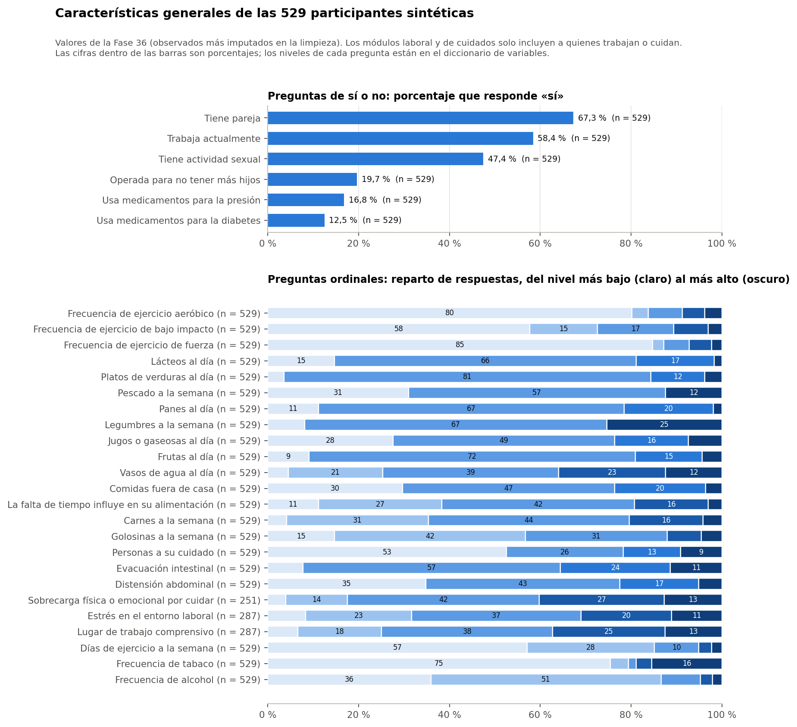
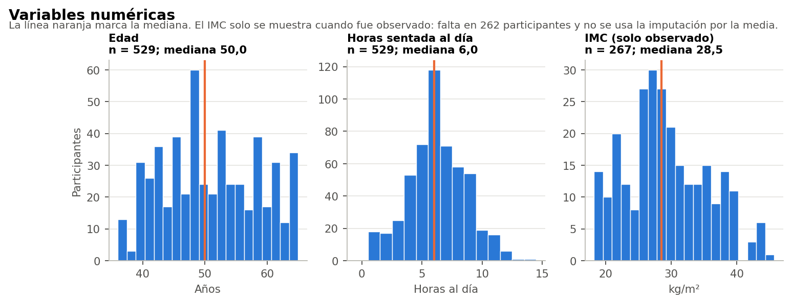
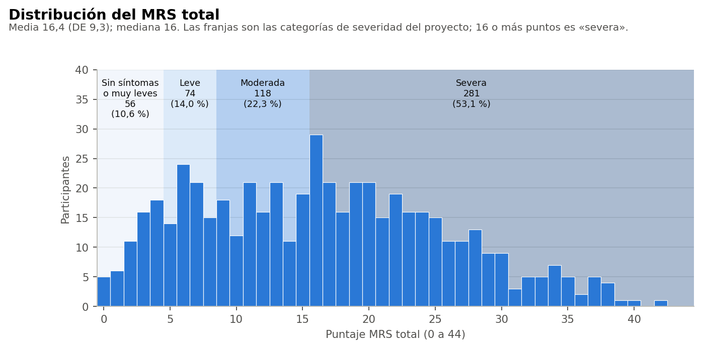
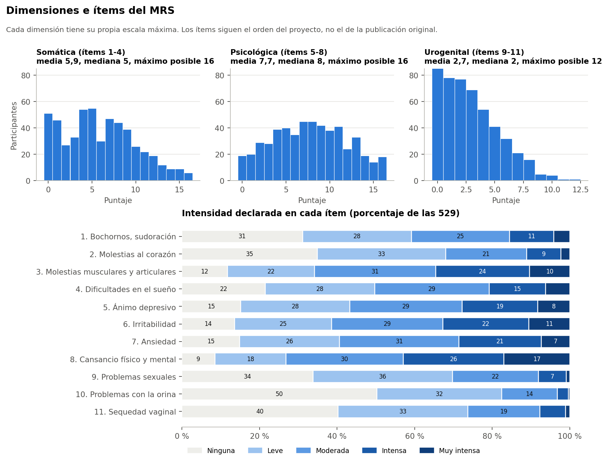

# Resumen

Todo el análisis usa el conjunto sintético de usuarias (N = 529). Sus asociaciones vienen de una simulación, por lo que los resultados no permiten afirmar nada sobre mujeres reales ni tienen valor clínico.

- **Imputaciones:** 385 participantes (72,8 %) tienen al menos una de las 29 variables de A imputada en la limpieza. Son 665 celdas de 15.341 (4,3 %), así que pocas celdas, pero repartidas entre muchas personas.
- **Tres preguntas:** 82 participantes tienen imputada alguna de trabajo, pareja o días de ejercicio.
- **Datos parciales:** el IMC está observado en 267 participantes (50,5 %). Las preguntas laborales aplican a quienes trabajan (287 con dato) y la sobrecarga a quienes cuidan (251).

# Características generales

## Preguntas de sí o no

| Variable | n | % «sí» |
|---|---|---|
| Tiene pareja | 529 | 67,3 |
| Trabaja actualmente | 529 | 58,4 |
| Tiene actividad sexual | 529 | 47,4 |
| Operada para no tener más hijos | 529 | 19,7 |
| Usa medicamentos para la presión | 529 | 16,8 |
| Usa medicamentos para la diabetes | 529 | 12,5 |

## Variables numéricas y ordinales

| Variable | n | Media (DE) | Mediana [RIC] | Mín.-máx. |
|---|---|---|---|---|
| Días de ejercicio a la semana | 529 | 1,65 (0,93) | 1,0 [1,0-2,0] | 1-5 |
| Frecuencia de ejercicio aeróbico | 529 | 0,49 (1,07) | 0,0 [0,0-0,0] | 0-4 |
| Frecuencia de ejercicio de bajo impacto | 529 | 0,83 (1,14) | 0,0 [0,0-2,0] | 0-4 |
| Frecuencia de ejercicio de fuerza | 529 | 0,38 (0,96) | 0,0 [0,0-0,0] | 0-4 |
| Horas sentada al día | 529 | 6,27 (2,39) | 6,0 [5,0-8,0] | 1-14 |
| Personas a su cuidado | 529 | 0,78 (0,98) | 0,0 [0,0-1,0] | 0-3 |
| Carnes a la semana | 529 | 2,85 (0,89) | 3,0 [2,0-3,0] | 1-5 |
| La falta de tiempo influye en su alimentación | 529 | 2,73 (0,96) | 3,0 [2,0-3,0] | 1-5 |
| Comidas fuera de casa | 529 | 1,98 (0,80) | 2,0 [1,0-2,0] | 1-4 |
| Frutas al día | 529 | 2,14 (0,63) | 2,0 [2,0-2,0] | 1-4 |
| Golosinas a la semana | 529 | 2,45 (0,98) | 2,0 [2,0-3,0] | 1-5 |
| Jugos o gaseosas al día | 529 | 2,03 (0,86) | 2,0 [1,0-2,0] | 1-4 |
| Lácteos al día | 529 | 2,06 (0,62) | 2,0 [2,0-2,0] | 1-4 |
| Legumbres a la semana | 529 | 2,17 (0,55) | 2,0 [2,0-3,0] | 1-3 |
| Panes al día | 529 | 2,12 (0,61) | 2,0 [2,0-2,0] | 1-4 |
| Pescado a la semana | 529 | 1,81 (0,63) | 2,0 [1,0-2,0] | 1-3 |
| Platos de verduras al día | 529 | 2,16 (0,53) | 2,0 [2,0-2,0] | 1-4 |
| Vasos de agua al día | 529 | 3,19 (1,04) | 3,0 [2,0-4,0] | 1-5 |
| Frecuencia de tabaco | 529 | 1,80 (1,51) | 1,0 [1,0-1,0] | 1-5 |
| Frecuencia de alcohol | 529 | 1,84 (0,85) | 2,0 [1,0-2,0] | 1-5 |
| Edad | 529 | 50,98 (7,71) | 50,0 [45,0-58,0] | 36-65 |
| Distensión abdominal | 529 | 1,93 (0,85) | 2,0 [1,0-2,0] | 1-4 |
| Evacuación intestinal | 529 | 2,39 (0,79) | 2,0 [2,0-3,0] | 1-4 |
| IMC (solo observado) | 267 | 29,23 (6,28) | 28,5 [25,1-33,7] | 18-46 |
| Lugar de trabajo comprensivo | 287 | 3,18 (1,08) | 3,0 [2,5-4,0] | 1-5 |
| Estrés en el entorno laboral | 287 | 3,02 (1,10) | 3,0 [2,0-4,0] | 1-5 |
| Sobrecarga física o emocional por cuidar | 251 | 3,31 (0,99) | 3,0 [3,0-4,0] | 1-5 |

Las ordinales usan el código del instrumento (sección 4.4 del protocolo); su media sirve para comparar, no es una cantidad. Las frecuencias completas por categoría están en `resultados/descripcion/caracteristicas_categorias.csv`.

## Nominales

| Variable | Categoría | n | % |
|---|---|---|---|
| Quién prepara las comidas | Yo preparo algunas y otras personas otras | 86 | 16,3 |
| Quién prepara las comidas | Generalmente compro comida preparada | 22 | 4,2 |
| Quién prepara las comidas | Otra persona de mi hogar prepara la mayoría | 49 | 9,3 |
| Quién prepara las comidas | Otro | 7 | 1,3 |
| Quién prepara las comidas | Yo preparo la mayoría | 365 | 69,0 |
| Etapa menopáusica | indeterminada | 20 | 3,8 |
| Etapa menopáusica | indeterminada (histerectomía) | 2 | 0,4 |
| Etapa menopáusica | perimenopausia | 79 | 14,9 |
| Etapa menopáusica | posmenopausia | 313 | 59,2 |
| Etapa menopáusica | premenopausia | 96 | 18,1 |
| Etapa menopáusica | quirurgica | 19 | 3,6 |
| Previsión de salud | FFAA | 7 | 1,3 |
| Previsión de salud | FONASA | 435 | 82,2 |
| Previsión de salud | ISAPRE | 70 | 13,2 |
| Previsión de salud | NINGUNA | 15 | 2,8 |
| Previsión de salud | NS | 2 | 0,4 |

# Síntomas del MRS

| Resultado | Máximo | Media (DE) | Mediana [RIC] |
|---|---|---|---|
| MRS total | 42 | 16,40 (9,29) | 16,0 [9,0-23,0] |
| Dimensión somática | 16 | 5,95 (4,06) | 5,0 [3,0-9,0] |
| Dimensión psicológica | 16 | 7,74 (4,21) | 8,0 [4,0-11,0] |
| Dimensión urogenital | 12 | 2,71 (2,49) | 2,0 [1,0-4,0] |
| Bochornos, sudoración | 4 | 1,29 (1,14) | 1,0 [0,0-2,0] |
| Molestias al corazón | 4 | 1,10 (1,05) | 1,0 [0,0-2,0] |
| Molestias musculares y articulares | 4 | 1,99 (1,16) | 2,0 [1,0-3,0] |
| Dificultades en el sueño | 4 | 1,56 (1,16) | 2,0 [1,0-2,0] |
| Ánimo depresivo | 4 | 1,78 (1,17) | 2,0 [1,0-3,0] |
| Irritabilidad | 4 | 1,91 (1,20) | 2,0 [1,0-3,0] |
| Ansiedad | 4 | 1,80 (1,15) | 2,0 [1,0-3,0] |
| Cansancio físico y mental | 4 | 2,25 (1,19) | 2,0 [1,0-3,0] |
| Problemas sexuales | 4 | 1,05 (0,96) | 1,0 [0,0-2,0] |
| Problemas con la orina | 4 | 0,71 (0,84) | 0,0 [0,0-1,0] |
| Sequedad vaginal | 4 | 0,95 (0,98) | 1,0 [0,0-2,0] |

| Severidad | n | % |
|---|---|---|
| Sin síntomas o muy leves | 56 | 10,6 |
| Leve | 74 | 14,0 |
| Moderada | 118 | 22,3 |
| Severa | 281 | 53,1 |

- **Más intensos:** cansancio físico y mental, molestias musculares y articulares, e irritabilidad.
- **Menos intensos:** problemas con la orina, sequedad vaginal y problemas sexuales.
- **Total:** se reparte de forma amplia y sin grupos visibles; algo más de la mitad llega a 16 puntos o más.

