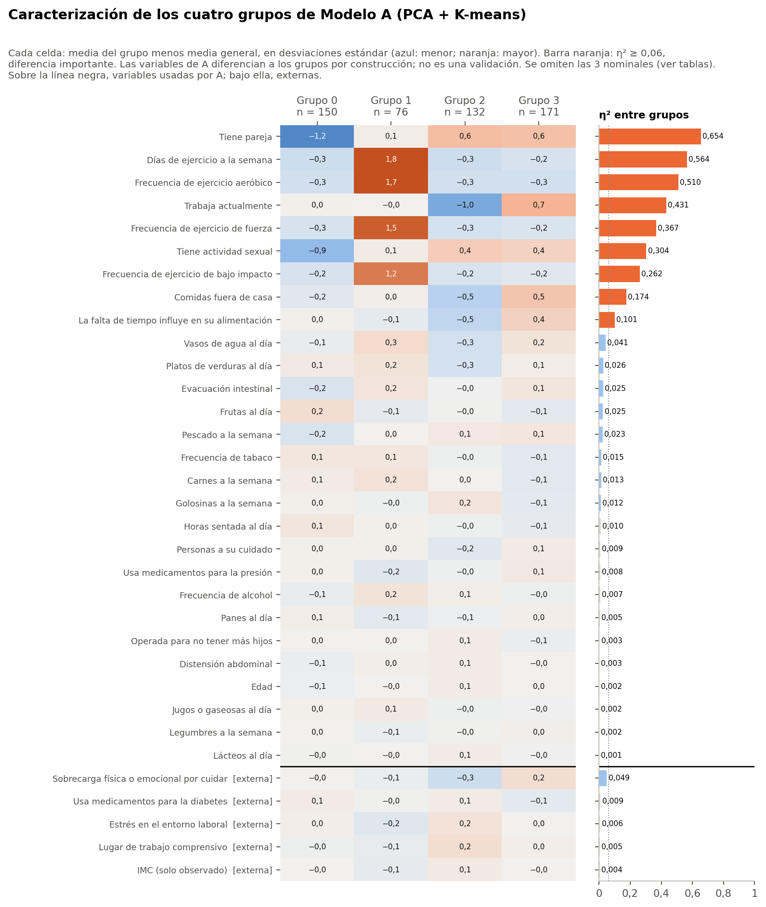

# Advertencia

Las 29 variables de A se usaron para formar los grupos. Que los grupos difieran en ellas es esperable y **no constituye una validación independiente**.

Todo el análisis usa el conjunto sintético de usuarias (N = 529). Sus asociaciones vienen de una simulación, por lo que los resultados no permiten afirmar nada sobre mujeres reales ni tienen valor clínico.

Los grupos se llaman Grupo 0 a Grupo 3, con la numeración histórica. No se les asignan nombres.

# Tamaños

| Grupo | n | % |
|---|---|---|
| Grupo 0 | 150 | 28,4 |
| Grupo 1 | 76 | 14,4 |
| Grupo 2 | 132 | 25,0 |
| Grupo 3 | 171 | 32,3 |

# Rasgos de cada grupo

Variables con diferencia importante (η² ≥ 0,06) en las que el grupo se aleja al menos 0,5 desviaciones estándar del promedio:

- **Grupo 0:** tiene pareja: 9 % «sí» (general 67 %); tiene actividad sexual: 5 % «sí» (general 47 %).
- **Grupo 1:** días de ejercicio a la semana: media más alta, 3,36 (general 1,65); frecuencia de ejercicio aeróbico: media más alta, 2,36 (general 0,49); frecuencia de ejercicio de fuerza: media más alta, 1,79 (general 0,38); frecuencia de ejercicio de bajo impacto: media más alta, 2,25 (general 0,83).
- **Grupo 2:** trabaja actualmente: 9 % «sí» (general 58 %); tiene pareja: 97 % «sí» (general 67 %); comidas fuera de casa: media más baja, 1,54 (general 1,98).
- **Grupo 3:** trabaja actualmente: 95 % «sí» (general 58 %); tiene pareja: 95 % «sí» (general 67 %); comidas fuera de casa: media más alta, 2,40 (general 1,98).

# Qué diferencia a los grupos

- **Diferencias importantes (η² o V² ≥ 0,06):** 9 variables, todas usadas por A: tiene pareja, días de ejercicio a la semana, frecuencia de ejercicio aeróbico, trabaja actualmente, frecuencia de ejercicio de fuerza, tiene actividad sexual, frecuencia de ejercicio de bajo impacto, comidas fuera de casa, la falta de tiempo influye en su alimentación.
- **Diferencias pequeñas (0,01 a 0,06):** 9 variables: sobrecarga física o emocional por cuidar, vasos de agua al día, platos de verduras al día, evacuación intestinal, frutas al día, pescado a la semana, frecuencia de tabaco, carnes a la semana, golosinas a la semana.
- **Distribuciones semejantes (< 0,01):** 18 variables, entre ellas horas sentada al día, personas a su cuidado, quién prepara las comidas, jugos o gaseosas al día, lácteos al día, legumbres a la semana, panes al día, frecuencia de alcohol, edad, operada para no tener más hijos, usa medicamentos para la presión, distensión abdominal, imc (solo observado), etapa menopáusica, usa medicamentos para la diabetes, previsión de salud, lugar de trabajo comprensivo, estrés en el entorno laboral.

**Variables externas:** sobrecarga física o emocional por cuidar η² 0,049; usa medicamentos para la diabetes η² 0,009; etapa menopáusica V² 0,007; estrés en el entorno laboral η² 0,006; lugar de trabajo comprensivo η² 0,005; imc (solo observado) η² 0,004; previsión de salud V² 0,004. Los grupos no se distinguen por IMC, etapa menopáusica, diabetes, previsión ni por las preguntas laborales.

# Tabla completa

Valores por grupo: porcentaje de «sí» en binarias, media del código en ordinales y cuantitativas, y categoría más frecuente en nominales. Las pruebas son Kruskal-Wallis o χ², con q de Benjamini-Hochberg dentro de la familia F6-A (36 pruebas).

| Variable | Origen | G0 | G1 | G2 | G3 | Efecto | q | Lectura |
|---|---|---|---|---|---|---|---|---|
| Tiene pareja | A | 9 % | 70 % | 97 % | 95 % | η² 0,654 | < 0,001 | diferencia importante |
| Días de ejercicio a la semana | A | 1,33 | 3,36 | 1,34 | 1,42 | η² 0,564 | < 0,001 | diferencia importante |
| Frecuencia de ejercicio aeróbico | A | 0,17 | 2,36 | 0,17 | 0,18 | η² 0,510 | < 0,001 | diferencia importante |
| Trabaja actualmente | A | 60 % | 58 % | 9 % | 95 % | η² 0,431 | < 0,001 | diferencia importante |
| Frecuencia de ejercicio de fuerza | A | 0,13 | 1,79 | 0,12 | 0,16 | η² 0,367 | < 0,001 | diferencia importante |
| Tiene actividad sexual | A | 5 % | 51 % | 70 % | 66 % | η² 0,304 | < 0,001 | diferencia importante |
| Frecuencia de ejercicio de bajo impacto | A | 0,56 | 2,25 | 0,57 | 0,65 | η² 0,262 | < 0,001 | diferencia importante |
| Comidas fuera de casa | A | 1,85 | 2,01 | 1,54 | 2,40 | η² 0,174 | < 0,001 | diferencia importante |
| La falta de tiempo influye en su alimentación | A | 2,75 | 2,62 | 2,29 | 3,09 | η² 0,101 | < 0,001 | diferencia importante |
| Vasos de agua al día | A | 3,10 | 3,46 | 2,89 | 3,36 | η² 0,041 | < 0,001 | diferencia pequeña |
| Platos de verduras al día | A | 2,21 | 2,25 | 2,02 | 2,19 | η² 0,026 | 0,010 | diferencia pequeña |
| Evacuación intestinal | A | 2,21 | 2,51 | 2,37 | 2,51 | η² 0,025 | 0,004 | diferencia pequeña |
| Frutas al día | A | 2,29 | 2,08 | 2,13 | 2,05 | η² 0,025 | 0,005 | diferencia pequeña |
| Pescado a la semana | A | 1,67 | 1,82 | 1,88 | 1,89 | η² 0,023 | 0,013 | diferencia pequeña |
| Frecuencia de tabaco | A | 1,99 | 2,00 | 1,73 | 1,58 | η² 0,015 | 0,167 | diferencia pequeña |
| Carnes a la semana | A | 2,91 | 3,01 | 2,86 | 2,72 | η² 0,013 | 0,188 | diferencia pequeña |
| Golosinas a la semana | A | 2,48 | 2,41 | 2,61 | 2,33 | η² 0,012 | 0,323 | diferencia pequeña |
| Horas sentada al día | A | 6,62 | 6,33 | 6,17 | 6,03 | η² 0,010 | 0,323 | distribución semejante |
| Personas a su cuidado | A | 0,81 | 0,82 | 0,63 | 0,87 | η² 0,009 | 0,530 | distribución semejante |
| Usa medicamentos para la presión | A | 17 % | 11 % | 15 % | 20 % | η² 0,008 | 0,436 | distribución semejante |
| Frecuencia de alcohol | A | 1,77 | 1,99 | 1,89 | 1,81 | η² 0,007 | 0,852 | distribución semejante |
| Panes al día | A | 2,16 | 2,04 | 2,09 | 2,15 | η² 0,005 | 0,815 | distribución semejante |
| Operada para no tener más hijos | A | 20 % | 20 % | 23 % | 17 % | η² 0,003 | 0,852 | distribución semejante |
| Distensión abdominal | A | 1,87 | 1,96 | 1,98 | 1,92 | η² 0,003 | 0,852 | distribución semejante |
| Quién prepara las comidas | A | YO_MAYORIA 68 % | YO_MAYORIA 67 % | YO_MAYORIA 70 % | YO_MAYORIA 70 % | V² 0,002 | 0,986 | distribución semejante |
| Edad | A | 50,50 | 50,88 | 51,53 | 51,01 | η² 0,002 | 0,852 | distribución semejante |
| Jugos o gaseosas al día | A | 2,05 | 2,12 | 2,00 | 2,01 | η² 0,002 | 0,852 | distribución semejante |
| Legumbres a la semana | A | 2,17 | 2,13 | 2,16 | 2,20 | η² 0,002 | 0,879 | distribución semejante |
| Lácteos al día | A | 2,05 | 2,05 | 2,10 | 2,04 | η² 0,001 | 0,984 | distribución semejante |
| Sobrecarga física o emocional por cuidar | externa | 3,31 | 3,25 | 2,98 | 3,56 | η² 0,049 | 0,030 | diferencia pequeña |
| Usa medicamentos para la diabetes | externa | 15 % | 12 % | 15 % | 8 % | η² 0,009 | 0,323 | distribución semejante |
| Etapa menopáusica | externa | posmenopausia 57 % | posmenopausia 58 % | posmenopausia 61 % | posmenopausia 60 % | V² 0,007 | 0,815 | distribución semejante |
| Estrés en el entorno laboral | externa | 3,07 | 2,83 | 3,22 | 3,03 | η² 0,006 | 0,852 | distribución semejante |
| Lugar de trabajo comprensivo | externa | 3,13 | 3,08 | 3,44 | 3,22 | η² 0,005 | 0,852 | distribución semejante |
| IMC (solo observado) | externa | 29,18 | 28,55 | 29,80 | 29,19 | η² 0,004 | 0,852 | distribución semejante |
| Previsión de salud | externa | FONASA 83 % | FONASA 83 % | FONASA 86 % | FONASA 78 % | V² 0,004 | 0,852 | distribución semejante |

 En `quien_prepara_comidas`, el 25 % de las frecuencias esperadas es menor que 5, así que su χ² es aproximado.

# Comparación con la Fase 37C

La Fase 37C describió los mismos grupos con las variables generales, sin MRS. Las 10 variables que entonces separaban más tienen aquí exactamente el mismo η² (diferencia máxima 0,000000). Los rasgos se confirman: pareja, ejercicio y trabajo dominan, seguidos por actividad sexual y dos preguntas de alimentación (comidas fuera y falta de tiempo).

Lo nuevo de esta fase son las variables externas. Ninguna diferencia a los grupos de forma importante. La mayor es la sobrecarga por cuidar (η² 0,049), medida solo en quienes cuidan.
