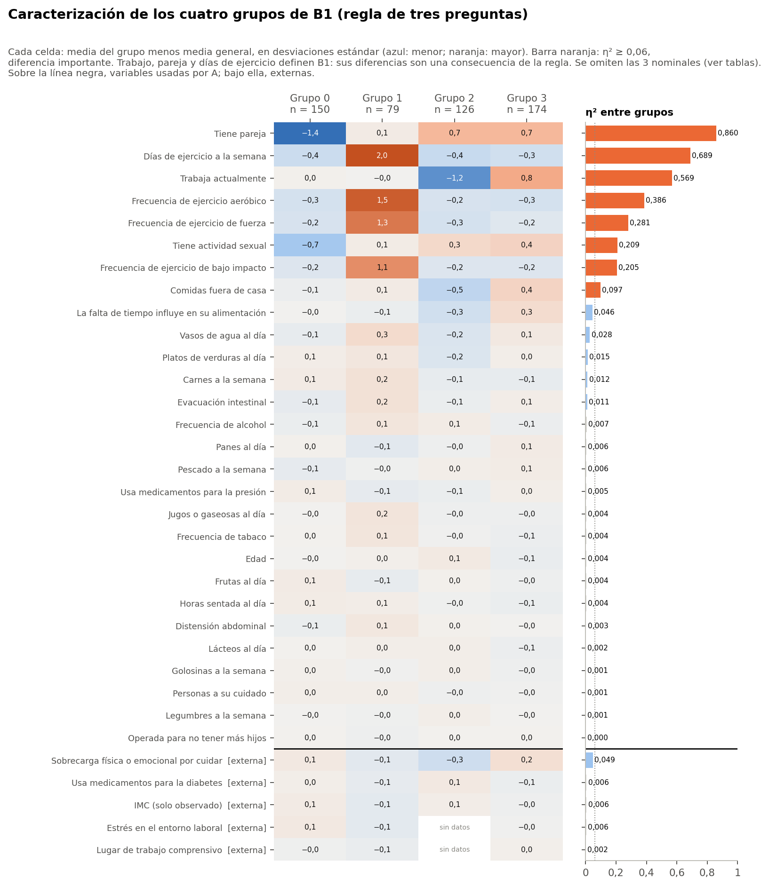

# Advertencia

B1 se define con trabajo, pareja y días de ejercicio. Que difieran en esas tres es una consecuencia de la regla. B1 no es un modelo clínico ni una validación independiente de A: se construyó imitando a A.

Todo el análisis usa el conjunto sintético de usuarias (N = 529). Sus asociaciones vienen de una simulación, por lo que los resultados no permiten afirmar nada sobre mujeres reales ni tienen valor clínico.

Los grupos se llaman Grupo 0 a Grupo 3, con la numeración histórica. No se les asignan nombres.

# Tamaños

| Grupo | n | % |
|---|---|---|
| Grupo 0 | 150 | 28,4 |
| Grupo 1 | 79 | 14,9 |
| Grupo 2 | 126 | 23,8 |
| Grupo 3 | 174 | 32,9 |

# Rasgos de cada grupo

Variables con diferencia importante (η² ≥ 0,06) en las que el grupo se aleja al menos 0,5 desviaciones estándar del promedio:

- **Grupo 0:** tiene pareja: 0 % «sí» (general 67 %); tiene actividad sexual: 12 % «sí» (general 47 %).
- **Grupo 1:** días de ejercicio a la semana: media más alta, 3,49 (general 1,65); frecuencia de ejercicio aeróbico: media más alta, 2,08 (general 0,49); frecuencia de ejercicio de fuerza: media más alta, 1,58 (general 0,38); frecuencia de ejercicio de bajo impacto: media más alta, 2,06 (general 0,83).
- **Grupo 2:** trabaja actualmente: 0 % «sí» (general 58 %); tiene pareja: 100 % «sí» (general 67 %).
- **Grupo 3:** trabaja actualmente: 100 % «sí» (general 58 %); tiene pareja: 100 % «sí» (general 67 %).

# Qué diferencia a los grupos

- **Diferencias importantes (η² o V² ≥ 0,06):** 8 variables, todas usadas por A: tiene pareja, días de ejercicio a la semana, trabaja actualmente, frecuencia de ejercicio aeróbico, frecuencia de ejercicio de fuerza, tiene actividad sexual, frecuencia de ejercicio de bajo impacto, comidas fuera de casa.
- **Diferencias pequeñas (0,01 a 0,06):** 6 variables: sobrecarga física o emocional por cuidar, la falta de tiempo influye en su alimentación, vasos de agua al día, platos de verduras al día, carnes a la semana, evacuación intestinal.
- **Distribuciones semejantes (< 0,01):** 22 variables, entre ellas horas sentada al día, personas a su cuidado, quién prepara las comidas, frutas al día, golosinas a la semana, jugos o gaseosas al día, lácteos al día, legumbres a la semana, panes al día, pescado a la semana, frecuencia de tabaco, frecuencia de alcohol, edad, operada para no tener más hijos, usa medicamentos para la presión, distensión abdominal, imc (solo observado), etapa menopáusica, usa medicamentos para la diabetes, previsión de salud, lugar de trabajo comprensivo, estrés en el entorno laboral.

**Variables externas:** sobrecarga física o emocional por cuidar η² 0,049; usa medicamentos para la diabetes η² 0,006; imc (solo observado) η² 0,006; estrés en el entorno laboral η² 0,006; etapa menopáusica V² 0,006; previsión de salud V² 0,005; lugar de trabajo comprensivo η² 0,002. Los grupos no se distinguen por IMC, etapa menopáusica, diabetes, previsión ni por las preguntas laborales.

# Tabla completa

Valores por grupo: porcentaje de «sí» en binarias, media del código en ordinales y cuantitativas, y categoría más frecuente en nominales. Las pruebas son Kruskal-Wallis o χ², con q de Benjamini-Hochberg dentro de la familia F6-B1 (36 pruebas).

| Variable | Origen | G0 | G1 | G2 | G3 | Efecto | q | Lectura |
|---|---|---|---|---|---|---|---|---|
| Tiene pareja | A | 0 % | 71 % | 100 % | 100 % | η² 0,860 | < 0,001 | diferencia importante |
| Días de ejercicio a la semana | A | 1,32 | 3,49 | 1,29 | 1,37 | η² 0,689 | < 0,001 | diferencia importante |
| Trabaja actualmente | A | 59 % | 58 % | 0 % | 100 % | η² 0,569 | < 0,001 | diferencia importante |
| Frecuencia de ejercicio aeróbico | A | 0,20 | 2,08 | 0,22 | 0,20 | η² 0,386 | < 0,001 | diferencia importante |
| Frecuencia de ejercicio de fuerza | A | 0,15 | 1,58 | 0,12 | 0,21 | η² 0,281 | < 0,001 | diferencia importante |
| Tiene actividad sexual | A | 12 % | 51 % | 62 % | 66 % | η² 0,209 | < 0,001 | diferencia importante |
| Frecuencia de ejercicio de bajo impacto | A | 0,62 | 2,06 | 0,62 | 0,61 | η² 0,205 | < 0,001 | diferencia importante |
| Comidas fuera de casa | A | 1,93 | 2,04 | 1,60 | 2,26 | η² 0,097 | < 0,001 | diferencia importante |
| La falta de tiempo influye en su alimentación | A | 2,73 | 2,66 | 2,43 | 2,98 | η² 0,046 | < 0,001 | diferencia pequeña |
| Vasos de agua al día | A | 3,09 | 3,47 | 2,96 | 3,30 | η² 0,028 | 0,007 | diferencia pequeña |
| Platos de verduras al día | A | 2,19 | 2,23 | 2,05 | 2,18 | η² 0,015 | 0,168 | diferencia pequeña |
| Carnes a la semana | A | 2,92 | 3,03 | 2,77 | 2,77 | η² 0,012 | 0,402 | diferencia pequeña |
| Evacuación intestinal | A | 2,31 | 2,54 | 2,34 | 2,43 | η² 0,011 | 0,216 | diferencia pequeña |
| Frecuencia de alcohol | A | 1,78 | 1,96 | 1,90 | 1,80 | η² 0,007 | 0,817 | distribución semejante |
| Panes al día | A | 2,13 | 2,04 | 2,10 | 2,17 | η² 0,006 | 0,817 | distribución semejante |
| Pescado a la semana | A | 1,75 | 1,80 | 1,84 | 1,86 | η² 0,006 | 0,817 | distribución semejante |
| Usa medicamentos para la presión | A | 19 % | 13 % | 14 % | 18 % | η² 0,005 | 0,817 | distribución semejante |
| Jugos o gaseosas al día | A | 2,03 | 2,16 | 2,00 | 2,00 | η² 0,004 | 0,817 | distribución semejante |
| Frecuencia de tabaco | A | 1,80 | 2,01 | 1,77 | 1,71 | η² 0,004 | 0,817 | distribución semejante |
| Edad | A | 50,93 | 51,25 | 51,68 | 50,38 | η² 0,004 | 0,819 | distribución semejante |
| Frutas al día | A | 2,19 | 2,09 | 2,16 | 2,11 | η² 0,004 | 0,817 | distribución semejante |
| Horas sentada al día | A | 6,44 | 6,42 | 6,21 | 6,11 | η² 0,004 | 0,817 | distribución semejante |
| Quién prepara las comidas | A | YO_MAYORIA 70 % | YO_MAYORIA 70 % | YO_MAYORIA 69 % | YO_MAYORIA 68 % | V² 0,004 | 0,977 | distribución semejante |
| Distensión abdominal | A | 1,87 | 2,03 | 1,94 | 1,92 | η² 0,003 | 0,817 | distribución semejante |
| Lácteos al día | A | 2,06 | 2,09 | 2,09 | 2,02 | η² 0,002 | 0,932 | distribución semejante |
| Golosinas a la semana | A | 2,48 | 2,43 | 2,49 | 2,41 | η² 0,001 | 0,977 | distribución semejante |
| Personas a su cuidado | A | 0,82 | 0,82 | 0,74 | 0,76 | η² 0,001 | 0,977 | distribución semejante |
| Legumbres a la semana | A | 2,17 | 2,15 | 2,20 | 2,17 | η² 0,001 | 0,977 | distribución semejante |
| Operada para no tener más hijos | A | 20 % | 18 % | 20 % | 20 % | η² 0,000 | 0,977 | distribución semejante |
| Sobrecarga física o emocional por cuidar | externa | 3,42 | 3,18 | 2,98 | 3,53 | η² 0,049 | 0,049 | diferencia pequeña |
| Usa medicamentos para la diabetes | externa | 14 % | 9 % | 16 % | 10 % | η² 0,006 | 0,817 | distribución semejante |
| IMC (solo observado) | externa | 29,73 | 28,41 | 29,55 | 28,95 | η² 0,006 | 0,819 | distribución semejante |
| Estrés en el entorno laboral | externa | 3,13 | 2,88 | sin datos | 3,00 | η² 0,006 | 0,817 | distribución semejante |
| Etapa menopáusica | externa | posmenopausia 60 % | posmenopausia 61 % | posmenopausia 60 % | posmenopausia 57 % | V² 0,006 | 0,869 | distribución semejante |
| Previsión de salud | externa | FONASA 81 % | FONASA 86 % | FONASA 87 % | FONASA 78 % | V² 0,005 | 0,817 | distribución semejante |
| Lugar de trabajo comprensivo | externa | 3,14 | 3,10 | sin datos | 3,22 | η² 0,002 | 0,819 | distribución semejante |

En B1, el Grupo 2 no tiene ninguna participante que trabaje: las preguntas laborales no aplican en él. En `quien_prepara_comidas`, el 25 % de las frecuencias esperadas es menor que 5, así que su χ² es aproximado.
