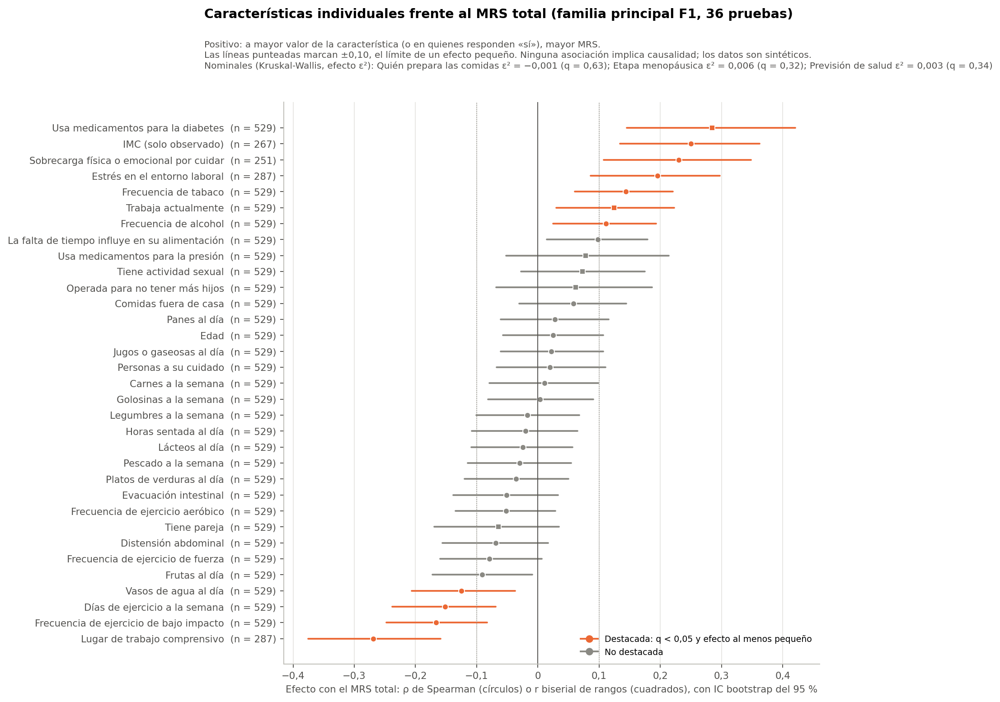
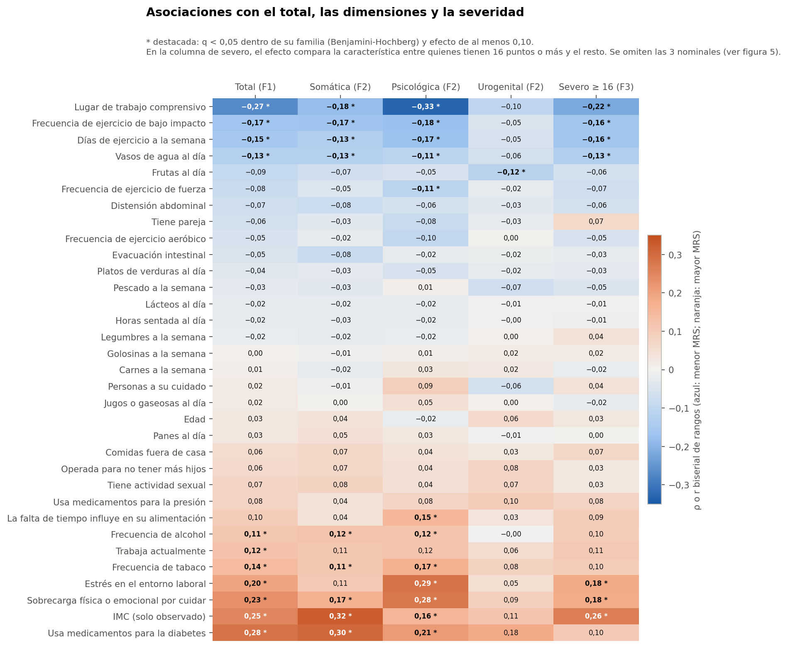
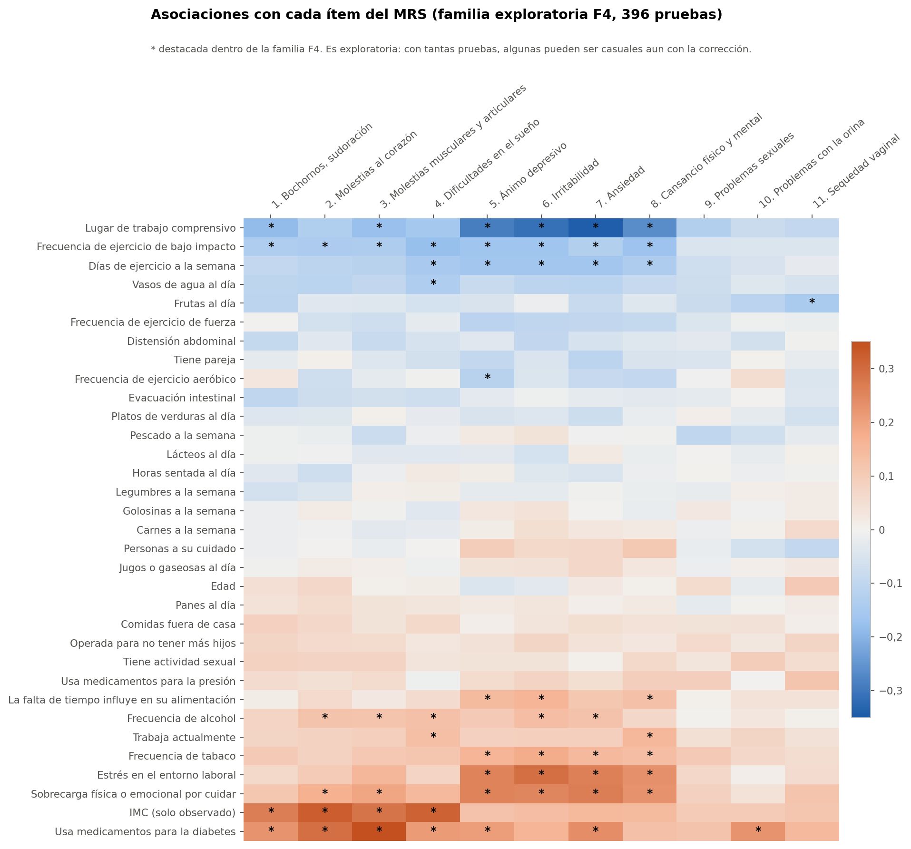

# Resumen

Es el análisis principal: cada característica frente al MRS, sin segmentar.

- **Familia F1 (total, 36 pruebas):** 11 asociaciones destacadas, es decir, con q < 0,05 y efecto al menos pequeño. Todas son pequeñas: ninguna llega a 0,30.
- **Dirección:** 7 se asocian a mayor MRS y 4 a menor MRS.
- **Lo que no aparece:** la edad, la etapa menopáusica, la pareja, la actividad sexual, el sedentarismo y casi toda la alimentación no se asocian con el total.
- **Interpretación:** son asociaciones descriptivas en datos sintéticos. No indican causa, y la dirección podría ser la inversa: por ejemplo, más síntomas podrían llevar a menos ejercicio.

Todo el análisis usa el conjunto sintético de usuarias (N = 529). Sus asociaciones vienen de una simulación, por lo que los resultados no permiten afirmar nada sobre mujeres reales ni tienen valor clínico.

# Asociaciones con el MRS total (F1)

| Característica | Origen | Prueba | Efecto | IC 95 % | n | q | Magnitud |
|---|---|---|---|---|---|---|---|
| Lugar de trabajo comprensivo | externa | Spearman | ρ −0,269 | −0,376 a −0,159 | 287 | < 0,001 | pequeña **(destacada)** |
| IMC (solo observado) | externa | Spearman | ρ 0,250 | 0,134 a 0,362 | 267 | < 0,001 | pequeña **(destacada)** |
| Frecuencia de ejercicio de bajo impacto | A | Spearman | ρ −0,166 | −0,248 a −0,083 | 529 | 0,001 | pequeña **(destacada)** |
| Usa medicamentos para la diabetes | externa | Mann-Whitney | r 0,284 | 0,145 a 0,420 | 529 | 0,002 | pequeña **(destacada)** |
| Sobrecarga física o emocional por cuidar | externa | Spearman | ρ 0,230 | 0,108 a 0,348 | 251 | 0,002 | pequeña **(destacada)** |
| Días de ejercicio a la semana | A | Spearman | ρ −0,151 | −0,238 a −0,069 | 529 | 0,003 | pequeña **(destacada)** |
| Estrés en el entorno laboral | externa | Spearman | ρ 0,195 | 0,086 a 0,297 | 287 | 0,004 | pequeña **(destacada)** |
| Frecuencia de tabaco | A | Spearman | ρ 0,144 | 0,060 a 0,221 | 529 | 0,004 | pequeña **(destacada)** |
| Vasos de agua al día | A | Spearman | ρ −0,125 | −0,206 a −0,037 | 529 | 0,016 | pequeña **(destacada)** |
| Frecuencia de alcohol | A | Spearman | ρ 0,111 | 0,025 a 0,193 | 529 | 0,038 | pequeña **(destacada)** |
| Trabaja actualmente | A | Mann-Whitney | r 0,125 | 0,030 a 0,223 | 529 | 0,048 | pequeña **(destacada)** |
| La falta de tiempo influye en su alimentación | A | Spearman | ρ 0,098 | 0,014 a 0,179 | 529 | 0,072 | despreciable |
| Frutas al día | A | Spearman | ρ −0,091 | −0,172 a −0,009 | 529 | 0,100 | despreciable |
| Frecuencia de ejercicio de fuerza | A | Spearman | ρ −0,080 | −0,160 a 0,006 | 529 | 0,174 | despreciable |
| Distensión abdominal | A | Spearman | ρ −0,069 | −0,156 a 0,017 | 529 | 0,273 | despreciable |
| Etapa menopáusica | externa | Kruskal-Wallis | ε² 0,006 | −0,003 a 0,037 | 529 | 0,316 | despreciable |
| Tiene actividad sexual | A | Mann-Whitney | r 0,073 | −0,027 a 0,175 | 529 | 0,316 | despreciable |
| Previsión de salud | externa | Kruskal-Wallis | ε² 0,003 | −0,003 a 0,027 | 529 | 0,344 | despreciable |
| Comidas fuera de casa | A | Spearman | ρ 0,058 | −0,031 a 0,144 | 529 | 0,344 | despreciable |
| Tiene pareja | A | Mann-Whitney | r −0,064 | −0,169 a 0,035 | 529 | 0,387 | despreciable |
| Frecuencia de ejercicio aeróbico | A | Spearman | ρ −0,052 | −0,134 a 0,028 | 529 | 0,387 | despreciable |
| Evacuación intestinal | A | Spearman | ρ −0,051 | −0,138 a 0,033 | 529 | 0,387 | despreciable |
| Usa medicamentos para la presión | A | Mann-Whitney | r 0,078 | −0,052 a 0,214 | 529 | 0,387 | despreciable |
| Operada para no tener más hijos | A | Mann-Whitney | r 0,062 | −0,069 a 0,187 | 529 | 0,491 | despreciable |
| Platos de verduras al día | A | Spearman | ρ −0,036 | −0,120 a 0,050 | 529 | 0,597 | despreciable |
| Quién prepara las comidas | A | Kruskal-Wallis | ε² −0,001 | −0,005 a 0,026 | 529 | 0,628 | despreciable |
| Pescado a la semana | A | Spearman | ρ −0,029 | −0,115 a 0,054 | 529 | 0,666 | despreciable |
| Panes al día | A | Spearman | ρ 0,028 | −0,061 a 0,116 | 529 | 0,676 | despreciable |
| Edad | A | Spearman | ρ 0,025 | −0,057 a 0,107 | 529 | 0,691 | despreciable |
| Lácteos al día | A | Spearman | ρ −0,024 | −0,109 a 0,057 | 529 | 0,691 | despreciable |
| Jugos o gaseosas al día | A | Spearman | ρ 0,022 | −0,060 a 0,107 | 529 | 0,705 | despreciable |
| Horas sentada al día | A | Spearman | ρ −0,020 | −0,108 a 0,065 | 529 | 0,705 | despreciable |
| Personas a su cuidado | A | Spearman | ρ 0,020 | −0,067 a 0,110 | 529 | 0,705 | despreciable |
| Legumbres a la semana | A | Spearman | ρ −0,017 | −0,101 a 0,068 | 529 | 0,734 | despreciable |
| Carnes a la semana | A | Spearman | ρ 0,011 | −0,079 a 0,099 | 529 | 0,827 | despreciable |
| Golosinas a la semana | A | Spearman | ρ 0,003 | −0,081 a 0,091 | 529 | 0,938 | despreciable |

- **Mayor MRS:** Usa medicamentos para la diabetes (r = 0,28); IMC (solo observado) (ρ = 0,25); Sobrecarga física o emocional por cuidar (ρ = 0,23); Estrés en el entorno laboral (ρ = 0,20); Frecuencia de tabaco (ρ = 0,14); Trabaja actualmente (r = 0,12); Frecuencia de alcohol (ρ = 0,11).
- **Menor MRS:** Lugar de trabajo comprensivo (ρ = −0,27); Frecuencia de ejercicio de bajo impacto (ρ = −0,17); Días de ejercicio a la semana (ρ = −0,15); Vasos de agua al día (ρ = −0,13).
- **Signo:** ρ positivo significa que a mayor valor de la característica, mayor MRS. En las binarias, r positivo significa mayor MRS en quienes responden «sí».
- **Subpoblaciones:** cuatro de las destacadas (IMC, lugar de trabajo comprensivo, estrés laboral y sobrecarga) se miden solo en una parte de las participantes. Sus efectos no son comparables con los de las 529.

**Medianas del total por nivel, en binarias y nominales seleccionadas:**

| Variable | Nivel | n | Media | Mediana | % severo |
|---|---|---|---|---|---|
| Trabaja actualmente | 0.0 | 220 | 15,2 | 14,5 | 46,8 |
| Trabaja actualmente | 1.0 | 309 | 17,3 | 17,0 | 57,6 |
| Tiene pareja | 0.0 | 173 | 17,1 | 17,0 | 57,8 |
| Tiene pareja | 1.0 | 356 | 16,1 | 16,0 | 50,8 |
| Tiene actividad sexual | 0.0 | 278 | 15,9 | 16,0 | 51,8 |
| Tiene actividad sexual | 1.0 | 251 | 16,9 | 17,0 | 54,6 |
| Etapa menopáusica | indeterminada | 22 | 19,9 | 19,0 | 72,7 |
| Etapa menopáusica | perimenopausia | 79 | 15,1 | 15,0 | 48,1 |
| Etapa menopáusica | posmenopausia | 313 | 16,8 | 16,0 | 54,6 |
| Etapa menopáusica | premenopausia | 96 | 15,3 | 14,5 | 47,9 |
| Etapa menopáusica | quirurgica | 19 | 16,1 | 16,0 | 52,6 |
| Usa medicamentos para la diabetes | 0.0 | 463 | 15,8 | 16,0 | 51,2 |
| Usa medicamentos para la diabetes | 1.0 | 66 | 20,5 | 20,0 | 66,7 |

# Dimensiones y severidad (F2, F3)

- **F2 (dimensiones, 108 pruebas):** 24 destacadas.
- **F3 (severo ≥ 16, 36 pruebas):** 7 destacadas.

**Por dimensión:**

- **Psicológica:** concentra la mayoría de las asociaciones destacadas (12). Las más altas son lugar de trabajo comprensivo, estrés laboral y sobrecarga.
- **Somática:** 9 destacadas. Las mayores son el IMC y la diabetes.
- **Urogenital:** 3 destacadas, todas pequeñas: frutas, etapa menopáusica y previsión.

# Ítems (F4, exploratoria)

- **Destacadas:** 60 de 396.
- **Dónde:** se concentran en los ítems psicológicos (5 a 8) y en los somáticos (1 a 4), y casi no aparecen en los urogenitales.
- **Advertencia:** con tantas pruebas, algunas pueden ser casuales aun con la corrección. Sirven para orientar, no para concluir.

# Sensibilidades del análisis individual

- **S-OBS (solo datos observados):** 35 de 36 características mantienen la misma conclusión. Cambia solo la falta de tiempo influye en su alimentación, que pasa a destacada con un efecto apenas sobre 0,10 (r de 0,098 a 0,108). La mayor diferencia de efecto entre ambos análisis es 0,011.
- **S-SIN9 (sin el ítem 9, problemas sexuales):** pareja y actividad sexual no se asocian ni con el total ni con la urogenital, con o sin el ítem 9. El solapamiento conceptual previsto no produce ninguna asociación artificial.
