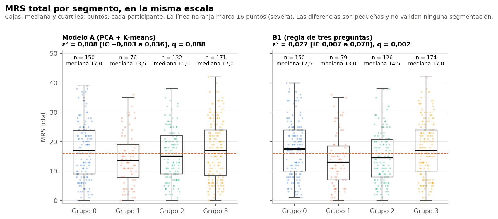
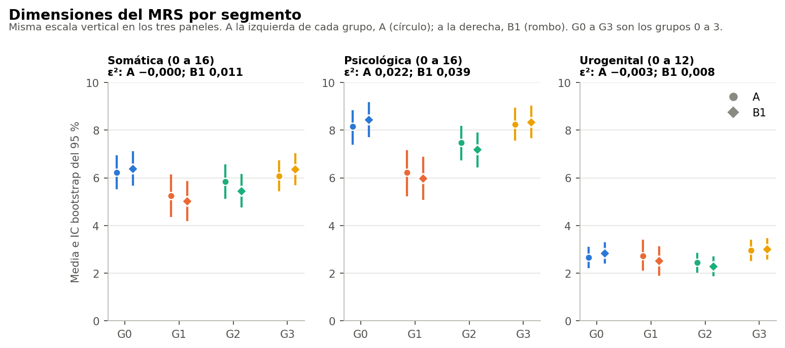
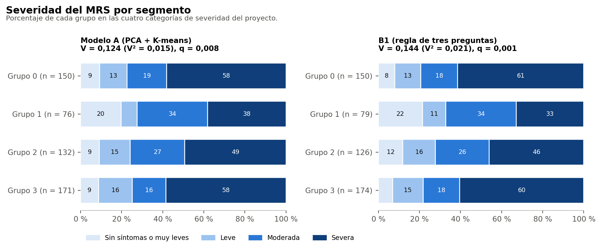

# Resumen

- **Severo ≥ 16:** del 38 % en el Grupo 1 al 58 % en el grupo más alto.
- **MRS total:** la media va de 14,2 en el Grupo 1 a 17,3 en el Grupo 3.
- **Tamaño de las diferencias:** son pequeñas. En el total, ε² = 0,008 (IC −0,003 a 0,036; q = 0,088); en la psicológica, ε² = 0,022; en severo, V = 0,144.
- **Lo que queda dentro:** cerca del 99 % de la variación del total queda dentro de los grupos.

Los grupos de A se formaron sin usar el MRS. Que difieran en él es la primera comparación externa de esta segmentación, pero los datos son sintéticos y la diferencia no convierte a A en una clasificación válida.

Todo el análisis usa el conjunto sintético de usuarias (N = 529). Sus asociaciones vienen de una simulación, por lo que los resultados no permiten afirmar nada sobre mujeres reales ni tienen valor clínico.

# MRS por grupo

| Grupo | n | Total: media (DE) | Mediana [RIC] | IC 95 % mediana | Somática | Psicológica | Urogenital | Severo (IC 95 %) |
|---|---|---|---|---|---|---|---|---|
| Grupo 0 | 150 | 17,0 (9,4) | 17,0 [9,0-23,8] | 15,5 a 19,0 | 6,2 | 8,2 | 2,7 | 58,0 % (50-66) |
| Grupo 1 | 76 | 14,2 (8,8) | 13,5 [7,8-19,0] | 11,0 a 15,5 | 5,2 | 6,2 | 2,7 | 38,2 % (28-49) |
| Grupo 2 | 132 | 15,8 (8,7) | 15,0 [9,0-22,0] | 13,0 a 18,0 | 5,8 | 7,5 | 2,5 | 49,2 % (41-58) |
| Grupo 3 | 171 | 17,3 (9,7) | 17,0 [8,5-24,0] | 16,0 a 19,0 | 6,1 | 8,2 | 3,0 | 58,5 % (51-66) |

# Diferencias entre grupos (familia F5)

| Resultado | Prueba | Efecto | IC 95 % | p | q (F5) | Magnitud |
|---|---|---|---|---|---|---|
| Total | Kruskal-Wallis | ε² 0,008 | −0,003 a 0,036 | 0,073 | 0,088 | despreciable |
| Somática | Kruskal-Wallis | ε² −0,000 | −0,005 a 0,024 | 0,432 | 0,471 | despreciable |
| Psicológica | Kruskal-Wallis | ε² 0,022 | 0,004 a 0,060 | 0,002 | 0,006 | pequeña |
| Urogenital | Kruskal-Wallis | ε² −0,003 | −0,005 a 0,020 | 0,716 | 0,716 | despreciable |
| Severidad (4 clases) | χ² | V 0,124 (V² 0,015) | 0,096 a 0,190 | 0,004 | 0,008 | pequeña |
| Severo ≥ 16 | χ² | V 0,144 (V² 0,021) | 0,081 a 0,239 | 0,012 | 0,020 | pequeña |

La familia F5 tiene 12 pruebas (A y B1 × 6 resultados), corregidas juntas.

# Comparaciones por pares en el total (F7, Holm)

| Par | Medianas | r | p | p de Holm |
|---|---|---|---|---|
| G0 frente a G1 | 17,0 y 13,5 | 0,18 | 0,031 | 0,156 |
| G0 frente a G2 | 17,0 y 15,0 | 0,07 | 0,298 | 0,813 |
| G0 frente a G3 | 17,0 y 17,0 | −0,01 | 0,830 | 0,830 |
| G1 frente a G2 | 13,5 y 15,0 | −0,11 | 0,203 | 0,813 |
| G1 frente a G3 | 13,5 y 17,0 | −0,19 | 0,014 | 0,087 |
| G2 frente a G3 | 15,0 y 17,0 | −0,08 | 0,206 | 0,813 |

Ninguna diferencia por pares se mantiene después de la corrección de Holm.

# Variabilidad

Las desviaciones estándar dentro de cada grupo (de 8,7 a 9,7) son casi iguales a la de las 529 (9,3). Los rangos intercuartílicos se superponen ampliamente. Dentro de cada grupo hay participantes con casi ningún síntoma y con síntomas muy intensos.
