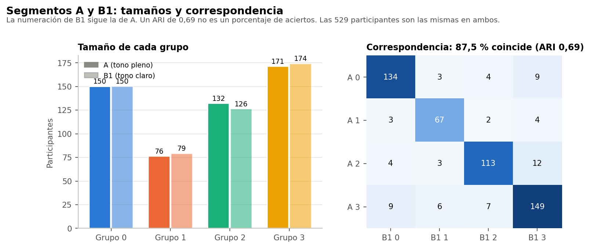
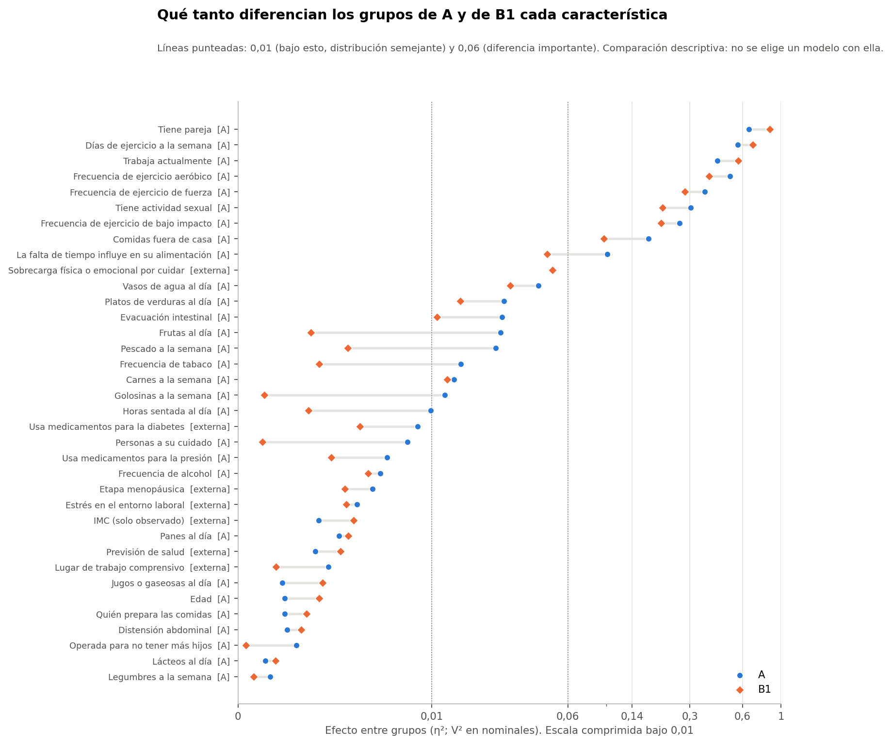
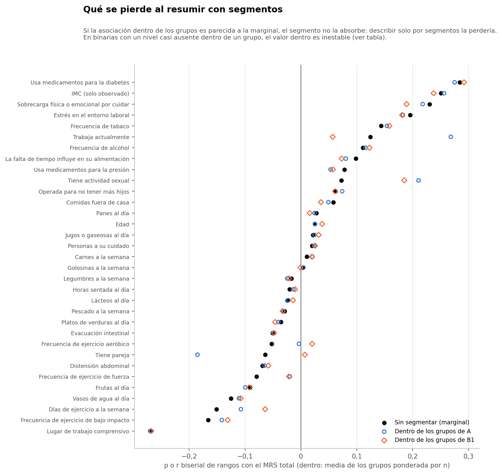

# Resumen

Esta comparación es descriptiva y exploratoria. **No se usa para elegir una segmentación ni modifica la selección de la Fase 37C.** No hay criterio de ganador.

Todo el análisis usa el conjunto sintético de usuarias (N = 529). Sus asociaciones vienen de una simulación, por lo que los resultados no permiten afirmar nada sobre mujeres reales ni tienen valor clínico.

| Pregunta | Sin segmentar | A | B1 |
|---|---|---|---|
| Qué describe | 36 características, una por una | 4 grupos definidos por 29 variables | 4 grupos definidos por 3 respuestas |
| Variables con diferencia importante entre grupos | No aplica | 9 (todas usadas por A) | 8 (todas usadas por A) |
| Diferencias del MRS total | 11 asociaciones destacadas, todas pequeñas | ε² 0,008, q 0,088 | ε² 0,027, q 0,002 |
| Dimensión psicológica | 12 destacadas | ε² 0,022 | ε² 0,039 |
| Severo ≥ 16 | 7 destacadas | V 0,144 | V 0,209 |
| Variación del total dentro de los grupos | No aplica | 98,7 % | 96,8 % |
| Variables externas destacadas con el MRS | 5 | No las distingue (η² < 0,05) | No las distingue (η² < 0,05) |

# Correspondencia entre A y B1

- **Coincidencia:** 87,5 % de las participantes quedan en el grupo equivalente (ARI 0,69). El ARI no es un porcentaje de aciertos.
- **Desacuerdos:** se concentran cerca de las fronteras de A. El acuerdo es de 58 % con margen menor que 0,05 y de 98 % con margen de 0,20 o más.

| A / B1 | B1 0 | B1 1 | B1 2 | B1 3 |
|---|---|---|---|---|
| A 0 | 134 | 3 | 4 | 9 |
| A 1 | 3 | 67 | 2 | 4 |
| A 2 | 4 | 3 | 113 | 12 |
| A 3 | 9 | 6 | 7 | 149 |

# Características que diferencian

Los perfiles de los cuatro grupos son casi los mismos en A y en B1:

- **Grupo 0:** sin pareja.
- **Grupo 1:** con ejercicio frecuente.
- **Grupo 2:** con pareja y sin trabajo.
- **Grupo 3:** con pareja y con trabajo.

En B1 las tres preguntas separan más (por ejemplo, pareja η² 0,86 frente a 0,65). A separa algo más en las otras variables: ejercicio adicional, actividad sexual y alimentación. Ninguna de las dos distingue a las participantes por las variables externas.

# Diferencias de MRS

Las diferencias de MRS son pequeñas en ambas segmentaciones:

- **Tamaño:** B1 muestra efectos algo mayores que A en el total, la psicológica y severo.
- **Patrón común:** el Grupo 1, el de ejercicio frecuente, tiene los puntajes más bajos en las dos segmentaciones.

Que B1 muestre diferencias algo mayores **no la convierte en mejor segmentación**. Además, refleja algo ya visible sin segmentar: los días de ejercicio y el trabajo se asocian con el MRS. Las 20 combinaciones de las tres preguntas explican, con el ajuste por número de grupos, un η² de 0,040 en el total. En A el valor es 0,008 y en B1 0,027.

# Información que se pierde al segmentar

- **Variación individual:** más del 96 % de la variación del MRS queda dentro de los grupos, tanto en A como en B1.
- **Asociaciones externas:** las asociaciones de las variables externas con el MRS (IMC, diabetes, sobrecarga, estrés laboral, lugar de trabajo) se mantienen casi iguales dentro de los grupos; la mayor diferencia entre la marginal y la de dentro es 0,041. Los segmentos no las absorben: un resumen solo por segmentos las perdería.
- **Hábitos fuera de A:** lo mismo ocurre con tabaco, alcohol, agua y ejercicio de bajo impacto.
- **Variables que ya definen el grupo:** dentro de los grupos, la asociación de días de ejercicio y del ejercicio aeróbico o de fuerza se debilita. El grupo ya recoge esa información.
- **Valores inestables:** trabajo, pareja y actividad sexual muestran dentro de los grupos de A asociaciones mayores que sin segmentar. El detalle por grupo indica que dependen de grupos con muy pocas participantes en un nivel; por ejemplo, en el Grupo 3 de A solo 8 participantes no trabajan. No son hallazgos estables. Este detalle se agregó tras ver los resultados (nota posterior).

# Respuestas a las preguntas de la sección 9

1. **¿Qué diferencia los segmentos?** Pareja, días y tipos de ejercicio, trabajo y actividad sexual, y en menor grado comidas fuera y falta de tiempo. Todas son variables usadas por A.
2. **¿Qué es similar?** Edad, etapa, IMC, diabetes, previsión, sedentarismo, cuidado de personas, tabaco, alcohol, la mayor parte de la alimentación y las preguntas laborales.
3. **¿Se describen con más que tres preguntas?** Solo un poco. A difiere además en ejercicio adicional, actividad sexual y dos preguntas de alimentación, pero nada externo los distingue.
4. **¿Qué diferencias de MRS aparecen?** Pequeñas, sobre todo psicológicas y en la proporción con severo. El grupo de ejercicio frecuente tiene menos síntomas.
5. **¿Se mantienen con faltantes y sensibilidades?** Ver el informe 11. La diferencia psicológica se mantiene en todas las particiones y en el corte de margen principal, pero se pierde con poco n.
6. **¿Qué se pierde al segmentar?** Casi toda la variación individual y las asociaciones de variables que no definen los grupos.
7. **¿B1 representa diferencias semejantes?** Sí: mismo patrón y magnitud parecida o algo mayor, con tres preguntas.
8. **¿Qué enfoque es base más clara para asociaciones posteriores?** El análisis de características individuales. Mantiene las asociaciones externas, informa cada n y no depende de una partición. Los segmentos sirven como variable de estratificación descriptiva, no como unidad principal.
