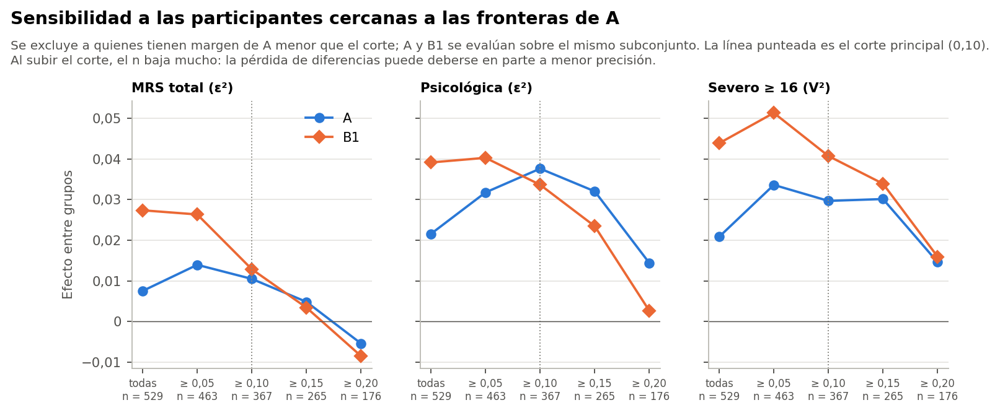

# Resumen

Todas las sensibilidades se fijaron en el protocolo antes de ver los resultados. Las adiciones posteriores van rotuladas.

Todo el análisis usa el conjunto sintético de usuarias (N = 529). Sus asociaciones vienen de una simulación, por lo que los resultados no permiten afirmar nada sobre mujeres reales ni tienen valor clínico.

# Sensibilidades de los segmentos

| Análisis | n | A total ε² | A psicol. ε² | A severo V² | B1 total ε² | B1 psicol. ε² | B1 severo V² |
|---|---|---|---|---|---|---|---|
| Principal | 529 | 0,008 | 0,022 | 0,021 | 0,027 | 0,039 | 0,044 |
| S-MARGEN: margen ≥ 0,10 | 367 | 0,010 (p ≥ 0,05) | 0,038 | 0,030 | 0,013 (p ≥ 0,05) | 0,034 | 0,041 |
| S-MARGEN: margen ≥ 0,20 | 176 | −0,005 (p ≥ 0,05) | 0,014 (p ≥ 0,05) | 0,015 (p ≥ 0,05) | −0,008 (p ≥ 0,05) | 0,003 (p ≥ 0,05) | 0,016 (p ≥ 0,05) |
| S-SIN-IMP3: sin imputación en las tres preguntas | 446 | 0,003 (p ≥ 0,05) | 0,014 | 0,019 | 0,017 | 0,031 | 0,036 |
| S-SIN-IMP29: sin ninguna imputación en las 29 variables de A | 118 | −0,007 (p ≥ 0,05) | 0,005 (p ≥ 0,05) | 0,039 (p ≥ 0,05) | 0,002 (p ≥ 0,05) | 0,004 (p ≥ 0,05) | 0,055 (p ≥ 0,05) |

## Participantes cercanas a las fronteras (S-MARGEN)

- **Corte principal (0,10):** se excluye al 31 % de las participantes. Las diferencias psicológica y de severo se mantienen en A y en B1, y la psicológica de A incluso sube (ε² 0,038). El total de B1 baja a la mitad (ε² 0,013) y deja de ser significativo; el de A ya no lo era.
- **Corte de 0,20:** quedan 176 participantes y las diferencias se reducen o desaparecen. Con un tercio de la muestra cae la precisión, y además el subconjunto deja de ser representativo.
- **Lectura:** las diferencias psicológica y de severo no dependen de las participantes de margen bajo. La mayor diferencia del total en B1 sí se apoya en parte en las participantes cercanas a las fronteras de A.

## Imputación

- **S-SIN-IMP3:** sin las 83 participantes con alguna de las tres preguntas imputada o deducida, las diferencias psicológicas y de severidad se mantienen en A y en B1. En A, el total sigue sin ser significativo, igual que con las 529, y la psicológica se debilita (ε² 0,014).
- **S-SIN-IMP29:** solo 118 participantes no tienen ninguna imputación en las 29 variables de A. Con ese n nada es significativo, aunque los efectos de severidad son parecidos. No permite confirmar ni descartar.
- **S-OBS (análisis individual):** las conclusiones cambian solo en una variable (informe 07).

## Particiones ya guardadas (S-PARTICIONES)

Ninguna se reajustó; solo muestran si la descripción depende de la configuración.

| Partición | ARI con A | Tamaños | Total ε² | Psicológica ε² | Severo V |
|---|---|---|---|---|---|
| P2_c08_km_k4 | 0,91 | 154 / 78 / 136 / 161 | 0,009 | 0,024 | 0,155 |
| P2_c16_km_k4 | 0,92 | 76 / 179 / 144 / 130 | 0,006 | 0,020 | 0,140 |
| P2_c12_km_k4 (37B) | 1,00 | 150 / 76 / 132 / 171 | 0,008 | 0,022 | 0,144 |
| S-SOLAPE P2_c12_km_k4 | 0,36 | 161 / 80 / 153 / 135 | 0,011 | 0,033 | 0,157 |
| S-ORD (ridit) P2_c12_km_k4 | 0,69 | 145 / 116 / 133 / 135 | 0,014 | 0,024 | 0,165 |

- **Todas las particiones:** la diferencia psicológica (ε² entre 0,02 y 0,03) y la de severo (V entre 0,14 y 0,16) aparecen en todas, incluso en S-SOLAPE, que no usa actividad sexual ni distensión y coincide poco con A (ARI 0,36).
- **Lectura:** la descripción no depende de la configuración exacta. Tampoco es exclusiva de A: cualquier partición que separe ejercicio y trabajo la reproduce.
- **No es un criterio de elección:** este resultado no sirve para elegir entre particiones.

## Otras

- **S-B1CV:** las etiquetas de B1 con validación cruzada dan los mismos efectos que B1 (total ε² 0,028).
- **S-SIN9:** sin el ítem 9, las diferencias del total de A y B1 casi no cambian (A ε² 0,009; B1 0,029). La actividad sexual dentro de A no infla la comparación con el MRS.

# Notas posteriores al sellado

En `protocolo/02_nota_posterior_37D.md`, con su propia huella (`bf5938d5d393399c…`):

1. La única celda deducida se trató como no observada.
2. Se agregó el η² ajustado por número de grupos.
3. Se guardó el detalle por grupo de la asociación dentro de los segmentos, después de ver los resultados.
4. Los 4 archivos del simulador del manifiesto 34-35 no se abrieron.

Ninguna cambia una familia, una prueba ni una conclusión.

# Limitaciones

1. **Datos sintéticos.** Toda asociación refleja lo que el simulador programó. No hay validación con mujeres reales ni recomendación clínica posible.
2. **Análisis no ciego.** Las Fases 34C a 35B ya habían examinado asociaciones con el MRS. Se analizaron todas las variables pertinentes para no elegirlas por esos resultados, pero la lectura no es independiente.
3. **Efectos marginales.** Cada asociación se estima sin ajustar por las demás. Por ejemplo, edad y etapa se relacionan entre sí, y trabajo y preguntas laborales están anidadas.
4. **Causalidad y dirección.** No se puede saber si una característica precede a los síntomas o es consecuencia de ellos (estrés laboral, sobrecarga, ejercicio).
5. **Imputaciones.** Están en el 72,8 % de las participantes. Diabetes y previsión no tienen marca de imputación por participante; la etapa depende de respuestas imputadas en 27.
6. **Poblaciones parciales.** El IMC solo está en la mitad, los módulos laborales en quienes trabajan y la sobrecarga en quienes cuidan.
7. **Circularidad.** Las diferencias entre segmentos en las variables que los definen no validan nada. Pareja y actividad sexual se solapan con el ítem 9, aunque las sensibilidades no muestran efecto.
8. **Multiplicidad.** Hay 684 pruebas en siete familias. F4 es exploratoria.
9. **Doble uso.** Los grupos y su descripción usan las mismas 529 participantes; no hay una muestra de confirmación.
