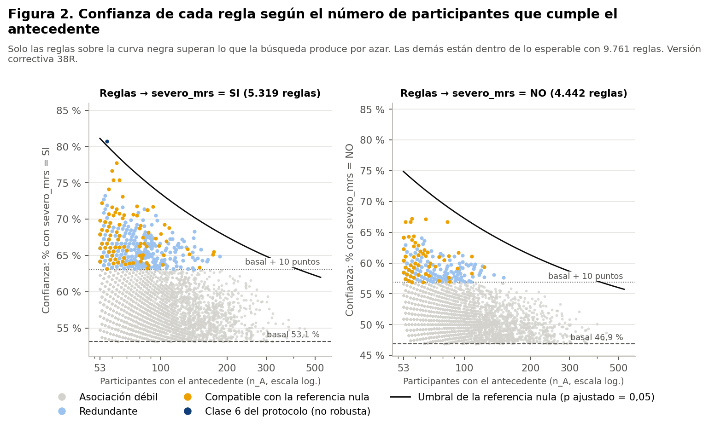
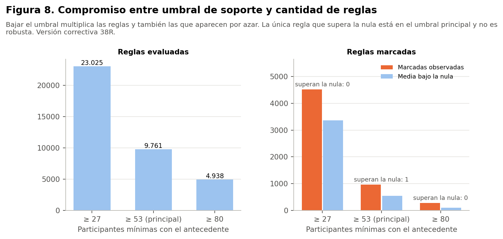

> **Versión correctiva (Fase 38R).** Corrige la Fase 38 histórica retirando de la matriz principal `prevision` y `usa_medicamentos_diabetes`, que las decisiones de las Fases 35 y 36 excluían del modelado. Ninguna de las dos es predictora autorizada y solo se nombran para documentar ese motivo. Todas las cifras de este documento provienen de los resultados corregidos; las cifras de la versión anterior no están vigentes. Las sensibilidades se identifican siempre como tales y no sustituyen al análisis principal.

# Medidas

Todo el análisis usa el conjunto **sintético** de 529 participantes. Las reglas describen lo que contiene la simulación: no son hechos sobre la menopausia en mujeres reales, no son diagnósticos ni predicciones y no permiten recomendaciones de salud. Ninguna asociación indica causa. No hay validación externa: es un análisis **exploratorio** y su utilidad clínica no está demostrada.

| Medida | Significado | Ejemplo con la regla de la clase 6 |
|---|---|---|
| n_A | Participantes que cumplen el antecedente | 57 |
| n_AC | Las que, además, tienen el consecuente | 46 |
| Soporte | n_AC / 529 | 8,7 % |
| Confianza | n_AC / n_A | 80,7 % |
| Frecuencia basal | Frecuencia del consecuente en las 529 | 53,1 % |
| Lift | Confianza / basal | 1,52 |
| Diferencia respecto de la basal | Confianza − basal | 27,6 puntos |
| Leverage | Soporte − (n_A / 529) × basal | 0,030 |
| Diferencia de riesgo | Confianza − frecuencia en quienes no cumplen el antecedente (IC 95 % de Newcombe) | 30,9 puntos (18,1 a 40,2) |
| Razón de riesgos | Confianza / frecuencia en quienes no cumplen | 1,62 |

- **La confianza sola engaña:** la frecuencia basal de síntomas severos es 53,1 %, así que una regla con 60 % de confianza solo está 7 puntos sobre lo esperable. Por eso ninguna regla se destaca por su confianza.
- **Consecuente «no severo»:** la basal es 46,9 %.
- **Lift mayor que 1:** significa que el consecuente es más frecuente con el antecedente que en general. No significa causa.

# Distribución en la búsqueda principal

|  | → severos | → no severos |
|---|---|---|
| Reglas | 5.319 | 4.442 |
| Confianza mediana | 57,4 % | 50,7 % |
| Confianza máxima | 80,7 % | 67,2 % |
| Lift máximo | 1,52 | 1,43 |
| Marcadas (≥ 10 puntos) | 629 | 342 |
| n_A mediano de las marcadas | 68 | 65 |

**Dónde están las reglas marcadas:**
- **Antecedentes pequeños:** la mediana de n_A entre las marcadas es 67 y el 90 % tiene 96 participantes o menos.
- **Antecedentes grandes:** ninguna regla con más de 185 participantes en el antecedente se aleja 10 puntos de la basal.
- **Por qué:** es lo esperable cuando las asociaciones son pequeñas. Solo los grupos chicos, más variables por azar, alcanzan diferencias grandes.

# Cobertura

La cobertura es la proporción de las 529 que cumple al menos una regla del conjunto.

| Conjunto | Consecuente | Reglas | Participantes cubiertas | Cobertura | Confianza media |
|---|---|---|---|---|---|
| todas las reglas | severos | 5.319 | 529 | 100,0 % | 58,2 % |
| todas las reglas | no severos | 4.442 | 529 | 100,0 % | 51,4 % |
| marcadas | severos | 629 | 528 | 99,8 % | 65,8 % |
| marcadas | no severos | 342 | 529 | 100,0 % | 59,1 % |
| marcadas no redundantes | severos | 109 | 524 | 99,1 % | 67,5 % |
| marcadas no redundantes | no severos | 75 | 529 | 100,0 % | 60,3 % |
| superan la referencia nula | severos | 1 | 57 | 10,8 % | 80,7 % |
| superan la referencia nula | no severos | 0 | 0 | 0,0 % | — |
| sólidas (clase 6) | severos | 1 | 57 | 10,8 % | 80,7 % |
| sólidas (clase 6) | no severos | 0 | 0 | 0,0 % | — |

- **Marcadas:** cubren casi a todas las participantes. Con 971 reglas, casi cualquier persona cumple alguna.
- **Clase 6:** la única regla que cumple los criterios del protocolo, sin robustez en las sensibilidades, cubre a 57 participantes (10,8 %).

El compromiso es claro: mucha cobertura viene con poca precisión, y la precisión aparece solo en grupos pequeños.

# Umbrales

| Umbral de antecedente | Reglas | Marcadas | Media nula | Superan la nula |
|---|---|---|---|---|
| S3-bajo (n_A ≥ 27) | 23.025 | 4.519 | 3.364 | 0 |
| principal (n_A ≥ 53) | 9.761 | 971 | 544 | 1 |
| S3-alto (n_A ≥ 80) | 4.938 | 278 | 101 | 0 |
