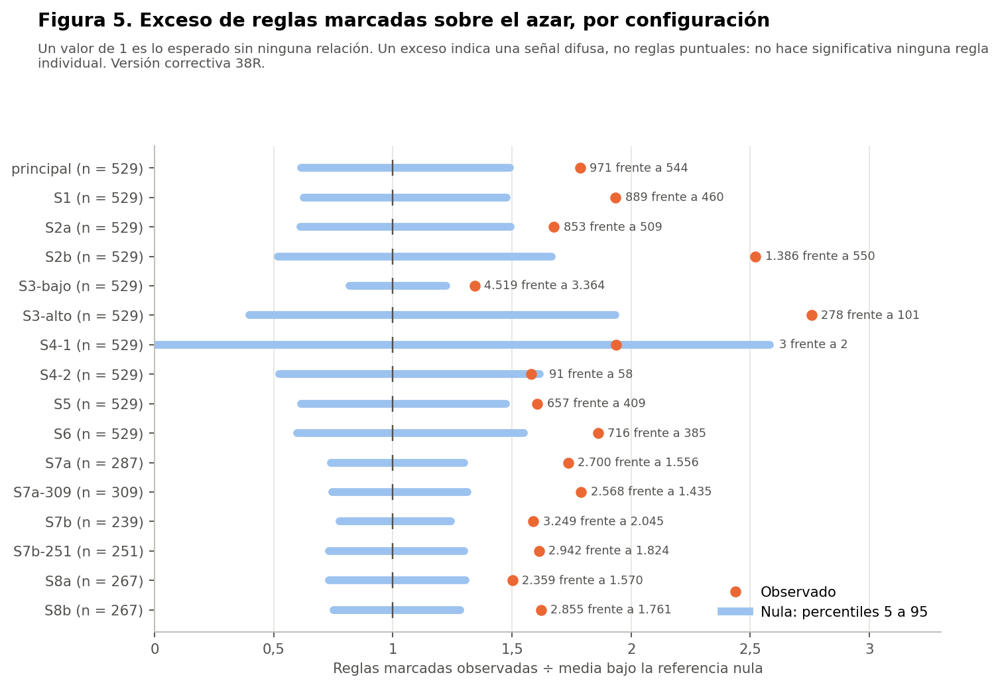
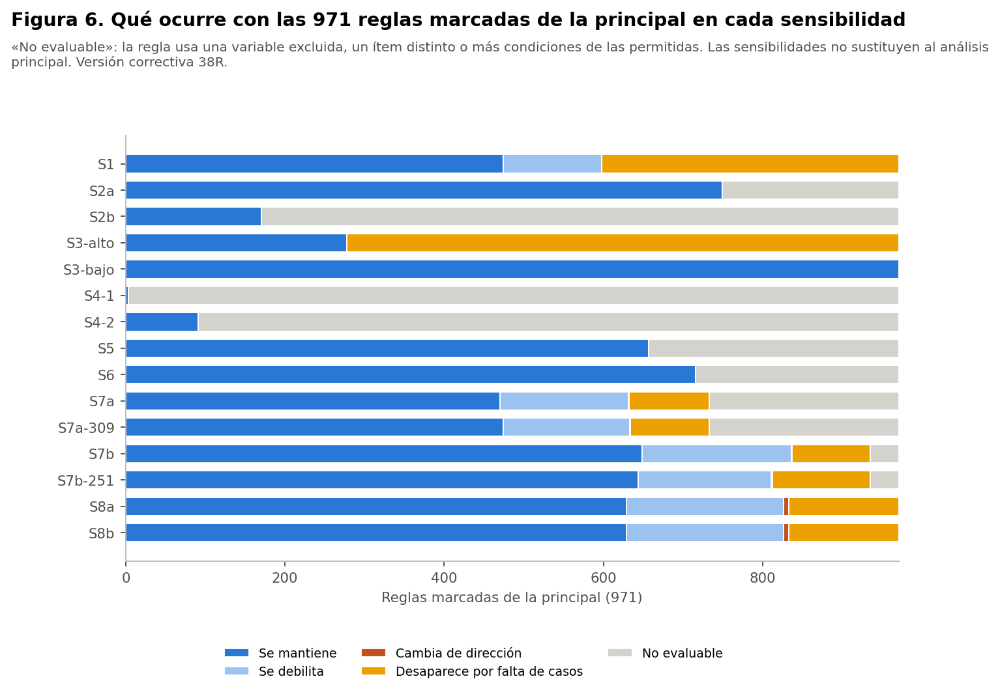

> **Versión correctiva (Fase 38R).** Corrige la Fase 38 histórica retirando de la matriz principal `prevision` y `usa_medicamentos_diabetes`, que las decisiones de las Fases 35 y 36 excluían del modelado. Ninguna de las dos es predictora autorizada y solo se nombran para documentar ese motivo. Todas las cifras de este documento provienen de los resultados corregidos; las cifras de la versión anterior no están vigentes. Las sensibilidades se identifican siempre como tales y no sustituyen al análisis principal.

# Resumen

Todo el análisis usa el conjunto **sintético** de 529 participantes. Las reglas describen lo que contiene la simulación: no son hechos sobre la menopausia en mujeres reales, no son diagnósticos ni predicciones y no permiten recomendaciones de salud. Ninguna asociación indica causa. No hay validación externa: es un análisis **exploratorio** y su utilidad clínica no está demostrada.

Todas las sensibilidades se fijaron en el protocolo. Cada una repite la búsqueda completa con 1.000 permutaciones propias.

| Configuración | Cambio | n | Reglas | Marcadas | Media nula | p (exceso) | Superan la nula |
|---|---|---|---|---|---|---|---|
| principal | Análisis principal | 529 | 9.761 | 971 | 544 | 0,013 | 1 |
| S1 | Sin valores imputados | 529 | 7.542 | 889 | 460 | 0,003 | 0 |
| S2a | Categorías originales sin agrupar | 529 | 9.269 | 853 | 509 | 0,025 | 1 |
| S2b | Agrupación gruesa | 529 | 13.639 | 1.386 | 550 | 0,003 | 2 |
| S3-bajo | Umbral 5 % (antecedente ≥ 27, conjunto ≥ 14) | 529 | 23.025 | 4.519 | 3.364 | 0,007 | 0 |
| S3-alto | Umbral 15 % (antecedente ≥ 80, conjunto ≥ 40) | 529 | 4.938 | 278 | 101 | 0,005 | 0 |
| S4-1 | Antecedentes de una condición | 529 | 77 | 3 | 2 | 0,216 | 0 |
| S4-2 | Antecedentes de hasta dos condiciones | 529 | 1.401 | 91 | 58 | 0,059 | 0 |
| S5 | Sin frecuencias de ejercicio aeróbico, bajo impacto y fuerza | 529 | 6.955 | 657 | 409 | 0,027 | 0 |
| S6 | Sin variables próximas a síntomas | 529 | 7.072 | 716 | 385 | 0,013 | 0 |
| S7a | Trabajadoras con información laboral (287), con módulo laboral | 287 | 10.435 | 2.700 | 1.556 | < 0,001 | 0 |
| S7a-309 | Población laboral ampliada (309), con módulo laboral | 309 | 10.178 | 2.568 | 1.435 | < 0,001 | 0 |
| S7b | Cuidadoras con sobrecarga observada (239), con sobrecarga | 239 | 11.315 | 3.249 | 2.045 | < 0,001 | 1 |
| S7b-251 | Población de cuidadoras ampliada (251, 12 imputadas), con sobrecarga | 251 | 10.747 | 2.942 | 1.824 | 0,002 | 1 |
| S8a | Con IMC observado, sin IMC | 267 | 9.808 | 2.359 | 1.570 | 0,004 | 0 |
| S8b | Con IMC observado, con IMC | 267 | 10.798 | 2.855 | 1.761 | 0,002 | 0 |

**Lectura general (son resultados de sensibilidad, no del análisis principal):**
- **Exceso global:** en 13 de las 15 sensibilidades hay más reglas marcadas que por azar (p < 0,05); no en S4-1, S4-2. Es una señal difusa: un exceso global no hace significativa ninguna regla individual.
- **Reglas que superan su nula:** 5 casos en 4 sensibilidades. Solo se repiten la regla de la clase 6 (S2a) y la de sobrecarga, que aparece en las dos poblaciones de cuidadoras (S7b y S7b-251).
- **Ninguna regla puntual es robusta.**

# Qué ocurre con las 971 reglas marcadas de la principal

| Configuración | Se mantiene | Se debilita | Cambia de dirección | Desaparece por falta de casos | No evaluable |
|---|---|---|---|---|---|
| S1 | 474 | 124 | 0 | 373 | 0 |
| S2a | 749 | 0 | 0 | 0 | 222 |
| S2b | 170 | 0 | 0 | 0 | 801 |
| S3-alto | 278 | 0 | 0 | 693 | 0 |
| S3-bajo | 971 | 0 | 0 | 0 | 0 |
| S4-1 | 3 | 0 | 0 | 0 | 968 |
| S4-2 | 91 | 0 | 0 | 0 | 880 |
| S5 | 657 | 0 | 0 | 0 | 314 |
| S6 | 716 | 0 | 0 | 0 | 255 |
| S7a | 470 | 161 | 1 | 101 | 238 |
| S7a-309 | 474 | 159 | 1 | 99 | 238 |
| S7b | 649 | 187 | 1 | 98 | 36 |
| S7b-251 | 644 | 167 | 1 | 123 | 36 |
| S8a | 629 | 197 | 7 | 138 | 0 |
| S8b | 629 | 197 | 7 | 138 | 0 |

- **Cambios de dirección:** son pocos y solo ocurren en las subpoblaciones (S7 y S8). Cuando una regla se pierde es porque **se debilita o le faltan casos**, no porque se invierta.
- **«No evaluable»:** la regla usa una variable retirada en esa configuración, un ítem que no existe con otra agrupación, o más condiciones de las permitidas.

# Poblaciones de S7a y S7b: observadas y ampliadas

Las sensibilidades de los módulos se analizan solo en la población a la que se aplica cada pregunta, y cada una se identifica con su tamaño:

| Configuración | Población | n | Reglas | Marcadas | Superan la nula |
|---|---|---|---|---|---|
| S7a | Trabajadoras con información laboral | 287 | 10.435 | 2.700 | 0 |
| S7a-309 | Población laboral ampliada | 309 | 10.178 | 2.568 | 0 |
| S7b | Cuidadoras con sobrecarga observada | 239 | 11.315 | 3.249 | 1 |
| S7b-251 | Población de cuidadoras ampliada (12 con sobrecarga imputada) | 251 | 10.747 | 2.942 | 1 |

| Comparación | Marcadas en la primera | Marcadas en la segunda | Marcadas en ambas |
|---|---|---|---|
| S7a frente a S7a-309 | 2.700 | 2.568 | 2.225 |
| S7b frente a S7b-251 | 3.249 | 2.942 | 2.568 |

- **S7a (287):** quienes trabajan y tienen información laboral; 263 tienen ambas respuestas observadas y 24 alguna imputada. **S7a-309** amplía a todas quienes trabajan.
- **S7b (239):** cuidadoras con sobrecarga observada. **S7b-251** añade 12 con sobrecarga imputada.
- **Circularidad:** las preguntas laborales mencionan los síntomas y la sobrecarga puede ser consecuencia de ellos.

# La regla de la clase 6 en cada sensibilidad

| Configuración | n_A | Confianza | Diferencia | Lectura | Supera la nula |
|---|---|---|---|---|---|
| S1 | 52 | 80,8 % | 27,7 pts | desaparece por falta de casos | — |
| S2a | 57 | 80,7 % | 27,6 pts | se mantiene | sí |
| S2b | — | — | — | no evaluable | — |
| S3-bajo | 57 | 80,7 % | 27,6 pts | se mantiene | no |
| S3-alto | 57 | 80,7 % | 27,6 pts | desaparece por falta de casos | — |
| S4-1 | — | — | — | no evaluable | — |
| S4-2 | — | — | — | no evaluable | — |
| S5 | — | — | — | no evaluable | — |
| S6 | — | — | — | no evaluable | — |
| S7a | — | — | — | no evaluable | — |
| S7a-309 | — | — | — | no evaluable | — |
| S7b | 26 | 88,5 % | 31,6 pts | se mantiene | no |
| S7b-251 | 26 | 88,5 % | 32,3 pts | se mantiene | no |
| S8a | 23 | 82,6 % | 29,8 pts | desaparece por falta de casos | — |
| S8b | 23 | 82,6 % | 29,8 pts | desaparece por falta de casos | — |

La regla **mantiene sus medidas descriptivas y su clasificación en el análisis principal, pero no cumple los criterios de robustez**. De las 15 sensibilidades, 8 son evaluables:
- **Se mantiene (4):** S2a, donde además supera la nula, y S3-bajo, S7b y S7b-251, donde es compatible con ella.
- **Desaparece por falta de casos (4):** S1 (n_A 52), S3-alto (umbral 80), S8a y S8b (n_A 23).
- **No evaluable (7):** S2b, S4-1, S4-2, S5, S6, S7a y S7a-309. En S7a y S7a-309, «trabaja» es constante.
- **Clínicamente:** no es una regla validada ni una recomendación individual.

<!-- apaisada -->

# Reglas que superan la nula en alguna sensibilidad

| Configuración | Antecedente | Consecuente | n_A (n) | Confianza | Basal | p ajustado | Redundante | Clase |
|---|---|---|---|---|---|---|---|---|
| S2a | Frecuencia de ejercicio de bajo impacto: no realiza o nunca y Distensión abdominal: nunca o casi nunca y Trabaja actualmente: sí | severos | 57 (529) | 80,7 % | 53,1 % | 0,036 | no | Supera la nula de su sensibilidad (estabilidad no evaluada; no es la clase 6 del protocolo) |
| S2b | Comidas fuera de casa: nunca o 1-2 veces por semana y Días de ejercicio a la semana: 3 o más días | no severos | 60 (529) | 73,3 % | 46,9 % | 0,031 | no | Supera la nula de su sensibilidad (estabilidad no evaluada; no es la clase 6 del protocolo) |
| S2b | Frecuencia de ejercicio de bajo impacto: rara vez a siempre y Usa medicamentos para la presión: no y Frecuencia de tabaco: nunca | no severos | 134 (529) | 64,2 % | 46,9 % | 0,049 | sí | redundante |
| S7b | Frecuencia de ejercicio aeróbico: no realiza o nunca y Vasos de agua al día: 3-4 porciones y Sobrecarga física o emocional por cuidar: frecuente o siempre | severos | 34 (239) | 91,2 % | 56,9 % | 0,038 | no | Supera la nula de su sensibilidad (estabilidad no evaluada; no es la clase 6 del protocolo) |
| S7b-251 | Frecuencia de ejercicio aeróbico: no realiza o nunca y Vasos de agua al día: 3-4 porciones y Sobrecarga física o emocional por cuidar: frecuente o siempre | severos | 34 (251) | 91,2 % | 56,2 % | 0,027 | no | Supera la nula de su sensibilidad (estabilidad no evaluada; no es la clase 6 del protocolo) |

**S2b (agrupación gruesa): dos reglas superan su referencia nula.**
- **Primera, no redundante:** comidas fuera de casa nunca o 1-2 veces por semana y 3 días o más de ejercicio → síntomas no severos (p ajustado 0,031).
- **Segunda, redundante:** ejercicio de bajo impacto de rara vez a siempre, sin medicamentos para la presión y sin tabaco → síntomas no severos (p ajustado 0,049).
- **Cómo leerlas:** solo existen con los ítems agrupados de S2b, no son evaluables en la principal y no se repiten en otra configuración. **No son evidencia confirmatoria.** El corte de «3 días o más» se fijó en el protocolo, sin ver resultados.

**S7b y S7b-251 (cuidadoras):** sin ejercicio aeróbico, 3-4 vasos de agua y sobrecarga frecuente o siempre → síntomas severos, con 34 participantes. La sobrecarga puede reflejar los mismos síntomas. Es exploratoria y no es una recomendación.

<!-- vertical -->

# Detalles por sensibilidad

**S1 (sin valores imputados):**
- **Qué cambia:** las celdas imputadas no generan ítem.
- **Efecto:** muchas reglas pierden casos (373 desaparecen por esa razón), pero ninguna cambia de dirección.
- **Lectura:** las imputaciones de la limpieza no fabrican las reglas, pero sí aportan casos que las sostienen sobre el umbral.

**S2a y S2b (agrupaciones):**
- **Categorías originales:** dan resultados casi iguales a la principal.
- **Agrupación gruesa:** cambia los ítems, así que la mayoría de las reglas no es comparable.

**S3 (umbrales):**
- **Umbral del 5 %:** produce 23.025 reglas y ninguna supera la nula.
- **Umbral del 15 %:** produce 4.938 reglas, también ninguna.
- **Lectura:** bajar el umbral no revela reglas más sólidas; solo agrega ruido.

**S4 (largo):**
- **Una condición:** hay 3 reglas marcadas, frente a 1,5 en promedio bajo el azar (p = 0,216), y ninguna supera la nula.
- **Hasta dos condiciones:** 91 marcadas frente a 57,5 (p = 0,059); tampoco aparece ninguna regla que supere la nula.

**S5 y S6 (variables excluidas de esa sensibilidad):**
- **S5:** quitar las frecuencias de ejercicio no cambia la conclusión.
- **S6:** quitar las variables próximas a síntomas tampoco la cambia; la regla de la clase 6 deja de ser evaluable.

**S8 (IMC observado, n = 267):**
- **Resultado:** con o sin las categorías de IMC, ninguna regla supera la nula.
- **Cambios de dirección:** las 7 reglas que cambian de dirección en S8 se deben a la subpoblación, no al IMC: son las mismas en S8a y S8b.
