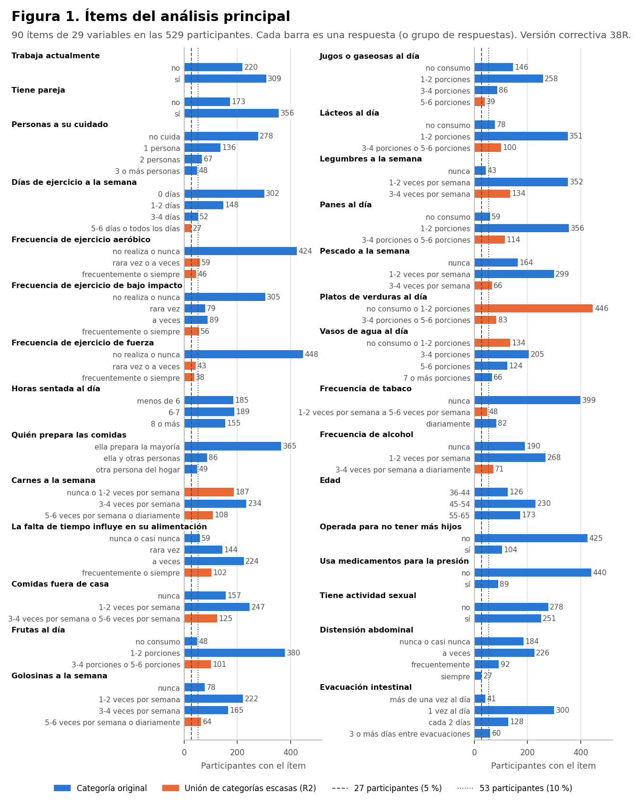
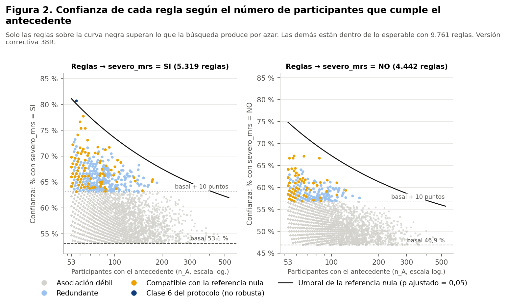
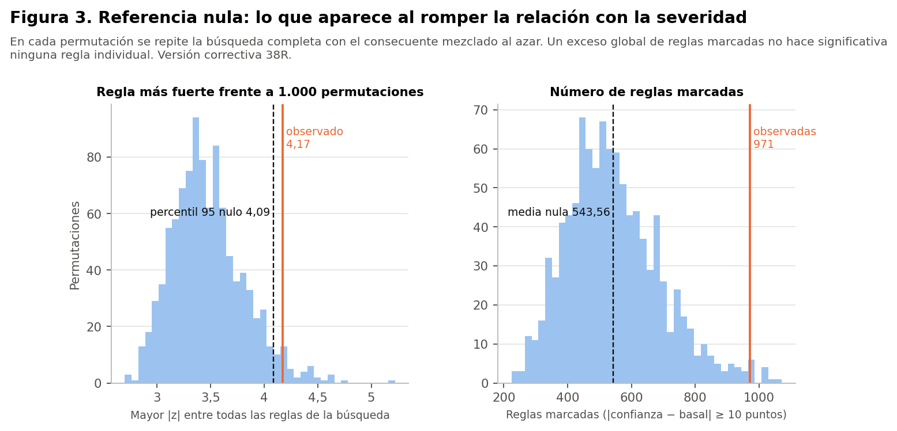
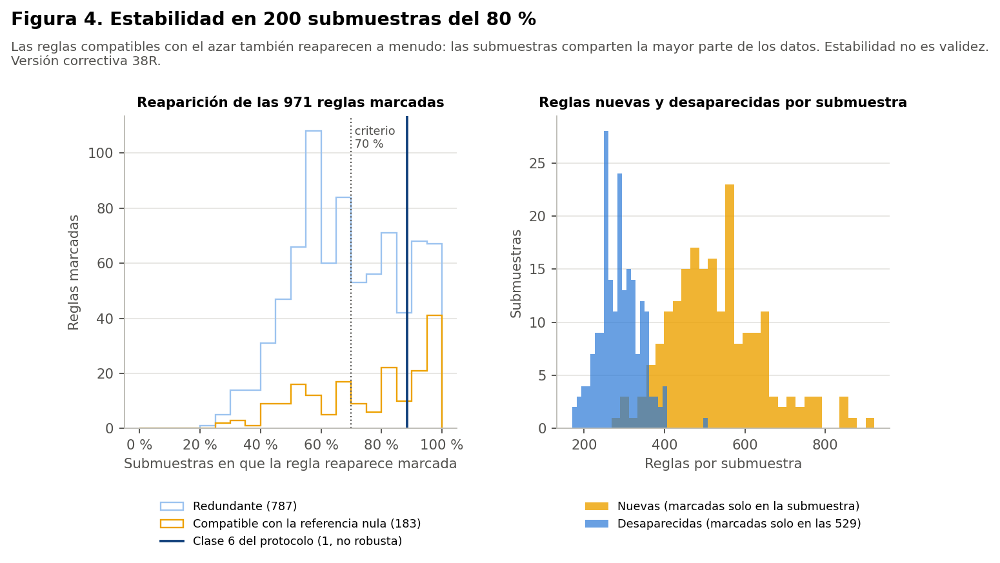
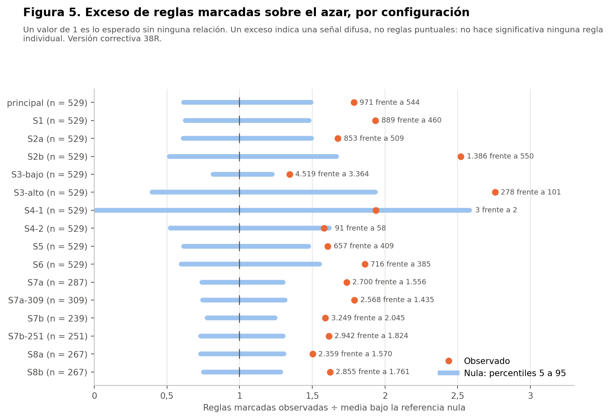
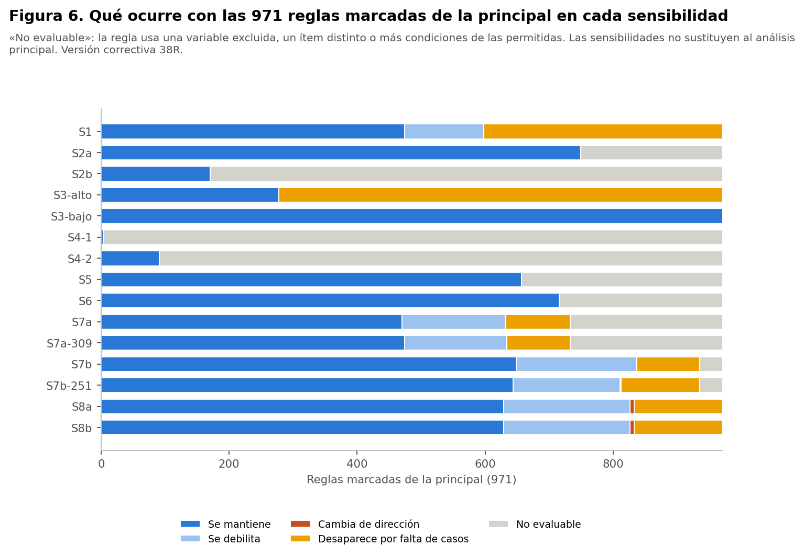
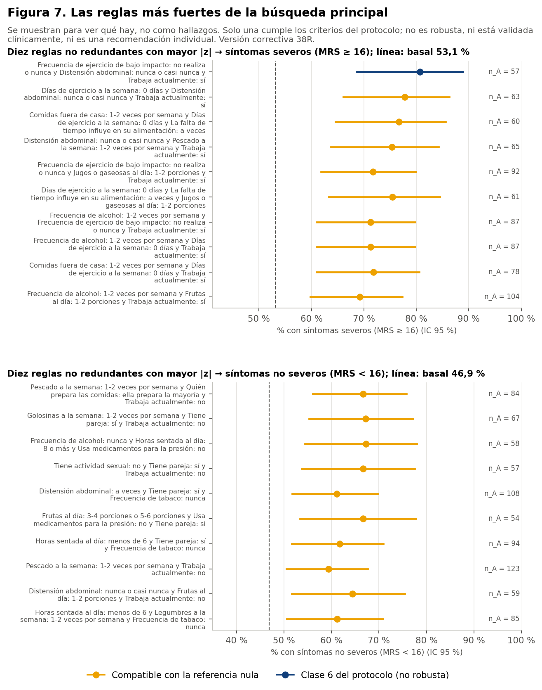
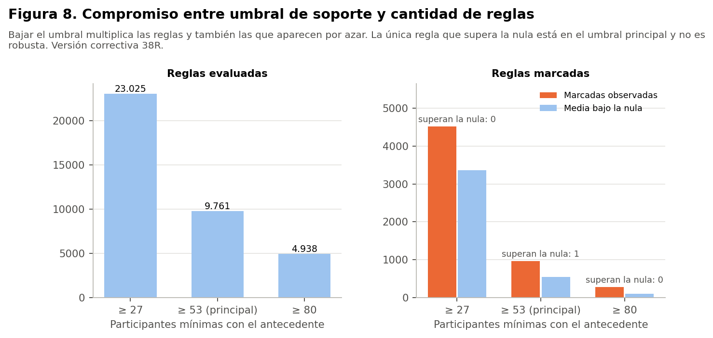

> **Versión correctiva (Fase 38R).** Corrige la Fase 38 histórica retirando de la matriz principal `prevision` y `usa_medicamentos_diabetes`, que las decisiones de las Fases 35 y 36 excluían del modelado. Ninguna de las dos es predictora autorizada y solo se nombran para documentar ese motivo. Todas las cifras de este documento provienen de los resultados corregidos; las cifras de la versión anterior no están vigentes. Las sensibilidades se identifican siempre como tales y no sustituyen al análisis principal.

# Contenido

Todo el análisis usa el conjunto **sintético** de 529 participantes. Las reglas describen lo que contiene la simulación: no son hechos sobre la menopausia en mujeres reales, no son diagnósticos ni predicciones y no permiten recomendaciones de salud. Ninguna asociación indica causa. No hay validación externa: es un análisis **exploratorio** y su utilidad clínica no está demostrada.

Hay 8 figuras, generadas desde las tablas corregidas con `documentos_definitivos/scripts/figuras_38r.py`, y 68 tablas de respaldo. Los lotes de permutaciones y submuestras están en `referencia_nula/` y `sensibilidades/lotes/`, y sirven para reanudar si se interrumpe la ejecución.

# Tablas

| Archivo |
|---|
| estabilidad/estabilidad_familias.csv |
| estabilidad/estabilidad_reglas.csv |
| estabilidad/submuestras.csv |
| preparacion/diccionario_items.csv |
| preparacion/matriz_transaccional_principal.csv |
| preparacion/poblaciones_verificadas.csv |
| preparacion/resumen_transacciones.csv |
| preparacion/sensibilidades/matriz_S1.csv |
| preparacion/sensibilidades/matriz_S2a.csv |
| preparacion/sensibilidades/matriz_S2b.csv |
| preparacion/sensibilidades/matriz_S5.csv |
| preparacion/sensibilidades/matriz_S6.csv |
| preparacion/sensibilidades/matriz_S7a-309.csv |
| preparacion/sensibilidades/matriz_S7a.csv |
| preparacion/sensibilidades/matriz_S7b-251.csv |
| preparacion/sensibilidades/matriz_S7b.csv |
| preparacion/sensibilidades/matriz_S8a.csv |
| preparacion/sensibilidades/matriz_S8b.csv |
| preparacion/trazabilidad_transformaciones.csv |
| preparacion/verificacion_preparacion.json |
| referencia_nula/nula_principal.csv |
| reglas/clases_principal.csv |
| reglas/cobertura.csv |
| reglas/conviccion_descriptiva_anexo.csv |
| reglas/entorno.json |
| reglas/equivalencia_algoritmos.csv |
| reglas/equivalencia_comparaciones.csv |
| reglas/familias_marcadas.csv |
| reglas/redundantes_marcadas.csv |
| reglas/reglas_destacadas.csv |
| reglas/reglas_no_destacadas_mayor_z.csv |
| reglas/reglas_principal.csv |
| reglas/resumen_principal.json |
| sensibilidades/clases_sensibilidades.csv |
| sensibilidades/lectura_reglas_principal.csv |
| sensibilidades/lectura_resumen.csv |
| sensibilidades/nula/nula_S1.csv |
| sensibilidades/nula/nula_S2a.csv |
| sensibilidades/nula/nula_S2b.csv |
| sensibilidades/nula/nula_S3-alto.csv |
| sensibilidades/nula/nula_S3-bajo.csv |
| sensibilidades/nula/nula_S4-1.csv |
| sensibilidades/nula/nula_S4-2.csv |
| sensibilidades/nula/nula_S5.csv |
| sensibilidades/nula/nula_S6.csv |
| sensibilidades/nula/nula_S7a-309.csv |
| sensibilidades/nula/nula_S7a.csv |
| sensibilidades/nula/nula_S7b-251.csv |
| sensibilidades/nula/nula_S7b.csv |
| sensibilidades/nula/nula_S8a.csv |
| sensibilidades/nula/nula_S8b.csv |
| sensibilidades/reglas/reglas_S1.csv |
| sensibilidades/reglas/reglas_S2a.csv |
| sensibilidades/reglas/reglas_S2b.csv |
| sensibilidades/reglas/reglas_S3-alto.csv |
| sensibilidades/reglas/reglas_S3-bajo.csv |
| sensibilidades/reglas/reglas_S4-1.csv |
| sensibilidades/reglas/reglas_S4-2.csv |
| sensibilidades/reglas/reglas_S5.csv |
| sensibilidades/reglas/reglas_S6.csv |
| sensibilidades/reglas/reglas_S7a-309.csv |
| sensibilidades/reglas/reglas_S7a.csv |
| sensibilidades/reglas/reglas_S7b-251.csv |
| sensibilidades/reglas/reglas_S7b.csv |
| sensibilidades/reglas/reglas_S8a.csv |
| sensibilidades/reglas/reglas_S8b.csv |
| sensibilidades/resumen_sensibilidades.csv |
| sensibilidades/superan_nula_sensibilidades.csv |

# Figuras

