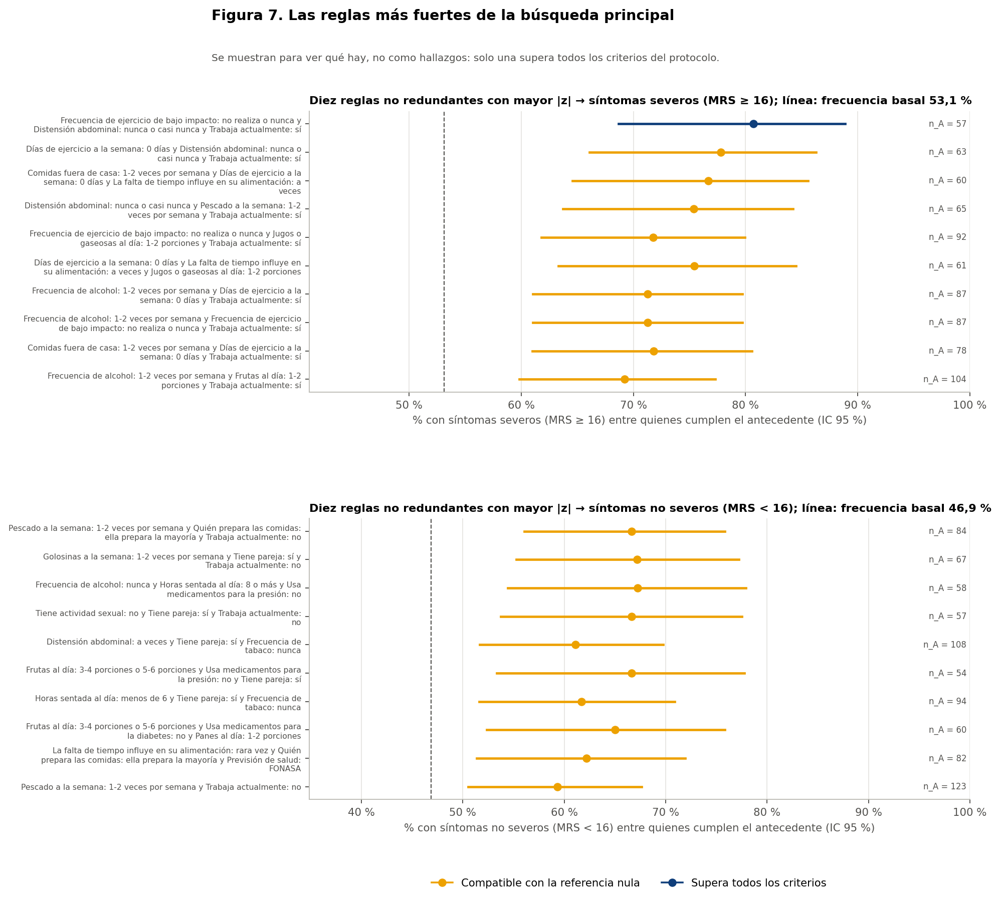

# Resumen

Todo el análisis usa el conjunto **sintético** de 529 participantes. Las reglas describen lo que contiene la simulación: no son hechos sobre la menopausia en mujeres reales, no son diagnósticos ni predicciones y no permiten recomendaciones de salud. Ninguna asociación indica causa.

- **Búsqueda principal:** se evaluaron **12.201 reglas** de 1 a 3 condiciones, todas las combinaciones con al menos 53 participantes en el antecedente.
- **Marcadas:** 1.119 se alejan al menos 10 puntos de la frecuencia basal. Bajo la referencia nula aparecen 650 marcadas en promedio, con un percentil 95 de 970.
- **Señal difusa:** hay más reglas marcadas de lo que produce el azar (p = 0,015). La relación entre hábitos y severidad no es nula en los datos sintéticos, pero está repartida en muchas combinaciones débiles.
- **Reglas que superan la referencia nula:** solo **1** regla supera la nula de toda la búsqueda. Cumple además los criterios de estabilidad y no redundancia, así que es la **única de la clase 6**. Es frágil (informe 12).
- **Benjamini-Hochberg:** sobre todas las reglas, ninguna tiene q < 0,05; el mínimo es 0,096.

# Clasificación de todas las reglas

| Clase | Reglas | → severos | → no severos |
|---|---|---|---|
| asociación débil | 11.082 | 5.601 | 5.481 |
| redundante | 926 | 563 | 363 |
| compatible con la referencia nula | 192 | 110 | 82 |
| asociación relativamente más marcada | 1 | 1 | 0 |

- **Asociación débil:** la confianza está a menos de 10 puntos de la frecuencia basal.
- **Redundante:** agregar una condición mejora la confianza en menos de 5 puntos respecto de una regla más simple.
- **Compatible con la referencia nula:** su fuerza está dentro de lo que aparece al buscar entre 12.201 reglas sin ninguna relación real.
- **Inestables:** ninguna regla queda en esta clase.

## La única regla de la clase 6

**Frecuencia de ejercicio de bajo impacto: no realiza o nunca y Distensión abdominal: nunca o casi nunca y Trabaja actualmente: sí** → síntomas severos (mrs ≥ 16)

| Antecedente | Consecuente | n (con / antecedente) | Soporte | Confianza (IC 95 %) | Basal | Lift | Diferencia | p ajustado (búsqueda) | Reaparece | Clase |
|---|---|---|---|---|---|---|---|---|---|---|
| Frecuencia de ejercicio de bajo impacto: no realiza o nunca y Distensión abdominal: nunca o casi nunca y Trabaja actualmente: sí | severos | 46 de 57 | 8,7 % | 80,7 % (69-89) | 53,1 % | 1,52 | +27,6 pts | 0,038 | 88 % | asociación relativamente más marcada |

**Lectura sencilla:**
- **Cifras:** de las 57 participantes que trabajan, no hacen ejercicio de bajo impacto y casi nunca tienen distensión abdominal, 46 (81 %) tienen síntomas severos, frente al 53 % del total.
- **Margen:** supera la referencia nula por poco (p ajustado 0,038, con un corte de 0,05). Reaparece marcada en el 88 % de las submuestras.

**Advertencias:**
- **Dirección inesperada:** incluye una variable próxima a síntomas, la distensión abdominal, en una dirección poco intuitiva: casi nunca tener distensión aparece junto a más síntomas severos.
- **Fragilidad:** no sobrevive a varias sensibilidades (informe 12).
- **Lectura:** describe una combinación del conjunto sintético, no un mecanismo.

# Reglas más fuertes que no destacan

La tabla muestra, para cada consecuente, las 10 reglas no redundantes con mayor |z|. **No son hallazgos:** salvo la primera, todas son compatibles con la referencia nula. Se muestran para que se vea qué hay y no quede oculto.

| Antecedente | Consecuente | n (con / antecedente) | Soporte | Confianza (IC 95 %) | Basal | Lift | Diferencia | p ajustado (búsqueda) | Reaparece | Clase |
|---|---|---|---|---|---|---|---|---|---|---|
| Frecuencia de ejercicio de bajo impacto: no realiza o nunca y Distensión abdominal: nunca o casi nunca y Trabaja actualmente: sí | severos | 46 de 57 | 8,7 % | 80,7 % (69-89) | 53,1 % | 1,52 | +27,6 pts | 0,038 | 88 % | asociación relativamente más marcada |
| Días de ejercicio a la semana: 0 días y Distensión abdominal: nunca o casi nunca y Trabaja actualmente: sí | severos | 49 de 63 | 9,3 % | 77,8 % (66-86) | 53,1 % | 1,46 | +24,7 pts | 0,113 | 98 % | compatible con la referencia nula |
| Comidas fuera de casa: 1-2 veces por semana y Días de ejercicio a la semana: 0 días y La falta de tiempo influye en su alimentación: a veces | severos | 46 de 60 | 8,7 % | 76,7 % (65-86) | 53,1 % | 1,44 | +23,5 pts | 0,285 | 98 % | compatible con la referencia nula |
| Distensión abdominal: nunca o casi nunca y Pescado a la semana: 1-2 veces por semana y Trabaja actualmente: sí | severos | 49 de 65 | 9,3 % | 75,4 % (64-84) | 53,1 % | 1,42 | +22,3 pts | 0,341 | 100 % | compatible con la referencia nula |
| Frecuencia de ejercicio de bajo impacto: no realiza o nunca y Jugos o gaseosas al día: 1-2 porciones y Trabaja actualmente: sí | severos | 66 de 92 | 12,5 % | 71,7 % (62-80) | 53,1 % | 1,35 | +18,6 pts | 0,356 | 100 % | compatible con la referencia nula |
| Días de ejercicio a la semana: 0 días y La falta de tiempo influye en su alimentación: a veces y Jugos o gaseosas al día: 1-2 porciones | severos | 46 de 61 | 8,7 % | 75,4 % (63-84) | 53,1 % | 1,42 | +22,3 pts | 0,464 | 98 % | compatible con la referencia nula |
| Frecuencia de alcohol: 1-2 veces por semana y Días de ejercicio a la semana: 0 días y Trabaja actualmente: sí | severos | 62 de 87 | 11,7 % | 71,3 % (61-80) | 53,1 % | 1,34 | +18,1 pts | 0,593 | 100 % | compatible con la referencia nula |
| Frecuencia de alcohol: 1-2 veces por semana y Frecuencia de ejercicio de bajo impacto: no realiza o nunca y Trabaja actualmente: sí | severos | 62 de 87 | 11,7 % | 71,3 % (61-80) | 53,1 % | 1,34 | +18,1 pts | 0,593 | 100 % | compatible con la referencia nula |
| Comidas fuera de casa: 1-2 veces por semana y Días de ejercicio a la semana: 0 días y Trabaja actualmente: sí | severos | 56 de 78 | 10,6 % | 71,8 % (61-81) | 53,1 % | 1,35 | +18,7 pts | 0,717 | 100 % | compatible con la referencia nula |
| Frecuencia de alcohol: 1-2 veces por semana y Frutas al día: 1-2 porciones y Trabaja actualmente: sí | severos | 72 de 104 | 13,6 % | 69,2 % (60-77) | 53,1 % | 1,30 | +16,1 pts | 0,736 | 100 % | compatible con la referencia nula |
| Pescado a la semana: 1-2 veces por semana y Quién prepara las comidas: ella prepara la mayoría y Trabaja actualmente: no | no severos | 56 de 84 | 10,6 % | 66,7 % (56-76) | 46,9 % | 1,42 | +19,8 pts | 0,311 | 100 % | compatible con la referencia nula |
| Golosinas a la semana: 1-2 veces por semana y Tiene pareja: sí y Trabaja actualmente: no | no severos | 45 de 67 | 8,5 % | 67,2 % (55-77) | 46,9 % | 1,43 | +20,3 pts | 0,694 | 100 % | compatible con la referencia nula |
| Frecuencia de alcohol: nunca y Horas sentada al día: 8 o más y Usa medicamentos para la presión: no | no severos | 39 de 58 | 7,4 % | 67,2 % (54-78) | 46,9 % | 1,43 | +20,4 pts | 0,902 | 92 % | compatible con la referencia nula |
| Tiene actividad sexual: no y Tiene pareja: sí y Trabaja actualmente: no | no severos | 38 de 57 | 7,2 % | 66,7 % (54-78) | 46,9 % | 1,42 | +19,8 pts | 0,962 | 85 % | compatible con la referencia nula |
| Distensión abdominal: a veces y Tiene pareja: sí y Frecuencia de tabaco: nunca | no severos | 66 de 108 | 12,5 % | 61,1 % (52-70) | 46,9 % | 1,30 | +14,2 pts | 0,971 | 96 % | compatible con la referencia nula |
| Frutas al día: 3-4 porciones o 5-6 porciones y Usa medicamentos para la presión: no y Tiene pareja: sí | no severos | 36 de 54 | 6,8 % | 66,7 % (53-78) | 46,9 % | 1,42 | +19,8 pts | 0,984 | 59 % | compatible con la referencia nula |
| Horas sentada al día: menos de 6 y Tiene pareja: sí y Frecuencia de tabaco: nunca | no severos | 58 de 94 | 11,0 % | 61,7 % (52-71) | 46,9 % | 1,32 | +14,8 pts | 0,987 | 98 % | compatible con la referencia nula |
| Frutas al día: 3-4 porciones o 5-6 porciones y Usa medicamentos para la diabetes: no y Panes al día: 1-2 porciones | no severos | 39 de 60 | 7,4 % | 65,0 % (52-76) | 46,9 % | 1,39 | +18,1 pts | 0,997 | 96 % | compatible con la referencia nula |
| La falta de tiempo influye en su alimentación: rara vez y Quién prepara las comidas: ella prepara la mayoría y Previsión de salud: FONASA | no severos | 51 de 82 | 9,6 % | 62,2 % (51-72) | 46,9 % | 1,33 | +15,3 pts | 0,997 | 100 % | compatible con la referencia nula |
| Pescado a la semana: 1-2 veces por semana y Trabaja actualmente: no | no severos | 73 de 123 | 13,8 % | 59,3 % (51-68) | 46,9 % | 1,27 | +12,5 pts | 0,997 | 90 % | compatible con la referencia nula |

**Patrones que se repiten:**
- **Con los síntomas severos:** trabajar, no hacer ejercicio (0 días o sin bajo impacto) y frecuencias intermedias de algunos alimentos.
- **Con los síntomas no severos:** no trabajar, tener pareja y algunos hábitos de alimentación.

Ninguno supera la referencia nula salvo la regla de la clase 6. Los patrones son coherentes con las asociaciones pequeñas de la Fase 37D (trabajo y ejercicio), pero esta fase no las confirma de forma independiente.
