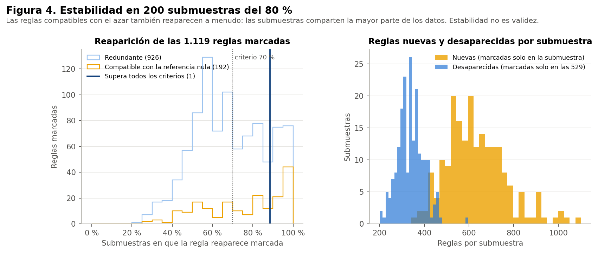

# Método

Todo el análisis usa el conjunto **sintético** de 529 participantes. Las reglas describen lo que contiene la simulación: no son hechos sobre la menopausia en mujeres reales, no son diagnósticos ni predicciones y no permiten recomendaciones de salud. Ninguna asociación indica causa.

- **Submuestras:** 200 del 80 % (423 participantes), sin reemplazo y con semilla 42.
- **Redescubrimiento:** en cada una se buscan de nuevo las reglas, con los mismos ítems y agrupaciones y con umbrales proporcionales: n_A ≥ 43 y n_AC ≥ 22.
- **Sin fuga:** las agrupaciones se fijaron con las 529 y sin el MRS, y no se reajustan.
- **Regla estable:** reaparece marcada en al menos el 70 % de las submuestras y mantiene la dirección en al menos el 95 %.

# Resultados

- **Reglas estables:** 535 de 1.119 reglas marcadas son estables.
- **La regla de la clase 6:** reaparece marcada en el 88 % de las submuestras y siempre en la misma dirección. Su confianza varía entre 76 % y 85 % (percentiles 2,5 y 97,5) y su lift entre 1,43 y 1,61.
- **Familias:** de 1.089 familias con reglas marcadas, 571 reaparecen en al menos el 70 % de las submuestras.
- **Recambio en cada submuestra:**
  - En promedio aparecen 1.411 reglas marcadas (entre 863 y 2.000).
  - De ellas, 631 son nuevas: no estaban marcadas en las 529.
  - Desaparecen en promedio 339 de las 1.119.
  - Las reglas marcadas cambian mucho de una submuestra a otra.

# Lectura

**La estabilidad no separa la señal del ruido en este diseño.**

- **Reglas compatibles con el azar:** las 192 reglas no redundantes compatibles con la referencia nula reaparecen en promedio en el 76 % de las submuestras, y 118 cumplen el criterio de estabilidad.
- **Motivo:** las submuestras del 80 % comparten la mayor parte de las participantes. Una regla que aparece por azar en las 529 tiende a reaparecer en submuestras que contienen casi los mismos datos.
- **Consecuencia:** la estabilidad es una condición necesaria, no suficiente. **No demuestra validez y menos validez clínica.** El control principal contra las reglas casuales es la referencia nula (informe 11).
