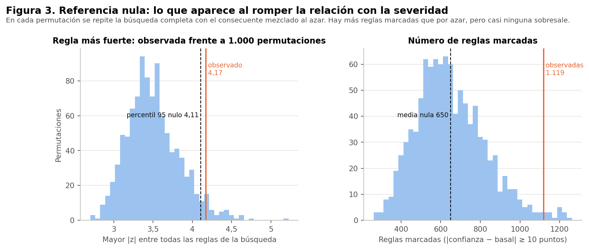

# Método

Todo el análisis usa el conjunto **sintético** de 529 participantes. Las reglas describen lo que contiene la simulación: no son hechos sobre la menopausia en mujeres reales, no son diagnósticos ni predicciones y no permiten recomendaciones de salud. Ninguna asociación indica causa.

- **Permutaciones:** 1.000 de la severidad entre las participantes (semilla 42). Cada una conserva todas las características de cada participante y la frecuencia basal (281 severas), y rompe cualquier relación entre ambas.
- **Búsqueda completa en cada permutación:** las mismas 12.325 combinaciones y los mismos umbrales.
- **Valor p ajustado de cada regla:** la proporción de permutaciones en que **la regla más fuerte de toda la búsqueda** iguala o supera a la regla observada. Es el método de máximo estadístico de Westfall-Young, que corrige por haber buscado entre miles de reglas.
- **Cuándo se supera la nula:** con un p ajustado menor que 0,05.

# Resultados

|  | Observado | Referencia nula: media | Percentil 95 | p |
|---|---|---|---|---|
| Reglas marcadas | 1.119 | 650 | 970 | 0,015 |
| Mayor /z/ de la búsqueda | 4,17 | 3,50 | 4,11 | 0,038 |
| Mayor diferencia respecto de la basal | 27,6 pts | 22,4 pts | 26,7 pts | — |

**Lectura:**
- **En conjunto, hay más reglas que por azar.** Sin relación real aparecen unas 650 reglas marcadas; en los datos hay 1.119. La diferencia indica una asociación real en la simulación, pero repartida y débil.
- **Ninguna regla puntual sobresale con claridad.** La mayor diferencia observada (27,6 puntos) es parecida a la que el azar produce en el 5 % de las búsquedas (26,7 puntos). Solo una regla supera el umbral, y por poco (p = 0,038).
- **Reglas que aparecen fácilmente bajo la nula:** las 192 reglas marcadas no redundantes de la clase 4, más todas las débiles y las redundantes. Su fuerza está dentro de lo que el azar produce al buscar entre 12.201 reglas.

**Valores p y Benjamini-Hochberg:**
- **p de Fisher:** cada regla tiene uno, pero es ordinario. La regla se descubrió con los mismos datos, así que ese p no confirma nada.
- **Benjamini-Hochberg:** se aplicó a **todas** las reglas evaluadas, no solo a las seleccionadas. Ninguna queda con q < 0,05.
