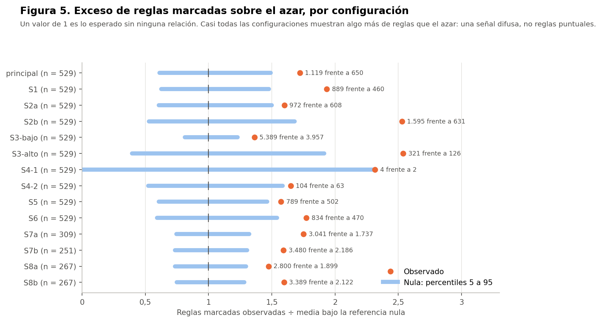
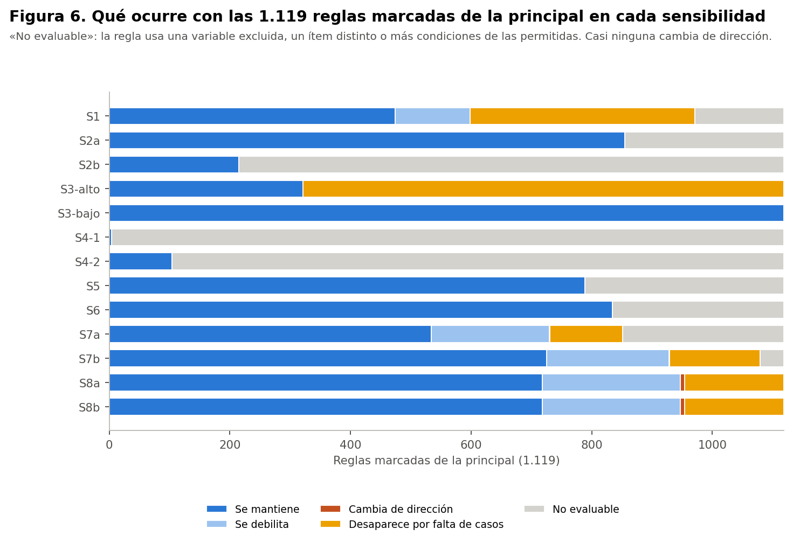

# Resumen

Todo el análisis usa el conjunto **sintético** de 529 participantes. Las reglas describen lo que contiene la simulación: no son hechos sobre la menopausia en mujeres reales, no son diagnósticos ni predicciones y no permiten recomendaciones de salud. Ninguna asociación indica causa.

Todas las sensibilidades se fijaron en el protocolo. Cada una repite la búsqueda completa con 1.000 permutaciones propias.

| Configuración | Cambio | n | Reglas | Marcadas | Media nula | p (exceso) | Superan la nula |
|---|---|---|---|---|---|---|---|
| principal | Análisis principal | 529 | 12.201 | 1.119 | 650 | 0,015 | 1 |
| S1 | Sin valores imputados (sin diabetes ni previsión) | 529 | 7.542 | 889 | 460 | 0,003 | 0 |
| S2a | Categorías originales sin agrupar | 529 | 11.602 | 972 | 608 | 0,029 | 1 |
| S2b | Agrupación gruesa | 529 | 16.126 | 1.595 | 631 | 0,003 | 10 |
| S3-bajo | Umbral 5 % (antecedente ≥ 27, conjunto ≥ 14) | 529 | 27.767 | 5.389 | 3.957 | 0,004 | 0 |
| S3-alto | Umbral 15 % (antecedente ≥ 80, conjunto ≥ 40) | 529 | 6.488 | 321 | 126 | 0,012 | 0 |
| S4-1 | Antecedentes de una condición | 529 | 81 | 4 | 2 | 0,109 | 0 |
| S4-2 | Antecedentes de hasta dos condiciones | 529 | 1.565 | 104 | 63 | 0,037 | 0 |
| S5 | Sin frecuencias de ejercicio aeróbico, bajo impacto y fuerza | 529 | 9.002 | 789 | 502 | 0,034 | 0 |
| S6 | Sin variables próximas a síntomas | 529 | 9.033 | 834 | 470 | 0,016 | 0 |
| S7a | Quienes trabajan, con módulo laboral | 309 | 12.772 | 3.041 | 1.737 | < 0,001 | 0 |
| S7b | Quienes cuidan, con sobrecarga | 251 | 13.401 | 3.480 | 2.186 | 0,003 | 1 |
| S8a | Con IMC observado, sin IMC | 267 | 12.287 | 2.800 | 1.899 | 0,006 | 0 |
| S8b | Con IMC observado, con IMC | 267 | 13.479 | 3.389 | 2.122 | 0,002 | 0 |

**Lectura general:**
- **Hay más reglas marcadas que por azar en casi todas las configuraciones** (p ≤ 0,04), salvo cuando solo se permite una condición (S4-1). La señal difusa es robusta.
- **Las reglas que superan la nula son pocas y distintas en cada configuración:** 12 entre las 13 sensibilidades, ninguna igual en dos configuraciones, salvo la regla de la clase 6, que reaparece con las categorías originales (S2a).
- **Ninguna regla puntual es robusta.**

# Qué ocurre con las 1.119 reglas marcadas de la principal

| Configuración | Se mantiene | Se debilita | Cambia de dirección | Desaparece por falta de casos | No evaluable |
|---|---|---|---|---|---|
| S1 | 474 | 124 | 0 | 373 | 148 |
| S2a | 855 | 0 | 0 | 0 | 264 |
| S2b | 215 | 0 | 0 | 0 | 904 |
| S3-alto | 321 | 0 | 0 | 798 | 0 |
| S3-bajo | 1.119 | 0 | 0 | 0 | 0 |
| S4-1 | 4 | 0 | 0 | 0 | 1.115 |
| S4-2 | 104 | 0 | 0 | 0 | 1.015 |
| S5 | 789 | 0 | 0 | 0 | 330 |
| S6 | 834 | 0 | 0 | 0 | 285 |
| S7a | 534 | 196 | 1 | 120 | 268 |
| S7b | 725 | 203 | 1 | 150 | 40 |
| S8a | 718 | 229 | 7 | 165 | 0 |
| S8b | 718 | 229 | 7 | 165 | 0 |

- **Cambios de dirección:** casi ninguna regla cambia de dirección, y las que cambian son de las subpoblaciones (S7, S8). Cuando una regla se pierde es porque **se debilita o le faltan casos**, no porque se invierta.
- **«No evaluable»:** la regla usa una variable excluida, un ítem que no existe con otra agrupación, o más condiciones de las permitidas.

# La regla de la clase 6 en cada sensibilidad

| Configuración | n_A | Confianza | Diferencia | Lectura | Supera la nula |
|---|---|---|---|---|---|
| S1 | 52 | 80,8 % | 27,7 pts | desaparece por falta de casos | — |
| S2a | 57 | 80,7 % | 27,6 pts | se mantiene | sí |
| S2b | — | — | — | no evaluable | — |
| S3-bajo | 57 | 80,7 % | 27,6 pts | se mantiene | no |
| S3-alto | 57 | 80,7 % | 27,6 pts | desaparece por falta de casos | — |
| S4-1 | — | — | — | no evaluable | — |
| S4-2 | — | — | — | no evaluable | — |
| S5 | — | — | — | no evaluable | — |
| S6 | — | — | — | no evaluable | — |
| S7a | — | — | — | no evaluable | — |
| S7b | 26 | 88,5 % | 32,3 pts | se mantiene | no |
| S8a | 23 | 82,6 % | 29,8 pts | desaparece por falta de casos | — |
| S8b | 23 | 82,6 % | 29,8 pts | desaparece por falta de casos | — |

La regla **no es robusta**:
- **S1 (sin imputados):** baja a 52 casos, bajo el umbral de 53.
- **Umbral del 5 %:** queda compatible con la nula, porque la búsqueda es más amplia.
- **Umbral del 15 %:** no tiene casos suficientes.
- **S5 y S6:** no es evaluable, porque usa una frecuencia de ejercicio (S5) y una variable próxima a síntomas (S6).
- **S7a:** no es evaluable, porque «trabaja» es constante en esa subpoblación.
- **S7b:** se mantiene en dirección, pero ya no supera la nula.
- **Solo se mantiene** con las categorías originales (S2a), que no cambian sus ítems.

# Reglas que superan la nula en alguna sensibilidad

| Configuración | Antecedente | Consecuente | n_A (n) | Confianza | Basal | p ajustado | Clase |
|---|---|---|---|---|---|---|---|
| S2a | Frecuencia de ejercicio de bajo impacto: no realiza o nunca y Distensión abdominal: nunca o casi nunca y Trabaja actualmente: sí | severos | 57 (529) | 80,7 % | 53,1 % | 0,042 | 6 supera la nula (estabilidad no evaluada) |
| S2b | Comidas fuera de casa: nunca o 1-2 veces por semana y Días de ejercicio a la semana: 3 o más días | no severos | 60 (529) | 73,3 % | 46,9 % | 0,033 | 6 supera la nula (estabilidad no evaluada) |
| S2b | Días de ejercicio a la semana: 3 o más días y Previsión de salud: FONASA | no severos | 68 (529) | 73,5 % | 46,9 % | 0,011 | 6 supera la nula (estabilidad no evaluada) |
| S2b | Vasos de agua al día: 3-4 porciones a 7 o más porciones y Días de ejercicio a la semana: 3 o más días y Previsión de salud: FONASA | no severos | 61 (529) | 73,8 % | 46,9 % | 0,022 | redundante |
| S2b | Frecuencia de ejercicio de bajo impacto: rara vez a siempre y Días de ejercicio a la semana: 3 o más días y Previsión de salud: FONASA | no severos | 53 (529) | 75,5 % | 46,9 % | 0,024 | redundante |
| S2b | Comidas fuera de casa: nunca o 1-2 veces por semana y Días de ejercicio a la semana: 3 o más días y Usa medicamentos para la diabetes: no | no severos | 55 (529) | 74,5 % | 46,9 % | 0,030 | redundante |
| S2b | Días de ejercicio a la semana: 3 o más días y La falta de tiempo influye en su alimentación: nunca o casi nunca a a veces y Previsión de salud: FONASA | no severos | 57 (529) | 73,7 % | 46,9 % | 0,044 | redundante |
| S2b | Días de ejercicio a la semana: 3 o más días y Usa medicamentos para la diabetes: no y Previsión de salud: FONASA | no severos | 61 (529) | 75,4 % | 46,9 % | 0,008 | redundante |
| S2b | Días de ejercicio a la semana: 3 o más días y Usa medicamentos para la presión: no y Previsión de salud: FONASA | no severos | 60 (529) | 75,0 % | 46,9 % | 0,012 | redundante |
| S2b | Días de ejercicio a la semana: 3 o más días y Operada para no tener más hijos: no y Previsión de salud: FONASA | no severos | 55 (529) | 78,2 % | 46,9 % | 0,004 | redundante |
| S2b | Días de ejercicio a la semana: 3 o más días y Pescado a la semana: nunca o 1-2 veces por semana y Previsión de salud: FONASA | no severos | 58 (529) | 75,9 % | 46,9 % | 0,011 | redundante |
| S7b | Frecuencia de ejercicio aeróbico: no realiza o nunca y Vasos de agua al día: 3-4 porciones y Sobrecarga física o emocional por cuidar: frecuente o siempre | severos | 34 (251) | 91,2 % | 56,2 % | 0,032 | 6 supera la nula (estabilidad no evaluada) |

**Reglas que aparecen solo en una sensibilidad:**
- **S2b (agrupación gruesa):** las reglas que superan la nula giran en torno a **«3 días o más de ejercicio» → síntomas no severos**, combinado con condiciones muy frecuentes (FONASA, no usar medicamentos). Solo dos de ellas no son redundantes. Es la misma dirección que la asociación pequeña de la Fase 37D entre días de ejercicio y MRS. Aparece al juntar las categorías de 3 días o más (79 participantes), un corte que el protocolo fijó para S2b sin ver resultados.
- **S7b (quienes cuidan, n = 251):** una regla con sobrecarga frecuente, sin ejercicio aeróbico y 3-4 vasos de agua. Se apoya en solo 34 participantes, y la pregunta de sobrecarga puede reflejar las mismas dificultades que los síntomas.

Ninguna de estas reglas se repite en la principal ni en las demás sensibilidades, así que no se presentan como hallazgos.

# Detalles por sensibilidad

**S1 (sin valores imputados):**
- **Qué cambia:** las celdas imputadas no generan ítem, y diabetes y previsión quedan fuera.
- **Efecto:** muchas reglas pierden casos (373 desaparecen por esa razón), pero ninguna cambia de dirección.
- **Lectura:** las imputaciones de la limpieza no fabrican las reglas, pero sí aportan casos que las sostienen sobre el umbral.

**S2a y S2b (agrupaciones):**
- **Categorías originales:** dan resultados casi iguales a la principal.
- **Agrupación gruesa:** cambia los ítems, así que la mayoría de las reglas no es comparable. Hace visible un patrón de ejercicio.

**S3 (umbrales):**
- **Umbral del 5 %:** produce 27.767 reglas y ninguna supera la nula.
- **Umbral del 15 %:** produce 6.488 reglas, también ninguna.
- **Lectura:** bajar el umbral no revela reglas más sólidas; solo agrega ruido.

**S4 (largo):**
- **Una condición:** hay 4 reglas marcadas, frente a 2 en promedio bajo el azar (p = 0,109), y ninguna supera la nula. Las más fuertes son el ejercicio de bajo impacto frecuente (→ no severos) y el uso de medicamentos para la diabetes (→ severos).
- **Hasta dos condiciones:** tampoco aparece ninguna regla que supere la nula.

**S5 y S6 (variables excluidas):**
- **S5:** quitar las frecuencias de ejercicio no cambia la conclusión.
- **S6:** quitar las variables próximas a síntomas tampoco la cambia; solo elimina la regla de la clase 6.

**S7a (quienes trabajan, n = 309):**
- **Población:** el módulo laboral se analiza solo en quienes trabajan. Su basal es más alta (57,6 %).
- **Resultado:** ninguna regla supera la nula.
- **Advertencia:** las dos preguntas del módulo mencionan los síntomas, así que cualquier regla con ellas sería circular.

**S7b (quienes cuidan, n = 251):** hay una regla con sobrecarga, débil y pequeña (ver arriba).

**S8 (IMC observado, n = 267):**
- **Resultado:** con o sin las categorías de IMC, ninguna regla supera la nula.
- **Lectura:** el IMC no aporta reglas sólidas, y la mitad sin IMC no altera la conclusión.
- **Cambios de dirección:** las 7 reglas que cambian de dirección en S8 se deben a la subpoblación, no al IMC: son las mismas en S8a y S8b.
