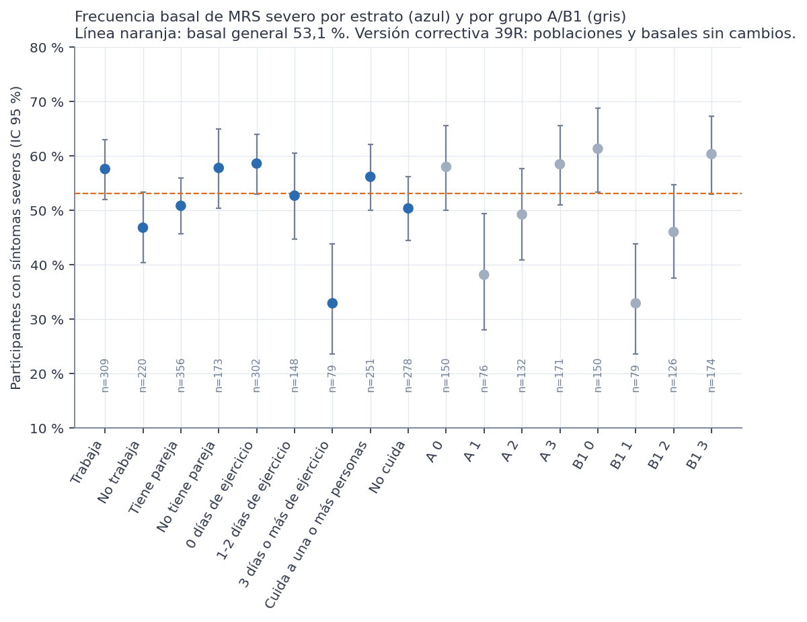

> **Versión correctiva (Fase 39R).** Corrige la Fase 39 histórica, que heredaba de la Fase 38 histórica dos variables que las decisiones de las Fases 35 y 36 excluían del modelado: `prevision` y `usa_medicamentos_diabetes`. Ninguna de las dos es predictora autorizada y solo se nombran para documentar ese motivo. Todas las cifras de este documento provienen de los resultados corregidos; las de la versión anterior no están vigentes. Las sensibilidades se identifican siempre como tales y no sustituyen al análisis principal.

# Tamaños, frecuencia basal y viabilidad

Todo el análisis usa el conjunto **sintético** de 529 participantes. Los resultados describen la simulación, no a mujeres reales. No son diagnósticos ni predicciones, no permiten recomendaciones de salud y ninguna asociación indica causa. No hay validación externa y la utilidad clínica no está demostrada. Es un análisis **exploratorio**: los estratos y la pregunta se definieron después de conocer las Fases 37D y 38 (versión histórica), y la 39R los repitió conociendo además la 38R.

**Frecuencia basal:** la proporción de participantes del estrato con MRS ≥ 16. Cada regla del estrato se compara con **esta** basal, no con el 53,1 % general.

| Grupo | Estrato | n | Severas | Basal (IC 95 %) | Largo máximo | n_A mínimo | n_AC mínimo | Ítems en el estrato | Búsqueda |
|---|---|---|---|---|---|---|---|---|---|
| Trabajo | Trabaja | 309 | 178 | 57,6 % (52 %-63 %) | 3 | 31 | 16 | 88 | búsqueda de reglas |
| Trabajo | No trabaja | 220 | 103 | 46,8 % (40 %-53 %) | 2 | 22 | 11 | 88 | búsqueda de reglas |
| Pareja | Tiene pareja | 356 | 181 | 50,8 % (46 %-56 %) | 3 | 36 | 18 | 88 | búsqueda de reglas |
| Pareja | No tiene pareja | 173 | 100 | 57,8 % (50 %-65 %) | 2 | 20 | 10 | 88 | búsqueda de reglas |
| Ejercicio | 0 días de ejercicio | 302 | 177 | 58,6 % (53 %-64 %) | 3 | 31 | 16 | 86 | búsqueda de reglas |
| Ejercicio | 1-2 días de ejercicio | 148 | 78 | 52,7 % (45 %-61 %) | 2 | 20 | 10 | 86 | búsqueda de reglas |
| Ejercicio | 3 días o más de ejercicio | 79 | 26 | 32,9 % (24 %-44 %) | 1 | 20 | 10 | 86 | búsqueda de reglas |
| Cuidado | Cuida a una o más personas | 251 | 141 | 56,2 % (50 %-62 %) | 3 | 26 | 13 | 86 | búsqueda de reglas |
| Cuidado | No cuida | 278 | 140 | 50,4 % (45 %-56 %) | 3 | 28 | 14 | 86 | búsqueda de reglas |
| A | A 0 | 150 | 87 | 58,0 % (50 %-66 %) | 2 | 20 | 10 | 82 | búsqueda de reglas |
| A | A 1 | 76 | 29 | 38,2 % (28 %-49 %) | 1 | 20 | 10 | 82 | búsqueda de reglas |
| A | A 2 | 132 | 65 | 49,2 % (41 %-58 %) | 2 | 20 | 10 | 82 | búsqueda de reglas |
| A | A 3 | 171 | 100 | 58,5 % (51 %-66 %) | 2 | 20 | 10 | 82 | búsqueda de reglas |
| B1 | B1 0 | 150 | 92 | 61,3 % (53 %-69 %) | 2 | 20 | 10 | 82 | búsqueda de reglas |
| B1 | B1 1 | 79 | 26 | 32,9 % (24 %-44 %) | 1 | 20 | 10 | 82 | búsqueda de reglas |
| B1 | B1 2 | 126 | 58 | 46,0 % (38 %-55 %) | 2 | 20 | 10 | 82 | búsqueda de reglas |
| B1 | B1 3 | 174 | 105 | 60,3 % (53 %-67 %) | 2 | 20 | 10 | 82 | búsqueda de reglas |

# Diferencias de frecuencia basal entre estratos

Esta tabla muestra cuánto cambia la **proporción de severas** de un estrato a otro, es decir, la asociación del propio contexto con la severidad. **No** es una diferencia en la asociación de los hábitos (eso se trata en el informe 12). Es descriptiva, sin ajuste por búsqueda.

| Grupo | Estrato 1 | Estrato 2 | Basal 1 | Basal 2 | Diferencia (IC 95 %) | p de Fisher |
|---|---|---|---|---|---|---|
| Trabajo | Trabaja | No trabaja | 57,6 % | 46,8 % | 10,8 pts (2,2 a 19,2) | 0,017 |
| Pareja | Tiene pareja | No tiene pareja | 50,8 % | 57,8 % | −7,0 pts (−15,8 a 2,1) | 0,138 |
| Ejercicio | 0 días de ejercicio | 1-2 días de ejercicio | 58,6 % | 52,7 % | 5,9 pts (−3,8 a 15,6) | 0,266 |
| Ejercicio | 0 días de ejercicio | 3 días o más de ejercicio | 58,6 % | 32,9 % | 25,7 pts (13,4 a 36,5) | < 0,001 |
| Ejercicio | 1-2 días de ejercicio | 3 días o más de ejercicio | 52,7 % | 32,9 % | 19,8 pts (6,2 a 32,0) | 0,005 |
| Cuidado | Cuida a una o más personas | No cuida | 56,2 % | 50,4 % | 5,8 pts (−2,7 a 14,2) | 0,191 |
| A | A 0 | A 1 | 58,0 % | 38,2 % | 19,8 pts (6,0 a 32,5) | 0,005 |
| A | A 0 | A 2 | 58,0 % | 49,2 % | 8,8 pts (−2,9 a 20,1) | 0,152 |
| A | A 0 | A 3 | 58,0 % | 58,5 % | −0,5 pts (−11,2 a 10,2) | 1,000 |
| A | A 1 | A 2 | 38,2 % | 49,2 % | −11,1 pts (−24,2 a 2,9) | 0,148 |
| A | A 1 | A 3 | 38,2 % | 58,5 % | −20,3 pts (−32,7 a −6,8) | 0,004 |
| A | A 2 | A 3 | 49,2 % | 58,5 % | −9,2 pts (−20,2 a 2,0) | 0,130 |
| B1 | B1 0 | B1 1 | 61,3 % | 32,9 % | 28,4 pts (14,9 a 40,4) | < 0,001 |
| B1 | B1 0 | B1 2 | 61,3 % | 46,0 % | 15,3 pts (3,5 a 26,6) | 0,015 |
| B1 | B1 0 | B1 3 | 61,3 % | 60,3 % | 1,0 pts (−9,6 a 11,5) | 0,909 |
| B1 | B1 1 | B1 2 | 32,9 % | 46,0 % | −13,1 pts (−25,9 a 0,7) | 0,080 |
| B1 | B1 1 | B1 3 | 32,9 % | 60,3 % | −27,4 pts (−39,1 a −14,2) | < 0,001 |
| B1 | B1 2 | B1 3 | 46,0 % | 60,3 % | −14,3 pts (−25,3 a −2,9) | 0,019 |

**Lectura:**
- **Ejercicio:** quienes hacen 3 días o más tienen menos síntomas severos (32,9 %) que quienes no hacen ejercicio (58,6 %).
- **Trabajo:** quienes trabajan tienen algo más que quienes no trabajan (57,6 % frente a 46,8 %).
- **Pareja y cuidado:** las diferencias son pequeñas y sus intervalos incluyen el 0.
- **Coherencia con la Fase 37D:** coincide con lo que mostró sobre el MRS.
- **Advertencia:** son diferencias marginales, sin ajuste y en datos sintéticos.

# Viabilidad

- **Estratos de 250 o más:** trabaja, tiene pareja, 0 días, cuida y no cuida admiten antecedentes de hasta 3 condiciones.
- **Estratos de 120 a 249:** no trabaja, no tiene pareja y 1-2 días admiten hasta 2 condiciones.
- **Estratos de 60 a 119:** 3 días o más (79) admite solo antecedentes de 1 condición, con al menos 20 participantes. Con eso solo hay 41 reglas posibles.
- **Estratos de menos de 60:** ninguno queda solo descriptivo.
