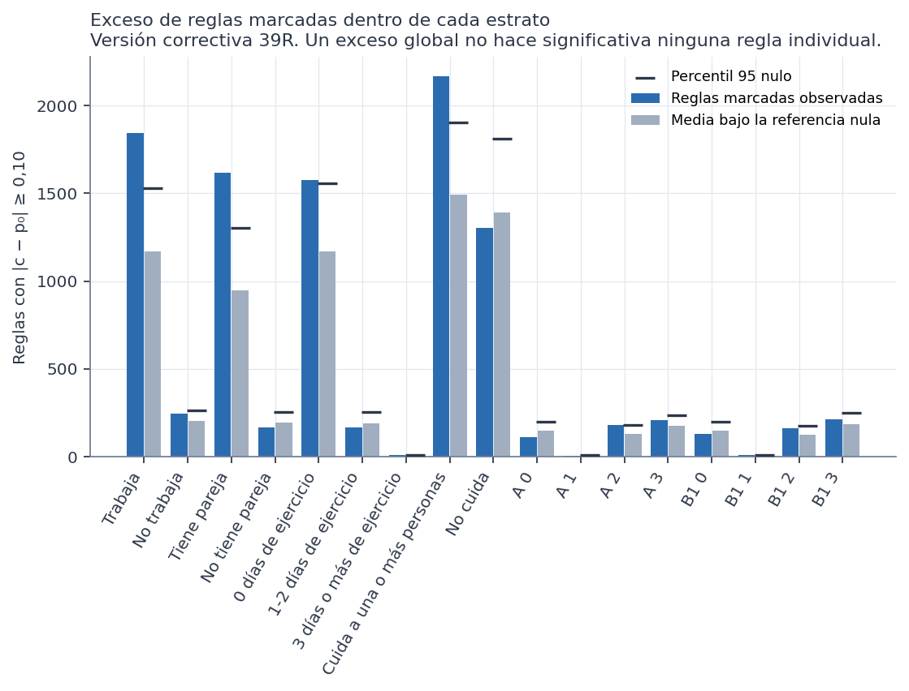
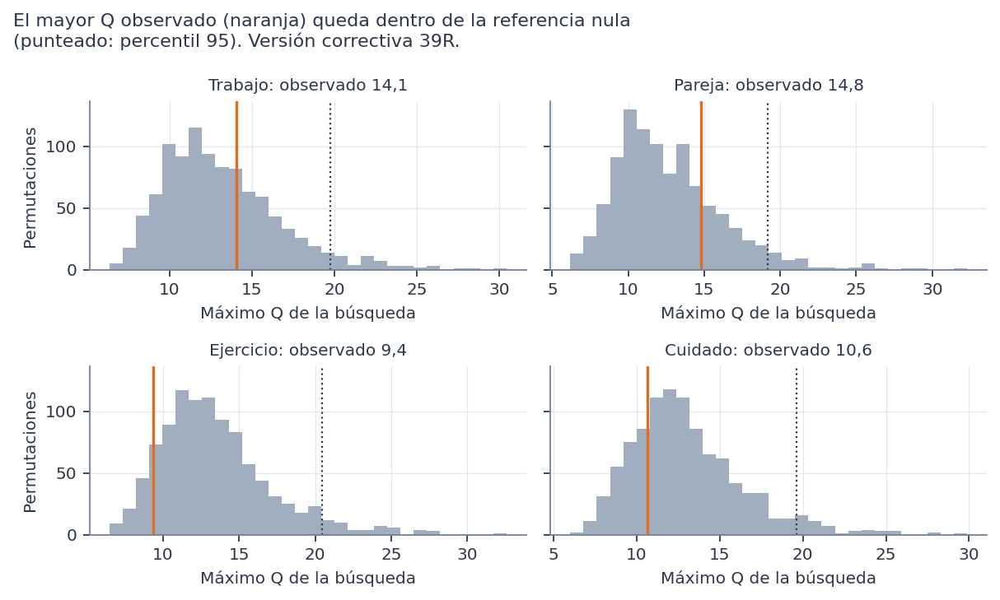

> **Versión correctiva (Fase 39R).** Corrige la Fase 39 histórica, que heredaba de la Fase 38 histórica dos variables que las decisiones de las Fases 35 y 36 excluían del modelado: `prevision` y `usa_medicamentos_diabetes`. Ninguna de las dos es predictora autorizada y solo se nombran para documentar ese motivo. Todas las cifras de este documento provienen de los resultados corregidos; las de la versión anterior no están vigentes. Las sensibilidades se identifican siempre como tales y no sustituyen al análisis principal.

# Método

Todo el análisis usa el conjunto **sintético** de 529 participantes. Los resultados describen la simulación, no a mujeres reales. No son diagnósticos ni predicciones, no permiten recomendaciones de salud y ninguna asociación indica causa. No hay validación externa y la utilidad clínica no está demostrada. Es un análisis **exploratorio**: los estratos y la pregunta se definieron después de conocer las Fases 37D y 38 (versión histórica), y la 39R los repitió conociendo además la 38R.

**Dentro de cada estrato:**
- **Permutaciones:** 1.000 de la severidad, solo entre las participantes del estrato, con la semilla [42, 39, número del estrato]. Así se conserva su número de severas y no se mezclan estratos con basales distintas.
- **Búsqueda:** en cada permutación se repite la búsqueda completa sobre los mismos antecedentes.
- **p ajustado de Westfall-Young:** la proporción de permutaciones en que la regla más fuerte **de toda la búsqueda del estrato** iguala o supera a la regla observada.

**Conjunto de los 9 estratos:** el máximo |z| de los 9 en cada índice de permutación. Aproxima de forma conservadora la búsqueda en todos a la vez.

**Comparación entre estratos:** 1.000 permutaciones de la severidad dentro de cada estrato de la dimensión a la vez. Se registran el máximo Q y el menor p χ².
- **Qué representa:** ninguna asociación en ningún estrato. Se usa como aproximación a «sin interacción».
- **Comprobación:** la prueba 13 simula una asociación común no nula sin interacción. El estadístico rechaza alrededor del 5 % (resultado: 0,055), así que está bien calibrado.

# Resultados dentro de los estratos

| Dimensión | Estrato | Antecedentes evaluados | Marcadas | Nula: media | Nula: p95 | p de exceso | Máximo \|z\|: p95 nulo | Menor p ajustado | Superan la nula del estrato |
|---|---|---|---|---|---|---|---|---|---|
| Trabajo | Trabaja | 8.958 | 1.842 | 1.168 | 1.531 | 0,006 | 4,02 | 0,187 | 0 |
| Trabajo | No trabaja | 1.302 | 243 | 201 | 265 | 0,148 | 3,59 | 0,468 | 0 |
| Pareja | Tiene pareja | 8.709 | 1.617 | 947 | 1.305 | 0,002 | 4,01 | 0,107 | 0 |
| Pareja | No tiene pareja | 1.133 | 164 | 195 | 256 | 0,809 | 3,55 | 0,163 | 0 |
| Ejercicio | 0 días de ejercicio | 9.500 | 1.574 | 1.168 | 1.557 | 0,047 | 3,95 | 0,273 | 0 |
| Ejercicio | 1-2 días de ejercicio | 1.035 | 167 | 191 | 252 | 0,747 | 3,41 | 0,646 | 0 |
| Ejercicio | 3 días o más de ejercicio | 47 | 7 | 5 | 9 | 0,212 | 2,46 | 0,427 | 0 |
| Cuidado | Cuida a una o más personas | 9.023 | 2.169 | 1.494 | 1.903 | 0,006 | 3,97 | 0,055 | 0 |
| Cuidado | No cuida | 9.190 | 1.302 | 1.390 | 1.809 | 0,595 | 3,99 | 0,933 | 0 |

**Lectura:**
- **Ninguna regla supera la nula de su estrato.** La más cercana está en «cuida» (p ajustado 0,055).
- **Hay más reglas marcadas que por azar en cuatro estratos:** trabaja, tiene pareja, cuida (p ≤ 0,006) y 0 días (p = 0,047, en el límite). Son estratos grandes, donde se permiten 3 condiciones.
- **Un exceso global no es significancia individual:** ninguna de las reglas de esos estratos supera por sí sola la referencia nula.
- **No cuida no tiene exceso,** aunque también es grande (278) y admite 3 condiciones (p 0,595).
- **En los estratos más pequeños tampoco hay exceso:** no trabaja, no tiene pareja, 1-2 días y 3 días o más.
- **Es lo mismo que en la Fase 38R:** una señal difusa repartida en muchas reglas débiles, que se detecta mejor donde hay más participantes.
- **Una diferencia entre estratos en el p de exceso no prueba que la asociación sea distinta.** Refleja, sobre todo, el tamaño y el número de combinaciones posibles.

# Resultados de la comparación

| Dimensión | Comparables | Diferencias marcadas | Nula: media | p de exceso | Mayor Q | p95 del máximo Q nulo | Menor p ajustado (dimensión) | Menor p ajustado (conjunto) |
|---|---|---|---|---|---|---|---|---|
| Trabajo | 1.348 | 569 | 521 | 0,178 | 14,1 | 19,8 | 0,336 | 0,707 |
| Pareja | 1.129 | 435 | 436 | 0,509 | 14,8 | 19,2 | 0,226 | 0,615 |
| Ejercicio | 363 | 234 | 257 | 0,898 | 9,4 | 20,5 | 0,905 | 1,000 |
| Cuidado | 1.496 | 582 | 580 | 0,483 | 10,6 | 19,6 | 0,757 | 0,992 |

**Benjamini-Hochberg:** se aplicó a todas las comparaciones evaluadas, no solo a las seleccionadas. El menor q por dimensión es: trabajo 0,133, pareja 0,086, ejercicio 0,895, cuidado 0,944. Ninguno es menor que 0,05.
