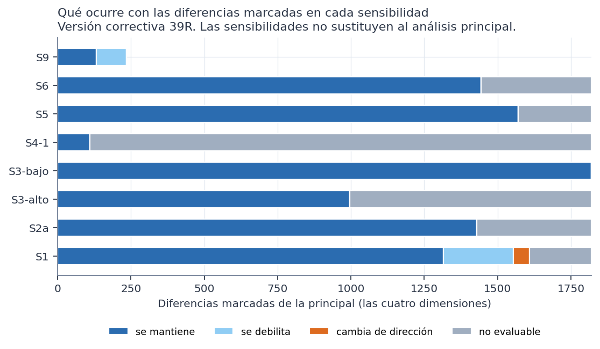

> **Versión correctiva (Fase 39R).** Corrige la Fase 39 histórica, que heredaba de la Fase 38 histórica dos variables que las decisiones de las Fases 35 y 36 excluían del modelado: `prevision` y `usa_medicamentos_diabetes`. Ninguna de las dos es predictora autorizada y solo se nombran para documentar ese motivo. Todas las cifras de este documento provienen de los resultados corregidos; las de la versión anterior no están vigentes. Las sensibilidades se identifican siempre como tales y no sustituyen al análisis principal.

# Resumen

Todo el análisis usa el conjunto **sintético** de 529 participantes. Los resultados describen la simulación, no a mujeres reales. No son diagnósticos ni predicciones, no permiten recomendaciones de salud y ninguna asociación indica causa. No hay validación externa y la utilidad clínica no está demostrada. Es un análisis **exploratorio**: los estratos y la pregunta se definieron después de conocer las Fases 37D y 38 (versión histórica), y la 39R los repitió conociendo además la 38R.

Todas las sensibilidades se fijaron en el protocolo antes de ejecutar. Cada una repite la búsqueda en cada estrato y la comparación entre estratos, con sus propias 1.000 permutaciones.

# Reglas dentro de los estratos

| Sensibilidad | Cambio | Reglas | Marcadas | Nula: media | Estratos con exceso (p < 0,05) | Superan la nula del estrato |
|---|---|---|---|---|---|---|
| S1 | Sin valores imputados ni deducidos | 37.913 | 7.903 | 5.789 | 4 de 9 | 1 |
| S2a | Categorías originales sin agrupar | 45.275 | 8.162 | 6.287 | 3 de 9 | 0 |
| S3-bajo | Umbrales bajos: n_A ≥ max(15, 7,5 %), n_AC ≥ max(8, 3,75 %), comparabilidad ≥ 15 | 70.715 | 16.852 | 13.676 | 3 de 9 | 0 |
| S3-alto | Umbrales altos: n_A ≥ max(30, 15 %), n_AC ≥ max(15, 7,5 %), comparabilidad ≥ 30 | 25.091 | 3.152 | 1.945 | 4 de 9 | 1 |
| S4-1 | Antecedentes de una condición | 619 | 63 | 48 | 3 de 9 | 3 |
| S4-2 | Antecedentes de hasta dos condiciones | 9.918 | 1.497 | 1.274 | 3 de 9 | 0 |
| S5 | Sin frecuencias de ejercicio aeróbico, bajo impacto y fuerza | 33.833 | 6.523 | 5.035 | 4 de 9 | 0 |
| S6 | Sin variables próximas a síntomas | 34.624 | 6.647 | 4.802 | 4 de 9 | 1 |
| S7a | Quienes trabajan, con el módulo laboral | 10.178 | 2.568 | 1.435 | 1 de 1 | 0 |
| S7b | Quienes cuidan, con la sobrecarga | 9.785 | 2.666 | 1.655 | 1 de 1 | 1 |

**Reglas que superan la nula de su estrato en alguna sensibilidad:**

| Sensibilidad | Estrato | Regla | n (con / antecedente) | Confianza | Basal | p ajustado (estrato) | p ajustado (conjunto) |
|---|---|---|---|---|---|---|---|
| S1 | Cuida a una o más personas | Frecuencia de ejercicio de bajo impacto: no realiza o nunca y Frutas al día: 1-2 porciones y Horas sentada al día: 6-7 → severos | 27 de 29 | 93,1 % | 56,2 % | 0,033 | 0,184 |
| S3-alto | Trabaja | Frecuencia de alcohol: nunca y Usa medicamentos para la presión: no y Frecuencia de tabaco: nunca → no severos | 54 de 87 | 62,1 % | 42,4 % | 0,04995 | 0,271 |
| S4-1 | Trabaja | Frecuencia de ejercicio de bajo impacto: frecuentemente o siempre → no severos | 24 de 35 | 68,6 % | 42,4 % | 0,020 | 0,124 |
| S4-1 | Cuida a una o más personas | Frecuencia de ejercicio de bajo impacto: frecuentemente o siempre → no severos | 22 de 31 | 71,0 % | 43,8 % | 0,024 | 0,185 |
| S4-1 | Cuida a una o más personas | Días de ejercicio a la semana: 3-4 días → no severos | 19 de 26 | 73,1 % | 43,8 % | 0,033 | 0,215 |
| S6 | Cuida a una o más personas | Días de ejercicio a la semana: 0 días y Frutas al día: 1-2 porciones y Horas sentada al día: 6-7 → severos | 32 de 36 | 88,9 % | 56,2 % | 0,045 | 0,205 |
| S7b | Cuida a una o más personas | Frecuencia de ejercicio aeróbico: no realiza o nunca y Vasos de agua al día: 3-4 porciones y Sobrecarga física o emocional por cuidar: frecuente o siempre → severos | 31 de 34 | 91,2 % | 56,2 % | 0,031 | 0,031 |

**Lectura (son resultados de sensibilidad, no del análisis principal, y no son evidencia confirmatoria):**
- **Cada regla aparece en una sola configuración.** No se repite en la principal ni en las demás sensibilidades.
- **S3-alto (estrato trabaja):** Frecuencia de alcohol: nunca y Usa medicamentos para la presión: no y Frecuencia de tabaco: nunca → no severos alcanza un p ajustado de 0,04995 en su estrato, apenas bajo 0,05. Es redundante y **no supera la referencia nula conjunta** (p 0,271).
- **S7b (quienes cuidan, n = 251, 12 con sobrecarga imputada):** Frecuencia de ejercicio aeróbico: no realiza o nunca y Vasos de agua al día: 3-4 porciones y Sobrecarga física o emocional por cuidar: frecuente o siempre → severos, 31 de 34, supera la referencia nula de esa sensibilidad (p 0,031). S7b tiene un solo estrato, así que la nula conjunta coincide con la del estrato. **No es un hallazgo robusto ni una recomendación clínica:** combina ejercicio aeróbico, agua y sobrecarga por cuidar, que puede ser consecuencia de los síntomas, y se apoya en 34 participantes.
- **S1, S4-1 y S6:** las demás reglas de la tabla superan solo la nula de su estrato y ninguna supera la nula conjunta.

**Ninguna de estas reglas es robusta.**

# Comparación entre estratos

| Sensibilidad | Dimensión | Comparables | Marcadas | Nula: media | p de exceso | Superan la nula de la dimensión |
|---|---|---|---|---|---|---|
| S1 | Trabajo | 1.260 | 559 | 491 | 0,089 | 0 |
| S1 | Pareja | 1.031 | 412 | 405 | 0,432 | 0 |
| S1 | Ejercicio | 272 | 173 | 193 | 0,937 | 0 |
| S1 | Cuidado | 1.400 | 528 | 550 | 0,653 | 0 |
| S2a | Trabajo | 1.273 | 532 | 483 | 0,165 | 0 |
| S2a | Pareja | 1.082 | 404 | 417 | 0,593 | 0 |
| S2a | Ejercicio | 354 | 233 | 250 | 0,839 | 0 |
| S2a | Cuidado | 1.410 | 537 | 545 | 0,563 | 0 |
| S3-bajo | Trabajo | 1.714 | 769 | 720 | 0,227 | 0 |
| S3-bajo | Pareja | 1.493 | 632 | 630 | 0,473 | 0 |
| S3-bajo | Ejercicio | 578 | 403 | 424 | 0,835 | 1 |
| S3-bajo | Cuidado | 1.836 | 792 | 768 | 0,350 | 0 |
| S3-alto | Trabajo | 896 | 335 | 304 | 0,224 | 0 |
| S3-alto | Pareja | 706 | 240 | 241 | 0,500 | 0 |
| S3-alto | Ejercicio | 124 | 67 | 84 | 0,975 | 0 |
| S3-alto | Cuidado | 1.042 | 353 | 358 | 0,533 | 0 |
| S4-1 | Trabajo | 79 | 29 | 28 | 0,454 | 0 |
| S4-1 | Pareja | 72 | 27 | 26 | 0,454 | 0 |
| S4-1 | Ejercicio | 39 | 25 | 27 | 0,796 | 0 |
| S4-1 | Cuidado | 77 | 28 | 26 | 0,420 | 0 |
| S4-2 | todas | — | — | — | — | igual a la principal (comparación ya limitada a 2 condiciones) |
| S5 | Trabajo | 1.126 | 482 | 437 | 0,189 | 0 |
| S5 | Pareja | 941 | 376 | 369 | 0,447 | 0 |
| S5 | Ejercicio | 342 | 221 | 243 | 0,912 | 0 |
| S5 | Cuidado | 1.259 | 492 | 494 | 0,509 | 0 |
| S6 | Trabajo | 1.063 | 437 | 409 | 0,269 | 0 |
| S6 | Pareja | 923 | 366 | 359 | 0,413 | 0 |
| S6 | Ejercicio | 285 | 185 | 202 | 0,873 | 0 |
| S6 | Cuidado | 1.180 | 456 | 455 | 0,495 | 0 |
| S7a | todas | — | — | — | — | no aplica |
| S7b | todas | — | — | — | — | no aplica |
| S9 | Ejercicio | 972 | 388 | 400 | 0,601 | 0 |

**Una sola diferencia supera la nula de su dimensión, en una sola sensibilidad (S3-bajo, ejercicio):**

| Antecedente | 0 días | 1-2 días | 3 días o más | p ajustado (dimensión) | p ajustado (conjunto) |
|---|---|---|---|---|---|
| Frecuencia de ejercicio aeróbico: no realiza o nunca y Frutas al día: 1-2 porciones | 122/203 · DR 0,05 | 49/86 · DR 0,10 | 0/18 · DR −0,43 | 0,011 | 0,048 |

**Por qué no es un hallazgo:**
- **Alcanza p ajustado conjunto 0,048 solo en S3-bajo,** pero **no cumple la comparabilidad mínima del análisis principal**: el estrato de 3 días o más tiene 18 participantes con el antecedente, y el mínimo principal es 20. Con el umbral bajo de 15 es comparable; con el principal, no.
- **Depende de un grupo mínimo:** 0 severas entre esas 18 participantes.
- **Está ligada al estrato:** usa una frecuencia de ejercicio dentro de la dimensión ejercicio.
- **No es evidencia confirmatoria:** es el tipo de resultado que el protocolo anticipó al pedir revisar los grupos pequeños.

# Estratos pequeños

Los estratos pequeños limitan la precisión de algunas comparaciones:

| Dimensión | Conjunto | Comparaciones | Con menos de 30 en algún estrato | Mayor Q | Mayor Q con menos de 30 |
|---|---|---|---|---|---|
| Trabajo | todas las comparables | 1.348 | 452 | 14,1 | 13,7 |
| Trabajo | marcadas | 569 | 234 | 14,1 | 13,7 |
| Trabajo | marcadas no redundantes | 207 | 100 | 14,1 | 13,7 |
| Pareja | todas las comparables | 1.129 | 421 | 14,8 | 14,3 |
| Pareja | marcadas | 435 | 194 | 14,8 | 14,3 |
| Pareja | marcadas no redundantes | 140 | 71 | 14,8 | 14,3 |
| Ejercicio | todas las comparables | 363 | 229 | 9,4 | 9,2 |
| Ejercicio | marcadas | 234 | 164 | 9,4 | 9,2 |
| Ejercicio | marcadas no redundantes | 76 | 47 | 9,4 | 9,2 |
| Cuidado | todas las comparables | 1.496 | 454 | 10,6 | 8,4 |
| Cuidado | marcadas | 582 | 229 | 10,6 | 8,4 |
| Cuidado | marcadas no redundantes | 226 | 114 | 10,6 | 8,4 |

# Qué ocurre con las diferencias marcadas de la principal

| Dimensión | Sensibilidad | Se mantiene | Se debilita | Cambia de dirección | No evaluable |
|---|---|---|---|---|---|
| Cuidado | S1 | 446 | 89 | 0 | 47 |
| Cuidado | S2a | 440 | 0 | 0 | 142 |
| Cuidado | S3-alto | 353 | 0 | 0 | 229 |
| Cuidado | S3-bajo | 582 | 0 | 0 | 0 |
| Cuidado | S4-1 | 28 | 0 | 0 | 554 |
| Cuidado | S5 | 492 | 0 | 0 | 90 |
| Cuidado | S6 | 456 | 0 | 0 | 126 |
| Ejercicio | S1 | 98 | 15 | 51 | 70 |
| Ejercicio | S2a | 211 | 0 | 0 | 23 |
| Ejercicio | S3-alto | 67 | 0 | 0 | 167 |
| Ejercicio | S3-bajo | 234 | 0 | 0 | 0 |
| Ejercicio | S4-1 | 25 | 0 | 0 | 209 |
| Ejercicio | S5 | 221 | 0 | 0 | 13 |
| Ejercicio | S6 | 185 | 0 | 0 | 49 |
| Ejercicio | S9 | 132 | 102 | 0 | 0 |
| Pareja | S1 | 323 | 64 | 2 | 46 |
| Pareja | S2a | 326 | 0 | 0 | 109 |
| Pareja | S3-alto | 240 | 0 | 0 | 195 |
| Pareja | S3-bajo | 435 | 0 | 0 | 0 |
| Pareja | S4-1 | 27 | 0 | 0 | 408 |
| Pareja | S5 | 376 | 0 | 0 | 59 |
| Pareja | S6 | 366 | 0 | 0 | 69 |
| Trabajo | S1 | 449 | 69 | 2 | 49 |
| Trabajo | S2a | 451 | 0 | 0 | 118 |
| Trabajo | S3-alto | 335 | 0 | 0 | 234 |
| Trabajo | S3-bajo | 569 | 0 | 0 | 0 |
| Trabajo | S4-1 | 29 | 0 | 0 | 540 |
| Trabajo | S5 | 482 | 0 | 0 | 87 |
| Trabajo | S6 | 437 | 0 | 0 | 132 |

**Lectura:**
- **S3:** las diferencias se mantienen siempre que siguen siendo comparables, porque los datos son los mismos y solo cambia qué antecedentes entran. S3 sirve para ver si el umbral cambia la conclusión, y no la cambia.
- **S1 (sin imputados):**
  - las diferencias pierden casos y varias se debilitan;
  - en ejercicio, 51 cambian de dirección: el estrato de 3 días o más queda con muy pocos casos;
  - las comparaciones se apoyan en parte en los datos imputados.
- **S9 (sin el estrato de 3 días o más):** en ejercicio, 102 diferencias marcadas se debilitan. Dependían del grupo pequeño.
- **S4-1:** con una sola condición, casi ninguna diferencia es evaluable. Las de una condición se mantienen, pero ninguna supera la nula.

**Módulos (S7a y S7b):**
- **S7a (quienes trabajan, n = 309, con el módulo laboral):** hay exceso de reglas marcadas (p < 0,001), pero ninguna supera la nula. Las preguntas laborales mencionan los síntomas, así que cualquier regla con ellas sería circular.
- **S7b (quienes cuidan, n = 251):** ver la regla de arriba.

**Poblaciones de los módulos.** La 38R y la 39R usan poblaciones que no siempre coinciden. Cada resultado debe leerse con su tamaño y su definición, y no deben equipararse resultados de poblaciones diferentes:

| Fase | Sensibilidad | Población | Participantes |
|---|---|---|---|
| 38R | S7a | Quienes trabajan y tienen información laboral | 287 |
| 38R | S7a-309 (ampliada) | Todas quienes trabajan; 22 sin ítems laborales | 309 |
| 38R | S7b | Quienes cuidan y tienen la sobrecarga observada | 239 |
| 38R | S7b-251 (ampliada) | Todas quienes cuidan; incluye 12 con sobrecarga imputada | 251 |
| 39R | S7a | Quienes trabajan, con el módulo laboral | 309 |
| 39R | S7b | Quienes cuidan, con la sobrecarga | 251 |

**Dependencia entre antecedentes.** 12 ítems cambian su prevalencia al menos 20 puntos entre los estratos de alguna dimensión (`sensibilidades/dependencia_items_estratos.csv`). Casi todos son de ejercicio (frecuencias de modalidades) y de trabajo (comidas fuera de casa, falta de tiempo).
