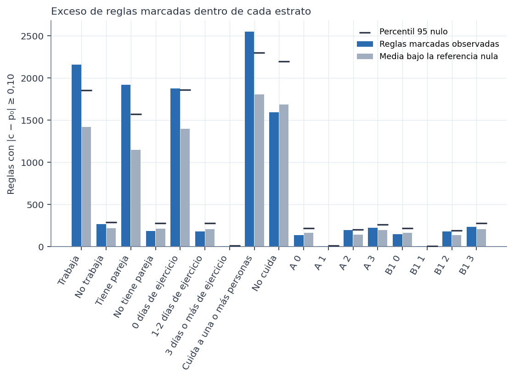
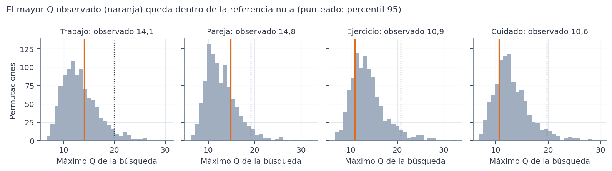

# Método

Todo el análisis usa el conjunto **sintético** de 529 participantes. Los resultados describen la simulación, no a mujeres reales. No son diagnósticos ni predicciones, no permiten recomendaciones de salud y ninguna asociación indica causa. Es un análisis **exploratorio**: los estratos y la pregunta se definieron después de conocer las Fases 37D y 38.

**Dentro de cada estrato:**
- **Permutaciones:** 1.000 de la severidad, solo entre las participantes del estrato, con la semilla [42, 39, número del estrato]. Así se conserva su número de severas y no se mezclan estratos con basales distintas.
- **Búsqueda:** en cada permutación se repite la búsqueda completa sobre los mismos antecedentes.
- **p ajustado de Westfall-Young:** la proporción de permutaciones en que la regla más fuerte **de toda la búsqueda del estrato** iguala o supera a la regla observada.

**Conjunto de los 9 estratos:** el máximo |z| de los 9 en cada índice de permutación. Aproxima de forma conservadora la búsqueda en todos a la vez.

**Comparación entre estratos:** 1.000 permutaciones de la severidad dentro de cada estrato de la dimensión a la vez. Se registran el máximo Q y el menor p χ².
- **Qué representa:** ninguna asociación en ningún estrato. Se usa como aproximación a «sin interacción».
- **Comprobación:** la prueba 13 simula una asociación común no nula sin interacción. El estadístico rechaza alrededor del 5 % (resultado: 0,055), así que está bien calibrado.

# Resultados dentro de los estratos

| Dimensión | Estrato | Antecedentes evaluados | Marcadas | Nula: media | Nula: p95 | p de exceso | Máximo |z|: p95 nulo | Menor p ajustado | Superan la nula del estrato |
|---|---|---|---|---|---|---|---|---|---|
| Trabajo | Trabaja | 11.289 | 2.162 | 1.422 | 1.855 | 0,007 | 4,04 | 0,200 | 0 |
| Trabajo | No trabaja | 1.453 | 264 | 218 | 287 | 0,142 | 3,59 | 0,479 | 0 |
| Pareja | Tiene pareja | 10.985 | 1.922 | 1.150 | 1.573 | 0,004 | 4,01 | 0,118 | 0 |
| Pareja | No tiene pareja | 1.271 | 183 | 212 | 279 | 0,768 | 3,56 | 0,175 | 0 |
| Ejercicio | 0 días de ejercicio | 11.788 | 1.874 | 1.399 | 1.861 | 0,049 | 3,99 | 0,290 | 0 |
| Ejercicio | 1-2 días de ejercicio | 1.167 | 182 | 208 | 276 | 0,744 | 3,45 | 0,660 | 0 |
| Ejercicio | 3 días o más de ejercicio | 49 | 7 | 5 | 9 | 0,212 | 2,46 | 0,427 | 0 |
| Cuidado | Cuida a una o más personas | 11.331 | 2.553 | 1.804 | 2.303 | 0,013 | 3,99 | 0,058 | 0 |
| Cuidado | No cuida | 11.528 | 1.592 | 1.688 | 2.196 | 0,590 | 4,03 | 0,891 | 0 |

**Lectura:**
- **Ninguna regla supera la nula de su estrato.** La más cercana está en «cuida» (p ajustado 0,058).
- **Hay más reglas marcadas que por azar en cuatro estratos:** trabaja, tiene pareja, cuida (p ≤ 0,013) y 0 días (p = 0,049, en el límite). Son estratos grandes, donde se permiten 3 condiciones.
- **No cuida no tiene exceso,** aunque también es grande (278) y admite 3 condiciones (p 0,590).
- **En los estratos más pequeños tampoco hay exceso:** no trabaja, no tiene pareja, 1-2 días y 3 días o más.
- **Es lo mismo que en la Fase 38:** una señal difusa repartida en muchas reglas débiles, que se detecta mejor donde hay más participantes.
- **Una diferencia entre estratos en el p de exceso no prueba que la asociación sea distinta.** Refleja, sobre todo, el tamaño y el número de combinaciones posibles.

# Resultados de la comparación

| Dimensión | Comparables | Diferencias marcadas | Nula: media | p de exceso | Mayor Q | p95 del máximo Q nulo | Menor p ajustado (dimensión) | Menor p ajustado (conjunto) |
|---|---|---|---|---|---|---|---|---|
| Trabajo | 1.500 | 620 | 574 | 0,218 | 14,1 | 19,9 | 0,343 | 0,729 |
| Pareja | 1.265 | 491 | 485 | 0,455 | 14,8 | 19,2 | 0,235 | 0,635 |
| Ejercicio | 436 | 286 | 307 | 0,834 | 10,9 | 20,8 | 0,785 | 1,000 |
| Cuidado | 1.672 | 637 | 645 | 0,541 | 10,6 | 19,8 | 0,777 | 0,994 |

**Benjamini-Hochberg:** se aplicó a todas las comparaciones evaluadas, no solo a las seleccionadas. El menor q por dimensión es: trabajo 0,149, pareja 0,096, ejercicio 0,642, cuidado 0,963. Ninguno es menor que 0,05.
