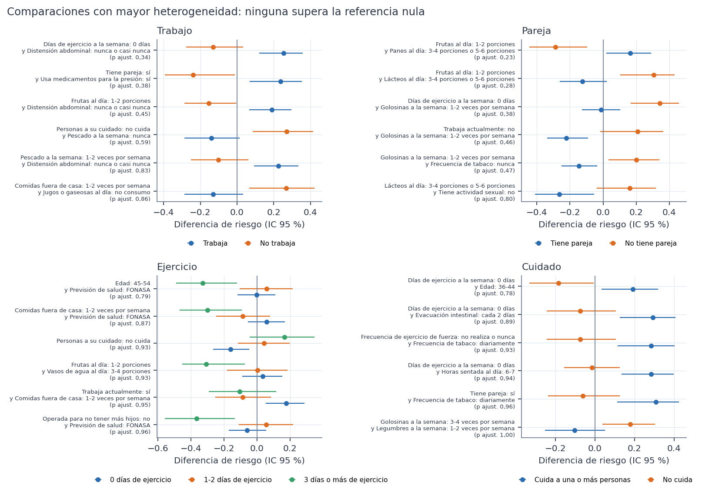
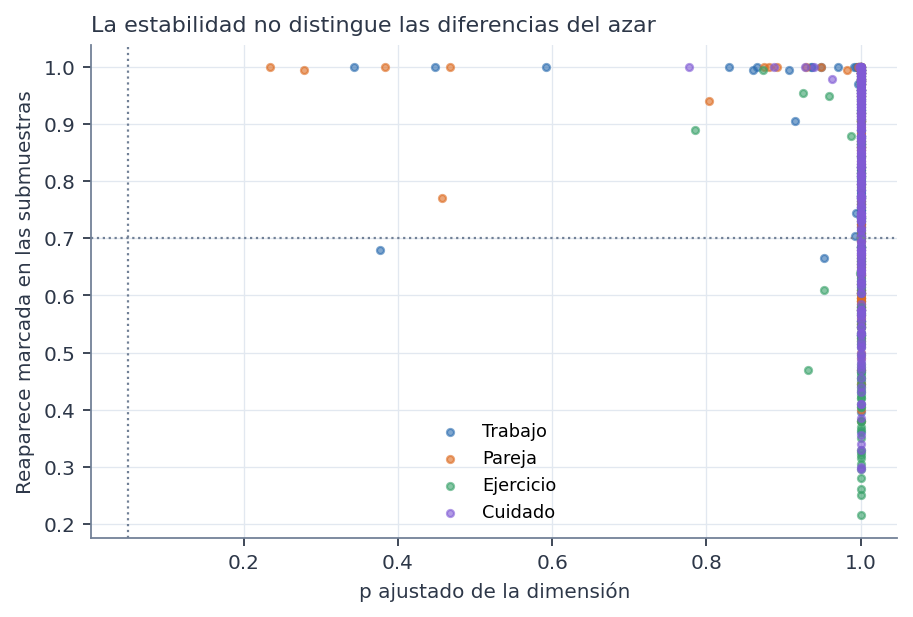

# Qué se compara

Todo el análisis usa el conjunto **sintético** de 529 participantes. Los resultados describen la simulación, no a mujeres reales. No son diagnósticos ni predicciones, no permiten recomendaciones de salud y ninguna asociación indica causa. Es un análisis **exploratorio**: los estratos y la pregunta se definieron después de conocer las Fases 37D y 38.

Hay que distinguir dos preguntas:

- **A. ¿Hay asociación dentro de un estrato?** Por ejemplo, ¿entre quienes trabajan, un hábito va con más síntomas severos? Se responde en los informes 7 a 10.
- **B. ¿Esa asociación es distinta entre estratos?** Es una pregunta de **interacción**. Que una regla sea significativa en un estrato y no en otro **no** responde B.

**Cómo se responde B:**
- **Antecedentes evaluados:** todos los de 1 y 2 condiciones comparables, no solo las reglas seleccionadas.
- **Medida en cada estrato:** la diferencia de riesgo DR = P(severo | A) − P(severo | no A), con su IC de Newcombe.
- **Heterogeneidad:** Q = Σ w(DR − DR̄)², con w = 1/varianza. Con dos estratos también se informan Δ = DR₁ − DR₂, su IC 95 % y z, con Q = z².
- **Control:** la referencia nula por dimensión (máximo Q) y la conjunta de las 4 dimensiones (menor p).
- **Estabilidad:** 200 submuestras estratificadas del 80 %.

# Resultados

| Dimensión | Comparables | Marcadas (rango ≥ 0,10) | H1 sin diferencia | H2 redundantes | H3 compatibles con la nula | H4 inestables | H5 superan los controles |
|---|---|---|---|---|---|---|---|
| Trabajo | 1.500 | 620 | 880 | 404 | 216 | 0 | 0 |
| Pareja | 1.265 | 491 | 774 | 342 | 149 | 0 | 0 |
| Ejercicio | 436 | 286 | 150 | 185 | 101 | 0 | 0 |
| Cuidado | 1.672 | 637 | 1.035 | 398 | 239 | 0 | 0 |

**Ninguna diferencia de asociación entre estratos supera su referencia nula, en ninguna dimensión.** Tampoco hay más diferencias marcadas de las que produce el azar (p de exceso entre 0,218 y 0,834).

**Lectura de la figura:**
- **Las comparaciones más extremas parecen grandes**, con diferencias de riesgo de signos opuestos e intervalos que no se tocan.
- **Pero es justo lo que produce el azar** al buscar entre 4.873 comparaciones: el p ajustado de cada una es alto.
- **Visualmente convincentes, no son evidencia.**

# Diferencias de significación (tabla exploratoria)

La tabla del protocolo «reglas que superan la nula en un estrato y no en otro» está **vacía**, porque ninguna regla supera la nula de su estrato.

Como ilustración, agregada después del sellado y sin intervenir en la conclusión, la tabla siguiente usa la significación **nominal**: el p de Fisher sin ajuste en cada estrato.

| Dimensión | Comparables | Significativas (p < 0,05 sin ajuste) en ambos estratos | Significativas en solo uno | De estas, interacción p < 0,05 sin ajuste | De estas, superan la nula |
|---|---|---|---|---|---|
| Trabajo | 1.500 | 4 | 207 | 69 | 0 |
| Pareja | 1.265 | 8 | 179 | 48 | 0 |
| Cuidado | 1.672 | 4 | 204 | 46 | 0 |

**Lectura:**
- **Cientos de antecedentes** son «significativos» en un estrato y no en el otro.
- **Solo una parte** tiene además una interacción nominal (p < 0,05 sin ajuste).
- **Ninguno resiste** la referencia nula de la búsqueda.

Interpretar «significativo aquí, no significativo allá» como una diferencia entre contextos produciría cientos de falsos hallazgos.

# Estabilidad

- **Muchas diferencias marcadas reaparecen** en más del 70 % de las submuestras: trabajo 174, pareja 94, ejercicio 12, cuidado 170.
- **Todas son compatibles con la nula.** Como en la Fase 38, las submuestras del 80 % comparten casi todos los datos, así que la estabilidad no distingue señal de azar. **No demuestra validez.**

# Composición y grupos pequeños

**Composición distinta.** Un antecedente cuya prevalencia difiere al menos 20 puntos entre estratos cambia la composición de cada comparación. Entre las diferencias marcadas hay: trabajo 9, pareja 7, ejercicio 13, cuidado 0.

**Grupos pequeños.** 900 de las 2.034 diferencias marcadas se apoyan en menos de 30 participantes con el antecedente en algún estrato.

**Diferencias ligadas al estrato.** En ejercicio, 24 comparaciones usan frecuencias de modalidades de ejercicio. Dependen de la variable del estrato y se marcan como «ligadas».

# Conclusión de este informe

**No hay evidencia de que la asociación entre características y severidad difiera entre estratos.** Lo que se observa son, a lo sumo, diferencias de significación y diferencias de magnitud compatibles con el azar.
