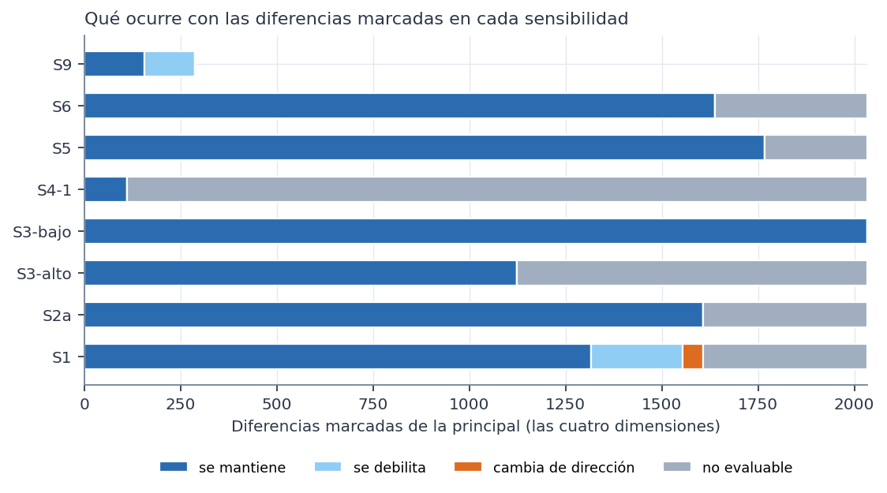

# Resumen

Todo el análisis usa el conjunto **sintético** de 529 participantes. Los resultados describen la simulación, no a mujeres reales. No son diagnósticos ni predicciones, no permiten recomendaciones de salud y ninguna asociación indica causa. Es un análisis **exploratorio**: los estratos y la pregunta se definieron después de conocer las Fases 37D y 38.

Todas las sensibilidades se fijaron en el protocolo antes de ejecutar. Cada una repite la búsqueda en cada estrato y la comparación entre estratos, con sus propias 1.000 permutaciones.

# Reglas dentro de los estratos

| Sensibilidad | Cambio | Reglas | Marcadas | Nula: media | Estratos con exceso (p < 0,05) | Superan la nula del estrato |
|---|---|---|---|---|---|---|
| S1 | Sin valores imputados ni deducidos (sin diabetes ni previsión) | 37.913 | 7.903 | 5.789 | 4 de 9 | 1 |
| S2a | Categorías originales sin agrupar | 56.455 | 9.621 | 7.537 | 3 de 9 | 0 |
| S3-bajo | Umbrales bajos: n_A ≥ max(15, 7,5 %), n_AC ≥ max(8, 3,75 %), comparabilidad ≥ 15 | 86.663 | 20.008 | 16.259 | 3 de 9 | 0 |
| S3-alto | Umbrales altos: n_A ≥ max(30, 15 %), n_AC ≥ max(15, 7,5 %), comparabilidad ≥ 30 | 32.621 | 3.797 | 2.407 | 4 de 9 | 0 |
| S4-1 | Antecedentes de una condición | 651 | 69 | 51 | 3 de 9 | 3 |
| S4-2 | Antecedentes de hasta dos condiciones | 11.111 | 1.624 | 1.386 | 3 de 9 | 0 |
| S5 | Sin frecuencias de ejercicio aeróbico, bajo impacto y fuerza | 43.638 | 7.967 | 6.196 | 4 de 9 | 0 |
| S6 | Sin variables próximas a síntomas | 44.033 | 7.977 | 5.877 | 4 de 9 | 1 |
| S7a | Quienes trabajan, con el módulo laboral | 12.772 | 3.041 | 1.736 | 1 de 1 | 0 |
| S7b | Quienes cuidan, con la sobrecarga | 12.256 | 3.150 | 1.992 | 1 de 1 | 1 |

**Reglas que superan la nula de su estrato en alguna sensibilidad:**

| Sensibilidad | Estrato | Regla | n (con / antecedente) | Confianza | Basal | p ajustado (estrato) | p ajustado (conjunto) |
|---|---|---|---|---|---|---|---|
| S1 | Cuida a una o más personas | Frecuencia de ejercicio de bajo impacto: no realiza o nunca y Frutas al día: 1-2 porciones y Horas sentada al día: 6-7 → severos | 27 de 29 | 93,1 % | 56,2 % | 0,033 | 0,184 |
| S4-1 | Trabaja | Frecuencia de ejercicio de bajo impacto: frecuentemente o siempre → no severos | 24 de 35 | 68,6 % | 42,4 % | 0,021 | 0,130 |
| S4-1 | Cuida a una o más personas | Frecuencia de ejercicio de bajo impacto: frecuentemente o siempre → no severos | 22 de 31 | 71,0 % | 43,8 % | 0,027 | 0,193 |
| S4-1 | Cuida a una o más personas | Días de ejercicio a la semana: 3-4 días → no severos | 19 de 26 | 73,1 % | 43,8 % | 0,036 | 0,226 |
| S6 | Cuida a una o más personas | Días de ejercicio a la semana: 0 días y Frutas al día: 1-2 porciones y Horas sentada al día: 6-7 → severos | 32 de 36 | 88,9 % | 56,2 % | 0,048 | 0,223 |
| S7b | Cuida a una o más personas | Frecuencia de ejercicio aeróbico: no realiza o nunca y Vasos de agua al día: 3-4 porciones y Sobrecarga física o emocional por cuidar: frecuente o siempre → severos | 31 de 34 | 91,2 % | 56,2 % | 0,037 | 0,037 |

**Lectura:**
- **Cada regla aparece en una sola configuración.** No se repite en la principal ni en las demás sensibilidades.
- **Casi ninguna supera la nula conjunta.** La única excepción es la de S7b, donde la nula conjunta coincide con la del estrato, porque S7b tiene un solo estrato.
- **La regla de S7b** (quienes cuidan: sobrecarga frecuente, sin ejercicio aeróbico y 3-4 vasos de agua → severos; 31 de 34) es la misma que apareció en la S7b de la Fase 38. Incluye la sobrecarga por cuidar, que puede ser consecuencia de los síntomas, y se apoya en 34 participantes.
- **Las reglas de una condición en S4-1** (por ejemplo, ejercicio de bajo impacto frecuente → no severos, en quienes trabajan y en quienes cuidan) **coinciden con la regla simple más fuerte de la Fase 38**, que tampoco superaba la nula general.

**Ninguna de estas reglas es robusta.**

# Comparación entre estratos

| Sensibilidad | Dimensión | Comparables | Marcadas | Nula: media | p de exceso | Superan la nula de la dimensión |
|---|---|---|---|---|---|---|
| S1 | Trabajo | 1.260 | 559 | 491 | 0,089 | 0 |
| S1 | Pareja | 1.031 | 412 | 405 | 0,432 | 0 |
| S1 | Ejercicio | 272 | 173 | 193 | 0,937 | 0 |
| S1 | Cuidado | 1.400 | 528 | 550 | 0,653 | 0 |
| S2a | Trabajo | 1.416 | 579 | 532 | 0,204 | 0 |
| S2a | Pareja | 1.213 | 458 | 463 | 0,545 | 0 |
| S2a | Ejercicio | 426 | 283 | 300 | 0,804 | 0 |
| S2a | Cuidado | 1.578 | 589 | 606 | 0,600 | 0 |
| S3-bajo | Trabajo | 1.901 | 836 | 793 | 0,266 | 0 |
| S3-bajo | Pareja | 1.675 | 717 | 703 | 0,388 | 0 |
| S3-bajo | Ejercicio | 674 | 473 | 492 | 0,772 | 1 |
| S3-bajo | Cuidado | 2.037 | 856 | 846 | 0,433 | 0 |
| S3-alto | Trabajo | 1.014 | 371 | 341 | 0,257 | 0 |
| S3-alto | Pareja | 806 | 277 | 273 | 0,453 | 0 |
| S3-alto | Ejercicio | 161 | 91 | 109 | 0,962 | 0 |
| S3-alto | Cuidado | 1.168 | 385 | 399 | 0,585 | 0 |
| S4-1 | Trabajo | 82 | 29 | 29 | 0,556 | 0 |
| S4-1 | Pareja | 76 | 29 | 28 | 0,454 | 0 |
| S4-1 | Ejercicio | 39 | 25 | 27 | 0,796 | 0 |
| S4-1 | Cuidado | 81 | 28 | 28 | 0,555 | 0 |
| S4-2 | todas | — | — | — | — | igual a la principal (comparación ya limitada a 2 condiciones) |
| S5 | Trabajo | 1.264 | 529 | 485 | 0,214 | 0 |
| S5 | Pareja | 1.067 | 428 | 415 | 0,393 | 0 |
| S5 | Ejercicio | 412 | 271 | 292 | 0,869 | 0 |
| S5 | Cuidado | 1.418 | 540 | 552 | 0,590 | 0 |
| S6 | Trabajo | 1.200 | 483 | 458 | 0,308 | 0 |
| S6 | Pareja | 1.047 | 419 | 404 | 0,367 | 0 |
| S6 | Ejercicio | 349 | 231 | 246 | 0,808 | 0 |
| S6 | Cuidado | 1.340 | 504 | 514 | 0,569 | 0 |
| S7a | todas | — | — | — | — | no aplica |
| S7b | todas | — | — | — | — | no aplica |
| S9 | Ejercicio | 1.100 | 438 | 450 | 0,588 | 0 |

**Una sola diferencia supera la nula de su dimensión, en una sola sensibilidad (S3-bajo, ejercicio):**

| Antecedente | 0 días | 1-2 días | 3 días o más | p ajustado (dimensión) | p ajustado (conjunto) |
|---|---|---|---|---|---|
| Frecuencia de ejercicio aeróbico: no realiza o nunca y Frutas al día: 1-2 porciones | 122/203 · DR 0,05 | 49/86 · DR 0,10 | 0/18 · DR −0,43 | 0,013 | 0,054 |

**Por qué no es un hallazgo:**
- **Depende de un grupo mínimo:** 18 participantes del estrato de 3 días o más, **ninguna** con síntomas severos.
- **Solo aparece con el umbral bajo:** con 15 participantes por estrato es comparable; con el umbral principal de 20, no lo es.
- **No supera la nula conjunta** de las 4 dimensiones.
- **Es el tipo de resultado** que el protocolo anticipó al pedir revisar los grupos pequeños.

# Qué ocurre con las diferencias marcadas de la principal

| Dimensión | Sensibilidad | Se mantiene | Se debilita | Cambia de dirección | No evaluable |
|---|---|---|---|---|---|
| Cuidado | S1 | 446 | 89 | 0 | 102 |
| Cuidado | S2a | 485 | 0 | 0 | 152 |
| Cuidado | S3-alto | 385 | 0 | 0 | 252 |
| Cuidado | S3-bajo | 637 | 0 | 0 | 0 |
| Cuidado | S4-1 | 28 | 0 | 0 | 609 |
| Cuidado | S5 | 540 | 0 | 0 | 97 |
| Cuidado | S6 | 504 | 0 | 0 | 133 |
| Ejercicio | S1 | 98 | 15 | 51 | 122 |
| Ejercicio | S2a | 260 | 0 | 0 | 26 |
| Ejercicio | S3-alto | 91 | 0 | 0 | 195 |
| Ejercicio | S3-bajo | 286 | 0 | 0 | 0 |
| Ejercicio | S4-1 | 25 | 0 | 0 | 261 |
| Ejercicio | S5 | 271 | 0 | 0 | 15 |
| Ejercicio | S6 | 231 | 0 | 0 | 55 |
| Ejercicio | S9 | 156 | 130 | 0 | 0 |
| Pareja | S1 | 323 | 64 | 2 | 102 |
| Pareja | S2a | 373 | 0 | 0 | 118 |
| Pareja | S3-alto | 277 | 0 | 0 | 214 |
| Pareja | S3-bajo | 491 | 0 | 0 | 0 |
| Pareja | S4-1 | 29 | 0 | 0 | 462 |
| Pareja | S5 | 428 | 0 | 0 | 63 |
| Pareja | S6 | 419 | 0 | 0 | 72 |
| Trabajo | S1 | 449 | 69 | 2 | 100 |
| Trabajo | S2a | 490 | 0 | 0 | 130 |
| Trabajo | S3-alto | 371 | 0 | 0 | 249 |
| Trabajo | S3-bajo | 620 | 0 | 0 | 0 |
| Trabajo | S4-1 | 29 | 0 | 0 | 591 |
| Trabajo | S5 | 529 | 0 | 0 | 91 |
| Trabajo | S6 | 483 | 0 | 0 | 137 |

**Lectura:**
- **S3:** las diferencias se mantienen siempre que siguen siendo comparables, porque los datos son los mismos y solo cambia qué antecedentes entran. S3 sirve para ver si el umbral cambia la conclusión, y no la cambia.
- **S1 (sin imputados):**
  - las diferencias pierden casos y varias se debilitan;
  - en ejercicio, 51 cambian de dirección: el estrato de 3 días o más queda con muy pocos casos;
  - las comparaciones se apoyan en parte en los datos imputados.
- **S9 (sin el estrato de 3 días o más):** en ejercicio, 130 diferencias marcadas se debilitan. Dependían del grupo pequeño.
- **S4-1:** con una sola condición, casi ninguna diferencia es evaluable. Las de una condición se mantienen, pero ninguna supera la nula.

**Módulos (S7a y S7b):**
- **S7a (quienes trabajan, con el módulo laboral):** hay exceso de reglas marcadas (p < 0,001), pero ninguna supera la nula. Las preguntas laborales mencionan los síntomas, así que cualquier regla con ellas sería circular.
- **S7b:** ver la regla de arriba.

**Dependencia entre antecedentes.** 12 ítems cambian su prevalencia al menos 20 puntos entre los estratos de alguna dimensión (`sensibilidades/dependencia_items_estratos.csv`). Casi todos son de ejercicio (frecuencias de modalidades) y de trabajo (comidas fuera de casa, falta de tiempo).
