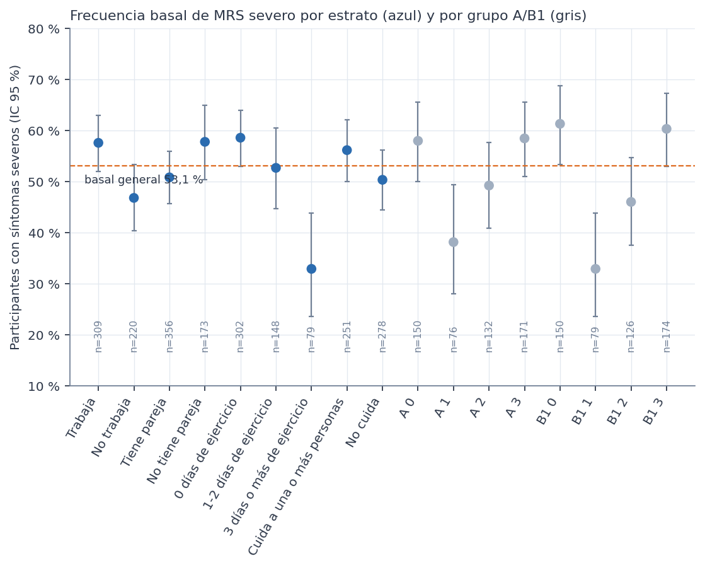
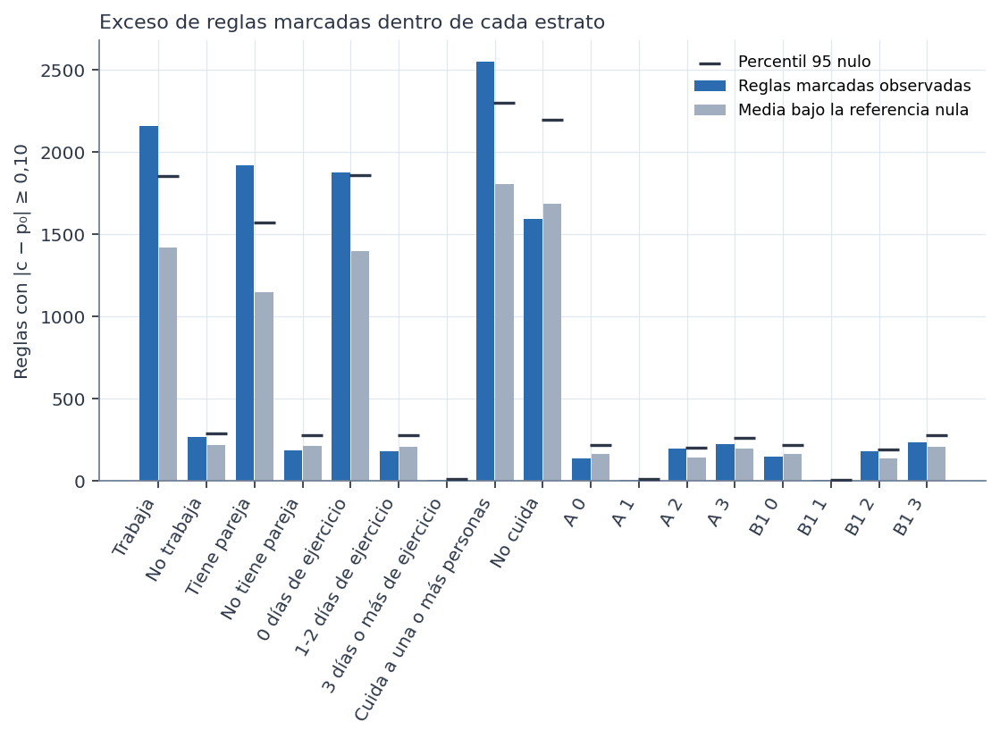
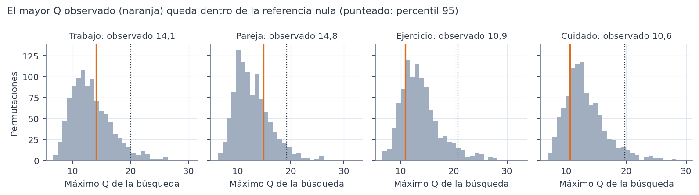
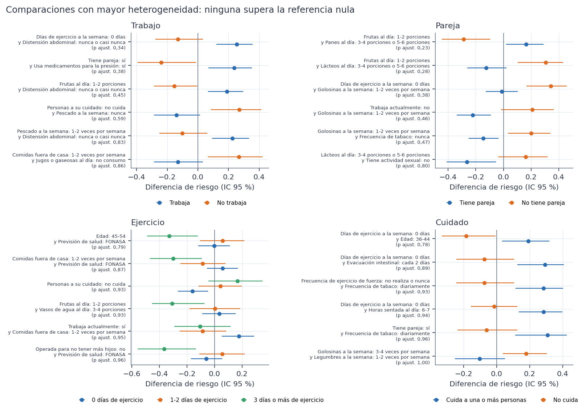
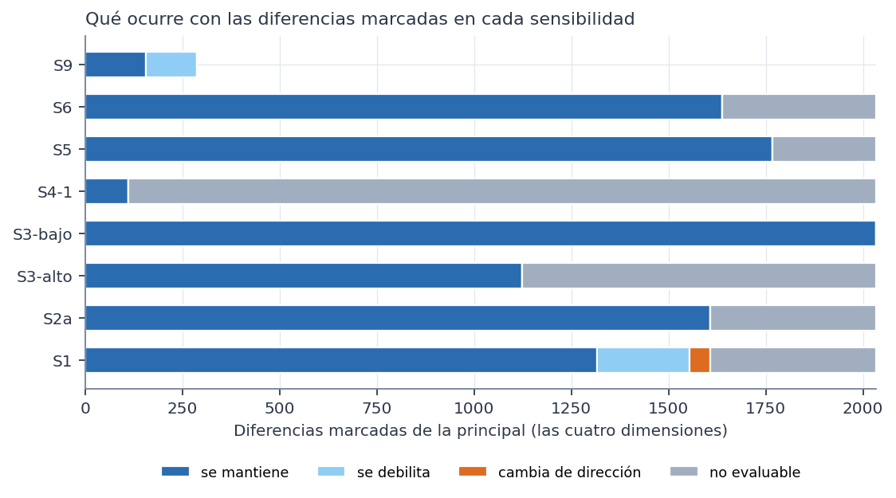
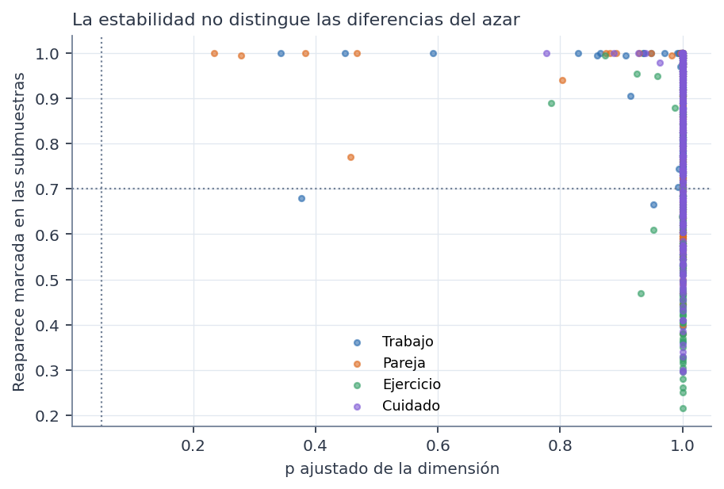

# Contenido

Todo el análisis usa el conjunto **sintético** de 529 participantes. Los resultados describen la simulación, no a mujeres reales. No son diagnósticos ni predicciones, no permiten recomendaciones de salud y ninguna asociación indica causa. Es un análisis **exploratorio**: los estratos y la pregunta se definieron después de conocer las Fases 37D y 38.

- **Figuras:** 6, generadas con `scripts/graficos_39.py` desde las tablas guardadas.
- **Tablas principales:** 71.
- **Otras tablas:** las matrices por estrato están en `preparacion/matrices/`; las tablas de cada sensibilidad, en `sensibilidades/reglas/` y `sensibilidades/comparacion/`.
- **Lotes reanudables:** los de permutaciones y submuestras están en las carpetas `lotes*`.

# Tablas

| Archivo |
|---|
| ab1/comparacion_A.csv |
| ab1/comparacion_B1.csv |
| ab1/composicion_A_B1_por_dimension.csv |
| ab1/cruce_A_B1.csv |
| ab1/nula_comparacion_A.csv |
| ab1/nula_comparacion_B1.csv |
| ab1/reglas_grupos_A_B1.csv |
| ab1/resumen_comparacion_A_B1.csv |
| ab1/resumen_grupos_A_B1.csv |
| comparacion/comparacion_cuidado.csv |
| comparacion/comparacion_ejercicio.csv |
| comparacion/comparacion_pareja.csv |
| comparacion/comparacion_trabajo.csv |
| comparacion/diferencias_de_significacion.csv |
| comparacion/nula_comparacion_cuidado.csv |
| comparacion/nula_comparacion_ejercicio.csv |
| comparacion/nula_comparacion_pareja.csv |
| comparacion/nula_comparacion_trabajo.csv |
| comparacion/nula_conjunta_dimensiones.csv |
| comparacion/resumen_comparacion.csv |
| comparacion/significacion_nominal_exploratoria.csv |
| comparacion/significacion_nominal_resumen.csv |
| estabilidad/estabilidad_cuidado_cuida.csv |
| estabilidad/estabilidad_cuidado_no_cuida.csv |
| estabilidad/estabilidad_ejercicio_0_dias.csv |
| estabilidad/estabilidad_ejercicio_1-2_dias.csv |
| estabilidad/estabilidad_ejercicio_3_o_mas_dias.csv |
| estabilidad/estabilidad_pareja_con_pareja.csv |
| estabilidad/estabilidad_pareja_sin_pareja.csv |
| estabilidad/estabilidad_trabajo_no_trabaja.csv |
| estabilidad/estabilidad_trabajo_trabaja.csv |
| preparacion/diccionario_estratos.csv |
| preparacion/diferencias_basales.csv |
| preparacion/items_por_estrato.csv |
| preparacion/pertenencia_estratos.csv |
| preparacion/superposicion_dimensiones.csv |
| preparacion/trazabilidad_items_fase38.csv |
| preparacion/verificacion_codificacion.json |
| redundancia/comparaciones_redundantes.csv |
| redundancia/reglas_redundantes_estratos.csv |
| referencia_nula/nula_conjunta_estratos.csv |
| referencia_nula/nula_cuidado_cuida.csv |
| referencia_nula/nula_cuidado_no_cuida.csv |
| referencia_nula/nula_ejercicio_0_dias.csv |
| referencia_nula/nula_ejercicio_1-2_dias.csv |
| referencia_nula/nula_ejercicio_3_o_mas_dias.csv |
| referencia_nula/nula_pareja_con_pareja.csv |
| referencia_nula/nula_pareja_sin_pareja.csv |
| referencia_nula/nula_trabajo_no_trabaja.csv |
| referencia_nula/nula_trabajo_trabaja.csv |
| reglas/cuidado/reglas_cuida.csv |
| reglas/cuidado/reglas_no_cuida.csv |
| reglas/ejercicio/reglas_0_dias.csv |
| reglas/ejercicio/reglas_1-2_dias.csv |
| reglas/ejercicio/reglas_3_o_mas_dias.csv |
| reglas/pareja/reglas_con_pareja.csv |
| reglas/pareja/reglas_sin_pareja.csv |
| reglas/reglas_mayor_z_por_estrato.csv |
| reglas/reglas_superan_nula_estrato.csv |
| reglas/reglas_todos_estratos.csv |
| reglas/resumen_estratos.csv |
| reglas/trabajo/reglas_no_trabaja.csv |
| reglas/trabajo/reglas_trabaja.csv |
| resultados/conclusion_39.json |
| sensibilidades/dependencia_items_estratos.csv |
| sensibilidades/grupos_pequenos_comparaciones.csv |
| sensibilidades/lectura_comparaciones_principal.csv |
| sensibilidades/lectura_comparaciones_resumen.csv |
| sensibilidades/reglas_superan_nula_sensibilidades.csv |
| sensibilidades/resumen_sensibilidades_comparacion.csv |
| sensibilidades/resumen_sensibilidades_estratos.csv |

# Figuras

