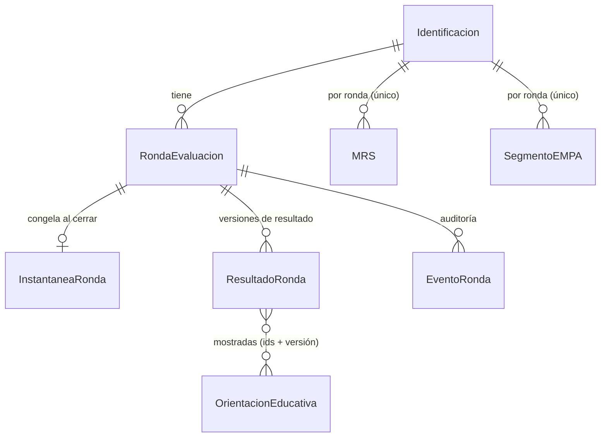

# AgingWomen — Fase 40A: auditoría, diseño técnico y plan de integración

*06-11-2026. Fase en modo de solo lectura. Punto de referencia: rama `datos-simulados`, commit `44bfe0b`. Se revisó el código real de `src/` y los artefactos de `analisis/fase36` y `analisis/fase37`. No se modificó, creó ni ejecutó nada dentro del repositorio.*

**Convenciones:**
- **[D]** = fallo **demostrado**: se deduce directamente del código o de una prueba existente.
- **[H]** = riesgo **hipotético**: el mecanismo existe, pero ocurrir requiere condiciones (concurrencia, uso de la API directa, despliegue) que no se reprodujeron.
- **Severidad:** Crítica, Alta, Media o Baja.

---

## Resumen ejecutivo

1. **El cierre de ronda no valida nada en el servidor** [D, Crítica]. `sync.py:241-244` avanza la ronda si ninguna sección dio error, sin comprobar qué secciones existen, si vienen parciales ni si el MRS está completo. La prueba existente `HistoricoRondaTest.test_finalizar_avanza_ronda_actual` (`tests.py:303`) **cierra una ronda con un MRS que solo trae `pregunta_1` y `parcial: true`** y exige que avance. El defecto está codificado como comportamiento esperado.
2. **El MRS no distingue «0 = ninguna molestia» de «no respondido»** [D, Crítica]:
   - Los 11 ítems son `IntegerField(default=0)` y no admiten nulos (`models.py:396-449`).
   - En una sincronización parcial, Django omite los campos no enviados y deja el valor por defecto 0.
   - Al volver a abrir la encuesta, el servidor devuelve esos ceros como respuestas reales (`sync._datos_de`).
   - El cliente los ve como contestados, de modo que **la usuaria puede finalizar con ceros fantasma sin haberlos elegido**.
3. **No existe un registro explícito de ronda.** No hay estado, fecha de cierre por ronda, quién cerró ni instantánea. La Identificación es una fila única que se sobrescribe (trabajo, región, comuna, educación) y la edad se calcula con la fecha de hoy. **La historia de las características no se puede reconstruir** [D, Alta].
4. **La sincronización no usa transacciones, bloqueos ni restricciones únicas por ronda** [D en el mecanismo, H en la ocurrencia].
   - Un reintento tras perder la respuesta del servidor choca con el plazo de 15 días y se informa como error.
   - Un cambio de ronda hecho desde otro dispositivo **descarta en silencio las respuestas locales no enviadas** (`encuesta.js:243-251`) [D, Alta].
5. **Hay secretos en el código, presentes en todas las ramas de GitHub desde el 14-07-2026** (commit `422d23e`) [D, Crítica antes de usar datos reales]:
   - `SECRET_KEY` escrita directamente en el código;
   - valores por defecto literales para `RUT_HASH_PEPPER` y la contraseña de la base de datos;
   - `DEBUG = True` fijo.

   El pepper es lo más grave: con él, cualquier `rut_hash` se revierte por enumeración en segundos. Cambiarlo **rompe el inicio de sesión por RUT** si no se hace con una migración de doble hash.
6. **Modelo A:** técnicamente es viable, porque sus parámetros están en JSON y bastaría Python puro, sin numpy. Pero **no se recomienda integrarlo**:
   - sus parámetros se ajustaron a datos sintéticos;
   - la regla de cuántas respuestas faltantes se toleran (D-09) está pendiente;
   - el 30,6 % de las participantes tiene un margen de asignación bajo 0,10;
   - depende de la Identificación sin historial.

   **B1 tampoco debe mostrarse a las usuarias**: solo les devuelve tres respuestas que ellas mismas dieron. **Recomendación:** empezar solo con resultados individuales (MRS, dimensiones y evolución) y orientaciones de un catálogo con fuentes. B1 quedaría como opción solo descriptiva y solo para la vista profesional o de investigación, si se decide expresamente.
7. **Orden recomendado:**
   - 40B: integridad de cierre y MRS con nulos, partida en dos incrementos.
   - 40C: resultados versionados, instantáneas y tablero individual.
   - 40D: catálogo educativo.
   - 40E: caracterización opcional.
   - 40F: seguridad y despliegue, que puede avanzar en paralelo y **debe terminar antes de recibir datos reales**.

---

# Documento 1. Auditoría técnica del sistema actual

## 1.1 Alcance revisado

| Componente | Ruta real |
|---|---|
| Modelos | `src/apps/encuestas/models.py` (1.371 líneas); `src/apps/usuarios/models.py` |
| Sincronización | `src/apps/encuestas/sync.py`; endpoints en `src/apps/encuestas/api.py` |
| Rutas | `src/Encuesta_integral/urls.py`; `src/apps/encuestas/urls.py` |
| Formularios y roles | `forms.py`, `campos_por_rol.py`, `condicionales.py`, `esquema.py` |
| Plazo entre rondas | `plazo.py` |
| Tablero e historial | `tablero.py`, `historial.py`, `templates/encuestas/mi_tablero.html` |
| Profesional | `profesional.py`, `templates/encuestas/ficha_paciente.html` |
| Retiro | `retiro.py` |
| Cliente | `src/static/js/encuesta.js` (IndexedDB, sincronización, cierre); `src/static/js/sw.js` |
| Configuración | `src/Encuesta_integral/settings.py`; `docker-compose.yml`; `.env.example`; `requirements.txt` |
| Migraciones | `encuestas` 0001–0019; `usuarios` 0001–0003 |
| Pruebas | `encuestas/tests.py` (136 pruebas); `usuarios/tests.py` (49 pruebas) |

`src/static/css/tema.css` no es relevante para los riesgos de integridad. Solo se considera en el diseño del tablero.

## 1.2 Cómo funciona hoy el cierre de una ronda

```mermaid
sequenceDiagram
    participant U as Usuaria (encuesta.js)
    participant I as IndexedDB
    participant S as /api/sincronizar/ (sync.py)
    participant BD as PostgreSQL
    U->>U: finalizar(): ¿todas las secciones aplicables completas? (solo en el cliente)
    U->>I: envio_final = true
    U->>S: POST {identificacion, secciones[], finalizar:true}
    S->>S: ¿plazo vigente? (solo usuaria) → 400
    S->>BD: guarda Identificación (sin transacción)
    loop cada sección
        S->>BD: guarda la sección (form parcial o completo) en ronda_actual
    end
    S->>S: ok = ninguna sección con error
    alt ok y finalizar
        S->>BD: ronda_actual += 1; ultima_finalizacion_en = ahora
    end
    S-->>U: {ok, ronda_actual, disponible_desde}
    U->>I: iniciarRondaNueva(): borra respuestas salvo identificación, uuids nuevos
```

## 1.3 Hallazgos

Cada hallazgo indica dónde está, qué hace hoy, cuál es el problema, la evidencia, su severidad, la solución propuesta y su compatibilidad con los datos existentes.

### H-01. El cierre de ronda no valida la completitud en el servidor [D, Crítica]

- **Dónde:** `sync.py`, `sincronizar_payload`, líneas 239–244.
- **Qué hace hoy:** `ok = all(estado != 'error')`. Si `finalizar` es verdadero, `ronda_actual += 1`.
- **Problema:** se puede cerrar una ronda con secciones ausentes, con secciones marcadas `parcial: true` o con un MRS incompleto. La única barrera es `finalizar()` en el cliente (`encuesta.js:949-961`), que cualquier petición directa a la API evita.
- **Evidencia:**
  - `tests.py:303` finaliza con `{'pregunta_1': 2}` y `parcial: True`, y comprueba `ronda_actual == 2`.
  - `tests.py:418`, `1050`, `1145`, `1176-1239`, `1263-1319`, `1339-1402` y `1466` también finalizan con datos parciales.
- **Solución:** un validador de completitud en el servidor (Documento 3, §3.3), aplicado dentro de una transacción antes de cerrar. Si falta algo, responde 409 con la lista de lo que falta y no cierra.
- **Compatibilidad:** no cambia datos. Obliga a reescribir las pruebas listadas con datos completos, por ejemplo con un ayudante `payload_completo()`.

### H-02. Ítems MRS omitidos se guardan como 0 y vuelven al cliente como respondidos [D, Crítica]

- **Dónde:** `models.py:396-449`, `MRS.pregunta_1` a `pregunta_11`; `forms.py:56-58` (con `parcial`, ningún campo es obligatorio); `sync.py:262-265`, `_datos_de`.
- **Qué hace hoy:** al crear un MRS con datos parciales, Django no asigna los campos omitidos que tienen valor por defecto, así que quedan en 0. `estado_ronda` devuelve todos los valores que no son `None`, ceros incluidos. `reconciliar()` (`encuesta.js:263-271`) los copia como respuestas cuando no hay cambios locales pendientes.
- **Problema:**
  1. El puntaje parcial se ve como si fuera completo.
  2. Si la usuaria abre la encuesta en otro dispositivo o la recarga, los ítems que nunca respondió aparecen marcados como «Ninguna» y `seccionCompleta()` los considera respondidos.
  3. **No hay forma de distinguir, en las filas existentes, un 0 elegido de un 0 por omisión.**
- **Evidencia:** el comportamiento de `construct_instance` de Django, que omite campos con valor por defecto ausentes del POST; `default=IntensidadMolestia.NINGUNA` en los 11 campos; y `_datos_de`, que filtra solo `None`.
- **Solución:** ítems con `null=True` y `default=None`; cálculo del MRS solo con los 11 ítems válidos; estados explícitos (Documento 3, §3.4).
- **Compatibilidad:** las filas existentes conservan su 0 y se marcan `mrs_verificable = False`, sin inventar nulos. Sus puntajes no se muestran como definitivos.

### H-03. El tablero y la ficha muestran un puntaje MRS de rondas en curso o parciales [D, Alta]

- **Dónde:** `historial.py:11-30`; `mi_tablero.html` («Puntaje MRS: …» en todas las rondas, también la marcada «en curso»); `ficha_paciente.html`.
- **Problema:** muestra resultados provisionales con valores por defecto como si fueran resultados.
- **Solución:** mostrar solo resultados de rondas `CERRADA` con resultado `DISPONIBLE`. La ronda en curso muestra solo su progreso.
- **Compatibilidad:** solo cambia la presentación.

### H-04. No hay transacción ni bloqueo al sincronizar ni al cerrar [D en el mecanismo, H en la ocurrencia; Alta]

- **Dónde:** `sync.py`, en todo `sincronizar_payload`. No hay `transaction.atomic`, `select_for_update` ni `ATOMIC_REQUESTS`.
- **Problemas posibles:**
  - **(a)** Cierre parcial: se guardan unas secciones y otras fallan. Esto es aceptable al guardar, pero no al cerrar.
  - **(b)** Una petición B, por ejemplo del profesional, carga `ronda_actual = N` antes de que la petición A haga el cierre. Luego B escribe en la ronda N cuando ya está cerrada: **modifica en silencio una ronda cerrada**.
  - **(c)** Dos cierres simultáneos leen el mismo N.
- **Solución:** cerrar dentro de `transaction.atomic()` con `select_for_update()` sobre la Identificación y verificar el estado de la ronda dentro del bloqueo. Los guardados normales también toman el bloqueo y rechazan escribir en una ronda que no esté `ABIERTA`.
- **Compatibilidad:** sin cambios de datos. PostgreSQL soporta `SELECT … FOR UPDATE`.

### H-05. El profesional puede cerrar rondas vacías una tras otra [D por la API, Alta]

- **Dónde:** `sync.py:216-221` (el plazo no aplica al profesional) y `sync.py:241`.
- **Problema:** un payload `{identificacion:{paciente_id}, secciones:[], finalizar:true}` devuelve `ok = True` y suma una ronda cada vez, creando rondas vacías. El cliente lo impide porque exige completitud, pero el servidor no.
- **Solución:** la misma de H-01, más idempotencia por `id_cierre`.
- **Compatibilidad:** las rondas vacías existentes se detectan en la retrocarga y se marcan como `ANULADA` u `ORIGEN_DUDOSO`, sin borrarlas.

### H-06. Un reintento de cierre con la respuesta perdida termina en error [D, Media]

- **Dónde:** `sync.py:216-221`; `encuesta.js:1069-1087`.
- **Qué pasa hoy:** el servidor cerró la ronda, pero la respuesta no llegó. El cliente guarda `envio_final = true` y reintenta al recuperar la conexión. Ese reintento choca con el plazo (400, «Podrás volver…») y la usuaria ve «Algunas respuestas no se pudieron enviar», aunque su ronda sí quedó cerrada. Al recargar, `reconciliar()` detecta el cambio de ronda y corrige el estado, pero el mensaje intermedio es falso.
- **Para el profesional:** el reintento falla por `uuid_local` de una ronda finalizada (`sync.py:174-178`), así que no hay doble cierre, pero también recibe un error.
- **Solución:** reconocer el `id_cierre` ya procesado **antes** de comprobar el plazo y responder 200 con el mismo resultado.
- **Compatibilidad:** sin cambios de datos.

### H-07. El cliente descarta respuestas locales no enviadas si la ronda cambió en otro dispositivo [D, Alta]

- **Dónde:** `encuesta.js:243-251`, `reconciliar()`.
- **Problema:** con `cambioDeRonda`, se llama a `iniciarRondaNueva()` y se ponen `sucio` y `pendiente_envio` en falso. Las respuestas locales pendientes se borran sin aviso. Esto ocurre, por ejemplo, si el profesional cerró la ronda mientras la usuaria contestaba sin conexión.
- **Solución:** mover lo pendiente a un almacén `no_enviadas_ronda_N` y avisar: «Estas respuestas no alcanzaron a guardarse antes de que se cerrara la ronda N». La usuaria decide si las usa en la ronda nueva. Nunca se reescribe la ronda cerrada.
- **Compatibilidad:** solo afecta al cliente. Requiere subir la versión de la caché del service worker.

### H-08. La Identificación es una sola fila que se sobrescribe y la edad depende de la fecha de hoy [D, Alta]

- **Dónde:** `models.py:192-344`, `Identificacion`; `sync.py:128-142` (`form.save` sobre la instancia existente); la propiedad `edad` (`models.py:337-344`) usa `date.today()`.
- **Problema:** `trabaja_actualmente`, `region_residencia`, `comuna`, `nivel_educacion` y `genero` se reemplazan sin historial. Si una usuaria deja de trabajar, sus rondas anteriores parecerán de alguien que no trabaja. `trabaja_actualmente` es una de las variables de B1 y del modelo A, y además decide si aparece la sección Trabajo.
- **Solución:** una instantánea inmutable al cerrar cada ronda (Documento 3, §3.5), con `edad_al_cierre` calculada en la fecha de cierre.
- **Compatibilidad:** las rondas ya cerradas no tienen instantánea. Se marcan `instantanea_disponible = False` y no se reconstruyen con datos actuales.

### H-09. No hay estado ni fecha de cierre por ronda [D, Media]

- **Dónde:** `Identificacion.ultima_finalizacion_en` es un solo campo que se sobrescribe. `fecha_evaluacion` y `fecha_registro` usan `auto_now_add`, es decir, la fecha de **creación** de la fila, no la de cierre.
- **Problema:** no se sabe cuándo se cerró la ronda 1 de una participante que ya está en la ronda 3, ni quién la cerró. Una ronda se considera cerrada solo porque es menor que `ronda_actual`.
- **Solución:** el modelo `RondaEvaluacion` (Documento 3).
- **Compatibilidad:** se retrocarga desde los datos existentes, marcada como `origen = RETROCARGA`.

### H-10. No hay restricción única (participante, ronda) por sección [D en el esquema, H en los duplicados; Media]

- **Dónde:** los modelos `SegmentoDeRonda` solo tienen `uuid_local` único. `sync.py:166-170` usa `.first()` y `historial.py:19` también.
- **Problema:** dos dispositivos que crean la misma sección a la vez, con `uuid_local` distintos, pueden dejar dos filas. Después `.first()` elige una arbitrariamente; MRS se ordena por fecha de evaluación descendente.
- **Solución:** `UniqueConstraint(fields=['participante', 'ronda'])` en cada sección, precedida de una migración que **detecta** duplicados y se detiene con un informe, sin borrar nada.
- **Compatibilidad:** requiere verificar la base de datos antes de aplicarla.

### H-11. La API de sincronización no exige el consentimiento [D, Media, ética]

- **Dónde:** `views.py:13` aplica `@requiere_consentimiento` solo a la página `/encuesta/`. `api.sincronizar`, `api.ronda_actual` y `api.esquema` solo exigen `@login_required`.
- **Problema:** una cuenta sin consentimiento aceptado puede guardar respuestas mediante peticiones directas. Esto también ocurre tras retirarse del estudio, que reinicia el consentimiento.
- **Solución:** exigir el consentimiento en los endpoints de escritura, con respuesta 403 en JSON. El profesional queda exento, como hoy.
- **Compatibilidad:** sin cambios de datos.

### H-12. Secretos en el código y configuración insegura [D, Crítica antes de usar datos reales]

- **Dónde:** `settings.py`. Revisé solo la presencia y la longitud de los valores, sin mostrarlos.
  - `SECRET_KEY` es literal, de 66 caracteres, y no se lee del entorno.
  - `RUT_HASH_PEPPER` y la contraseña de la base de datos se leen del entorno, pero tienen **valores por defecto literales** de 32 y 21 caracteres.
  - `DEBUG = True` está fijo.
  - Faltan `SESSION_COOKIE_SECURE`, `CSRF_COOKIE_SECURE`, `SECURE_*` y `CSRF_TRUSTED_ORIGINS`.
- **Exposición:** están en el repositorio desde `422d23e` (14-07-2026) y en todas las ramas remotas. El repositorio es privado, pero todas las personas con acceso y todos los clones locales los tienen. Por eso deben considerarse **comprometidos**.
- **Gravedad:**
  - **Pepper:** el espacio de RUT chilenos es pequeño, del orden de 10⁷ a 10⁸ valores. Conociendo el pepper, una base filtrada permite recuperar cada RUT y reidentificar a las participantes. **Es el riesgo de privacidad más importante del sistema.**
  - **SECRET_KEY:** permite falsificar enlaces de recuperación de contraseña, cookies firmadas y mensajes firmados.
  - **DEBUG:** muestra trazas con variables locales, que pueden incluir payloads de salud.
- **Solución:** Documento 3, §3.9. Incluye la rotación del pepper con doble hash, para no romper el inicio de sesión.
- **Compatibilidad:** cambiar el pepper sin migración deja a todas las cuentas sin poder iniciar sesión por RUT (`RutBackend`) y desvincula las fichas.

### H-13. Datos de salud en IndexedDB después de cerrar sesión [D, Media]

- **Dónde:** el formulario de salida de `base.html:18-20` no limpia nada. `encuesta.js:135-146` limpia solo cuando, al volver a cargar, detecta **otro** usuario.
- **Problema:** en un dispositivo compartido, como en un centro de salud, las respuestas de la última persona quedan en el navegador hasta que otra persona abra la encuesta. Lo mismo ocurre tras retirarse del estudio.
- **Solución:** al cerrar sesión y al retirarse, borrar la base local con `indexedDB.deleteDatabase` y las entradas de caché, salvo las respuestas pendientes de envío. Para esas, primero avisar: «Tienes respuestas sin enviar; si sales se perderán».
- **Compatibilidad:** solo afecta al cliente.

### H-14. El service worker guarda el esquema con una sola clave y sirve la página de la usuaria al profesional sin conexión [D en el código, H en el impacto; Baja]

- **Dónde:** `sw.js:55-74`.
- **Problema:** `/api/esquema/` depende del rol, pero se guarda con una sola clave. Si en el mismo navegador entra un profesional después de una usuaria, sin conexión podría recibir el esquema de la usuaria, que no incluye los campos de EMPA. Además, la navegación sin conexión a `/profesional/paciente/<id>/encuesta/` cae en la página `/encuesta/`.
- **Solución:** incluir el rol en la clave de caché del esquema y guardar una página propia para el modo profesional, o declarar que el modo profesional requiere conexión.

### H-15. Un valor vacío en un ítem que no admite nulos podría causar un error 500 [H, Media]

- **Dónde:** el campo de formulario de un `IntegerField` con opciones y sin `null` tiene `empty_value = ''`. Si el cliente envía `"pregunta_3": ""` en modo parcial, el formulario lo da por válido y el guardado falla al convertir a entero.
- **Estado:** el cliente actual no envía cadenas vacías (`encuesta.js:989` envía solo valores definidos). Hay que verificarlo con una prueba.
- **Solución:** desaparece con H-02, porque los ítems pasan a admitir nulos.

### H-16. Acceso amplio del profesional sin registro de auditoría [D, Media; diseño]

- **Dónde:** `profesional.py`, `ficha_paciente` y `encuesta_paciente`. Cualquier profesional ve y edita a cualquier paciente.
- **Problema:** es una decisión del proyecto, pero no queda constancia de quién vio o cambió qué.
- **Solución:** un modelo `RegistroAcceso`, de solo escritura, para la ficha, la edición y el cierre por profesional. No guarda el contenido de las respuestas, solo quién, qué, cuándo y sobre qué ficha.

### H-17. El cuestionario cambió entre versiones y no se registra la versión por ronda [D, Media]

- **Evidencia:** la Fase 26 cambió preguntas (previsión, multiselección y condicionales). No existe un campo `version_esquema`.
- **Problema:** las rondas antiguas se validaron con otras reglas. Un validador de completitud nuevo no debe aplicarse hacia atrás.
- **Solución:** `RondaEvaluacion.version_cuestionario`, que se fija al abrir la ronda.

### H-18. El tablero busca la ficha de otra forma que la sincronización [D, Baja]

- **Dónde:** `tablero.py:27` y `api.py:82` usan `filter(usuario=…)`; `sync.py:84-91` también acepta la ficha sin dueña que tenga el mismo `rut_hash`.
- **Problema:** si una ficha creada por el profesional todavía no quedó asociada, la usuaria podría sincronizar con ella pero no verla en su tablero. La Fase 29 asocia la ficha al registrarse, así que el riesgo es bajo.
- **Solución:** usar `identificacion_de_usuaria()` en todos los lugares.

## 1.4 Las pruebas existentes

- **Cubren:** campos por rol, esquema, edad, plazo, la creación de una fila nueva por ronda, el rechazo de un `uuid_local` de una ronda cerrada, el retiro, el profesional y la migración 0019.
- **No cubren:**
  - el rechazo de un cierre incompleto (al contrario: varias pruebas exigen que funcione);
  - la idempotencia del cierre;
  - la concurrencia;
  - la diferencia entre MRS faltante y 0;
  - el consentimiento en la API;
  - la limpieza local al cerrar sesión;
  - el cliente JavaScript, para el que no hay framework de pruebas.

---

# Documento 2. Riesgos priorizados

Escala de 1 a 5 en tres dimensiones:
- **Impacto** (I): 5 = pérdida de datos, reidentificación o resultado falso mostrado.
- **Probabilidad** (P).
- **Detección** (De): 5 = difícil de detectar.

El índice de prioridad (IPR) es I × P × De.

| Rango | ID | Riesgo | Tipo | I | P | De | IPR | Severidad |
|---:|---|---|---|---:|---:|---:|---:|---|
| 1 | H-02 | MRS omitido guardado y mostrado como 0; ceros fantasma que permiten finalizar | D | 5 | 4 | 5 | **100** | Crítica |
| 2 | H-12 | Pepper, SECRET_KEY y DEBUG en el código: reidentificación por RUT si se filtra la base | D | 5 | 3 | 5 | **75** | Crítica (antes de datos reales) |
| 3 | H-01 | Ronda cerrada sin validar en el servidor | D | 5 | 3 | 4 | **60** | Crítica |
| 4 | H-08 | Historia de características irrecuperable (Identificación sobrescrita, edad con la fecha de hoy) | D | 4 | 5 | 3 | **60** | Alta |
| 5 | H-07 | Respuestas locales descartadas en silencio al cambiar de ronda | D | 4 | 3 | 5 | **60** | Alta |
| 6 | H-04 | Escritura en una ronda cerrada por una petición concurrente | H | 4 | 2 | 5 | **40** | Alta |
| 7 | H-03 | Puntaje de una ronda en curso o parcial mostrado como resultado | D | 4 | 4 | 2 | **32** | Alta |
| 8 | H-13 | Datos de salud en IndexedDB en dispositivos compartidos | D | 4 | 2 | 4 | **32** | Media |
| 9 | H-05 | Rondas vacías creadas por la API (profesional) | D | 3 | 2 | 3 | **18** | Alta (integridad) |
| 10 | H-10 | Secciones duplicadas por ronda | H | 3 | 2 | 3 | **18** | Media |
| 11 | H-11 | Escritura sin consentimiento por la API | D | 4 | 1 | 4 | **16** | Media (ética) |
| 12 | H-17 | Validador nuevo aplicado a rondas antiguas | D | 3 | 2 | 2 | **12** | Media |
| 13 | H-06 | Reintento de cierre informado como error | D | 2 | 3 | 2 | **12** | Media |
| 14 | H-16 | Sin registro de accesos del profesional | D | 3 | 2 | 2 | **12** | Media |
| 15 | H-14 | Esquema guardado sin distinguir rol | H | 2 | 1 | 3 | **6** | Baja |
| 16 | H-15 | Error 500 por una cadena vacía en un ítem MRS | H | 2 | 1 | 2 | **4** | Media |
| 17 | H-18 | Búsqueda de ficha inconsistente | D | 2 | 1 | 2 | **4** | Baja |

**Riesgos metodológicos, que no son del código:**

| ID | Riesgo | Severidad | Mitigación |
|---|---|---|---|
| M-01 | Presentar grupos (A o B1) como diagnóstico o como nivel de riesgo | Crítica | No mostrar grupos a la usuaria en la primera versión (Documento 4) |
| M-02 | Usar las cuatro variables de FCBF como determinantes | Alta | Prohibido por diseño; el catálogo no se condiciona con ellas |
| M-03 | Convertir reglas de las Fases 38 y 39 en recomendaciones o alertas | Crítica | Prohibido; las condiciones del catálogo solo usan respuestas y fuentes externas |
| M-04 | Interpretar una baja del MRS como mejoría clínica | Alta | Usar un lenguaje de «cambio en los síntomas que reportaste» y una advertencia fija (Documento 6) |
| M-05 | Aplicar a mujeres reales parámetros ajustados a datos sintéticos (A) | Crítica | No integrar A; reajustarlo con datos reales y con aprobación ética |
| M-06 | Cortes del MRS sin fuente documentada; 16+ frente al 17+ que aparece en parte de la literatura | Media | Fijar la fuente y la versión del criterio (Documento 3, §3.4) |
| M-07 | El ítem 5 del MRS incluye «sin ganas de vivir»; un valor alto sin respuesta adecuada | Alta (ética) | Mensaje de apoyo y recursos de ayuda, sin diagnosticar (Documento 5, §5.6) |

---

# Documento 3. Arquitectura propuesta

## 3.1 Principios

1. **El servidor decide el cierre.** El cliente puede guardar sin conexión, pero solo el servidor declara una ronda cerrada.
2. **Las rondas cerradas no se modifican.** Toda corrección posterior es un evento nuevo que se audita; nunca se reescribe en silencio.
3. **Los resultados se calculan una sola vez y quedan versionados.** El tablero lee resultados guardados; no los recalcula.
4. **Un resultado definitivo solo sale de datos confirmados y completos.**
5. **Cambios solo aditivos y reversibles.** Ninguna migración borra datos.

## 3.2 Modelo de datos



**`RondaEvaluacion`** (tabla nueva):

| Campo | Tipo | Notas |
|---|---|---|
| `participante` | FK a `Identificacion`, con CASCADE | El retiro sigue borrando todo |
| `numero` | PositiveInteger | `UniqueConstraint(participante, numero)` |
| `estado` | `ABIERTA` / `CERRADA` / `ANULADA` | Sin estado intermedio: el cierre es atómico |
| `abierta_en`, `cerrada_en` | DateTime | `cerrada_en` es nulo mientras está abierta |
| `cerrada_por` | FK a `Usuario`, nulo, SET_NULL | Más `cerrada_por_rol` (texto) para conservarlo si se borra la cuenta |
| `id_cierre` | UUID, único y nulo | Lo genera el cliente: es la clave de idempotencia |
| `version_cuestionario` | Char | Por ejemplo `2026-10-r3`; se fija al abrir |
| `origen` | `NORMAL` / `RETROCARGA` | Las filas creadas a partir de datos anteriores se distinguen |
| `observaciones_retrocarga` | JSON | Por ejemplo `{"sin_mrs": true, "vacia": true}` |

- Se agrega una restricción adicional: como máximo una ronda `ABIERTA` por participante (`UniqueConstraint` condicional).
- `Identificacion.ronda_actual` se mantiene **solo por compatibilidad**. Su valor debe coincidir siempre con el número de la ronda abierta, y una prueba de invariante lo verifica. Se elimina más adelante, cuando el cliente y las vistas ya no lo usen.

**`EventoRonda`**: registro de auditoría de solo inserción.
- Tipos: `APERTURA`, `GUARDADO`, `CIERRE`, `CIERRE_RECHAZADO`, `REINTENTO_IDEMPOTENTE`, `ESCRITURA_RECHAZADA_RONDA_CERRADA` y `CORRECCION_ADMINISTRATIVA`.
- Campos: actor (usuario y rol), momento, datos breves **sin respuestas de salud** (por ejemplo, la lista de secciones faltantes).

## 3.3 Flujo de cierre seguro e idempotente

```mermaid
flowchart TD
    A[POST /api/sincronizar/ con finalizar:{id_cierre, ronda_cliente, version_cuestionario}] --> B{¿id_cierre ya existe?}
    B -- sí, misma participante --> R1[200 'ya_cerrada': mismo cuerpo que el cierre original]
    B -- sí, otra participante --> R0[409 'id_cierre_invalido']
    B -- no --> C{¿plazo vigente? solo usuaria}
    C -- sí --> R2[409 'en_espera' + disponible_desde]
    C -- no --> D[BEGIN; SELECT Identificacion FOR UPDATE]
    D --> E{¿ronda abierta == ronda_cliente?}
    E -- no --> R3[409 'ronda_ya_cerrada' + ronda_actual; ROLLBACK]
    E -- sí --> F[Guardar las secciones del payload en la ronda abierta]
    F --> G{¿hubo error de validación?}
    G -- sí --> R4[200 ok:false con detalle; ROLLBACK de las secciones del cierre]
    G -- no --> H[validar_completitud ronda, rol, versión]
    H -- faltan --> R5[409 'incompleta' + faltantes; las secciones quedan guardadas como parciales; COMMIT sin cerrar]
    H -- completa --> I[Instantánea + MRS + ResultadoRonda v1]
    I --> J[Ronda → CERRADA; nueva ronda ABIERTA; Evento CIERRE; COMMIT]
    J --> K[on_commit: componentes no críticos; si fallan, Resultado queda en PENDIENTE]
    K --> R6[200 'cerrada' + ronda_cerrada + ronda_actual + resultado]
```

**Decisiones:**
- **La idempotencia se comprueba antes que el plazo.** Así se corrige H-06.
- **Las secciones se guardan aunque el cierre quede incompleto** (R5). Así no se pierde trabajo, pero la ronda sigue abierta y la usuaria ve qué le falta.
- **Validador único:** `apps/encuestas/completitud.py`.
  - Lee las mismas reglas de `condicionales.py` y `campos_por_rol.py` y los campos obligatorios de los formularios.
  - Evalúa las secciones aplicables (por ejemplo, Trabajo solo si `trabaja_actualmente`) y las preguntas visibles con la misma regla de ocultar en cadena.
  - El esquema que recibe el cliente se genera con esas mismas reglas.
  - Una prueba compara el validador de Python con el comportamiento esperado del cliente sobre casos fijos, para que no diverjan.
- **Requisito mínimo de cierre:** Identificación válida, todas las secciones aplicables presentes y los 11 ítems MRS con valores de 0 a 4 confirmados. Las preguntas opcionales pueden quedar vacías.
- **Escrituras posteriores al cierre:** todo guardado toma el mismo bloqueo y verifica que la ronda de destino esté `ABIERTA`.
  - Hoy la búsqueda alternativa por (participante, ronda) de `sync.py:166` siempre escribe en la ronda actual, lo que es correcto. El riesgo es la carrera de H-04, que el bloqueo elimina.
  - Si llega un `uuid_local` de una ronda cerrada, se responde 409 con la sección y se registra un evento; nunca se sobrescribe.
- **Profesional:** mismo flujo, sin plazo. El cierre exige completitud igual que para la usuaria. Se registra `cerrada_por_rol = PROFESIONAL`.

**Si la usuaria pierde la conexión durante el cierre:**

| Momento del corte | Hoy | Con el diseño |
|---|---|---|
| Antes de enviar | Queda `envio_final = true`; se reintenta al reconectar | Igual. La interfaz muestra «Cierre pendiente: se enviará al recuperar la conexión» y el estado «guardado en este dispositivo» |
| La petición no llegó al servidor | El reintento funciona | Igual, con el mismo `id_cierre` |
| El servidor cerró, pero la respuesta se perdió | El reintento recibe un 400 por el plazo (usuaria) o un error de `uuid` (profesional). Mensaje falso de error; se corrige al recargar | El reintento con el mismo `id_cierre` recibe un 200 `ya_cerrada` con el mismo resultado. Mensaje correcto |
| El servidor falló a mitad del cierre | Puede quedar a medias (sin transacción) | ROLLBACK: la ronda sigue abierta; el reintento es seguro |

## 3.4 El MRS: valores faltantes, cero, estados y cálculo

**Cambios en el modelo:**
- `pregunta_1` a `pregunta_11` pasan a `null=True` y `default=None`. Las opciones se mantienen.
- Campo nuevo `mrs_verificable` (booleano):
  - `False` en todas las filas existentes, porque no se puede saber si su 0 fue elegido;
  - `True` en las filas nuevas.

**Estados por ítem**, que se calculan y no se guardan:

| Situación | Representación | Cuenta en el puntaje |
|---|---|---|
| Respuesta explícita 0 | `pregunta_k = 0` en el servidor | Sí, vale 0 |
| Falta la respuesta | `NULL` | No: el puntaje queda «incompleto» |
| Respondida, pero sin sincronizar | Existe solo en IndexedDB | No: el servidor no la conoce |
| Valor inválido (fuera de 0 a 4 o no entero) | Lo rechaza el formulario | No se guarda; error en ese campo |
| Encuesta parcial | Ronda `ABIERTA` | Se muestra el progreso, no el puntaje |

**Cálculo**, en una función pura `apps/encuestas/resultados/mrs.py` versionada (por ejemplo `MRS-1.0`):
- `total` es la suma de los 11 ítems, y **solo se calcula si los 11 no son nulos**. Si falta alguno devuelve `None` y la marca `datos_insuficientes = True`.
- Dimensiones: somática = ítems 1 a 4; psicológica = 5 a 8; urogenital = 9 a 11. Coincide con el orden del proyecto: bochornos, corazón, músculos y articulaciones, sueño; ánimo depresivo, irritabilidad, ansiedad, cansancio; sexual, orina, sequedad vaginal.
- **No se imputa** ningún ítem para el resultado individual.

**Cortes vigentes** en `MRS.SEVERIDAD_TOTAL`: 0–4 «Sin síntomas o muy leves», 5–8 «Leve», 9–15 «Moderada» y 16–44 «Severa». Coinciden con los indicados, y 16 o más es el mismo criterio que el objetivo `severo_mrs` de las Fases 35 a 39.

Advertencias:
- **Parte de la literatura cita para el MRS de Heinemann los tramos 0–4, 5–8, 9–16 y 17 o más, además de cortes por dimensión.** Hay que verificarlo con la fuente original antes de fijarlo.
- La propuesta es mantener 16 o más, por coherencia con el análisis. Hay que documentar la fuente y la decisión en una constante versionada (`CRITERIO_MRS = 'AW-2026-11: 0-4/5-8/9-15/16+'`) y guardar ese criterio en cada resultado.
- **Las dimensiones se informan como puntaje sobre su máximo** (16, 16 y 12), **sin categoría de severidad** hasta fijar cortes con fuente.
- **Textos para la usuaria:** «Intensidad de las molestias que reportaste: moderada». Nunca «tiene menopausia moderada» ni «diagnóstico».

**Por qué no se convierten los 0 existentes en nulos:** sería inventar ausencias. Lo correcto es marcar las filas antiguas como no verificables y que el tablero las muestre como «registro anterior, no comparable».

## 3.5 Historial: instantáneas por ronda

**Alternativas evaluadas:**

| Criterio | A. Modelos relacionales por ronda (copiar Identificación a `IdentificacionRonda`) | B. Instantánea JSON versionada | C. Híbrido |
|---|---|---|---|
| Integridad histórica | Alta | Alta (inmutable + huella) | Alta |
| Facilidad de consultas | Alta (SQL) | Media (JSONField en PostgreSQL, con índices GIN si hace falta) | Alta para lo frecuente, media para el resto |
| Migraciones | Una tabla por grupo de datos y cambios cada vez que cambia el cuestionario | Una tabla; el esquema evoluciona con `version` | Una tabla relacional pequeña + JSON |
| Compatibilidad | Duplica la lógica de los formularios | Desacoplada del cuestionario | Buena |
| Auditoría | Buena | Muy buena (huella SHA-256 del JSON canónico) | Muy buena |
| Rendimiento | Bueno | Bueno (una fila por ronda) | Bueno |
| Privacidad | Copia todo, incluidos datos innecesarios | Se elige qué se congela | Se elige qué se congela |
| Mantenimiento | Alto | Bajo | Bajo a medio |

**Recomendación: C, híbrido.**
- Campos relacionales mínimos en `RondaEvaluacion` y `ResultadoRonda` para lo que se consulta seguido: estado, fechas, MRS total y por dimensión.
- Una tabla `InstantaneaRonda` (1:1 con la ronda) con:
  - `datos` (JSON canónico con claves ordenadas);
  - `version_instantanea` (por ejemplo `INST-1`);
  - `huella_sha256`;
  - `creada_en`.

  No se puede modificar: se verifica en `save()` y con una prueba.

**Contenido de la instantánea, versión 1:**
- `edad_al_cierre`: entero calculado con `cerrada_en`, no con la fecha de hoy.
- De la Identificación al cierre: `trabaja_actualmente`, `region_residencia`, `nivel_educacion` y `excepcion_edad`.
  - `comuna`: guardarla solo si se justifica, porque permite identificar a una persona junto con la edad. Propuesta: no incluirla en la versión 1.
  - `fecha_nacimiento`: no se copia.
- Las variables que usan los componentes descriptivos, si se activan: las 30 de P2 y las 3 de B1, tomadas de las secciones de la ronda, con su estado (observada, estructural o ausente).
- `version_cuestionario`, `secciones_presentes` y `faltantes_opcionales` (conteo).
- **Nunca:** RUT, `rut_hash`, correo, textos libres (`*_otro`, comentarios) ni datos del EMPA que no se usen.

**Rondas cerradas antes de la migración:** se crean sus `RondaEvaluacion` con `origen = RETROCARGA` y **sin instantánea**. No se reconstruye con la Identificación actual, porque sería falso.

## 3.6 Registro de resultados (`ResultadoRonda`)

| Campo | Se guarda | Notas |
|---|---|---|
| `ronda` (FK), `version_algoritmo` | Sí | `UniqueConstraint(ronda, version_algoritmo)` impide calcular dos veces |
| `vigente` | Sí | Un solo resultado vigente por ronda (`UniqueConstraint` condicional) |
| `estado` | Sí | `PENDIENTE`, `DISPONIBLE`, `DATOS_INSUFICIENTES` o `ERROR_RECUPERABLE` |
| `calculado_en`, `intentos`, `ultimo_error` | Sí | `ultimo_error` guarda un código, nunca datos |
| `mrs_total`, `mrs_somatica`, `mrs_psicologica`, `mrs_urogenital` | Sí | Nulos si faltan datos |
| `mrs_categoria`, `criterio_mrs` | Sí | Por ejemplo `MODERADA` y `AW-2026-11` |
| `mrs_verificable` | Sí | Se copia del MRS |
| `version_catalogo`, `orientaciones_mostradas` | Sí | Lista de identificadores de orientaciones y su versión |
| `caracterizacion_id`, `caracterizacion_metodo`, `caracterizacion_version` | Sí, nulos | Solo si se activa en la 40E |
| `huella_instantanea` | Sí | Enlaza el resultado con los datos exactos que lo produjeron |
| Cambio respecto de la ronda anterior | **No se guarda** | Se calcula al mostrar, entre resultados vigentes y comparables |
| Textos de las orientaciones | **No se guardan** | Se leen del catálogo con el identificador y la versión, así quedan auditables |

**Cuándo se calcula:**
- El MRS se calcula dentro de la transacción de cierre: es una suma pura y no puede fallar si los datos son válidos.
- Las orientaciones y la caracterización se calculan en `transaction.on_commit`. Si fallan, quedan en `PENDIENTE` o `ERROR_RECUPERABLE` sin deshacer el cierre.
- Un comando `manage.py recalcular_resultados --pendientes` reintenta los pendientes. **No se necesita Celery**: el volumen es pequeño.

**Versiones nuevas del algoritmo o del catálogo:**
- Se crea un resultado nuevo con `vigente = True` y el anterior queda con `vigente = False`. No se borra.
- Se recalcula solo si la versión lo declara necesario, con un comando explícito que queda auditado.
- Las rondas sin instantánea (retrocarga) **no se recalculan** con componentes que dependan de ella.

**Privacidad:**
- No se guardan textos libres, RUT, correo, ni probabilidades o niveles de riesgo.
- Una exportación para investigación usaría `participante_id` seudonimizado y la instantánea, nunca la Identificación completa.

## 3.7 Contrato entre el cliente y el servidor

**Guardar (sin cerrar):** `POST /api/sincronizar/`

```json
{ "identificacion": {"uuid_local": "...", "datos": {...}},
  "ronda_cliente": 3,
  "version_cuestionario": "2026-10-r3",
  "secciones": [{"tipo": "mrs", "uuid_local": "...", "parcial": true, "datos": {...}}] }
```

Respuestas:
- 200 `{ok, resultados[], ronda_actual, estado_ronda: "ABIERTA"}`.
- 409 `{estado: "ronda_cerrada", ronda_actual, secciones_rechazadas: [...]}` si `ronda_cliente` ya está cerrada.

**Cerrar:** el mismo endpoint, con `"finalizar": {"id_cierre": "<uuid>", "ronda_cliente": 3}`.

| Resultado | Código | Cuerpo |
|---|---|---|
| Cerrada | 200 | `{estado:"cerrada", ronda_cerrada:3, ronda_actual:4, disponible_desde, resultado:{estado:"DISPONIBLE"/"PENDIENTE"}}` |
| Ya estaba cerrada con ese `id_cierre` | 200 | El mismo cuerpo, con `"repetida": true` |
| Incompleta | 409 | `{estado:"incompleta", faltantes:[{seccion, preguntas:[...]}]}` |
| La ronda ya la cerró otra persona | 409 | `{estado:"ronda_ya_cerrada", ronda_actual}` |
| Dentro del plazo | 409 | `{estado:"en_espera", disponible_desde}` |
| Sin consentimiento | 403 | `{estado:"sin_consentimiento"}` |

**Estados que muestra el cliente:**
- «Guardado solo en este dispositivo»: hay cambios sin enviar.
- «Guardado en el servidor»: el último envío tuvo éxito.
- «Cierre pendiente de envío».
- «Ronda cerrada».
- «Respuestas no enviadas de una ronda ya cerrada»: el almacén separado de H-07.

**Cambios de versión:**
- IndexedDB guarda `version_cuestionario` junto a las respuestas.
- Si el esquema nuevo tiene otra versión, el cliente **no descarta** lo pendiente: lo envía con su versión. El servidor acepta guardados de la versión anterior durante un período de transición y valida el cierre con la versión fijada en la ronda.
- La versión de la caché del service worker sube con cada cambio del cliente.

## 3.8 Sincronización y PWA

| Aspecto | Hoy | Propuesta |
|---|---|---|
| Reintentos | Al recuperar la conexión y al cargar, si hay algo pendiente | Igual, con un tope y espera creciente cuando el servidor responde 5xx |
| Duplicados | `uuid_local` único; búsqueda por (participante, ronda) | Además, restricción única (participante, ronda) por sección y `id_cierre` |
| Orden de llegada | El último en llegar gana, sin control | Cada guardado envía `ronda_cliente`; el servidor rechaza lo dirigido a rondas cerradas. Dentro de una ronda abierta sigue ganando el último (aceptable para una sola usuaria); entre el profesional y la usuaria, la Fase 29 ya decide que manda el servidor si no hay cambios locales |
| Cierre sin conexión | `envio_final` en IndexedDB | Además, `id_cierre` en IndexedDB, generado una sola vez por ronda |
| Cambio de dispositivo | `reconciliar()` descarta lo local si cambió la ronda | Se separa lo pendiente y se avisa (H-07) |
| Cerrar sesión | No se limpia | Se limpia, con aviso si hay pendientes (H-13) |

## 3.9 Secretos y configuración de producción

**Plan:**

1. **Paso 0, sin rotar ningún valor:**
   - `SECRET_KEY`, `DEBUG`, `RUT_HASH_PEPPER` y las credenciales se leen solo del entorno.
   - En producción, si falta alguna variable, la aplicación no arranca: se eliminan los valores literales por defecto.
   - En desarrollo se usa un `.env` local que no se sube al repositorio (`.env.example` sin valores).
   - Se agregan `SESSION_COOKIE_SECURE`, `CSRF_COOKIE_SECURE`, `SECURE_PROXY_SSL_HEADER`, `CSRF_TRUSTED_ORIGINS` y HSTS en el perfil de producción.
2. **Rotación de `SECRET_KEY`:** se genera una clave nueva y se configura `SECRET_KEY_FALLBACKS = [clave_anterior]` (Django 4.1 o posterior) durante una ventana corta, para no invalidar todas las sesiones de golpe. Luego se retira la clave anterior. Los enlaces de recuperación de contraseña pendientes caducan; se avisa.
3. **Rotación del pepper con doble hash:**
   - Se agrega `rut_hash_v2` (nulo y único) a `Usuario` e `Identificacion`.
   - **Inicio de sesión:** se calcula el hash con el pepper nuevo. Si no encuentra nada, se calcula con el anterior y, si coincide, se escribe `rut_hash_v2` en la misma transacción para la cuenta y su ficha.
   - **Búsqueda del profesional por RUT:** igual, actualizando la ficha encontrada.
   - Cuando todas las filas activas tengan `v2`, se retira el pepper anterior. Las fichas sin migrar quedan accesibles solo con una búsqueda que use el pepper anterior, guardado aparte, hasta que se decida.
   - **Si todavía no hay datos reales**, lo más simple es generar el pepper nuevo antes del primer despliegue y empezar con la base vacía. Ese es el escenario recomendado.
4. **Historial de Git:** borrar los valores del historial requiere reescribirlo, lo que obliga a hacer push forzado a todas las ramas y que cada persona vuelva a clonar. No es necesario si los valores se rotan, porque una vez rotados no sirven. Recomiendo rotarlos y no reescribir el historial.
5. **Gestor de secretos:** variables de entorno del proveedor (por ejemplo, DigitalOcean App Platform) o un archivo `.env` con permisos 600 en el servidor y respaldo cifrado del pepper. **Si se pierde el pepper, se pierde la asociación de todas las cuentas por RUT.**

## 3.10 Migraciones necesarias y su orden

| Orden | Migración (propuesta) | Contenido | Datos existentes | Reversión |
|---:|---|---|---|---|
| 0 | — | `pg_dump` completo y comprobación de que se puede restaurar | — | Restaurar |
| 1 | `encuestas 0020_rondaevaluacion` | Tabla nueva + `EventoRonda` | Ninguno | `migrate 0019` borra solo las tablas nuevas |
| 2 | `0021_retrocarga_rondas` (RunPython) | Por participante: rondas 1 a `ronda_actual − 1` → `CERRADA`, `origen = RETROCARGA`. `cerrada_en`: solo la última, con `ultima_finalizacion_en`; las demás quedan nulas. Ronda actual → `ABIERTA`. Marca `vacia` o `sin_mrs` en observaciones | Solo lectura de las tablas antiguas | Reversa: vacía las tablas nuevas |
| 3 | `0022_verificar_duplicados` (RunPython) | **Detecta** secciones duplicadas por (participante, ronda). Si hay, **se detiene** con un informe. No borra nada | Solo lectura | No aplica |
| 4 | `0023_unicidad_seccion_ronda` | `UniqueConstraint(participante, ronda)` en las 7 secciones | Requiere el paso 3 limpio | Elimina las restricciones |
| 5 | `0024_mrs_nulos` | `AlterField` de los 11 ítems a `null=True, default=None` + `mrs_verificable` (por defecto False en filas existentes, True en el código nuevo) | Conserva los 0 existentes | La reversa exige que no haya nulos: si hay MRS nuevos con nulos, la reversión es **solo hacia adelante** (restaurar el respaldo). Hay que documentarlo |
| 6 | `0025_instantanea_resultado` | `InstantaneaRonda` + `ResultadoRonda` | Ninguno; no se retrocargan resultados | Elimina las tablas |
| 7 | `0026_resultados_retrocarga` (opcional) | Resultados MRS para rondas retrocargadas con `mrs_verificable = False` → estado `DATOS_INSUFICIENTES` o «no comparable» | Solo lectura de MRS | Vacía la tabla |
| 8 | `usuarios 0004_rut_hash_v2` | Solo si se rota el pepper con datos reales | Columnas nulas | Elimina las columnas |
| 9 | Catálogo (40D) | Solo si el catálogo se guarda en la base (Documento 5 recomienda un archivo versionado) | — | — |

Todas las migraciones son compatibles con PostgreSQL. Los índices nuevos en tablas grandes no son un problema por el volumen esperado; si lo fueran, se usaría `AddIndexConcurrently` en una migración no atómica.

---

# Documento 4. Modelo A frente a B1 y la opción sin grupos

## 4.1 Auditoría de los artefactos de `P2_c12_km_k4` (A)

| Elemento | Dónde está | Estado |
|---|---|---|
| Variables de entrada | `fase36/artefactos/esquema_nueva_participante.json`: 30 generales (P2 excluye el IMC, quedan 29 variables y 33 columnas) + 4 campos de contexto (`realiza_*`, `cuida_otras_personas`) | Completo |
| Codificadores | `fase36/artefactos/P2/codificadores.json`: binarias, ordinales consecutivas (por ejemplo `frecuencia_fuerza`: 0 y 1 → 0, …, 5 → 4) e indicadoras para `quien_prepara_comidas` | Completo |
| Escaladores | `P2/escaladores.json`: z con media y desviación congeladas (n = 529) | Completo |
| Orden de columnas | `P2/orden_columnas.json` (33) | Completo |
| Faltantes | `P2/valores_desconocidos.json`. Cero estructural si la pregunta madre vale NO; otra ausente → valor congelado con marca; **«límite de respuestas ausentes pendiente (D-09)»** | **Incompleto** |
| PCA | `fase37/37A_reduccion/artefactos/P2/modelo.json`: media, 32 componentes y valores propios, `svd_solver = "full"`. Se usan 12 | Completo |
| Centroides | `fase37/37C_comparacion_seleccion/seleccion/artefactos_provisionales/P2_c12_km_k4/modelo_segmentacion.json`: 4 centroides; `estado`: «PROVISIONAL… No es un modelo clínico» | Completo, provisional |
| Entorno | Python 3.12.5, numpy 2.2.4, scikit-learn 1.6.1 (`37A/artefactos/entorno.json`) | Documentado |
| Asignación nueva | 37C (`09_asignacion.md`): ARI fuera de muestra 0,83 (p05 0,73); desacuerdo 6,4 %; **margen < 0,10 en el 30,6 %**; «no se fijan umbrales definitivos» | Medido, sin umbral |

**Viabilidad técnica:**
- **Es posible.** El flujo es: codificar → z → restar la media del PCA → proyectar sobre 12 componentes (matriz 33 × 12) → elegir el centroide más cercano.
- Se puede implementar en **Python puro**, sin numpy ni scikit-learn: son unas 400 multiplicaciones. Se ejecuta en microsegundos, **no agrega dependencias** a `requirements.txt` y se puede reproducir exactamente con tolerancia de 1e-9.
- No necesita los datos de otras participantes: la asignación de una persona no depende de las demás, como se verificó en la 37C.

**Correspondencia con Django:**

| Aspecto | Hallazgo |
|---|---|
| Nombres | Iguales a los campos del modelo (el conjunto sintético usa el esquema de la encuesta) |
| Categorías | Coinciden: `quien_prepara_comidas` (`YO_MAYORIA`, `COMPARTIDO`, `OTRA_HOGAR`, `COMPRO`, `OTRO`); frecuencias de 1 a 5; días de ejercicio de 1 a 5 |
| Ceros estructurales | Los códigos 0 de `frecuencia_*` y `cantidad_personas_cuida` **no existen en Django**: se deducen de `realiza_* = NO` o `cuida_otras_personas = NO`. Requiere una capa de traducción explícita y probada |
| Variables derivadas | `edad`: debe ser la edad al cierre (H-08). `trabaja_actualmente`: viene de la Identificación sin historial (H-08), así que se necesita la instantánea |
| Faltantes | Hay muchas preguntas opcionales (`null=True, blank=True`) y la regla de cuántas faltantes se toleran (D-09) **está pendiente**. Además, `tiene_actividad_sexual` tiene una imputación discutida en la 37C |
| Validación de los datos sintéticos | La limpieza (Fase 34) corrigió valores imposibles. En Django la validación de los formularios cumple ese papel, pero los límites plausibles del transformador (por ejemplo, horas de sedentarismo de 0 a 24) deben exigirse también |
| Valores desconocidos | Regla «nivel no admitido → error, no se asigna perfil». Hay que traducirla al estado `DATOS_INSUFICIENTES` |

**Prueba de equivalencia de extremo a extremo** (antes de cualquier uso):
1. Se generan las 529 participantes sintéticas como si fueran respuestas de Django: un adaptador lleva `dataset_usuaria_limpio.csv` al formato de los formularios, **sin usar la verdad del simulador**.
2. Se ejecuta la implementación en Python puro.
3. Se compara con `etiquetas.csv` (artefactos de la 37C): tiene que dar 529 de 529 etiquetas iguales, coordenadas iguales con diferencia ≤ 1e-9 y márgenes iguales.
4. Casos límite: preguntas madre en NO, cada variable ausente, niveles no admitidos y valores en los límites plausibles.
5. Se verifican las huellas SHA-256 de los artefactos JSON contra los manifiestos de la 37C antes de cargarlos.

**Por qué no se recomienda integrar A:**
1. **Sus parámetros salen de datos sintéticos.** Aplicar a mujeres reales medias, componentes y centroides de una simulación no tiene justificación metodológica (M-05).
2. **No es estable para cada persona.** Casi un tercio de las participantes queda cerca de una frontera, de modo que su «grupo» cambiaría con pequeñas diferencias de respuesta.
3. La regla de faltantes (D-09) y la imputación de `tiene_actividad_sexual` están **sin decidir**.
4. Los grupos son débiles (37B: silueta igual a la referencia nula) y su relación con el MRS es pequeña (37D).
5. **Para la usuaria no tiene valor explicable:** «perteneces al segmento 2» no se traduce en nada útil sin inventar una interpretación.

**Lo que sí se recomienda:** guardar en la instantánea las variables que A necesita. Así, cuando haya datos reales, el equipo de investigación puede **reajustar y evaluar A fuera de la plataforma**, sin consecuencias para las usuarias.

## 4.2 B1

- **Regla** (`37C_complemento_tres_preguntas/definiciones/definicion_B1_B2.json`, 20 celdas):
  - si `dias_ejercicio_semana` es al menos el código 3 («3–4 días» o más) → S1;
  - si no, sin pareja → S0;
  - si no, no trabaja → S2;
  - si no → S3.
- **Variables y disponibilidad:**
  - `dias_ejercicio_semana`: ActividadFisica, por ronda. Admite nulos.
  - `tiene_pareja`: el cuestionario complementario del MRS, por ronda. Admite nulos.
  - `trabaja_actualmente`: Identificación, **sin historial**. Admite nulos.
- **Categorías:** coinciden con Django (días de 1 a 5, `SI`/`NO`, verdadero/falso).
- **Faltantes:** si falta cualquiera de las variables que la regla consulta en su camino → `DATOS_INSUFICIENTES`. Sin imputación.
- **Historia:** solo es reconstruible con la instantánea, por `trabaja_actualmente`.
- **Interpretación:** B1 **es una aproximación a A, no una validación independiente**. Fuera de muestra coincide en un 84 % con A, pero la estabilidad alta es en gran parte estructural: tríos elegidos al azar dan una mediana de 0,96.
- **Riesgo principal:** presentar como «perfil» o «grupo» lo que es simplemente una tabla de tres respuestas. Puede sugerir que el grupo explica o predice los síntomas.

## 4.3 Comparación

| Criterio | A (`P2_c12_km_k4`) | B1 (regla de 4 pasos) | Sin grupos (solo resultados individuales) |
|---|---|---|---|
| Complejidad técnica | Media (traducción, z, PCA, centroides) | Muy baja | Ninguna adicional |
| Dependencias | Ninguna con Python puro; 6 archivos JSON congelados | Ninguna | Ninguna |
| Reproducibilidad | Alta, si pasa la prueba de equivalencia | Total | Total |
| Estabilidad individual | **Baja**: 30,6 % con margen < 0,10 | Alta, pero por construcción | No aplica |
| Interpretabilidad | Baja | Alta, aunque trivial | Alta |
| Mantenimiento | Alto: cualquier cambio del cuestionario rompe la traducción | Bajo | Mínimo |
| Funcionamiento sin conexión | Posible, pero el cálculo debe ocurrir en el servidor | Posible | No aplica |
| Datos faltantes | Problemático: regla D-09 pendiente | Simple: datos insuficientes | Solo el MRS, que es obligatorio |
| Riesgo metodológico | **Alto** (datos sintéticos, grupos débiles) | Medio (riesgo de sobreinterpretar) | Bajo |
| Valor para la usuaria | Bajo, sin interpretación posible | Muy bajo: repite sus respuestas | Alto: sus síntomas, su evolución y orientaciones pertinentes |

## 4.4 Recomendación

1. **Primera versión: sin grupos para la usuaria.** El tablero muestra el MRS, sus dimensiones, la evolución y orientaciones de un catálogo con fuentes.
2. **A: no integrarlo** en la plataforma. Guardar sus variables en la instantánea para reajustarlo fuera de línea con datos reales y aprobación ética.
3. **B1: opcional, en la 40E**, solo con una decisión expresa de la responsable:
   - activado por una configuración (`CARACTERIZACION_B1_ACTIVA`), apagada por defecto;
   - visible solo para el profesional o en las exportaciones de investigación;
   - con un texto fijo: «Descripción según tres respuestas (trabajo, pareja y días de ejercicio). No es un diagnóstico, no indica riesgo y no se usa para las orientaciones».

   Si algún día se muestra a la usuaria, que sea como descripción literal de sus respuestas, nunca como «tu grupo».

---

# Documento 5. Diseño de las orientaciones educativas

## 5.1 Tres componentes separados

| Componente | Origen | Ejemplo de presentación | Qué no es |
|---|---|---|---|
| **A. Resultado individual** | Sus respuestas: MRS, dimensiones y evolución | «En esta ronda, la intensidad total de las molestias que reportaste fue 18 de 44 (moderada)» | No es un diagnóstico |
| **B. Caracterización descriptiva** | Solo si se activa B1 (40E) | «Según tus respuestas sobre trabajo, pareja y ejercicio…» | No es un grupo de riesgo |
| **C. Orientaciones educativas** | Un catálogo con fuentes externas, elegido por sus síntomas o sus intereses declarados | «Sobre el sueño: hábitos que suelen ayudar (fuente: …)» | No es una indicación médica personalizada |

Regla dura: **las condiciones del catálogo solo pueden usar el componente A y las respuestas declaradas.** Nunca el B, ni reglas de las Fases 38 y 39, ni las cuatro variables de FCBF como factores.

## 5.2 Estructura del catálogo

**Formato recomendado:** un archivo versionado en el repositorio, por ejemplo `src/apps/encuestas/orientaciones/catalogo_v1.yaml` o JSON. Se revisa con pull request y se valida con un esquema. Al desplegar se carga en una caché de solo lectura y no se edita desde el panel de administración.

Ventajas:
- se puede comparar entre versiones;
- queda la revisión de cada cambio;
- no necesita migraciones;
- el `ResultadoRonda` guarda la versión y los identificadores que se mostraron.

**Estructura de cada orientación:**

```yaml
version_catalogo: "CAT-2026-12-1"
revisado_por: ["<rol: profesora responsable>", "<rol: profesional de salud>"]
fecha_revision: "AAAA-MM-DD"
orientaciones:
  - id: "SUENO-01"
    tema: "Sueño"
    titulo: "Dormir mejor durante la transición menopáusica"
    texto: "…"                     # lenguaje claro, ~80–150 palabras, sin indicaciones de dosis
    fuentes:
      - {nombre: "…", institucion: "…", anio: 2024, url: "…", fecha_consulta: "…"}
    condiciones:                    # todas deben cumplirse (Y); lista vacía = general
      - {campo: "mrs.pregunta_4", operador: ">=", valor: 2}
    precauciones: "Si el insomnio es persistente o afecta tu día a día, consulta en tu centro de salud."
    prioridad: 2                    # 1 = seguridad, 2 = síntoma relevante, 3 = general
    vigente: true
    version: 1
```

**Lenguaje de condiciones restringido**, que se evalúa en el servidor:
- **Campos permitidos:** los ítems y dimensiones del MRS de la ronda cerrada; el interés declarado (`tipo_informacion_apoyo_deseado` contiene X); la previsión, solo para orientar dónde consultar.
- **Operadores:** `>=`, `<=`, `==` y `contiene`.
- **Prohibido:** variables del agrupamiento, reglas de asociación, IMC o laboratorio para personalizar, y cualquier combinación que produzca «riesgo».

## 5.3 Fuentes candidatas

Hay que verificar su vigencia y su texto exacto antes de usarlas. La responsable o una profesional de salud debe aprobarlas.

- **MINSAL (Chile):** orientaciones técnicas para la atención integral de la mujer en edad de climaterio en atención primaria. Es la fuente prioritaria por contexto y porque enlaza con el programa en el que la encuesta ya pregunta por el control.
- **OMS:** nota descriptiva «Menopausia».
- **NICE NG23**, *Menopause: diagnosis and management* (con actualizaciones recientes): solo para contenidos educativos generales, no para indicaciones.
- **The Menopause Society (antes NAMS):** materiales para pacientes.
- Para **actividad física:** las recomendaciones de la OMS sobre actividad física para personas adultas.

## 5.4 Criterios de presentación

- Como máximo 3 a 5 orientaciones por ronda: primero la prioridad 1, después los síntomas con mayor puntaje y al final las de interés declarado.
- Cada tarjeta muestra el tema, el texto, «Por qué te mostramos esto» (por ejemplo «Marcaste 3 en dificultades del sueño»), la fuente con su fecha y la precaución.
- Nunca: «debes», dosis, medicamentos concretos, terapia hormonal como indicación personal ni pronósticos.
- Siempre: «Esta información es educativa y no reemplaza la consulta con un profesional de salud».
- Si el resultado es `DATOS_INSUFICIENTES`: solo las orientaciones generales y de interés declarado.

## 5.5 Proceso de actualización

1. Se propone el cambio (pull request) con la fuente y la fecha.
2. La responsable revisa el contenido y una profesional de salud lo valida.
3. Se sube la versión del catálogo y se despliega.
4. Las rondas nuevas usan la nueva versión. Las rondas anteriores muestran la versión con la que se calcularon, o se recalculan con un comando explícito y auditado.
5. Revisión periódica de las fuentes (por ejemplo, cada 12 meses): una prueba avisa si `fecha_revision` es demasiado antigua.

## 5.6 Mensaje de apoyo

El ítem 5 del MRS dice literalmente «…sin ganas de vivir». Si `pregunta_5 ≥ 3`, el sistema debe mostrar **siempre** una tarjeta de prioridad 1, sin diagnosticar:
- un texto empático;
- la invitación a conversar con alguien de confianza o con su centro de salud;
- recursos chilenos de ayuda: Salud Responde y la línea de prevención del suicidio. **Hay que verificar los números vigentes** antes de publicar.

Esto es una medida ética, no una predicción. Su texto lo debe aprobar la responsable con apoyo de salud mental. Además, hay que decidir si el profesional ve una marca en la ficha; esa decisión es del equipo y del comité de ética.

---

# Documento 6. Diseño del tablero de la usuaria

## 6.1 Estructura (en el celular, de arriba abajo)

```text
┌────────────────────────────────────────────┐
│ 1. ESTADO DE TU ENCUESTA                   │
│   Ronda 3 · En progreso · 6 de 8 secciones │
│   [Continuar]   ● Guardado en el servidor  │
├────────────────────────────────────────────┤
│ 2. TU ÚLTIMO RESULTADO (ronda 2, 12-10)    │
│   Intensidad total de molestias: 18 / 44   │
│   Nivel: Moderada  ⓘ ¿Qué significa?       │
├────────────────────────────────────────────┤
│ 3. POR ÁREA                                │
│   Físicas  ██████░░░░ 9/16                 │
│   Ánimo    ████░░░░░░ 6/16                 │
│   Íntimas  ██░░░░░░░░ 3/12                 │
├────────────────────────────────────────────┤
│ 4. CÓMO HA CAMBIADO (≥ 2 rondas)           │
│   R1 22 → R2 18   (−4 puntos)              │
│   "Reportaste menos molestias que antes."  │
├────────────────────────────────────────────┤
│ 5. (opcional, 40E) DESCRIPCIÓN             │
├────────────────────────────────────────────┤
│ 6. INFORMACIÓN PARA TI (máx. 3–5 tarjetas) │
├────────────────────────────────────────────┤
│ 7. HISTORIAL DE RONDAS                     │
├────────────────────────────────────────────┤
│ 8. Actualizado: 12-10-2026 14:32           │
│ 9. Sobre estos resultados y tu privacidad  │
└────────────────────────────────────────────┘
```

## 6.2 Estados

| Estado | Condición | Qué se muestra |
|---|---|---|
| Sin encuestas completadas | No hay rondas cerradas | Bienvenida, «Responder la encuesta» y una explicación breve del MRS. Sin resultados |
| Encuesta en progreso | Ronda abierta con datos en el servidor | Bloque 1 con las secciones completas y faltantes; resultados de la última ronda cerrada, si existe |
| Pendiente de sincronizar | IndexedDB tiene cambios o un cierre pendiente | «Tienes respuestas guardadas solo en este dispositivo. Se enviarán al conectarte.» No se muestran como resultado |
| Encuesta completa | La última ronda se cerró | Confirmación con fecha; plazo hasta la próxima ronda |
| Resultado en procesamiento | `ResultadoRonda` en `PENDIENTE` | «Estamos preparando tus resultados», con reintento al recargar |
| Resultado disponible | `DISPONIBLE` | Bloques 2 a 4 y 6 |
| Datos insuficientes | `DATOS_INSUFICIENTES` o `mrs_verificable = False` | «No podemos calcular un resultado completo de esta ronda», con el motivo en lenguaje simple. Las rondas antiguas aparecen como «registro anterior, no comparable» |
| Error recuperable | `ERROR_RECUPERABLE` | «No pudimos mostrar tus resultados ahora. Tus respuestas están guardadas.» Sin detalles técnicos |

## 6.3 Reglas

- **Nunca** se muestra el puntaje de una ronda abierta. Corrige H-03.
- **La evolución solo aparece con 2 o más rondas comparables**, es decir, cerradas, verificables y con el mismo criterio del MRS. Con una sola ronda no hay gráfico ni tendencia.
- **El lenguaje del cambio es descriptivo:** «Reportaste menos (o más) molestias que en la ronda anterior». Nunca «mejoraste», «empeoraste» ni «tu tratamiento funciona».
  - Advertencia fija: «Los cambios pueden deberse a muchas razones. Si algo te preocupa, consulta en tu centro de salud».
  - Las diferencias de 1 o 2 puntos se muestran como «sin cambios importantes». El umbral de diferencia mínima se fija con fuente; mientras no exista, no se califican las diferencias.
- Las dimensiones se muestran como barras con su máximo, sin categorías propias (Documento 3, §3.4).
- **Accesibilidad:**
  - el color nunca es la única señal: siempre hay número y texto;
  - contraste AA con los tokens existentes de `tema.css`;
  - una tabla alternativa al gráfico;
  - textos de lectura fácil;
  - botones de al menos 44 px.
- Privacidad, en el bloque 9:
  - qué se guarda;
  - quién lo ve (ella y el personal de salud);
  - cómo retirarse, con el enlace existente;
  - que los resultados no son diagnósticos;
  - que el sistema se probó con datos simulados.
- **Ficha del profesional:** los mismos resultados y estados, más quién cerró cada ronda. Nunca grupos de riesgo.

---

# Documento 7. Plan de implementación

**Orden propuesto.** Es un ajuste al de referencia: la 40B se parte en dos y los grupos van al final, como opción.

| Fase | Contenido | Por qué en este orden |
|---|---|---|
| **40B-1** | Integridad de cierre en el servidor | Detiene la creación de rondas incompletas; es la base de todo lo demás |
| **40B-2** | MRS con nulos y ajustes del cliente | Depende del validador de la 40B-1 y cambia el cliente |
| **40C** | Instantáneas, `ResultadoRonda` y tablero individual | Necesita rondas confiables |
| **40D** | Catálogo educativo | Depende de contenido revisado por terceros; puede avanzar en paralelo desde la 40C |
| **40E** | Caracterización B1 (opcional) | Solo con decisión expresa; tiene el menor valor y el mayor riesgo de malinterpretarse |
| **40F** | Seguridad y despliegue | Es independiente. El paso 0 (leer del entorno, sin rotar) puede hacerse en cualquier momento. **La rotación y la configuración de producción deben terminar antes de recibir datos reales** |

## 40B-1. Integridad de cierre

- **Objetivo:** que ninguna ronda se cierre incompleta, dos veces o de forma concurrente, y que nada escriba en una ronda cerrada.
- **Archivos:**
  - `models.py` (`RondaEvaluacion`, `EventoRonda`);
  - migraciones 0020 a 0023;
  - `completitud.py` (nuevo);
  - `sync.py` (transacción, bloqueo, idempotencia, plazo después de la idempotencia, códigos 409);
  - `api.py` (consentimiento en la escritura, H-11);
  - `tests.py`.
- **Dependencias:** respaldo de la base de datos; verificar duplicados.
- **Pruebas:** T-01 a T-08, T-10, T-11, T-19 y T-20 de la matriz.
- **Riesgos:**
  - las pruebas antiguas que finalizan con datos parciales fallarán: se reescriben con `payload_completo()`;
  - el cliente actual recibe 409 en vez de 200 cuando el cierre está incompleto. Su `finalizar()` ya exige completitud, así que solo ocurre con ceros fantasma (H-02). En ese caso la usuaria ve un error genérico hasta la 40B-2.
- **Aceptación:**
  - todas las pruebas pasan;
  - `makemigrations --check` no detecta cambios pendientes;
  - la invariante `ronda_actual == ronda ABIERTA` se cumple en todas las fichas tras la retrocarga;
  - una prueba con dos hilos y PostgreSQL demuestra que no hay doble cierre.
- **Para continuar:** que la usuaria lo apruebe tras probarlo en el navegador.
- **Reversión:** `migrate encuestas 0019`, que borra solo las tablas nuevas, y volver el código al commit anterior.

## 40B-2. MRS con nulos y cliente

- **Objetivo:** distinguir el 0 de la falta de respuesta; dejar de mostrar resultados parciales; no perder respuestas pendientes.
- **Archivos:**
  - `models.py` (ítems con nulos, `mrs_verificable`) y migración 0024;
  - `resultados/mrs.py` (nuevo);
  - `sync._datos_de` (enviar `null`, no 0);
  - `encuesta.js` (`id_cierre`, manejo de 409 y su lista de faltantes, almacén de no enviadas en vez de descartar, limpieza al cerrar sesión);
  - `sw.js` (versión de caché 12);
  - `base.html` (aviso al salir).
- **Dependencias:** 40B-1.
- **Pruebas:** T-03, T-04, T-05, T-09, T-12 y la prueba manual con conexión interrumpida (E2E-1 a E2E-4).
- **Riesgos:** la reversión de la migración 0024 es solo hacia adelante si ya existen nulos; las cachés antiguas del cliente.
- **Aceptación:** un MRS con 10 ítems guardado y vuelto a abrir **no** muestra el undécimo como «Ninguna»; un MRS antiguo aparece como «no verificable».
- **Reversión:** restaurar el respaldo y el commit anterior.

## 40C. Instantáneas, resultados y tablero individual

- **Objetivo:** congelar los datos al cierre, guardar el MRS versionado y mostrar el tablero con sus estados.
- **Archivos:**
  - `models.py` (`InstantaneaRonda`, `ResultadoRonda`) y migraciones 0025 y 0026;
  - `resultados/` (servicio y comando `recalcular_resultados`);
  - `tablero.py`, `historial.py`, `mi_tablero.html`, `ficha_paciente.html`;
  - `tema.css`, con los tokens existentes.
- **Dependencias:** 40B completa.
- **Pruebas:** T-13, T-14, T-16, T-18 y T-21.
- **Riesgos:** que se use la Identificación actual en vez de la instantánea (una prueba lo impide); exceso de texto en el celular.
- **Aceptación:**
  - las rondas abiertas no muestran puntaje;
  - no hay tendencia con una sola ronda;
  - un cambio de Identificación posterior no altera la instantánea ni el resultado de rondas anteriores;
  - la huella SHA-256 se verifica.
- **Reversión:** migrar a la 0024 (borra solo las tablas nuevas) y restaurar las plantillas.

## 40D. Catálogo educativo

- **Objetivo:** orientaciones con fuentes, versionadas y con su justificación visible.
- **Archivos:** `orientaciones/catalogo_v1.yaml`, su esquema de validación y el motor de condiciones restringido; las tarjetas del tablero.
- **Dependencias:** **el contenido escrito y aprobado por la responsable y una profesional de salud. Esto bloquea la fase y es externo al código.** La 40C debe estar lista.
- **Pruebas:** T-17, la validación del esquema del catálogo, la prueba de que las condiciones no usan campos prohibidos y la del mensaje de apoyo del ítem 5.
- **Riesgos:** contenido que parezca una indicación médica; fuentes desactualizadas.
- **Aceptación:** cada orientación tiene al menos una fuente y su fecha; el `ResultadoRonda` guarda la versión y los identificadores; las rondas antiguas conservan su versión.
- **Reversión:** volver a la versión anterior del archivo, sin migraciones.

## 40E. Caracterización B1 (opcional)

- **Objetivo:** la etiqueta descriptiva B1 en la vista profesional y en la exportación de investigación, si se aprueba.
- **Archivos:** `resultados/caracterizacion_b1.py`, la configuración y la ficha del profesional.
- **Dependencias:** la decisión de la responsable; la 40C, porque usa la instantánea.
- **Pruebas:** T-15 (reproduce las 20 celdas del JSON de la 37C) y la de datos insuficientes.
- **Aceptación:** con la configuración apagada, no se ve en ninguna parte; con ella encendida, se ve siempre con su texto de advertencia.
- **Reversión:** apagar la configuración.

## 40F. Seguridad y despliegue

- **Objetivo:** ningún secreto en el código y una configuración de producción segura.
- **Archivos:** `settings.py`, `docker-compose.yml` (y uno de producción), `.env.example`, `backends.py` y `rut.py` (solo si se rota el pepper con datos).
- **Dependencias:** decidir el alojamiento (pendiente desde la Fase 18) y si ya hay datos reales.
- **Pruebas:**
  - T-22: el arranque falla sin las variables obligatorias;
  - T-23: inicio de sesión con doble hash;
  - `manage.py check --deploy` sin advertencias críticas.
- **Riesgos:** perder el pepper; invalidar las sesiones.
- **Aceptación:** `git grep` no encuentra valores literales; `DEBUG = False` en producción; el pepper tiene respaldo cifrado.
- **Reversión:** `SECRET_KEY_FALLBACKS` y la ventana del doble hash.

## Matriz de pruebas

Tipos: U = unitaria, I = integración (cliente de pruebas de Django + base de datos), E2E = navegador, S = seguridad, C = concurrencia (PostgreSQL real, `TransactionTestCase` con hilos).

| ID | Caso | Tipo | Resultado esperado |
|---|---|---|---|
| T-01 | Encuesta completa + cierre | I | 200 `cerrada`; ronda N `CERRADA`, ronda N+1 `ABIERTA`; resultado `DISPONIBLE` |
| T-02 | Falta una sección aplicable | I | 409 `incompleta` con la sección; no cierra; las secciones enviadas quedan guardadas |
| T-03 | Falta un ítem MRS | U/I | 409; `total = None` en la función |
| T-04 | Ítem MRS con 0 legítimo (los 11 en 0) | U/I | Cierra; total 0, «Sin síntomas o muy leves» |
| T-05 | Ítem fuera de rango (5, −1, «a», «») | U | Error de validación en el campo; nunca un 500 |
| T-06 | Mismo `id_cierre` dos veces | I | La segunda vez, 200 `repetida`; una sola ronda cerrada |
| T-07 | Mismo payload de guardado repetido | I | Una fila por sección; sin duplicados |
| T-08 | Cierre a destiempo (respuesta perdida) dentro del plazo | I | 200 `repetida`, no 409 `en_espera` |
| T-09 | Cierre sin conexión y luego reconexión | E2E | Estado «cierre pendiente» y después «ronda cerrada»; un solo cierre |
| T-10 | Dos dispositivos cierran a la vez | C | Un 200 y un 409 `ronda_ya_cerrada`; una ronda cerrada |
| T-11 | Guardado concurrente con un cierre | C | El guardado se aplica antes del cierre o se rechaza con 409; nunca escribe en la ronda cerrada |
| T-12 | La ronda cambió en otro dispositivo con cambios locales pendientes | E2E | Lo pendiente pasa a «no enviadas» y se avisa; nada se borra en silencio |
| T-13 | Usuaria A pide la ronda o el resultado de B | S | 403 o 404; `paciente_id` ajeno ignorado o rechazado |
| T-14 | Historial de 3 rondas | I | Tres resultados; la evolución se muestra; la ronda abierta sin puntaje |
| T-15 | Asignación B1 reproducible | U | Las 20 celdas coinciden con `definicion_B1_B2.json` |
| T-16 | Cambio de trabajo o región después del cierre | I | La instantánea y el resultado de la ronda cerrada no cambian |
| T-17 | Cambio de versión del catálogo | I | Las rondas nuevas usan la versión nueva; las antiguas conservan la suya |
| T-18 | Excepción al calcular los componentes posteriores al cierre | I | La ronda queda cerrada; el resultado en `ERROR_RECUPERABLE`; el comando lo recupera |
| T-19 | Migraciones hacia adelante y hacia atrás sobre una copia con datos | I | La retrocarga cumple la invariante; la reversa de 0020 a 0023 no pierde datos |
| T-20 | Duplicados previos a la restricción única | I | La migración 0022 se detiene con un informe y no borra nada |
| T-21 | Diferencias de entorno (zona horaria, día del cierre) | U | `edad_al_cierre` y el plazo se calculan con la fecha de Chile |
| T-22 | Arranque en producción sin `SECRET_KEY`, pepper o `DEBUG` | S | Error al iniciar |
| T-23 | Inicio de sesión tras rotar el pepper | S | Entra con el hash anterior y migra al nuevo; la segunda vez usa el nuevo |
| T-24 | Escritura en la API sin consentimiento | S | 403 `sin_consentimiento` |
| T-25 | Al cerrar sesión se limpia IndexedDB | E2E | La base local queda vacía; aviso si había pendientes |
| T-26 | Mensaje de apoyo con el ítem 5 en 3 o 4 | U/I | Aparece siempre, con prioridad 1 |
| T-27 | Equivalencia de A (solo si algún día se evalúa) | U | 529 de 529 etiquetas y coordenadas con diferencia ≤ 1e-9 |

Nota: los datos de prueba se construyen con valores explícitos o con el conjunto sintético limpio. **Nunca con la verdad del simulador.**

---

# Documento 8. Informe de integridad

| Control | Resultado |
|---|---|
| Rama | `datos-simulados`, sin cambiar |
| HEAD | `44bfe0b`, igual al inicio de la fase |
| `git status --porcelain` | 0 entradas: sin cambios, sin archivos nuevos dentro del repositorio |
| Archivos editados en el repositorio | Ninguno |
| Scripts creados en el repositorio | Ninguno. Los auxiliares de lectura están en la carpeta temporal de la sesión, fuera del repositorio |
| Django, migraciones, datos y artefactos | Solo lectura. No se ejecutaron pruebas, migraciones, modelos ni análisis |
| Dependencias instaladas | Ninguna |
| Merge, rebase, checkout, commit o push | Ninguno |
| Secretos | Solo se comprobó su presencia y su longitud; no se mostraron sus valores en ninguna salida |
| Verdad del simulador | No se abrió |

Archivo de este informe: `C:\Users\scarl\AppData\Local\Temp\claude\c9607f9123dc8896\849f5933-394c-45ea-9b3d-3ba961ee9b2f\scratchpad\fase40A_informe.md`. Está fuera del repositorio y no se subió a ningún sitio.

---

## Recomendación final

1. **Empezar por la 40B-1**: validación de completitud en el servidor, transacción con bloqueo, `RondaEvaluacion` con retrocarga e idempotencia por `id_cierre`. Corrige los defectos que hoy permiten guardar resultados falsos y es la base de todo lo demás.
2. **Seguir con la 40B-2** (MRS con nulos y cliente sin pérdidas) y la **40C** (instantáneas, resultados versionados y tablero individual).
3. **No integrar el modelo A** en la plataforma. **No mostrar grupos a las usuarias.** B1 queda como opción solo descriptiva y profesional, con decisión expresa, en la 40E.
4. **Encargar en paralelo el contenido del catálogo educativo** a la responsable y a una profesional de salud. Es la dependencia externa más larga.
5. **Antes de recibir cualquier dato real**, completar la 40F: secretos fuera del código, pepper y `SECRET_KEY` nuevos, `DEBUG` desactivado y la configuración HTTPS.
6. **Decisiones pendientes de la responsable:**
   - la fuente y la versión de los cortes del MRS (16 o más frente a 17 o más);
   - si la comuna entra en la instantánea;
   - el texto y el destino del mensaje de apoyo del ítem 5;
   - si se activa B1;
   - si ya existen datos reales en alguna base, porque eso cambia la estrategia de rotación del pepper.
