# Análisis exploratorio de datos completo (Fase 34)

Generado por `analisis/eda_completo.py` el 2026-10-18. Responde a la reunión con la
profesora del 16 de octubre: antes de seleccionar variables hay que terminar el EDA (purificar los
datos, revisar atípicos y faltantes, y revisar con la matriz de correlación qué variables se
relacionan con la severidad). Es el paso previo del Objetivo 2.

> **Sobre el conjunto de datos.** A partir del Objetivo 2 se trabaja con un **conjunto de datos
> sintético**: la profesora lo generó a partir del dataset "menopausia" y llenó por simulación las
> variables que faltaban, porque en ese momento aún no se había hecho la recolección con la
> encuesta. Tiene el mismo esquema que la encuesta de la plataforma. En este informe se habla de
> "conjunto de datos" y no de "base de datos".

## Resumen de decisiones

| Tema | Decisión | Sección |
|---|---|---|
| Variable objetivo | severidad del MRS en 4 clases (0 a 3) | 2 |
| MRS de 44 puntos | se conservan (2 participantes): síntomas severos posibles | 2 y 4 |
| Faltantes estructurales ("no aplica") | no se imputan: la pregunta no se mostró | 3 |
| Faltantes reales | se imputan (mediana/moda o desde una variable relacionada) y se marcan | 3 |
| Atípicos estadísticos (Tukey) | se detectan (74) y se revisan; los clínicamente posibles se conservan | 4 |
| Valores imposibles o incoherentes | se vacían y se reimputan; ninguna participante se elimina | 5 |
| Random Forest (Fase 33) | pasa a complemento, en el Anexo B | Anexo B |

## 1. Conjunto de datos analizado

- Entrada: `datos/limpio/dataset_menopausia_limpio.csv` (Fase 32): **495 participantes** tras
  quitar duplicados, RUT repetidos y edades fuera de criterio (ver `informe_limpieza.md`).
- Con las 11 preguntas del MRS respondidas: **492**. Son las que entran al análisis de severidad
  y forman el conjunto de salida `datos/analitico/conjunto_eda.csv` (entrada de la Fase 35).
- Laboratorio y presión arterial solo existen en las 259 encuestas aplicadas por personal de salud
  (subgrupo profesional); en las autoaplicadas esas preguntas no se muestran.

## 2. Variable objetivo: severidad de los síntomas

El puntaje MRS total (0 a 44) se convierte en una variable de **severidad con cuatro clases**, que es
la variable objetivo del análisis. Los cortes son los de `MRS.SEVERIDAD_TOTAL` en la plataforma:

| Código | Clase | Puntaje MRS | Participantes | % |
|---|---|---|---|---|
| 0 | Sin síntomas o muy leves | 0-4 | 71 | 14.4 |
| 1 | Leve | 5-8 | 75 | 15.2 |
| 2 | Moderada | 9-15 | 141 | 28.7 |
| 3 | Severa | 16-44 | 205 | 41.7 |

**Figura 1. Distribución de la variable objetivo**

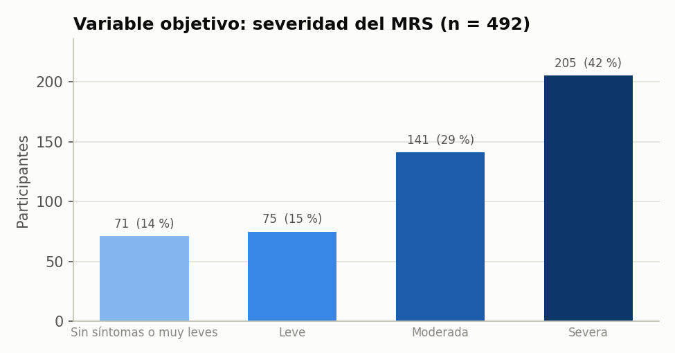

*Cuatro clases ordenadas; la clase severa es la más frecuente, por lo que las clases no están balanceadas (se tendrá en cuenta al evaluar modelos).*

**Cómo leerla.** Cada barra es una clase de severidad y su altura es el número de mujeres en ella; el azul más oscuro indica más severidad. Sobre cada barra está el número y el porcentaje.

**Qué muestra.** El grupo más grande es "Severa" (205 mujeres, 42 %), y los más pequeños son "Sin síntomas o muy leves" y "Leve" (alrededor del 15 % cada uno). Las clases no están balanceadas, y eso hay que tenerlo en cuenta en los modelos.

**Figura 2. Puntaje MRS total y cortes de severidad**

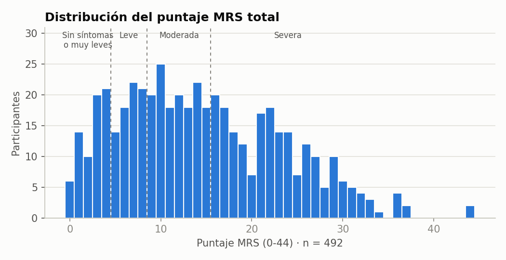

*Las líneas punteadas marcan los cortes 4/5, 8/9 y 15/16.*

**Cómo leerla.** Es un histograma: cada barra es un puntaje MRS (0 a 44) y su altura es cuántas mujeres lo obtuvieron. Las líneas punteadas separan las cuatro clases.

**Qué muestra.** Cómo se reparten los puntajes y de dónde salen las clases de la Figura 1. Las participantes con 44 puntos aparecen solas en el extremo derecho.

2 participantes tienen **44 puntos**, el máximo posible (todos los síntomas en grado 4). La regla
de Tukey las marca como atípicas (límite superior 42), pero **se conservan**: una mujer puede tener
todos los síntomas en grado muy severo, y eliminarlas sacaría del análisis justamente a quienes
más necesitan la caracterización.

## 3. Datos faltantes

Se distinguen dos tipos de vacío:

- **Estructural ("no aplica")**: la encuesta no mostró la pregunta por su lógica condicional (por
  ejemplo, la sección Trabajo a quien no trabaja, o el laboratorio en encuestas autoaplicadas). No
  es un dato perdido y **no se imputa**.
- **Real**: la pregunta se mostró y quedó en blanco o con un valor inválido. Se imputa:
  menos de 5 % → mediana (ordinales y continuas) o moda (categóricas);
  5-30 % → igual, y además se agrega la columna `<variable>_imputado`;
  más de 30 % → no se modela. Peso, cintura y presiones se imputan **desde una variable
  relacionada** (sección 5) para no crear combinaciones imposibles.
- Los ítems del MRS no se imputan: son la variable resultado. Quien no completó el MRS queda fuera
  del análisis de severidad (3 participantes).

55 variables tienen algún faltante real; ninguna supera el 30 %. El detalle
completo está en `resultados/faltantes.csv` y en la Figura A2 (Anexo A).

| Variable | Ámbito | Aplica | No aplica | Faltantes | % | Tratamiento |
|---|---|---|---|---|---|---|
| Riesgo cardiovascular | subgrupo profesional | 259 | 236 | 48 | 18.5 | imputada (moda = BAJO) + marca riesgo_cv_atp3_imputado |
| Glicemia | subgrupo profesional | 259 | 236 | 40 | 15.4 | imputada (mediana = 95) + marca glicemia_mg_dl_imputado |
| Cintura (cm) | general | 495 | 0 | 75 | 15.2 | imputada (recta cintura = 22.2 + 2.39·IMC; sin IMC, mediana 92.5) + marca circunferencia_cintura_cm_imputado |
| Colesterol total | subgrupo profesional | 259 | 236 | 39 | 15.1 | imputada (mediana = 200) + marca colesterol_total_mg_dl_imputado |
| Triglicéridos | subgrupo profesional | 259 | 236 | 39 | 15.1 | imputada (mediana = 146) + marca trigliceridos_mg_dl_imputado |
| Colesterol HDL | subgrupo profesional | 259 | 236 | 39 | 15.1 | imputada (mediana = 54) + marca colesterol_hdl_mg_dl_imputado |
| Regularidad de la menstruación | general | 170 | 325 | 11 | 6.5 | imputada (moda = REGULAR) + marca menstruacion_llega_imputado |
| Tipo de sangrado | general | 170 | 325 | 11 | 6.5 | imputada (moda = MODERADO) + marca tipo_sangrado_imputado |
| Presión sistólica | subgrupo profesional | 259 | 236 | 15 | 5.8 | imputada (diastólica + presión de pulso mediana (45); sin la otra, mediana 120) + marca presion_sistolica_imputado |
| Presión diastólica | subgrupo profesional | 259 | 236 | 13 | 5.0 | imputada (sistólica − presión de pulso mediana (45); sin la otra, mediana 75) + marca presion_diastolica_imputado |
| Estrés del entorno laboral | general | 306 | 189 | 10 | 3.3 | imputada (mediana = 3) |
| Método anticonceptivo | general | 66 | 429 | 2 | 3.0 | imputada (moda = ORAL) |
| Marihuana | general | 495 | 0 | 14 | 2.8 | imputada (mediana = 1) |
| Cambio en la relación de pareja | general | 324 | 171 | 8 | 2.5 | imputada (mediana = 2) |
| Tabaco | general | 495 | 0 | 12 | 2.4 | imputada (mediana = 1) |

*Se muestran las 15 variables con más faltantes reales, de 53 imputadas.*

## 4. Valores atípicos

**Criterio.** La regla de Tukey marca como atípico todo valor bajo Q1 − 1,5·RIC o sobre
Q3 + 1,5·RIC. Se calcula solo sobre valores **medidos** (los imputados no son observaciones).
Un atípico estadístico **no es lo mismo que un error**: solo dice que el valor se aleja del resto
del grupo. Por eso cada variable se revisa contra dos referencias:

1. **Rango fisiológico plausible** (limpieza, paso 5). Lo que cae fuera, como peso de 994 kg,
   talla de 1620 cm o glicemia de 9999, ya se trató como error en la limpieza.
2. **Categorías clínicas reconocidas.** Si los atípicos altos corresponden a una condición real y
   frecuente en mujeres de 40-65 años (obesidad, hipertensión, diabetes, dislipidemia), se
   conservan: eliminarlos sacaría del análisis a los grupos de riesgo que interesa caracterizar.

**Figura 3. Detección de atípicos por variable**

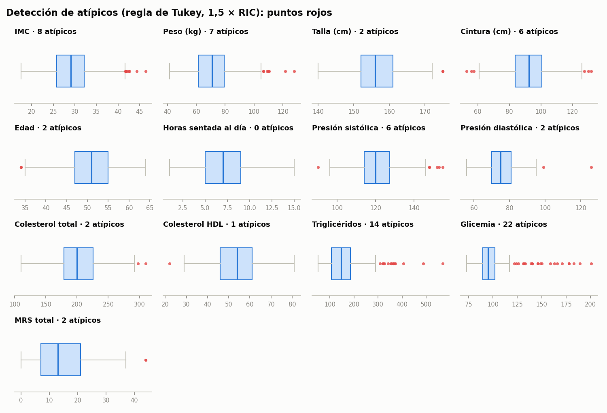

*Cada caja va de Q1 a Q3; los bigotes llegan hasta 1,5·RIC y los puntos rojos son los atípicos. Cada panel tiene su propia escala.*

**Cómo leerla.** Hay un diagrama de caja por variable. La caja contiene al 50 % central de las mujeres y la línea dentro de ella es la mediana. Los bigotes marcan hasta dónde llegan los valores "normales" para el grupo, y los puntos rojos son los atípicos, es decir, los valores que se alejan del resto.

**Qué muestra.** Cuántos atípicos tiene cada variable. La mayoría están en glicemia (22) y triglicéridos (14), que corresponden a mujeres con diabetes o triglicéridos altos. Son valores reales, por eso no se eliminan.

| Variable | n medidos | Límites Tukey | Atípicos bajos | Atípicos altos | Rango plausible | Altos en categoría clínica | Decisión |
|---|---|---|---|---|---|---|---|
| IMC | 487 | 16.3 a 41.7 | 0 | 8 |  | 8 de 8 | se conserva |
| Peso (kg) | 487 | 34.6 a 106.4 | 0 | 7 | 30-200 | 0 de 7 | se conserva |
| Talla (cm) | 495 | 138.5 a 174.5 | 0 | 2 | 120-200 | 0 de 2 | se conserva |
| Cintura (cm) | 420 | 58.0 a 126.4 | 3 (53, 56, 57.5) | 3 | 50-170 | 3 de 3 | se conserva |
| Edad | 495 | 35.0 a 67.0 | 2 (34) | 0 | 40-65 | - | se conserva |
| Horas sentada al día | 495 | -1.0 a 15.0 | 0 | 0 | 0-24 | - | se conserva |
| Presión sistólica | 244 | 94.1 a 147.1 | 1 (90) | 5 | 70-250 | 5 de 5 | se conserva |
| Presión diastólica | 246 | 53.5 a 97.5 | 0 | 2 | 40-150 | 2 de 2 | se conserva |
| Colesterol total | 220 | 108.5 a 296.5 | 0 | 2 | 80-500 | 2 de 2 | se conserva |
| Colesterol HDL | 220 | 23.5 a 83.5 | 1 (22) | 0 | 15-150 | - | se conserva |
| Triglicéridos | 220 | -14.0 a 306.0 | 0 | 14 | 20-1500 | 14 de 14 | se conserva |
| Glicemia | 219 | 70.8 a 120.8 | 0 | 22 | 40-600 | 20 de 22 | se conserva |
| MRS total | 492 | -14.0 a 42.0 | 0 | 2 | 0-44 | 2 de 2 | se conserva |

**Justificación por variable:**

- **IMC**: IMC ≥ 40: obesidad grado III (OMS). Altos: 41.7, 41.8, 42.1, 42.5, 42.7, 44.3, 46.4.
- **Peso (kg)**: acompaña al IMC; se juzga con él. Altos: 106.5, 106.7, 109, 109.9, 110.5, 121.8, 127.9.
- **Talla (cm)**: estatura adulta dentro del rango poblacional. Altos: 175.
- **Cintura (cm)**: cintura ≥ 88 cm: obesidad abdominal (ATP III, mujer). Altos: 127.6, 130.2, 132. Bajos: 53, 56, 57.5.
- **Edad**: criterio de inclusión de la encuesta (40-65, excepción quirúrgica). Bajos: 34.
- **Presión sistólica**: sistólica ≥ 140: hipertensión (MINSAL). Altos: 148, 152, 153, 155. Bajos: 90.
- **Presión diastólica**: diastólica ≥ 90: hipertensión (MINSAL). Altos: 99, 126.
- **Colesterol total**: colesterol ≥ 240: alto (ATP III). Altos: 298, 310.
- **Colesterol HDL**: HDL < 50: bajo en mujer (ATP III). Bajos: 22.
- **Triglicéridos**: triglicéridos ≥ 200: altos (ATP III). Altos: 308, 320, 322, 327, 341, 353, 355, 362, 364, 368, 372, 406, 488, 569.
- **Glicemia**: glicemia ≥ 126: rango de diabetes (ADA/MINSAL). Altos: 122, 124, 126, 131, 132, 133, 139, 140, 146, 149, 150, 159, 163, 166, 171, 178, 183, 189, 201.
- **MRS total**: MRS ≥ 16: síntomas severos. Altos: 44.

Detalles que conviene destacar:

- **Glicemia y triglicéridos** concentran la mayoría de los atípicos porque su distribución es
  asimétrica: casi todas las mujeres tienen valores normales y un grupo tiene valores de diabetes o
  hipertrigliceridemia. Es el patrón esperado en esta población, no un error.
- **Edad 34**: participantes con menopausia quirúrgica, que la encuesta admite como excepción de edad.
- **Cintura de 53-57,5 cm**: mujeres delgadas (IMC bajo); ver el caso 441 en la sección 5.

**Resultado:** de 74 atípicos detectados no se elimina ninguno. Todos están dentro del rango
fisiológico, y los altos corresponden a condiciones clínicas reconocidas. Los análisis siguientes no se
ven distorsionados por mantenerlos: la Fase 35 (entropía) y la Fase 38 (reglas) agrupan las variables
en categorías clínicas, donde un extremo queda en la categoría más alta; para K-Means (Fase 37) se
usará un escalado robusto en la Fase 36.

## 5. Coherencia entre mediciones

Un valor puede estar dentro de su rango y aun así ser imposible **en combinación** con otro. Durante
esta fase se revisaron las combinaciones y se encontró que el problema no estaba en los datos
originales sino en la **imputación con la mediana** de la limpieza:

- **Peso** (8 faltantes reales; venían como -1, "N/A" o fuera de rango). Imputar 71 kg a
  todas producía IMC incoherentes con la cintura medida. El caso más claro: participante 441, de
  1,75 m y 53 cm de cintura, a quien se le asignaban 71 kg (IMC 23,2), incompatible con esa cintura.
  Ahora el peso se estima desde la cintura (recta IMC ~ cintura, r ≈ 0,9) y la talla: 47,4 kg,
  IMC 15,5. Por eso la cintura de 53 cm parecía un error y no lo era: el dato faltante era el peso.
- **Presión arterial** (2 casos con una sola presión medida). Imputar la mediana
  producía, por ejemplo, 120/126 mmHg (diastólica mayor que sistólica, imposible). Ahora la presión
  que falta se estima desde la otra ± la presión de pulso mediana (45 mmHg): 171/126.
- **Cintura** (75 faltantes): antes se imputaba 92,5 cm a todas; ahora se estima desde el IMC.

Estos cambios se hicieron en la limpieza (`analisis/limpieza/reglas.py`, pasos 5 y 9) para que el
conjunto de datos limpio sea reproducible. Casos corregidos:

| Participante | Variable | Valor imputado | Contexto |
|---|---|---|---|
| 44 | Peso (kg) | 90.9 | talla 167 cm, cintura 101.5 cm → IMC 32.6 |
| 125 | Peso (kg) | 71 | sin cintura medida: mediana; la cintura se imputa después desde el IMC (24.9) |
| 127 | Peso (kg) | 62.1 | talla 159 cm, cintura 78.8 cm → IMC 24.6 |
| 145 | Peso (kg) | 89.3 | talla 164 cm, cintura 103.3 cm → IMC 33.2 |
| 331 | Peso (kg) | 78.1 | talla 152 cm, cintura 105 cm → IMC 33.8 |
| 340 | Peso (kg) | 74.8 | talla 159 cm, cintura 93 cm → IMC 29.6 |
| 441 | Peso (kg) | 47.4 | talla 175 cm, cintura 53 cm → IMC 15.5 |
| 457 | Peso (kg) | 88.7 | talla 152 cm, cintura 118 cm → IMC 38.4 |
| 103 | Presión sistólica | 171 | presión diastólica medida = 126 |
| 130 | Presión sistólica | 121 | presión diastólica medida = 76 |

Controles de coherencia sobre el conjunto limpio final:

| Control | Por qué | Casos | Tratamiento |
|---|---|---|---|
| Diastólica ≥ sistólica | fisiológicamente imposible | 0 | limpieza paso 5: ambas presiones vacías; paso 9: la que faltaba se imputa desde la otra |
| Cintura incoherente con el IMC (|z robusto| > 4) | la cintura sigue al IMC (r ≈ 0,9); un residuo tan grande indica error de registro | 0 | limpieza paso 5: cintura vacía; paso 9: imputada desde el IMC |
| IMC fuera de 15-60 | fuera de lo compatible con una adulta ambulatoria | 0 | no quedan casos |
| Índice cintura/talla fuera de 0,30-0,90 | proporción corporal imposible | 0 | no quedan casos |
| Talla actual > talla máxima | la talla máxima es la mayor alcanzada | 5 | limpieza paso 10: la pérdida de talla queda sin dato (las tallas se conservan) |

## 6. Correlación con la severidad

Se evaluaron **todas** las variables de la encuesta (61 pruebas) contra la severidad (0-3):

- Variables ordinales, continuas y binarias → **correlación de Spearman** (rho). Un rho positivo
  significa que a mayor valor de la variable, mayor severidad; uno negativo, menor severidad.
- Categóricas sin orden (Ha consultado por síntomas, Etapa menopáusica, Pueblo originario / afro, Riesgo cardiovascular, Quién prepara las comidas, Previsión de salud, Origen) →
  **Kruskal-Wallis**, con ε² como tamaño de efecto.
- Los valores p se ajustan por comparaciones múltiples (Benjamini-Hochberg, FDR) sobre todas las
  pruebas a la vez.
- Las variables de rol **impacto** (rendimiento laboral, ausencias, relación de pareja,
  antidepresivos) son **consecuencias** de los síntomas y no causas. Se informan, pero no son
  candidatas a predictor.

**Figura 4. Correlación de cada variable con la severidad**

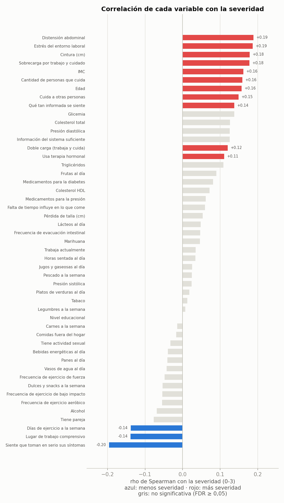

*Todas las variables con prueba de Spearman (excepto las de impacto). En color, las significativas (FDR < 0,05); en gris, las que no lo son.*

**Cómo leerla.** Cada barra es una variable y su largo es la correlación (rho) con la severidad. Una barra **roja hacia la derecha** indica que a mayor valor de esa variable hay más severidad (por ejemplo, más estrés laboral, más síntomas). Una barra **azul hacia la izquierda** indica que a mayor valor hay menos severidad (por ejemplo, más días de ejercicio, menos síntomas). Una barra **gris** no es significativa: esa relación podría deberse al azar.

**Qué muestra.** Qué variables de toda la encuesta se relacionan con la severidad. Todas las barras son cortas (la mayor es 0.20, sobre un máximo posible de 1): son relaciones débiles.

**14 variables explicativas tienen correlación significativa** con la severidad:

| Variable | Rol | n | rho | Dirección | p ajustado |
|---|---|---|---|---|---|
| Siente que toman en serio sus síntomas | otra | 492 | -0.20 | menos severidad | < 0,001 |
| Distensión abdominal | otra | 492 | +0.19 | más severidad | < 0,001 |
| Estrés del entorno laboral | predictor (trabajo) | 305 | +0.19 | más severidad | 0.004 |
| Cintura (cm) | otra | 492 | +0.18 | más severidad | < 0,001 |
| Sobrecarga por trabajo y cuidado | predictor | 492 | +0.18 | más severidad | < 0,001 |
| IMC | control | 492 | +0.16 | más severidad | 0.002 |
| Cantidad de personas que cuida | predictor | 492 | +0.16 | más severidad | 0.002 |
| Edad | control | 492 | +0.16 | más severidad | 0.002 |
| Cuida a otras personas | predictor | 492 | +0.15 | más severidad | 0.004 |
| Lugar de trabajo comprensivo | predictor (trabajo) | 305 | -0.14 | menos severidad | 0.044 |
| Días de ejercicio a la semana | predictor | 492 | -0.14 | menos severidad | 0.008 |
| Qué tan informada se siente | otra | 357 | +0.14 | más severidad | 0.030 |
| Doble carga (trabaja y cuida) | predictor | 492 | +0.12 | más severidad | 0.027 |
| Usa terapia hormonal | control | 492 | +0.11 | más severidad | 0.043 |

**Figura 5. Matriz de correlación de Spearman**

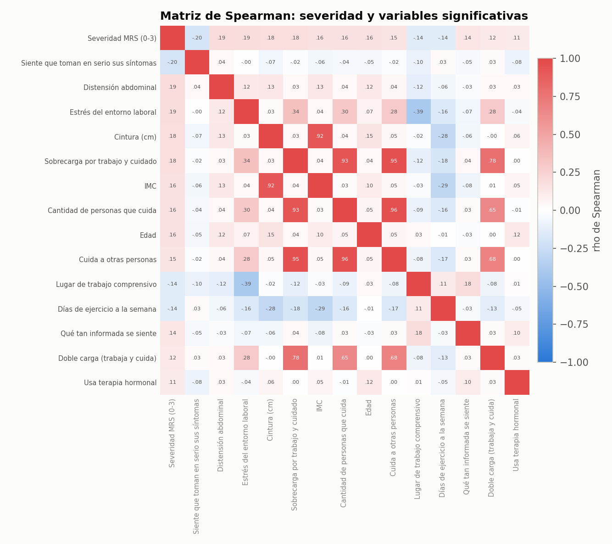

*Primera fila y columna: correlación de cada variable significativa con la severidad. El resto de la matriz muestra cuánto se parecen entre sí (por ejemplo, el grupo de cuidado).*

**Cómo leerla.** Es una tabla de colores donde cada cuadro cruza dos variables. El rojo indica relación positiva, el azul relación negativa y el blanco ausencia de relación; mientras más intenso el color, más fuerte la relación. La diagonal es siempre roja porque es cada variable consigo misma.

**Qué muestra.** En la primera fila y columna, la relación de cada variable con la severidad, que aparece en colores suaves (relaciones débiles). En el resto del cuadro, cuánto se parecen las variables entre sí: destacan los cuadros rojos intensos entre "Cuida a otras personas", "Cantidad de personas que cuida" y "Sobrecarga" (0,93 a 0,96), que miden casi lo mismo, y entre IMC y cintura (0,92). En la Fase 35 basta con conservar una variable de cada grupo.

Variables categóricas sin orden con diferencias significativas entre sus grupos (Kruskal-Wallis):

| Variable | Rol | n | ε² | p ajustado |
|---|---|---|---|---|
| Ha consultado por síntomas | otra | 357 | 0.083 | < 0,001 |
| Etapa menopáusica | control | 492 | 0.022 | 0.019 |

**Lectura.** Todas las correlaciones son **débiles** (la mayor es |rho| = 0.20). Por sí sola, ninguna variable
explica la severidad; lo que se espera es que la **combinación** de varias (clústeres y reglas de
asociación) describa perfiles. Las variables de cuidado están muy correlacionadas entre sí: en la
Fase 35 se escogerá una por grupo. La **terapia hormonal** aparece asociada a más severidad, pero
lo más probable es la causalidad inversa: se indica justamente a quienes tienen síntomas intensos.

Pares muy correlacionados (|rho| ≥ 0,8) en la matriz completa:

| Variable A | Variable B | rho |
|---|---|---|
| Sobrecarga por trabajo y cuidado | Cantidad de personas que cuida | +0.93 |
| Sobrecarga por trabajo y cuidado | Cuida a otras personas | +0.95 |
| Cantidad de personas que cuida | Cuida a otras personas | +0.96 |

**Sin correlación significativa** (35): Información del sistema suficiente, Glicemia, Presión diastólica, Colesterol total, Frutas al día, Medicamentos para la diabetes, Triglicéridos, Tiene pareja, Alcohol, Medicamentos para la presión, Falta de tiempo influye en lo que come, Frecuencia de ejercicio de bajo impacto, Dulces y snacks a la semana, Frecuencia de ejercicio aeróbico, Colesterol HDL, Frecuencia de ejercicio de fuerza, Lácteos al día, Frecuencia de evacuación intestinal, Marihuana, Vasos de agua al día, Panes al día, Bebidas energéticas al día, Pérdida de talla (cm), Horas sentada al día, Trabaja actualmente, Tiene actividad sexual, Pescado a la semana, Jugos y gaseosas al día, Comidas fuera del hogar, Presión sistólica, Platos de verduras al día, Carnes a la semana, Tabaco, Legumbres a la semana, Nivel educacional.

Destaca que **alimentación y sustancias** (tabaco, alcohol, marihuana) no se asocian con la
severidad en este conjunto de datos (sección 6.1).

Variables de impacto (consecuencias, rho de +0.32 a +0.48):
confirman que la severidad afecta el trabajo y la vida de pareja.

### 6.1 ¿Por qué alimentación y sustancias no se asocian con la severidad?

En este conjunto de datos, quienes comen o consumen distinto tienen casi la **misma proporción de
síntomas severos** (alrededor del 40 %, que es el promedio general). Porcentaje de mujeres con
síntomas severos en cada nivel de consumo:

| Variable | % con síntomas severos por nivel | rho | p ajustado |
|---|---|---|---|
| Tabaco | Nunca: 41 % (n=370) · 1-2 veces por semana: 47 % (n=15) · 3-4 veces por semana: 33 % (n=12) · 5-6 veces por semana: 45 % (n=11) · Diariamente: 43 % (n=84) | +0.01 | 0.810 |
| Alcohol | Nunca: 47 % (n=258) · 1-2 veces por semana: 31 % (n=132) · 3-4 veces por semana: 41 % (n=54) · 5-6 veces por semana: 30 % (n=27) · Diariamente: 57 % (n=21) | -0.07 | 0.246 |
| Marihuana | Nunca: 41 % (n=470) · 1-2 veces por semana: 58 % (n=12) · 3-4 veces por semana: 50 % (n=4) · 5-6 veces por semana: 100 % (n=2) · Diariamente: 25 % (n=4) | +0.05 | 0.442 |
| Platos de verduras al día | No consumo: 44 % (n=39) · 1-2 porciones: 41 % (n=276) · 3-4 porciones: 41 % (n=144) · 5-6 porciones: 48 % (n=29) · 7 o más porciones: 25 % (n=4) | +0.02 | 0.768 |
| Frutas al día | No consumo: 17 % (n=24) · 1-2 porciones: 40 % (n=253) · 3-4 porciones: 47 % (n=143) · 5-6 porciones: 41 % (n=58) · 7 o más porciones: 64 % (n=14) | +0.09 | 0.102 |

Hay cinco razones que lo explican:

1. **Casi nadie consume algunas sustancias.** El 96 % nunca usa marihuana y el 75 % nunca fuma.
   Con tan pocas consumidoras los grupos son demasiado pequeños para detectar una diferencia, aunque exista.
2. **Spearman solo detecta relaciones en una dirección.** El alcohol tiene forma de **U**: más
   severidad en quienes nunca beben (47 %) y en quienes beben a diario (57 %),
   y menos en quienes beben 1-2 veces por semana (31 %). Spearman mide si "más consumo
   → más (o menos) severidad", así que una U le da casi cero. El grupo diario es pequeño, por lo
   que también puede ser azar.
3. **Los extremos pequeños solo agregan ruido.** Las frutas parecen ir "al revés" (más fruta, más
   severidad), pero eso depende de grupos muy pequeños en los extremos y no es significativo.
4. **Probablemente el conjunto de datos no trae esa relación.** Es la explicación más importante.
   El conjunto es **sintético**: una relación solo aparece si la simulación la incluyó. Las
   variables que sí se asocian (IMC, cuidado, estrés laboral, ejercicio) muestran un patrón
   ordenado; alimentación y sustancias se ven planas, como si se hubieran generado sin relación
   con el MRS. Queda pendiente confirmarlo con la profesora.
5. **Las preguntas son gruesas.** Se mide por porciones o frecuencia en categorías amplias, lo que
   capta mal la calidad de la dieta y diluye efectos pequeños.

**Cómo se reporta.** No se fuerza el resultado: un hallazgo nulo también es un resultado. La
redacción correcta es "en este conjunto de datos no se observó asociación", **no** "la alimentación
no influye en los síntomas". Además, la **ganancia de información** de la Fase 35 sí detecta
relaciones en forma de U como la del alcohol, porque no exige una dirección: ahí se volverá a
evaluar si estas variables aportan algo.

## 7. Dirección de las asociaciones

Para que la dirección no quede ambigua, la Figura 6 muestra el valor medio de cada variable
significativa en cada clase de severidad. Si la línea sube, las mujeres con síntomas más severos
tienen valores más altos de esa variable.

**Figura 6. Media de cada variable según la clase de severidad**

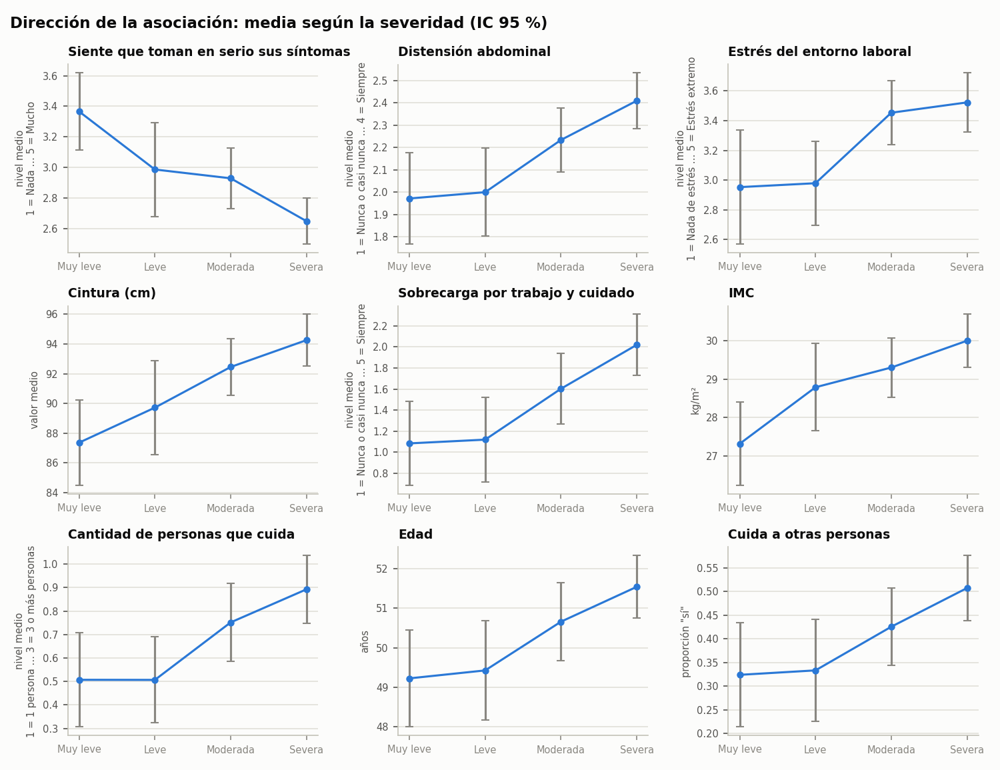

*Barras: intervalo de confianza del 95 %. En las preguntas ordinales el eje muestra el código de la respuesta (su significado está bajo cada eje).*

**Cómo leerla.** Hay un panel por variable. El eje horizontal muestra las cuatro clases de severidad, de "Muy leve" a "Severa", y cada punto es el promedio de la variable en esa clase. Las barritas verticales son el margen de error (intervalo de confianza del 95 %).

**Qué muestra.** Si la línea **sube**, las mujeres con más síntomas tienen valores más altos de esa variable; por ejemplo, el IMC promedio pasa de 27.3 en "Muy leve" a 30.0 en "Severa". Si la línea **baja**, ocurre lo contrario: "siente que toman en serio sus síntomas" disminuye a medida que aumenta la severidad. Esta figura resuelve la pregunta de la dirección de cada asociación.

### Días de ejercicio a la semana

En la reunión esta variable quedó ambigua. Hay dos fuentes de confusión:

1. **La variable no cuenta días.** Es una pregunta de alternativas con códigos 1 a 5: 1 = 0 días,
   2 = 1-2 días, 3 = 3-4 días, 4 = 5-6 días, 5 = todos los días. El rho se calcula sobre ese orden.
2. **El signo es negativo** (rho = -0.14, p ajustado = 0.008):
   **a más días de ejercicio, menor severidad**. La Figura 7 lo muestra directamente.

La diferencia principal está entre **no hacer ejercicio** (49 % con síntomas severos) y
**hacerlo al menos un día** (37 %). Entre quienes sí hacen ejercicio la tendencia no es
perfectamente pareja: el grupo de 5-6 días (44 % severas) es pequeño (n = 39) y su
porcentaje fluctúa más. Por eso conviene presentar el resultado como contraste "sin ejercicio vs.
con ejercicio", más que como un efecto día a día.

**Figura 7. Severidad según los días de ejercicio a la semana**

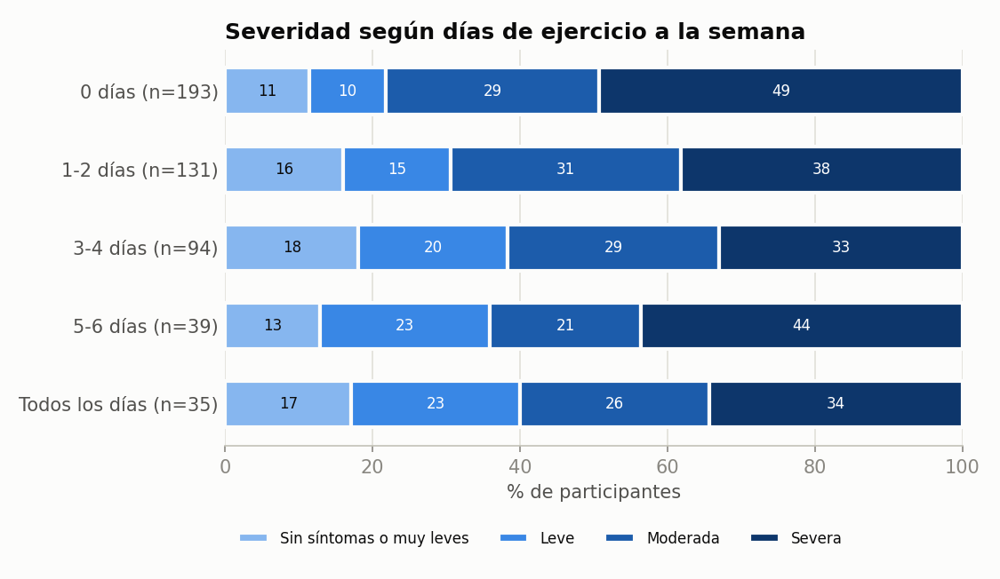

*Cada barra suma 100 %. Las mujeres que no hacen ejercicio tienen la mayor proporción de síntomas severos.*

**Cómo leerla.** Cada barra horizontal es un grupo según cuántos días hace ejercicio a la semana, y suma 100 %. Los colores muestran qué parte de ese grupo está en cada clase de severidad; el azul más oscuro es "Severa".

**Qué muestra.** Las mujeres que **no hacen ejercicio** tienen la mayor parte en "Severa" (49 %, el tramo azul oscuro más largo). En las que sí hacen ejercicio esa parte baja a 33-44 %. La diferencia principal está entre hacer y no hacer ejercicio.

| Días de ejercicio | n | MRS medio | Sin síntomas o muy leves | Leve | Moderada | Severa |
|---|---|---|---|---|---|---|
| 0 días | 193 | 16.1 | 11 % | 10 % | 29 % | 49 % |
| 1-2 días | 131 | 13.7 | 16 % | 15 % | 31 % | 38 % |
| 3-4 días | 94 | 13.1 | 18 % | 20 % | 29 % | 33 % |
| 5-6 días | 39 | 13.5 | 13 % | 23 % | 21 % | 44 % |
| Todos los días | 35 | 12.4 | 17 % | 23 % | 26 % | 34 % |

**Cuidado al redactar:** el diseño es transversal (una sola medición), así que no se puede afirmar
que el ejercicio *disminuya* los síntomas. También puede ocurrir al revés: las mujeres con síntomas
severos (dolor, cansancio) hacen menos ejercicio. La redacción correcta es "las mujeres que se
ejercitan más días presentan menor severidad".

## 8. Qué pasa a la Fase 35

- Conjunto de datos: `datos/analitico/conjunto_eda.csv` (492 participantes, columna `severidad` 0-3).
- Variable objetivo: `severidad`.
- Candidatas a predictor: todas las de rol predictor y control (no solo las significativas).
  La **selección por análisis entrópico** (entropía de Shannon y ganancia de información) decidirá
  cuáles se quedan, y este EDA servirá para contrastar esa selección.
- Las variables de impacto no entran como predictores.

## 9. Limitaciones

- Diseño transversal: las asociaciones no prueban causalidad.
- El conjunto de datos es sintético: los resultados describen el conjunto, no la población real.
- Los cortes de severidad (0-4 / 5-8 / 9-15 / 16+) y la definición de etapa menopáusica están
  pendientes de validar con la profesora.
- Las variables de laboratorio solo existen en el subgrupo profesional (n = 259), por eso tienen
  menos poder estadístico.

---

## Anexo A. Figuras secundarias del EDA

Estas figuras respaldan el análisis, pero no aportan al argumento central; por eso van en el anexo
y no en el texto.

**Figura A1. Distribución de las variables continuas**

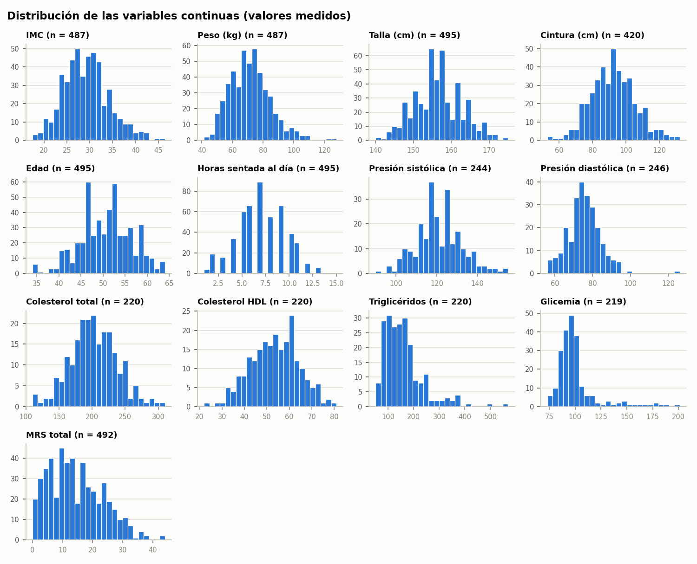

*Valores medidos (sin imputados). Va al anexo porque la Figura 3 ya resume lo relevante (centro, dispersión y atípicos); los histogramas solo muestran además la forma de cada distribución.*

**Cómo leerla.** Un histograma por variable continua (edad, IMC, presión, laboratorio, etc.): cada barra es un rango de valores y su altura es cuántas mujeres caen en él.

**Qué muestra.** La forma de cada distribución. Por ejemplo, la glicemia se concentra en valores normales y tiene una "cola" hacia valores altos, que es donde están sus atípicos.

**Figura A2. Faltantes reales por variable**

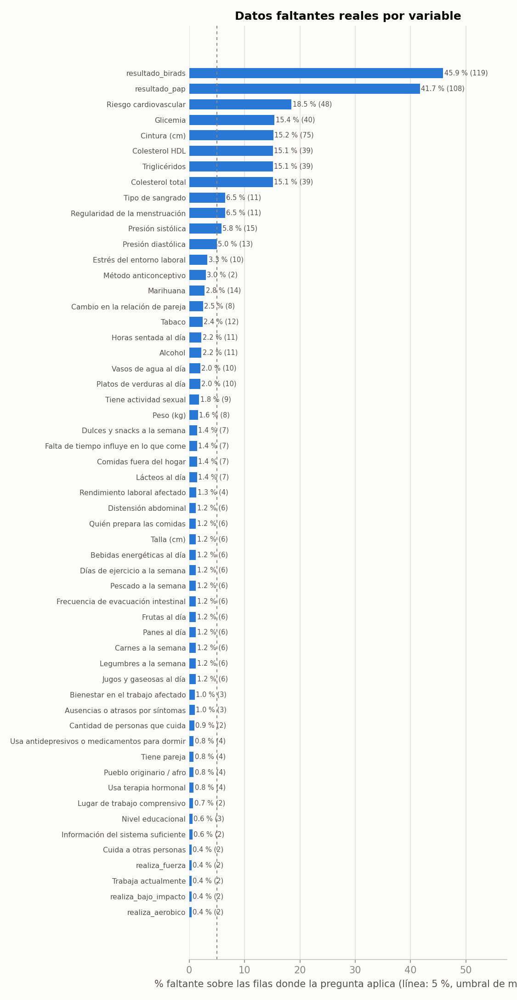

*Va al anexo porque ninguna variable supera el 30 % y el tratamiento ya se explica en la sección 3; la figura solo documenta el detalle.*

**Cómo leerla.** Cada barra es una pregunta y su largo es el porcentaje de respuestas que faltaban, contado solo entre las mujeres a quienes se les mostró esa pregunta. La línea punteada marca el 5 %.

**Qué muestra.** Qué preguntas tenían más datos faltantes. Ninguna supera el 30 %, así que todas se pueden usar.

**Figura A3. Matriz de Spearman completa**

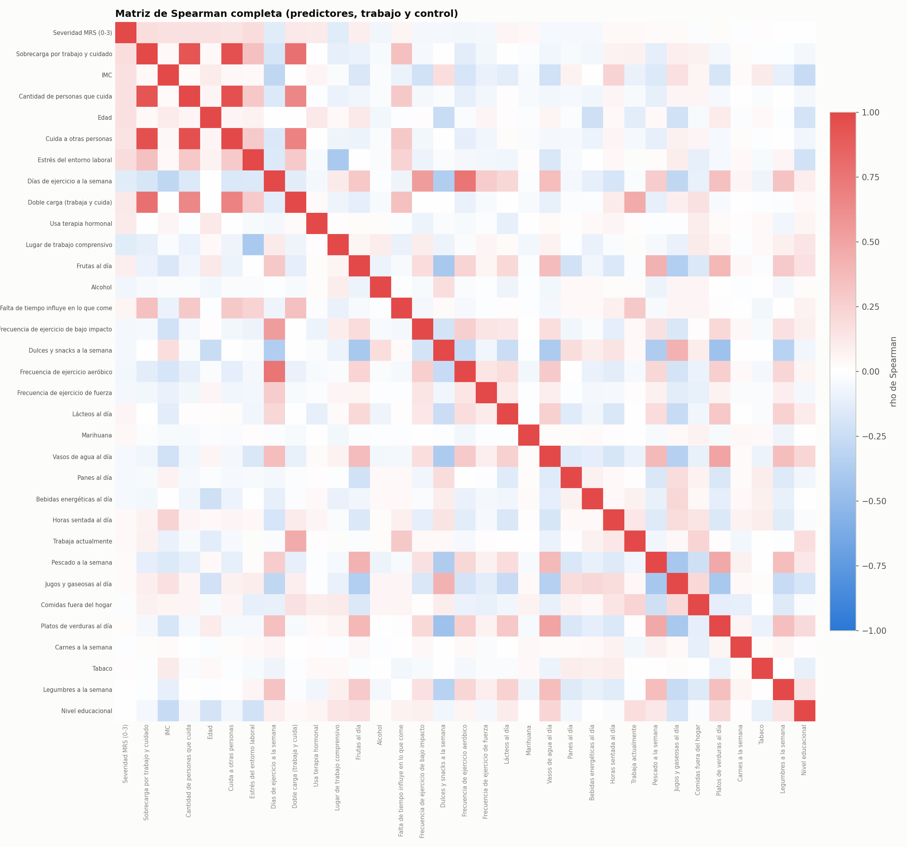

*Todas las variables de predictor, trabajo y control (32). Va al anexo porque la mayoría de las correlaciones son cercanas a cero y no son legibles en el texto; la Figura 5 muestra la parte relevante.*

**Cómo leerla.** Igual que la Figura 5, pero con todas las variables candidatas a predictor.

**Qué muestra.** Casi todo el cuadro es blanco o muy pálido: la mayoría de las variables no se relacionan entre sí. Los únicos bloques intensos son el grupo de cuidado y los tipos de ejercicio entre sí.

## Anexo B. Random Forest como complemento (Fase 33)

En la Fase 33 se estimó la importancia de las variables con Random Forest (regresión sobre el MRS
total y clasificación severa/no severa). Por indicación de la profesora, la selección de variables
se hará por **análisis entrópico** (Fase 35), y este análisis queda como **complemento**: sirve para
contrastar si ambos métodos coinciden en las variables importantes. El detalle completo está en
`analisis/informe_exploratorio.md`.

**Figura B1. Importancia de variables: modelo general**

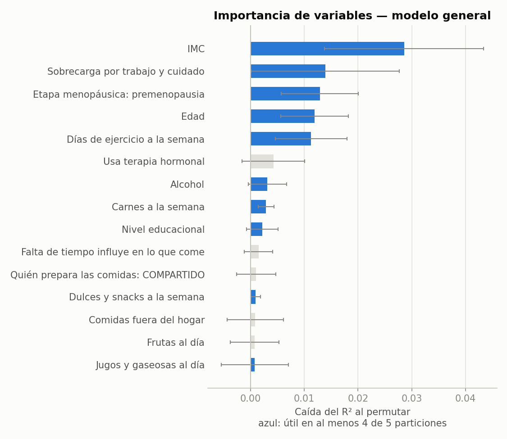

*Caída del R² al permutar cada variable. En azul, las útiles en al menos 4 de 5 particiones.*

**Cómo leerla.** Cada barra es una variable y su largo indica cuánto empeora la predicción del MRS si esa variable se desordena al azar: mientras más larga, más aporta. En azul, las que resultaron útiles en al menos 4 de las 5 pruebas.

**Qué muestra.** Las variables que más aportan son IMC, Sobrecarga por trabajo y cuidado, Etapa menopáusica: premenopausia, Edad, Días de ejercicio a la semana, que coinciden en gran parte con el análisis de correlación de la sección 6.

**Figura B2. Importancia de variables: trabajadoras**

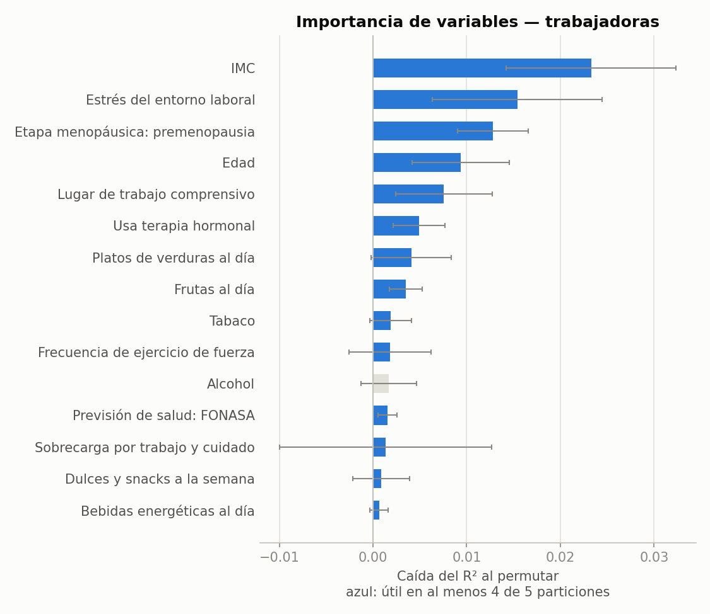

*Mismo análisis en el subgrupo que trabaja (incluye estrés laboral y lugar de trabajo comprensivo).*

**Cómo leerla.** Igual que la Figura B1, solo con las mujeres que trabajan.

**Qué muestra.** En este grupo las barras son aún más cortas: el modelo predice muy poco.

Métricas de validación cruzada (5 particiones), tomadas de `informe_exploratorio.md`:

- **Modelo general (n = 492, 45 variables)**
  - Regresión sobre el MRS total: R2 = 0.06 ± 0.03, MAE = 7.02 ± 0.20.
  - Clasificación severa (MRS ≥ 16) vs. no severa (42 % severas): AUC = 0.62 ± 0.07, exactitud_balanceada = 0.62 ± 0.04.
- **Modelo de trabajadoras (n = 305, 46 variables)**
  - Regresión sobre el MRS total: R2 = 0.03 ± 0.05, MAE = 7.40 ± 0.59.
  - Clasificación severa (MRS ≥ 16) vs. no severa (43 % severas): AUC = 0.57 ± 0.08, exactitud_balanceada = 0.55 ± 0.06.

Diez variables más importantes del modelo general (regresión, importancia por permutación):

| Variable | Importancia | Positiva en | Selección final |
|---|---|---|---|
| IMC | 0.0286 | 5/5 | sí |
| Sobrecarga por trabajo y cuidado | 0.0139 | 4/5 | sí |
| Etapa menopáusica: premenopausia | 0.0129 | 5/5 | sí |
| Edad | 0.0119 | 5/5 | sí |
| Días de ejercicio a la semana | 0.0113 | 5/5 | sí |
| Usa terapia hormonal | 0.0043 | 3/5 | sí |
| Alcohol | 0.0032 | 4/5 | sí |
| Carnes a la semana | 0.0029 | 5/5 | sí |
| Nivel educacional | 0.0022 | 4/5 | sí |
| Falta de tiempo influye en lo que come | 0.0015 | 3/5 | no |

El poder predictivo del bosque es bajo, lo que es coherente con las correlaciones débiles de la
sección 6.

## Anexo C. Archivos generados

- `resultados/asociacion_severidad.csv`: todas las pruebas de la sección 6.
- `resultados/matriz_spearman.csv`: matriz completa (Figura A3).
- `resultados/revision_atipicos.csv`: detección y decisión por variable (sección 4).
- `resultados/coherencia.csv` y `resultados/correcciones_imputacion.csv`: sección 5.
- `resultados/faltantes.csv`: sección 3.
- `datos/analitico/conjunto_eda.csv`: conjunto de datos para la Fase 35 (no se versiona).
