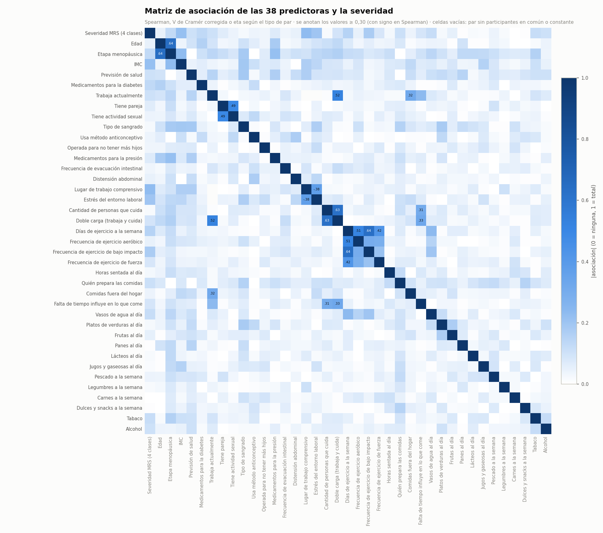
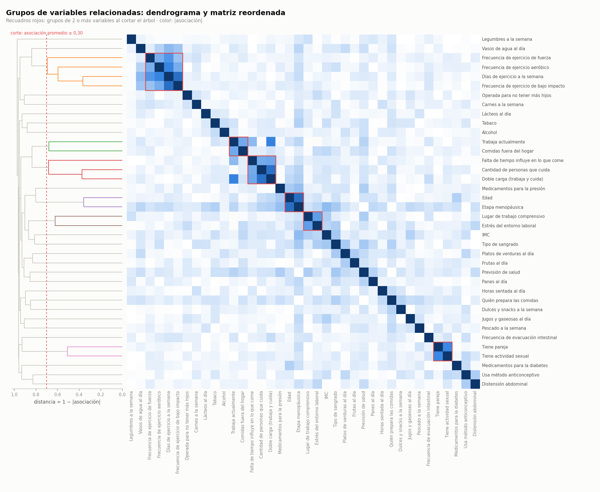
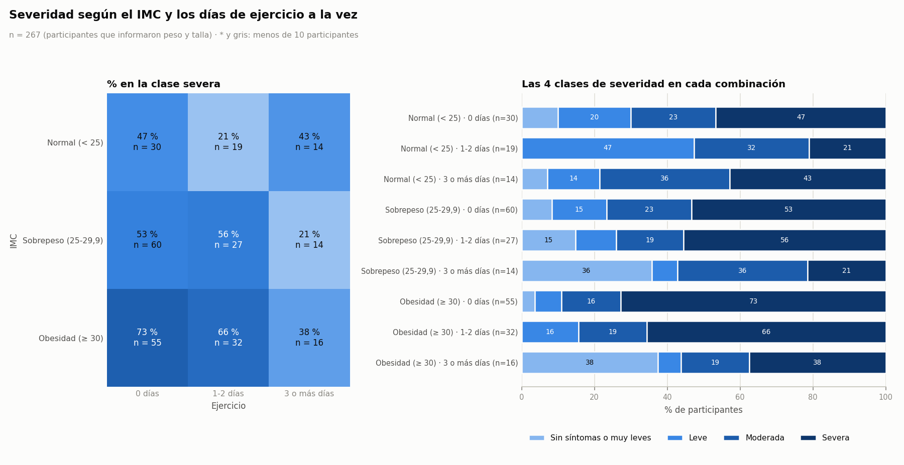
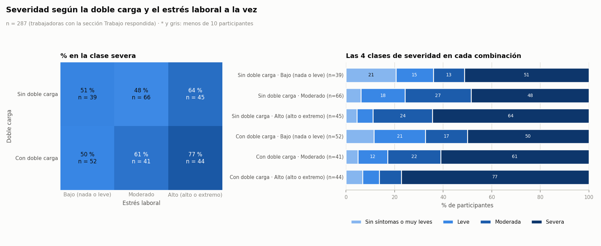
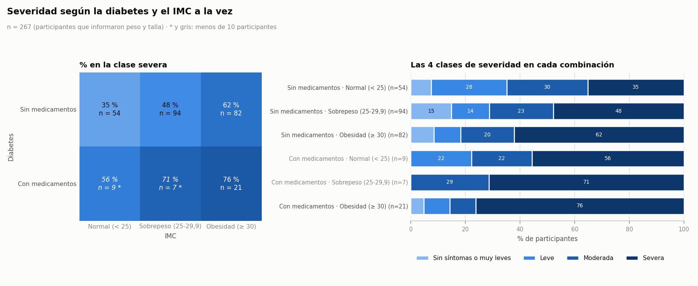
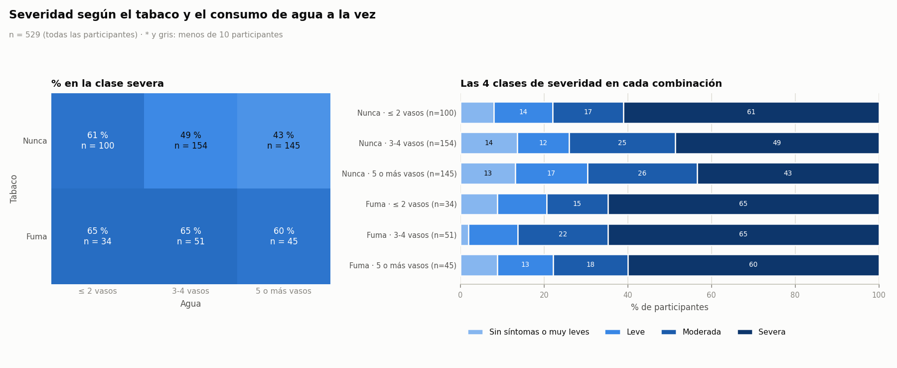

# Fase 34E. Análisis multivariado exploratorio

*Generado por `analisis/eda_multivariado.py` el 30-10-2026. Entradas: `datos/analitico/dataset_fase35.csv` (Fase 35A) y `datos/analitico/conjunto_eda_usuaria.csv` (Fase 34C).*

## 1. Propósito

Las fases anteriores miraron las variables de a una (34D) o de a dos, cada una contra la severidad (34C). Esta fase agrega dos miradas:

1. **Cómo se relacionan las variables entre ellas**: una matriz de asociación de las predictoras y los grupos de variables que "dicen lo mismo". Esto importa para la selección de variables (Fase 35B) y para el PCA (Fase 37): variables muy relacionadas aportan información repetida.
2. **Cómo actúan juntas sobre la severidad**: la severidad según dos variables a la vez (tríadas), para ver si el efecto de una se mantiene al tener en cuenta la otra y si el efecto de una cambia según la otra.

Todo es **exploratorio**: describe y genera hipótesis; no confirma causas.

## 2. Datos y decisiones de preparación

- **Participantes:** 529 con el MRS completo.
- **Variables:** las 38 predictoras que dejó la Fase 35A, más la severidad del MRS en 4 clases (0 = sin síntomas o muy leves … 3 = severa) como referencia. La severidad no se agrupa con las demás: solo se muestra cuánto se asocia cada predictora con ella.
- **Sin imputaciones.** Se usa lo que las participantes respondieron:
  - **IMC observado** (n = 267). La Fase 35A imputó el resto con la media; aquí no se usa ese valor, porque pondría a la mitad de la muestra en un mismo IMC y crearía asociaciones falsas.
  - **"No aplica" queda fuera del par.** Las preguntas de trabajo para quien no trabaja y las de menstruación para quien ya no menstrúa no tienen una respuesta en la escala: esas participantes no entran en los pares de esa pregunta.
  - **Respuestas laborales originales.** Las 22 trabajadoras sin respuesta en la sección Trabajo, imputadas por mediana en la 35A, quedan fuera de esos pares.
  - Las frecuencias de ejercicio y la cantidad de personas que cuida valen 0 cuando la participante no lo hace: ese 0 **sí** es un valor real de la escala ("frecuencia cero") y se conserva.

## 3. Matriz de asociación

### 3.1 ¿Qué es y para qué sirve?

Una **matriz de asociación** es una tabla cuadrada con las 39 variables en las filas y las mismas en las columnas. Cada casilla dice qué tan relacionadas están dos variables, de 0 (nada) a 1 (totalmente). Sirve para detectar variables que dicen lo mismo y para ver con qué se asocia cada una.

### 3.2 Por qué no se usa la correlación de Pearson

La **correlación de Pearson** mide si dos números suben juntos en línea recta. Sirve para cantidades medidas, pero no para respuestas codificadas: si a la previsión "Fonasa, Isapre, FF.AA." se le asignan los códigos 1, 2 y 3, esos números son etiquetas, no cantidades (Isapre no es "el doble" de Fonasa). Pearson trataría esos códigos como medidas y el resultado no tendría interpretación. Por eso se usa una medida distinta según el tipo de cada par.

### 3.3 Las tres medidas

| Par de variables | Medida | Qué mide | Se lee | Pares |
|---|---|---|---|---|
| Numérica, ordinal o sí/no × numérica, ordinal o sí/no | **ρ de Spearman** | Ordena a las participantes de menor a mayor en cada variable (**rangos**) y mide si los órdenes coinciden. Detecta relaciones **monótonas** ("cuando una sube, la otra tiende a subir"), aunque no sean en línea recta. Respeta el orden de las escalas sin suponer distancias iguales. | −1 a +1; el signo da la dirección | 595 |
| Nominal × nominal | **V de Cramér** con corrección de sesgo (Bergsma) | Parte de la **tabla de contingencia** (cuántas hay en cada combinación de respuestas) y la compara con lo esperable si no hubiera relación (**chi-cuadrado**). La corrección evita que la V se infle con muchas categorías o grupos chicos. | 0 a 1, sin signo | 6 |
| Nominal × numérica u ordinal | **Razón de correlación η (eta)**, sobre rangos | Mide si los grupos de la nominal tienen valores distintos en la otra (por ejemplo, ¿cada etapa menopáusica tiene una edad distinta?). Se calcula sobre rangos; su prueba es la de **Kruskal-Wallis**. Usa la variable completa, sin cortarla en tramos como en la 35A. | 0 a 1, sin signo | 140 |

Las variables nominales son 4: Etapa menopáusica, Previsión de salud, Usa método anticonceptivo, Quién prepara las comidas.

- **Pares completos.** Cada par se calcula con las participantes que respondieron **ambas** preguntas (por eso el n cambia de un par a otro; está en `pares_asociacion_mixta.csv`).
- **Comparables, pero no idénticas.** Las tres medidas van de 0 a 1 en valor absoluto y se pueden mirar juntas en la matriz, pero no son exactamente la misma cosa. La η tiende a salir algo más alta con muchos grupos y pocas participantes: por eso cada par trae también su valor p.
- **Corrección FDR.** Con 741 pares, algunos saldrían "significativos" por puro azar. El **p ajustado** (Benjamini-Hochberg, igual que en la 34C) corrige eso. Como aquí se corrige sobre muchos más pares, los p ajustados de la severidad son más altos que en la 34C; para la asociación con la severidad, la referencia sigue siendo la 34C.

### 3.4 Resultados

**Figura 1. Matriz de asociación de las 38 predictoras y la severidad**

*Color: |asociación|. Se anotan los valores de 0,30 o más (con signo cuando es Spearman). Orden: el de la encuesta.*

**Cómo leerla.** Cada casilla cruza la variable de su fila con la de su columna; la diagonal es la variable consigo misma (siempre 1). Cuanto más oscura, más relacionadas. La matriz es simétrica: la mitad de arriba repite la de abajo.

**Pares con asociación de 0,30 o más** (11 de 741):

| Variable 1 | Variable 2 | Medida | Valor | n | p ajustado |
|---|---|---|---|---|---|
| Edad | Etapa menopáusica | eta (rangos) | 0,64 | 529 | < 0,001 |
| Días de ejercicio a la semana | Frecuencia de ejercicio de bajo impacto | rho de Spearman | +0,64 | 529 | < 0,001 |
| Cantidad de personas que cuida | Doble carga (trabaja y cuida) | rho de Spearman | +0,63 | 529 | < 0,001 |
| Trabaja actualmente | Doble carga (trabaja y cuida) | rho de Spearman | +0,52 | 529 | < 0,001 |
| Días de ejercicio a la semana | Frecuencia de ejercicio aeróbico | rho de Spearman | +0,51 | 529 | < 0,001 |
| Tiene pareja | Tiene actividad sexual | rho de Spearman | +0,49 | 529 | < 0,001 |
| Días de ejercicio a la semana | Frecuencia de ejercicio de fuerza | rho de Spearman | +0,42 | 529 | < 0,001 |
| Lugar de trabajo comprensivo | Estrés del entorno laboral | rho de Spearman | -0,38 | 287 | < 0,001 |
| Doble carga (trabaja y cuida) | Falta de tiempo influye en lo que come | rho de Spearman | +0,33 | 529 | < 0,001 |
| Trabaja actualmente | Comidas fuera del hogar | rho de Spearman | +0,32 | 529 | < 0,001 |
| Cantidad de personas que cuida | Falta de tiempo influye en lo que come | rho de Spearman | +0,31 | 529 | < 0,001 |

**Qué muestra.** La gran mayoría de los pares tiene una asociación débil: el 86 % está bajo 0,10. Las asociaciones fuertes se dan entre variables que miden cosas emparentadas: edad y etapa menopáusica, las cuatro preguntas de ejercicio, la doble carga con trabajar y con cuidar, pareja y actividad sexual, y los dos climas laborales (un lugar comprensivo va con menos estrés). Ninguna supera 0,80 (máximo 0,64), coherente con el filtro de redundancia de la 35A. La mayoría de los hábitos (alimentación, sustancias) son casi independientes entre sí.

Hay 2 pares sin valor: Trabaja actualmente × Lugar de trabajo comprensivo, Trabaja actualmente × Estrés del entorno laboral. Entre quienes responden las preguntas de trabajo, "trabaja actualmente" vale siempre sí: una variable constante no puede asociarse con nada.

**Asociación de cada predictora con la severidad** (las 10 más altas):

| Predictora | Medida | Valor | n | p ajustado (741 pares) |
|---|---|---|---|---|
| Lugar de trabajo comprensivo | rho de Spearman | -0,23 | 287 | 0,003 |
| IMC | rho de Spearman | +0,22 | 267 | 0,010 |
| Estrés del entorno laboral | rho de Spearman | +0,20 | 287 | 0,022 |
| Frecuencia de ejercicio de bajo impacto | rho de Spearman | -0,17 | 529 | 0,003 |
| Días de ejercicio a la semana | rho de Spearman | -0,15 | 529 | 0,013 |
| Medicamentos para la diabetes | rho de Spearman | +0,13 | 529 | 0,074 |
| Etapa menopáusica | eta (rangos) | 0,13 | 529 | 0,713 |
| Tabaco | rho de Spearman | +0,11 | 529 | 0,176 |
| Vasos de agua al día | rho de Spearman | -0,11 | 529 | 0,176 |
| Quién prepara las comidas | eta (rangos) | 0,11 | 529 | 0,834 |

Son las mismas que destacó la 34C (lugar comprensivo, IMC, estrés laboral, ejercicio, diabetes, tabaco, agua), todas con asociación débil (|ρ| ≤ 0,23). Las η de etapa menopáusica, quién prepara las comidas y previsión no son significativas.

## 4. Grupos de variables relacionadas

### 4.1 ¿Cómo se buscan?

- **Agrupamiento jerárquico** (*clustering jerárquico*) de variables: trata la asociación como cercanía. Junta primero las dos variables más cercanas, después la siguiente más cercana, y así hasta unir todas.
- **Distancia = 1 − |asociación|.** Dos variables muy asociadas quedan cerca (distancia cercana a 0); dos sin relación quedan lejos (distancia 1). Un par sin valor (sin participantes en común) cuenta como sin relación.
- **Enlace promedio** (*average linkage*): al unir dos grupos se usa la distancia promedio entre todos sus miembros. Así, un solo par muy asociado no arrastra a todo un grupo.
- **Dendrograma:** el árbol que muestra en qué orden y a qué distancia se fueron uniendo las variables. Se **corta** a una asociación promedio de 0,30 (distancia 0,70): lo que queda unido bajo esa línea es un grupo. El corte es una convención (asociación "moderada"); se puede cambiar en `eda/multivariado.py` (`CORTE_GRUPO`).

### 4.2 Resultados

**Figura 2. Grupos de variables relacionadas**

*Izquierda: dendrograma (línea roja: corte). Derecha: la misma matriz, con las variables en el orden del árbol; los recuadros rojos son los grupos.*

**Cómo leerla.** En el árbol, cuanto más a la derecha se unen dos ramas, más asociadas están. En la matriz reordenada, los grupos aparecen como bloques oscuros pegados a la diagonal.

| Grupo | Variables | Asociación promedio | Mínima | Máxima | Máx. con la severidad |
|---|---|---|---|---|---|
| 1 | Frecuencia de ejercicio de fuerza, Frecuencia de ejercicio aeróbico, Días de ejercicio a la semana, Frecuencia de ejercicio de bajo impacto | 0,39 | 0,21 | 0,64 | 0,17 |
| 2 | Trabaja actualmente, Comidas fuera del hogar | 0,32 | 0,32 | 0,32 | 0,10 |
| 3 | Falta de tiempo influye en lo que come, Cantidad de personas que cuida, Doble carga (trabaja y cuida) | 0,42 | 0,31 | 0,63 | 0,09 |
| 4 | Edad, Etapa menopáusica | 0,64 | 0,64 | 0,64 | 0,13 |
| 5 | Lugar de trabajo comprensivo, Estrés del entorno laboral | 0,38 | 0,38 | 0,38 | 0,23 |
| 6 | Tiene pareja, Tiene actividad sexual | 0,49 | 0,49 | 0,49 | 0,06 |

**Qué muestra.** Se forman 6 grupos, que reúnen a 15 de las 38 predictoras; las otras 23 quedan solas, sin una compañera con asociación moderada. Los grupos tienen sentido temático:

- **Actividad física:** los días de ejercicio y las tres frecuencias (aeróbico, bajo impacto, fuerza). Es el grupo más grande; los días de ejercicio resumen bien a las demás.
- **Carga de cuidado y tiempo:** doble carga, cantidad de personas que cuida y falta de tiempo para comer bien.
- **Trabajo y comidas fuera:** quienes trabajan comen más fuera del hogar.
- **Etapa de la vida:** edad y etapa menopáusica (la etapa se definió en parte con la edad).
- **Clima laboral:** lugar comprensivo y estrés laboral, en sentido opuesto.
- **Pareja:** tener pareja y tener actividad sexual.

**Qué implica para las fases siguientes.**

- **Selección (35B):** dentro de cada grupo las variables comparten información; el FCBF (que descarta las redundantes con una ya elegida) probablemente se quedará con una o dos por grupo.
- **PCA (37):** con 23 variables casi independientes, el PCA no podrá resumir los datos en pocas componentes: cada componente explicará poca varianza. Es una característica del conjunto sintético (el simulador generó la mayoría de los hábitos de forma independiente), no un error, y conviene anticiparlo al interpretar la Fase 37.

## 5. Relaciones entre tres variables (tríadas)

### 5.1 Conceptos

- **Análisis estratificado:** en vez de mirar "IMC vs. severidad" y "ejercicio vs. severidad" por separado, se mira la severidad en **cada combinación** de las dos variables (por ejemplo, obesas que no hacen ejercicio vs. obesas que sí). Permite responder dos preguntas:
  - **Ajuste (control):** ¿el efecto de una variable se mantiene cuando se tiene en cuenta la otra? Si el IMC se asociara con la severidad solo porque las de IMC alto hacen menos ejercicio, al descontar el ejercicio su efecto desaparecería.
  - **Interacción:** ¿el efecto de una variable cambia según la otra? Por ejemplo, que el ejercicio proteja mucho a las mujeres con obesidad y poco a las de peso normal.
- **Regresión logística ordinal** (*modelo de odds proporcionales*): un modelo que predice la clase de severidad respetando su orden (muy leve < leve < moderada < severa) a partir de las dos variables. Entrega un **odds ratio (OR)** por categoría, comparado con una **categoría de referencia** (la primera de cada variable):
  - OR = 1: sin diferencia con la referencia; OR > 1: más chances de estar en una clase más severa (OR = 2, el doble); OR < 1: menos chances (efecto protector; OR = 0,5, la mitad).
  - **IC 95 %** (intervalo de confianza): el rango de valores plausibles para el OR. Si incluye el 1, la diferencia puede ser azar.
- **Término de interacción** y **prueba de razón de verosimilitud:** se ajusta el modelo dos veces, con y sin la combinación A × B, y se compara qué tan bien explica cada uno los datos. Si agregar la interacción no mejora el ajuste de forma significativa, los efectos simplemente se suman.
- **Supuesto de odds proporcionales:** el modelo supone que cada variable tiene un efecto parecido en cada "escalón" de severidad. Se revisa ajustando tres regresiones logísticas simples (leve o más; moderada o más; severa) y comparando sus OR: si son parecidos, el supuesto es razonable (§5.7).
- **Correlación parcial de Spearman:** la relación de una variable con la severidad **descontando** la otra. Si casi no cambia respecto de la ρ simple, la segunda variable no explica el efecto de la primera.
- **Corrección FDR** sobre las 4 pruebas de interacción, para no encontrar efectos por azar.
- **Potencia estadística** (capacidad de detectar un efecto que sí existe): con muchas combinaciones de menos de 30 participantes, es **baja**. Una interacción real pero moderada puede no salir significativa. Las combinaciones con menos de 10 participantes se muestran en gris y con asterisco.

### 5.2 Categorías usadas

Para que cada combinación tenga participantes suficientes, las respuestas se agrupan en pocas categorías. La primera de cada variable es la referencia de los OR.

| Tríada | Variable A (categorías) | Variable B (categorías) | Participantes |
|---|---|---|---|
| IMC y días de ejercicio | IMC: Normal (< 25) / Sobrepeso (25-29,9) / Obesidad (≥ 30) | Ejercicio: 0 días / 1-2 días / 3 o más días | 267 (participantes que informaron peso y talla) |
| Doble carga y estrés laboral | Doble carga: Sin doble carga / Con doble carga | Estrés laboral: Bajo (nada o leve) / Moderado / Alto (alto o extremo) | 287 (trabajadoras con la sección Trabajo respondida) |
| Diabetes e IMC | Diabetes: Sin medicamentos / Con medicamentos | IMC: Normal (< 25) / Sobrepeso (25-29,9) / Obesidad (≥ 30) | 267 (participantes que informaron peso y talla) |
| Tabaco y consumo de agua | Tabaco: Nunca / Fuma | Agua: ≤ 2 vasos / 3-4 vasos / 5 o más vasos | 529 (todas las participantes) |

El IMC sigue los cortes de la OMS (normal < 25; sobrepeso 25-29,9; obesidad ≥ 30; solo 2 participantes con bajo peso, incluidas en "normal"). La doble carga, entre trabajadoras, equivale a cuidar a otras personas.

### 5.3 IMC y días de ejercicio

**Figura 3. Severidad según el IMC y los días de ejercicio a la vez**

*Izquierda: % de participantes en la clase severa en cada combinación (n en cada casilla). Derecha: las 4 clases de severidad en cada combinación.*

**Cómo leerla.** En el mapa, recorra una fila para ver el efecto de ejercicio con IMC fijo, y una columna para ver el efecto de IMC con ejercicio fijo. Si las filas cambian de forma parecida entre sí, no hay interacción; si en una fila el cambio es mucho mayor que en otra, la hay.

**Qué muestra.** Entre las combinaciones con al menos 10 participantes, la de más severas es «Obesidad (≥ 30) · 0 días» (73 %, n = 55) y la de menos, «Normal (< 25) · 1-2 días» (21 %, n = 19).

| Categoría (vs. referencia) | Variable | OR | IC 95 % | p |
|---|---|---|---|---|
| Sobrepeso (25-29,9) | IMC | 1,19 | 0,66 a 2,13 | 0,562 |
| Obesidad (≥ 30) | IMC | 2,33 | 1,28 a 4,25 | 0,006 |
| 1-2 días | Ejercicio | 0,72 | 0,43 a 1,23 | 0,234 |
| 3 o más días | Ejercicio | 0,35 | 0,18 a 0,67 | 0,002 |

*Modelo ordinal aditivo (A + B), n = 267. Referencias: «Normal (< 25)» y «0 días».*

- **Interacción:** sin corregir, la interacción roza la significancia (p = 0,048), pero tras la corrección FDR no lo es (p ajustado = 0,192). Es una **pista** que conviene mirar con más datos, no un hallazgo.
- **Ajuste.** IMC: ρ = +0,22; descontando la otra, ρ parcial = +0,21 (p < 0,001): casi no cambia. Ejercicio: ρ = -0,18; descontando la otra, ρ parcial = -0,17 (p = 0,005): casi no cambia.

### 5.4 Doble carga y estrés laboral

**Figura 4. Severidad según la doble carga y el estrés laboral a la vez**

*Izquierda: % de participantes en la clase severa en cada combinación (n en cada casilla). Derecha: las 4 clases de severidad en cada combinación.*

**Cómo leerla.** En el mapa, recorra una fila para ver el efecto de estrés laboral con doble carga fijo, y una columna para ver el efecto de doble carga con estrés laboral fijo. Si las filas cambian de forma parecida entre sí, no hay interacción; si en una fila el cambio es mucho mayor que en otra, la hay.

**Qué muestra.** Entre las combinaciones con al menos 10 participantes, la de más severas es «Con doble carga · Alto (alto o extremo)» (77 %, n = 44) y la de menos, «Sin doble carga · Moderado» (48 %, n = 66).

| Categoría (vs. referencia) | Variable | OR | IC 95 % | p |
|---|---|---|---|---|
| Con doble carga | Doble carga | 1,41 | 0,88 a 2,24 | 0,152 |
| Moderado | Estrés laboral | 1,51 | 0,88 a 2,60 | 0,135 |
| Alto (alto o extremo) | Estrés laboral | 2,90 | 1,58 a 5,31 | < 0,001 |

*Modelo ordinal aditivo (A + B), n = 287. Referencias: «Sin doble carga» y «Bajo (nada o leve)».*

- **Interacción:** no hay evidencia de interacción (p = 0,793; p ajustado = 0,834): los efectos de doble carga y estrés laboral se suman, sin potenciarse.
- **Ajuste.** Doble carga: ρ = +0,07; descontando la otra, ρ parcial = +0,09 (p = 0,148): casi no cambia. Estrés laboral: ρ = +0,20; descontando la otra, ρ parcial = +0,20 (p < 0,001): casi no cambia.

### 5.5 Diabetes e IMC

**Figura 5. Severidad según la diabetes y el IMC a la vez**

*Izquierda: % de participantes en la clase severa en cada combinación (n en cada casilla). Derecha: las 4 clases de severidad en cada combinación.*

**Cómo leerla.** En el mapa, recorra una fila para ver el efecto de IMC con diabetes fijo, y una columna para ver el efecto de diabetes con IMC fijo. Si las filas cambian de forma parecida entre sí, no hay interacción; si en una fila el cambio es mucho mayor que en otra, la hay.

**Qué muestra.** Entre las combinaciones con al menos 10 participantes, la de más severas es «Con medicamentos · Obesidad (≥ 30)» (76 %, n = 21) y la de menos, «Sin medicamentos · Normal (< 25)» (35 %, n = 54).

| Categoría (vs. referencia) | Variable | OR | IC 95 % | p |
|---|---|---|---|---|
| Con medicamentos | Diabetes | 2,21 | 1,05 a 4,67 | 0,037 |
| Sobrepeso (25-29,9) | IMC | 1,39 | 0,79 a 2,47 | 0,257 |
| Obesidad (≥ 30) | IMC | 2,45 | 1,35 a 4,45 | 0,003 |

*Modelo ordinal aditivo (A + B), n = 267. Referencias: «Sin medicamentos» y «Normal (< 25)».*

- **Interacción:** no hay evidencia de interacción (p = 0,834; p ajustado = 0,834): los efectos de diabetes y IMC se suman, sin potenciarse.
- **Ajuste.** Diabetes: ρ = +0,14; descontando la otra, ρ parcial = +0,13 (p = 0,028): casi no cambia. IMC: ρ = +0,22; descontando la otra, ρ parcial = +0,21 (p < 0,001): casi no cambia.

### 5.6 Tabaco y consumo de agua

**Figura 6. Severidad según el tabaco y el consumo de agua a la vez**

*Izquierda: % de participantes en la clase severa en cada combinación (n en cada casilla). Derecha: las 4 clases de severidad en cada combinación.*

**Cómo leerla.** En el mapa, recorra una fila para ver el efecto de agua con tabaco fijo, y una columna para ver el efecto de tabaco con agua fijo. Si las filas cambian de forma parecida entre sí, no hay interacción; si en una fila el cambio es mucho mayor que en otra, la hay.

**Qué muestra.** Entre las combinaciones con al menos 10 participantes, la de más severas es «Fuma · ≤ 2 vasos» (65 %, n = 34) y la de menos, «Nunca · 5 o más vasos» (43 %, n = 145).

| Categoría (vs. referencia) | Variable | OR | IC 95 % | p |
|---|---|---|---|---|
| Fuma | Tabaco | 1,70 | 1,15 a 2,52 | 0,008 |
| 3-4 vasos | Agua | 0,73 | 0,47 a 1,12 | 0,146 |
| 5 o más vasos | Agua | 0,59 | 0,38 a 0,91 | 0,017 |

*Modelo ordinal aditivo (A + B), n = 529. Referencias: «Nunca» y «≤ 2 vasos».*

- **Interacción:** no hay evidencia de interacción (p = 0,525; p ajustado = 0,834): los efectos de tabaco y agua se suman, sin potenciarse.
- **Ajuste.** Tabaco: ρ = +0,11; descontando la otra, ρ parcial = +0,11 (p = 0,010): casi no cambia. Agua: ρ = -0,11; descontando la otra, ρ parcial = -0,11 (p = 0,010): casi no cambia.

### 5.7 Revisión del supuesto de odds proporcionales

| Tríada | Categoría | OR ordinal | OR leve o más | OR moderada o más | OR severa |
|---|---|---|---|---|---|
| IMC y días de ejercicio | Sobrepeso (25-29,9) | 1,19 | 0,31 | 1,27 | 1,47 |
| IMC y días de ejercicio | Obesidad (≥ 30) | 2,33 | 0,66 | 2,27 | 2,94 |
| IMC y días de ejercicio | 1-2 días | 0,72 | 1,29 | 0,67 | 0,71 |
| IMC y días de ejercicio | 3 o más días | 0,35 | 0,17 | 0,45 | 0,36 |
| Doble carga y estrés laboral | Con doble carga | 1,41 | 1,39 | 1,18 | 1,42 |
| Doble carga y estrés laboral | Moderado | 1,51 | 3,26 | 1,95 | 1,19 |
| Doble carga y estrés laboral | Alto (alto o extremo) | 2,90 | 3,14 | 3,72 | 2,45 |
| Diabetes e IMC | Con medicamentos | 2,21 | 3,87 | 2,15 | 2,20 |
| Diabetes e IMC | Sobrepeso (25-29,9) | 1,39 | 0,45 | 1,44 | 1,70 |
| Diabetes e IMC | Obesidad (≥ 30) | 2,45 | 0,76 | 2,29 | 2,95 |
| Tabaco y consumo de agua | Fuma | 1,70 | 2,08 | 1,59 | 1,72 |
| Tabaco y consumo de agua | 3-4 vasos | 0,73 | 0,74 | 0,93 | 0,68 |
| Tabaco y consumo de agua | 5 o más vasos | 0,59 | 0,65 | 0,70 | 0,55 |

**Qué muestra.** En los cortes "moderada o más" y "severa" los OR son parecidos al del modelo ordinal: para esos escalones el supuesto es razonable. El corte "leve o más" es el que más se aparta (a veces incluso cambia de sentido), porque compara contra la clase "sin síntomas o muy leves", que es chica (56 participantes en total y aún menos dentro de cada tríada): sus OR son poco precisos. Por eso los OR del modelo ordinal se leen sobre todo como el efecto de pasar a las clases moderada y severa.

## 6. Resumen

- **Matriz:** la mayoría de las predictoras se relacionan poco entre sí; las asociaciones fuertes son entre variables del mismo tema y ninguna llega a 0,80.
- **Grupos:** 6 grupos temáticos (actividad física, carga de cuidado, trabajo y comidas fuera, etapa de la vida, clima laboral, pareja); el resto de las variables va por su cuenta.
- **Tríadas:** en las cuatro, cada variable conserva su efecto al descontar la otra (la ρ parcial casi no cambia) y ninguna interacción es significativa tras la corrección FDR. Es decir, los factores **se suman**: por ejemplo, la obesidad y no hacer ejercicio aumentan cada uno las chances de síntomas severos, y juntas dan el mayor % de severas.
- **Pista para mirar:** IMC × ejercicio es la única con p < 0,05 sin corregir. En el mapa, hacer 3 o más días de ejercicio se asocia con muchas menos severas entre quienes tienen sobrepeso u obesidad, y no entre quienes tienen peso normal; con grupos de 14 a 16 participantes, no se puede afirmar.

## 7. Limitaciones

- **Conjunto sintético:** las relaciones reflejan los supuestos con que se generaron los datos (Fase 34A). Sirven para validar el método, no para concluir sobre la población.
- **Potencia baja** en las tríadas, sobre todo en las que usan el IMC (267 participantes) y en la de diabetes (pocas participantes con medicamentos).
- **Asociación no es causa:** que la diabetes vaya con más síntomas no dice cuál causa cuál.
- **Medidas mixtas:** Spearman, V de Cramér y η se comparan en la misma escala de 0 a 1, pero no son idénticas; los grupos dependen además del corte elegido (0,30).

## 8. Archivos

| Archivo | Contenido |
|---|---|
| `resultados/usuaria/matriz_asociacion_mixta.csv` | Matriz cuadrada (con signo en Spearman) |
| `resultados/usuaria/pares_asociacion_mixta.csv` | Cada par: medida, valor, n, p y p ajustado |
| `resultados/usuaria/grupos_variables.csv` | Grupos de variables y su asociación |
| `resultados/usuaria/triadas_estratificadas.csv` | Cada combinación: n, % por clase, mediana MRS |
| `resultados/usuaria/triadas_modelos.csv` | OR del modelo ordinal y de los tres cortes |
| `resultados/usuaria/triadas_resumen.csv` | Prueba de interacción y Spearman parcial |
