# Análisis exploratorio del conjunto de la usuaria común (Fase 34C)

Generado por `analisis/eda_usuaria.py` el 2026-10-30. Volver a ejecutar el script
regenera este informe, las figuras (`analisis/figuras/eda_usuaria/`) y las tablas
(`analisis/resultados/usuaria/`).

Responde a la reunión con la profesora del 20 de octubre: el análisis se hace sobre el conjunto
sintético de la usuaria común (Fase 34A, ronda 1, encuestas autoaplicadas), ya limpio (Fase 34B).
El EDA del dataset de la profesora (`informe_eda.md`) queda como anexo.

## 1. Conjunto analizado

- **546 participantes** después de la limpieza; **529** con las 11 preguntas del MRS respondidas
  (las 17 restantes se describen, pero no entran a los cruces con la severidad).
- Trabajan 320 (58.6 %); 309 de ellas tienen MRS completo.
  En 22 el dato "trabaja" vino vacío y la limpieza lo imputó con la moda ("sí"), por eso
  no tienen respondida la sección Trabajo.
- **Variables incluidas:** actividad física, alimentación, sustancias, cuidado de otras personas y
  trabajo (predictores); edad, etapa menopáusica, IMC, terapia hormonal, previsión de salud y
  medicamentos para la diabetes (control); salud ginecológica (menstruación, sangrado, método
  anticonceptivo, útero, ovarios, operada para no tener más hijos) y medicamentos para la presión,
  evacuación intestinal y distensión abdominal; origen, pueblo originario, comuna, pareja y
  actividad sexual (otras características).
- **Variables excluidas:** las que solo registra el personal de salud (laboratorio, presión,
  cintura, pérdida de talla, tamizaje), el nivel educacional, el conocimiento del sistema de salud y
  la encuesta de usabilidad de la plataforma: no se relacionan con los síntomas.
- **Consecuencias** de los síntomas (rendimiento, bienestar laboral, ausencias, cambio en la
  pareja, antidepresivos): se analizan aparte, en la sección 8, porque son efecto del MRS.

## 2. Variable objetivo: severidad del MRS en 4 clases

Cortes del puntaje MRS total confirmados por la profesora el 20-10: sin síntomas o muy leves (0-4), leve (5-8), moderada (9-15), severa (16-44).

| Severidad | Puntaje | Participantes | % |
|---|---|---|---|
| Sin síntomas o muy leves | 0-4 | 56 | 10.6 % |
| Leve | 5-8 | 74 | 14.0 % |
| Moderada | 9-15 | 118 | 22.3 % |
| Severa | 16-44 | 281 | 53.1 % |

**Figura 1. Distribución de la variable objetivo**

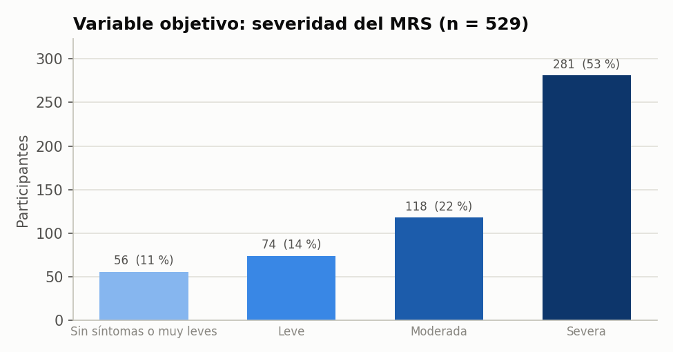

*Participantes con MRS completo (n = 529).*

**Qué muestra.** La clase severa reúne a 53.1 % de las participantes. Las clases no están balanceadas: hay que tenerlo en cuenta al evaluar los clústeres de la Fase 37 (por ejemplo, comparar la composición de cada clúster con esta distribución base).

**Figura 2. Puntaje MRS total y cortes de severidad**

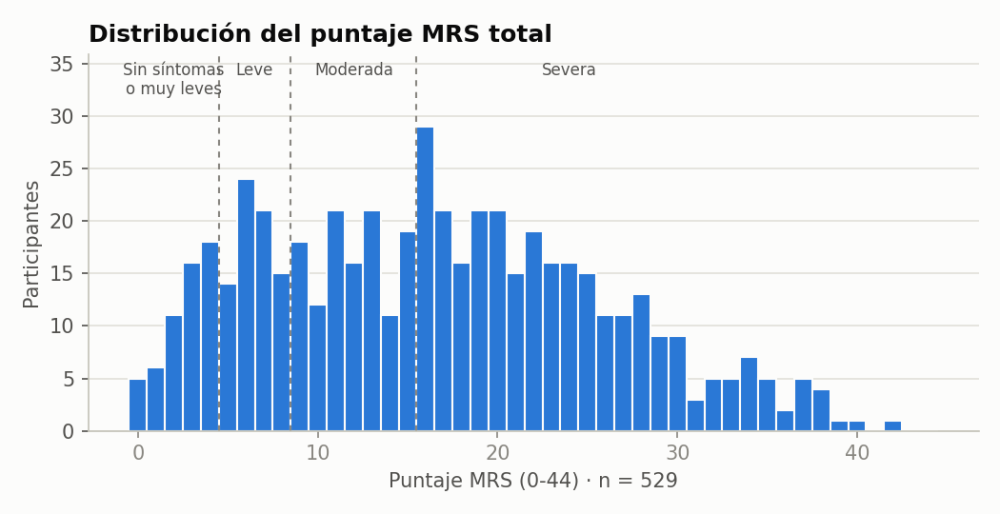

*Líneas punteadas: cortes entre clases.*

**Qué muestra.** Media 16.4 ± 9.3 puntos. El corte de "severa" (16) queda cerca de la media, por eso cerca de la mitad cae en esa clase.

### 2.1 Perfil de los 11 síntomas

Cada ítem del MRS va de 0 (ninguna molestia) a 4 (muy intensa). Se cuenta como presente en grado
moderado o mayor cuando la respuesta es 2 o más. La frecuencia de cada respuesta, ítem por ítem, está
en la sección 3.11.

| Síntoma | Media (0-4) | Moderado o más | Trabaja | No trabaja | p ajustado* |
|---|---|---|---|---|---|
| Cansancio físico y mental | 2.25 | 73.2 % | 76.1 % | 69.1 % | 0.286 |
| Dolor muscular y articular | 1.99 | 65.8 % | 67.3 % | 63.6 % | 0.286 |
| Irritabilidad | 1.91 | 61.4 % | 62.8 % | 59.5 % | 0.408 |
| Ansiedad | 1.80 | 59.4 % | 61.8 % | 55.9 % | 0.535 |
| Ánimo depresivo | 1.78 | 56.7 % | 59.2 % | 53.2 % | 0.536 |
| Problemas de sueño | 1.56 | 50.3 % | 54.7 % | 44.1 % | 0.392 |
| Bochornos y sudoración | 1.29 | 40.8 % | 43.4 % | 37.3 % | 0.696 |
| Molestias al corazón | 1.10 | 31.9 % | 35.3 % | 27.3 % | 0.488 |
| Problemas sexuales | 1.05 | 30.2 % | 30.7 % | 29.5 % | 0.696 |
| Sequedad vaginal | 0.95 | 26.3 % | 28.2 % | 23.6 % | 0.930 |
| Problemas urinarios | 0.71 | 17.6 % | 18.8 % | 15.9 % | 0.544 |

*Chi² entre las 5 respuestas del ítem y la situación laboral, con la corrección FDR de la sección 3.

**Figura 3. Síntomas en grado moderado o mayor**

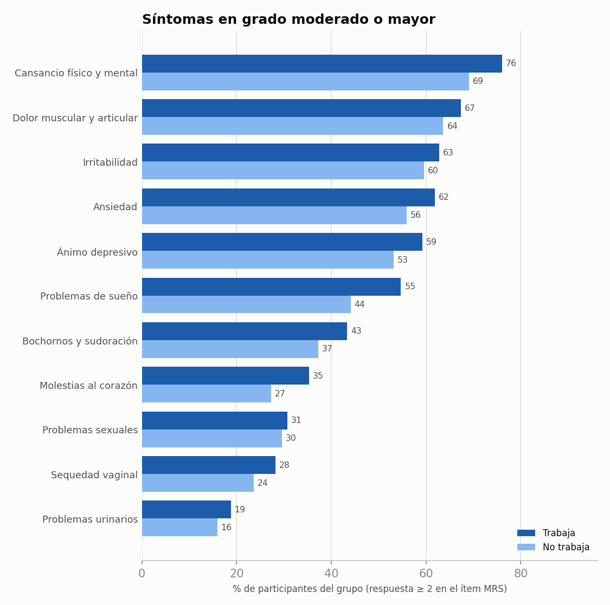

*Ordenados de más a menos frecuente; azul oscuro: trabaja; azul claro: no trabaja.*

**Qué muestra.** Los más frecuentes son cansancio físico y mental (73 %), dolor muscular y articular (66 %) y irritabilidad (61 %); el menos frecuente es problemas urinarios (18 %). Ningún síntoma difiere significativamente entre quienes trabajan y quienes no.

Puntaje medio por subescala:

| Grupo | Somática (0-16) | Psicológica (0-16) | Urogenital (0-12) | Total (0-44) |
|---|---|---|---|---|
| Trabaja | 6.3 | 8.1 | 2.8 | 17.3 |
| No trabaja | 5.5 | 7.2 | 2.5 | 15.2 |

## 3. Frecuencias de todas las variables según situación laboral

Una figura por pregunta (72 en total): el % de cada respuesta
entre quienes trabajan (azul oscuro) y quienes no (azul claro). Bajo el título de cada figura se
indica cuántas participantes de cada grupo tienen el dato y el resultado de la prueba de diferencia.

- En las preguntas que dependen de otra (frecuencia de cada tipo de ejercicio, cuántas personas
  cuida, sobrecarga), "no lo realiza" / "no cuida" es la respuesta de quien contestó "no" a la
  pregunta madre. Las demás preguntas condicionales (tipo de sangrado, método anticonceptivo, a quién
  cuida) se calculan solo sobre quienes las respondieron.
- La edad se muestra por tramo y las horas sentada agrupadas. IMC, peso y talla, como histograma en
  intervalos, solo para quienes los informaron.
- A quién cuida es de selección múltiple: el % es sobre quienes cuidan y puede sumar más de 100.
- Las preguntas de la sección Trabajo y las consecuencias laborales solo las responden quienes
  trabajan: tienen una sola barra.
- Región: las 546 participantes son de Coquimbo (región 04), por eso no se grafica.

**Prueba de diferencia.** Chi² de independencia (efecto: V de Cramér) para las categóricas y
ordinales, y Mann-Whitney (efecto: correlación biserial de rangos r) para edad, IMC, peso, talla y
horas sentada. Los valores p se corrigen por comparaciones múltiples con Benjamini-Hochberg (FDR).

**Cómo leer la prueba de cada figura.** La prueba compara a **quienes trabajan con quienes no**;
**no** mide la relación con la severidad de los síntomas (eso está en la sección 6). Responde a la
pregunta: ¿esta variable se reparte distinto en los dos grupos?

- **V o r (tamaño de la diferencia)**, de 0 a 1: menos de 0,10 = despreciable; 0,10 a 0,30 =
  pequeña; 0,30 a 0,50 = mediana; más de 0,50 = grande. En r, el signo solo indica qué grupo tiene
  valores más altos (+ = quienes trabajan).
- **p ajustado (¿puede ser azar?)**: menor que 0,05 = los grupos sí responden distinto; 0,05 o más =
  no se puede afirmar que difieran, aunque las barras no sean idénticas.
- Que una variable **no** difiera entre los grupos es un resultado normal y esperado: solo dice que
  trabajar no cambia esa respuesta.

### 3.1 Variables de control

**Figura 4. Edad**

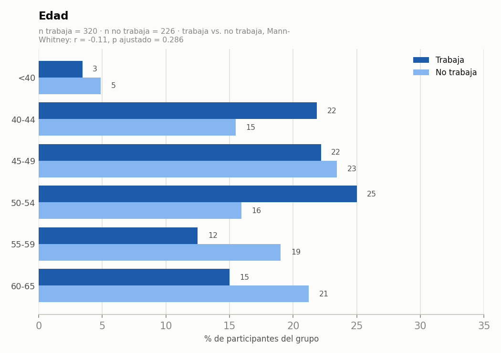

*n trabaja = 320 · n no trabaja = 226 · trabaja vs. no trabaja, Mann-Whitney: r = -0.11, p ajustado = 0.286*

**Qué interpretar.** r = -0.11: diferencia pequeña; p ajustado = 0.286 (0,05 o más). Quienes trabajan y quienes no responden de forma parecida: las diferencias que se ven entre las barras pueden ser azar. No dice nada sobre la relación con los síntomas.

**Figura 5. Etapa menopáusica**

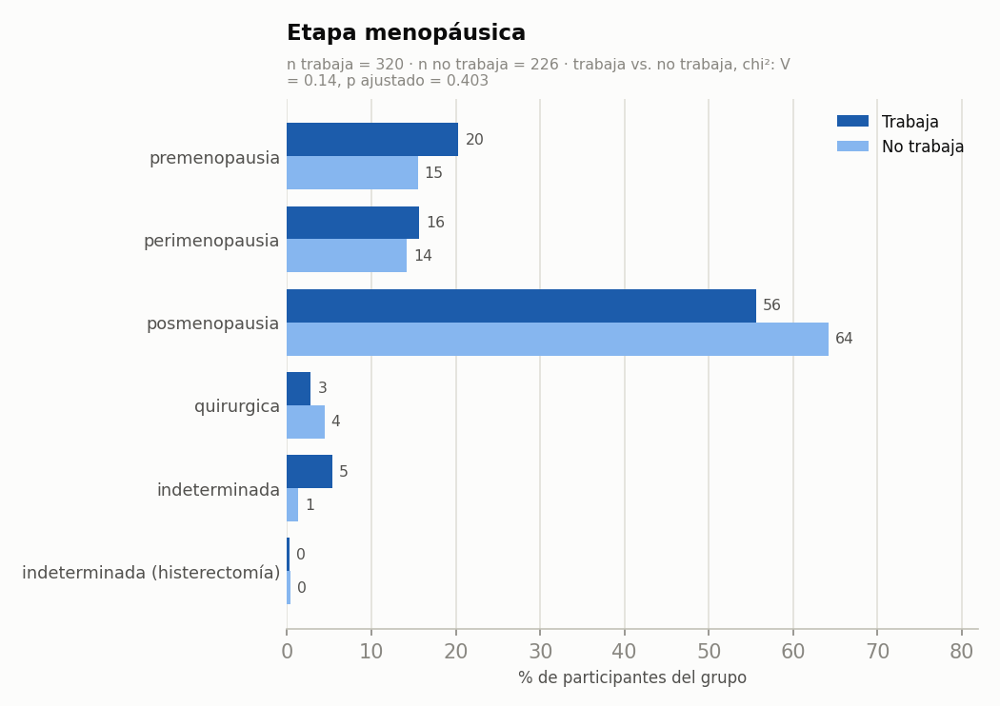

*n trabaja = 320 · n no trabaja = 226 · trabaja vs. no trabaja, chi²: V = 0.14, p ajustado = 0.403*

**Qué interpretar.** V = 0.14: diferencia pequeña; p ajustado = 0.403 (0,05 o más). Quienes trabajan y quienes no responden de forma parecida: las diferencias que se ven entre las barras pueden ser azar. No dice nada sobre la relación con los síntomas.

**Figura 6. IMC (categoría)**

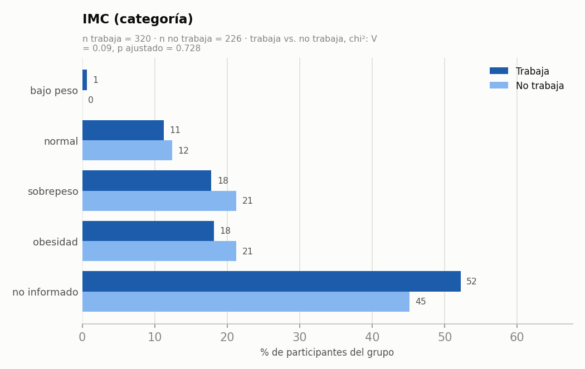

*n trabaja = 320 · n no trabaja = 226 · trabaja vs. no trabaja, chi²: V = 0.09, p ajustado = 0.728*

**Qué interpretar.** V = 0.09: diferencia despreciable; p ajustado = 0.728 (0,05 o más). Quienes trabajan y quienes no responden de forma parecida: las diferencias que se ven entre las barras pueden ser azar. No dice nada sobre la relación con los síntomas.

**Figura 7. IMC**

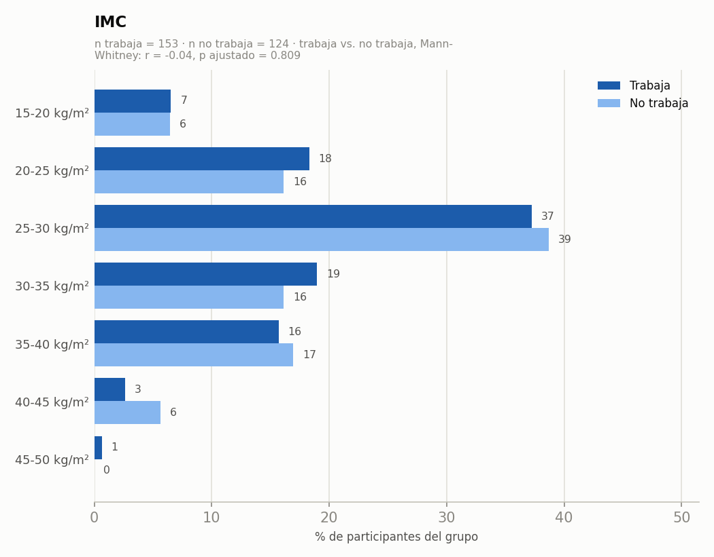

*n trabaja = 153 · n no trabaja = 124 · trabaja vs. no trabaja, Mann-Whitney: r = -0.04, p ajustado = 0.809*

**Qué interpretar.** r = -0.04: diferencia despreciable; p ajustado = 0.809 (0,05 o más). Quienes trabajan y quienes no responden de forma parecida: las diferencias que se ven entre las barras pueden ser azar. No dice nada sobre la relación con los síntomas.

**Figura 8. Peso (kg)**

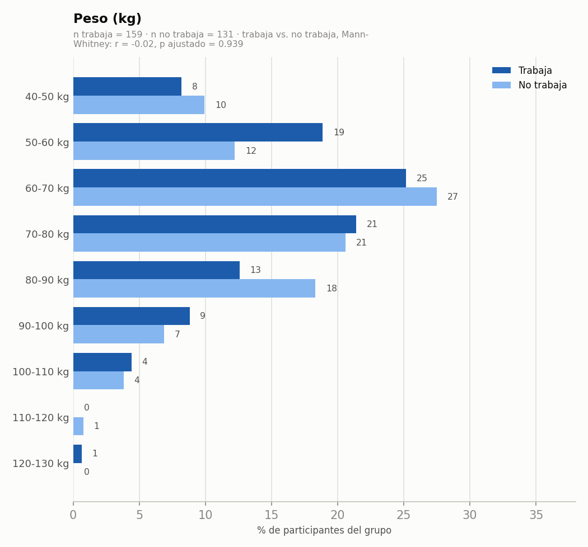

*n trabaja = 159 · n no trabaja = 131 · trabaja vs. no trabaja, Mann-Whitney: r = -0.02, p ajustado = 0.939*

**Qué interpretar.** r = -0.02: diferencia despreciable; p ajustado = 0.939 (0,05 o más). Quienes trabajan y quienes no responden de forma parecida: las diferencias que se ven entre las barras pueden ser azar. No dice nada sobre la relación con los síntomas.

**Figura 9. Talla (cm)**

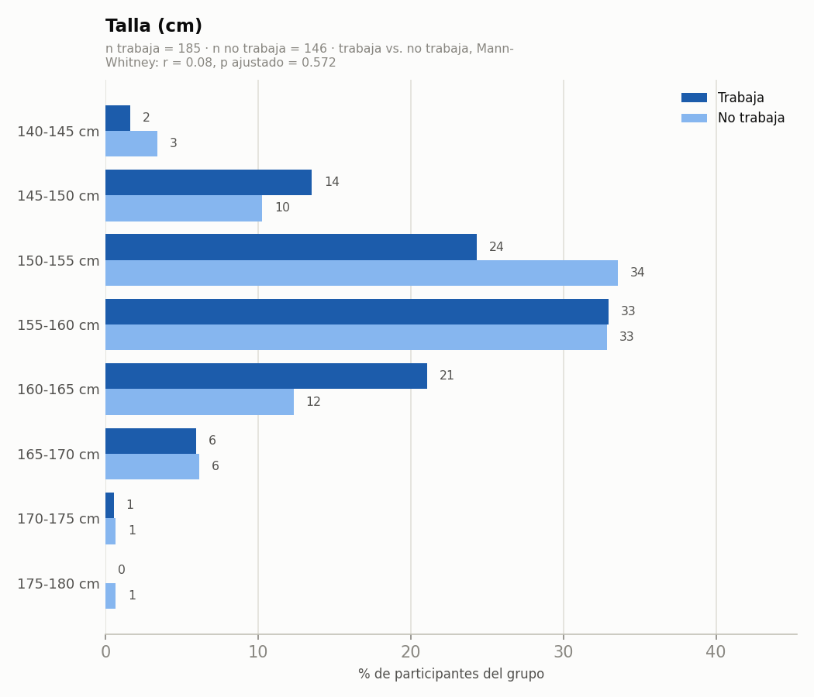

*n trabaja = 185 · n no trabaja = 146 · trabaja vs. no trabaja, Mann-Whitney: r = 0.08, p ajustado = 0.572*

**Qué interpretar.** r = 0.08: diferencia despreciable; p ajustado = 0.572 (0,05 o más). Quienes trabajan y quienes no responden de forma parecida: las diferencias que se ven entre las barras pueden ser azar. No dice nada sobre la relación con los síntomas.

**Figura 10. Usa terapia hormonal**

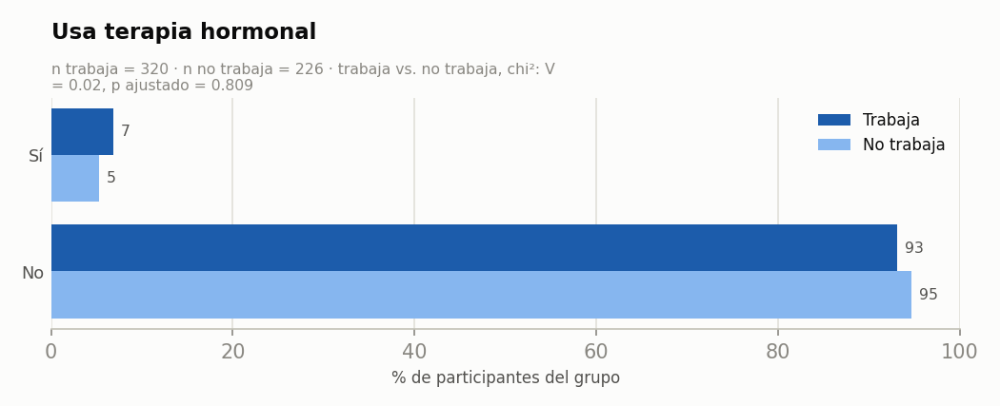

*n trabaja = 320 · n no trabaja = 226 · trabaja vs. no trabaja, chi²: V = 0.02, p ajustado = 0.809*

**Qué interpretar.** V = 0.02: diferencia despreciable; p ajustado = 0.809 (0,05 o más). Quienes trabajan y quienes no responden de forma parecida: las diferencias que se ven entre las barras pueden ser azar. No dice nada sobre la relación con los síntomas.

**Figura 11. Previsión de salud**

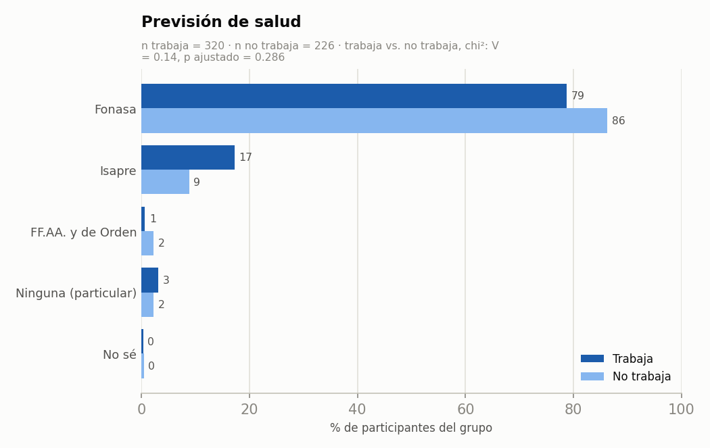

*n trabaja = 320 · n no trabaja = 226 · trabaja vs. no trabaja, chi²: V = 0.14, p ajustado = 0.286*

**Qué interpretar.** V = 0.14: diferencia pequeña; p ajustado = 0.286 (0,05 o más). Quienes trabajan y quienes no responden de forma parecida: las diferencias que se ven entre las barras pueden ser azar. No dice nada sobre la relación con los síntomas.

**Figura 12. Medicamentos para la diabetes**

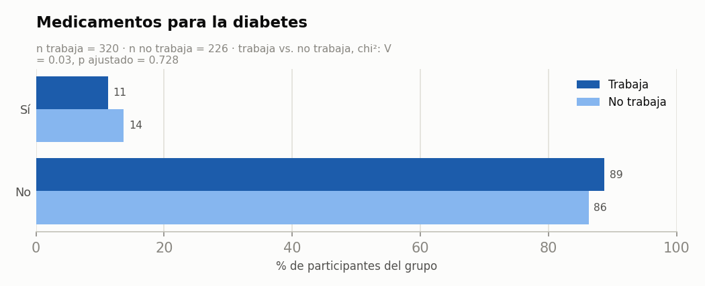

*n trabaja = 320 · n no trabaja = 226 · trabaja vs. no trabaja, chi²: V = 0.03, p ajustado = 0.728*

**Qué interpretar.** V = 0.03: diferencia despreciable; p ajustado = 0.728 (0,05 o más). Quienes trabajan y quienes no responden de forma parecida: las diferencias que se ven entre las barras pueden ser azar. No dice nada sobre la relación con los síntomas.

### 3.2 Actividad física

**Figura 13. Días de ejercicio a la semana**

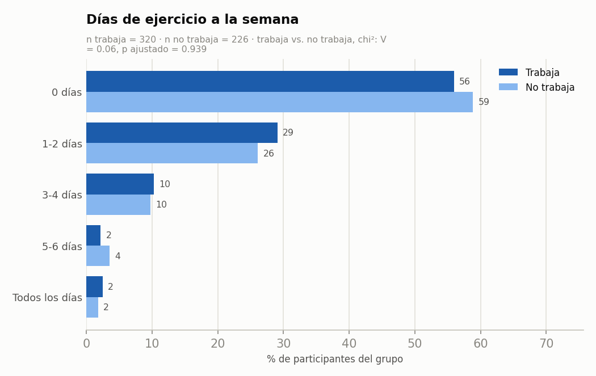

*n trabaja = 320 · n no trabaja = 226 · trabaja vs. no trabaja, chi²: V = 0.06, p ajustado = 0.939*

**Qué interpretar.** V = 0.06: diferencia despreciable; p ajustado = 0.939 (0,05 o más). Quienes trabajan y quienes no responden de forma parecida: las diferencias que se ven entre las barras pueden ser azar. No dice nada sobre la relación con los síntomas.

**Figura 14. Realiza ejercicio aeróbico**

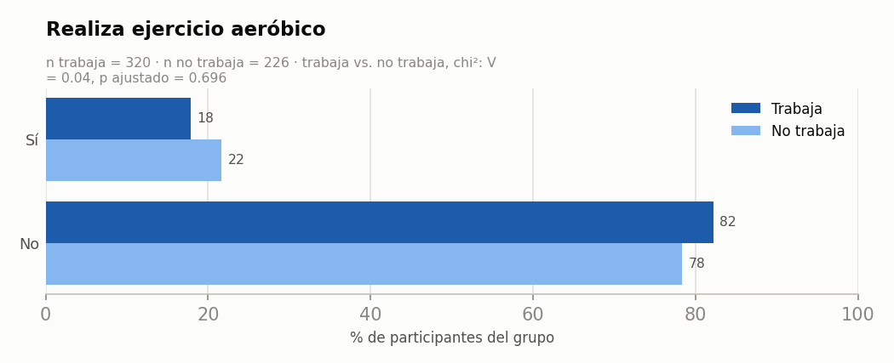

*n trabaja = 320 · n no trabaja = 226 · trabaja vs. no trabaja, chi²: V = 0.04, p ajustado = 0.696*

**Qué interpretar.** V = 0.04: diferencia despreciable; p ajustado = 0.696 (0,05 o más). Quienes trabajan y quienes no responden de forma parecida: las diferencias que se ven entre las barras pueden ser azar. No dice nada sobre la relación con los síntomas.

**Figura 15. Frecuencia de ejercicio aeróbico**

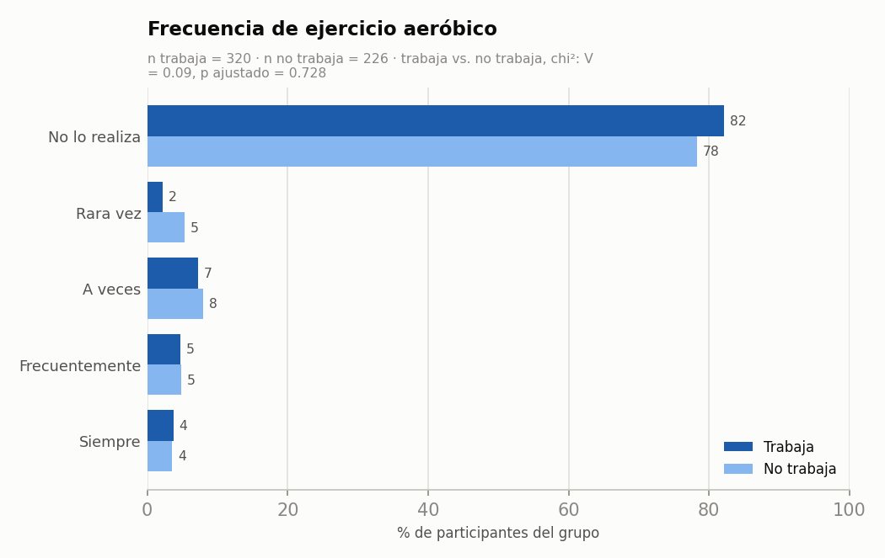

*n trabaja = 320 · n no trabaja = 226 · trabaja vs. no trabaja, chi²: V = 0.09, p ajustado = 0.728*

**Qué interpretar.** V = 0.09: diferencia despreciable; p ajustado = 0.728 (0,05 o más). Quienes trabajan y quienes no responden de forma parecida: las diferencias que se ven entre las barras pueden ser azar. No dice nada sobre la relación con los síntomas.

**Figura 16. Realiza ejercicio de bajo impacto**

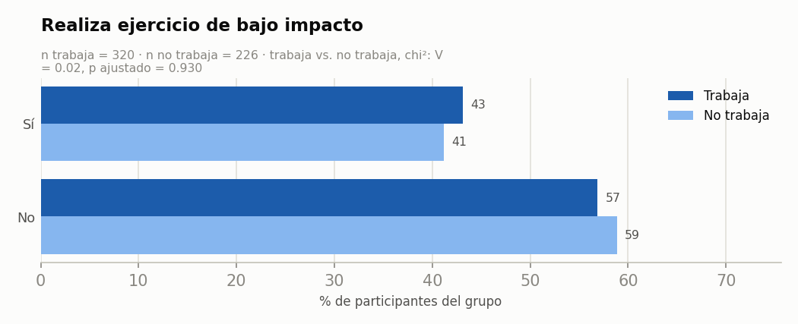

*n trabaja = 320 · n no trabaja = 226 · trabaja vs. no trabaja, chi²: V = 0.02, p ajustado = 0.930*

**Qué interpretar.** V = 0.02: diferencia despreciable; p ajustado = 0.930 (0,05 o más). Quienes trabajan y quienes no responden de forma parecida: las diferencias que se ven entre las barras pueden ser azar. No dice nada sobre la relación con los síntomas.

**Figura 17. Frecuencia de ejercicio de bajo impacto**

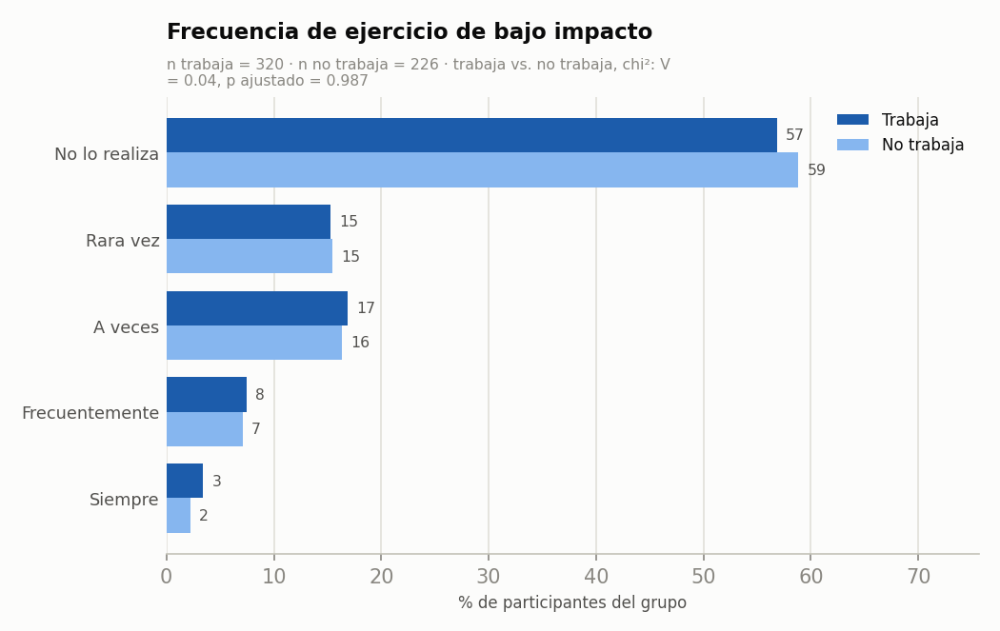

*n trabaja = 320 · n no trabaja = 226 · trabaja vs. no trabaja, chi²: V = 0.04, p ajustado = 0.987*

**Qué interpretar.** V = 0.04: diferencia despreciable; p ajustado = 0.987 (0,05 o más). Quienes trabajan y quienes no responden de forma parecida: las diferencias que se ven entre las barras pueden ser azar. No dice nada sobre la relación con los síntomas.

**Figura 18. Realiza ejercicio de fuerza**

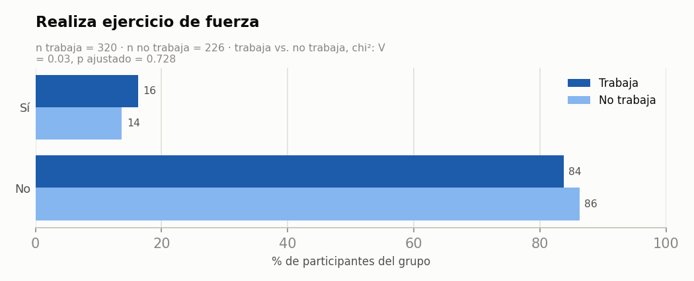

*n trabaja = 320 · n no trabaja = 226 · trabaja vs. no trabaja, chi²: V = 0.03, p ajustado = 0.728*

**Qué interpretar.** V = 0.03: diferencia despreciable; p ajustado = 0.728 (0,05 o más). Quienes trabajan y quienes no responden de forma parecida: las diferencias que se ven entre las barras pueden ser azar. No dice nada sobre la relación con los síntomas.

**Figura 19. Frecuencia de ejercicio de fuerza**

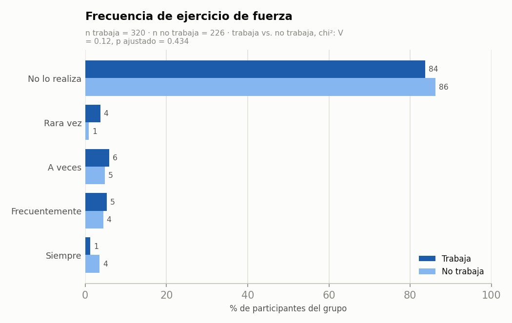

*n trabaja = 320 · n no trabaja = 226 · trabaja vs. no trabaja, chi²: V = 0.12, p ajustado = 0.434*

**Qué interpretar.** V = 0.12: diferencia pequeña; p ajustado = 0.434 (0,05 o más). Quienes trabajan y quienes no responden de forma parecida: las diferencias que se ven entre las barras pueden ser azar. No dice nada sobre la relación con los síntomas.

**Figura 20. Horas sentada al día**

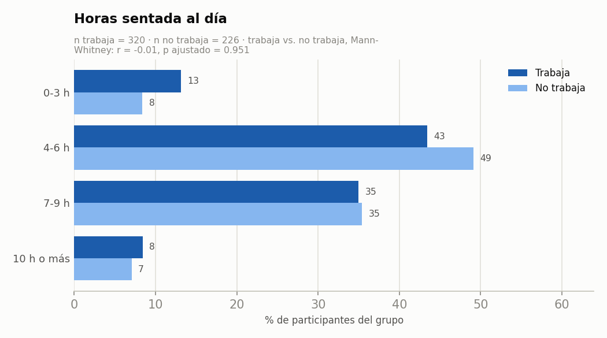

*n trabaja = 320 · n no trabaja = 226 · trabaja vs. no trabaja, Mann-Whitney: r = -0.01, p ajustado = 0.951*

**Qué interpretar.** r = -0.01: diferencia despreciable; p ajustado = 0.951 (0,05 o más). Quienes trabajan y quienes no responden de forma parecida: las diferencias que se ven entre las barras pueden ser azar. No dice nada sobre la relación con los síntomas.

### 3.3 Alimentación (contexto)

**Figura 21. Quién prepara las comidas**

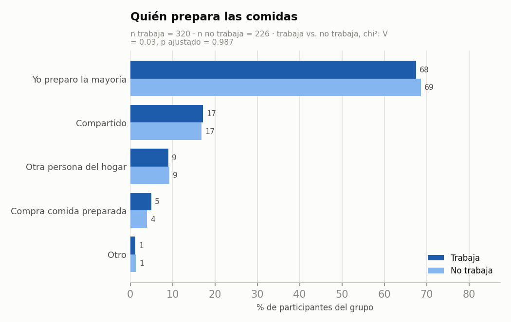

*n trabaja = 320 · n no trabaja = 226 · trabaja vs. no trabaja, chi²: V = 0.03, p ajustado = 0.987*

**Qué interpretar.** V = 0.03: diferencia despreciable; p ajustado = 0.987 (0,05 o más). Quienes trabajan y quienes no responden de forma parecida: las diferencias que se ven entre las barras pueden ser azar. No dice nada sobre la relación con los síntomas.

**Figura 22. Comidas fuera del hogar**

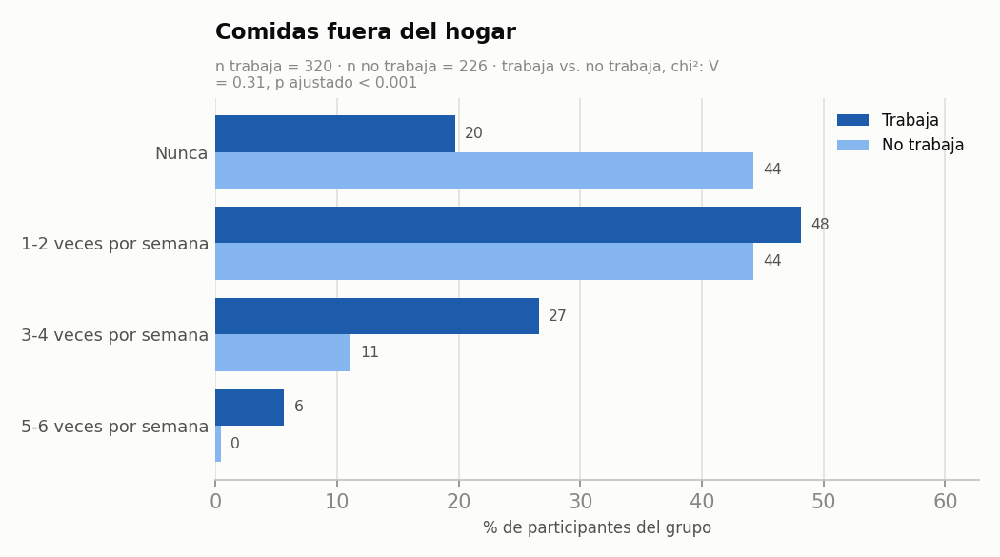

*n trabaja = 320 · n no trabaja = 226 · trabaja vs. no trabaja, chi²: V = 0.31, p ajustado < 0.001*

**Qué interpretar.** V = 0.31: diferencia mediana; p ajustado < 0,001 (menor que 0,05). Los dos grupos **sí** responden distinto y es poco probable que sea azar: mire en las barras qué respuestas concentra cada grupo. Esto no significa por sí solo que la variable se relacione con los síntomas.

**Figura 23. Falta de tiempo influye en lo que come**

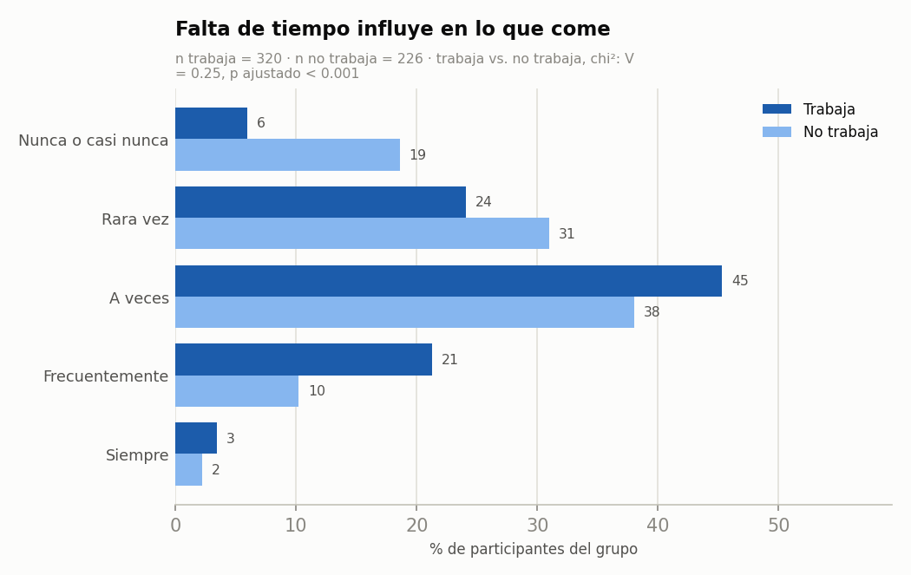

*n trabaja = 320 · n no trabaja = 226 · trabaja vs. no trabaja, chi²: V = 0.25, p ajustado < 0.001*

**Qué interpretar.** V = 0.25: diferencia pequeña; p ajustado < 0,001 (menor que 0,05). Los dos grupos **sí** responden distinto y es poco probable que sea azar: mire en las barras qué respuestas concentra cada grupo. Esto no significa por sí solo que la variable se relacione con los síntomas.

### 3.4 Alimentación (consumo)

**Figura 24. Vasos de agua al día**

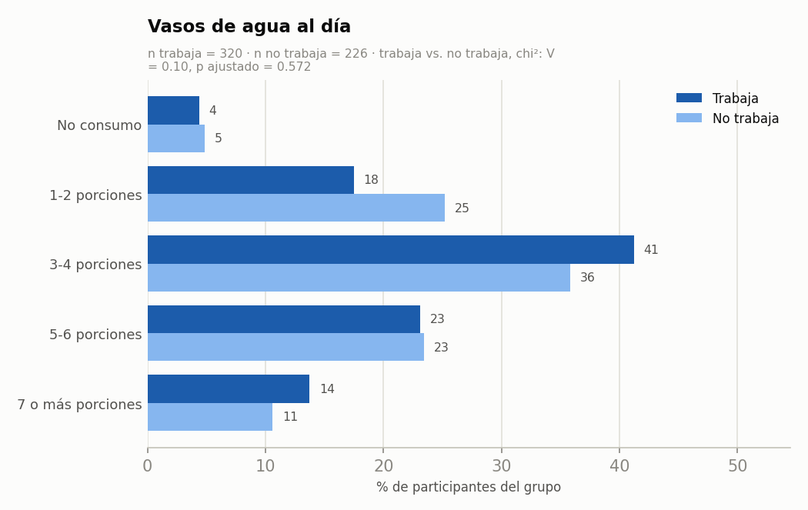

*n trabaja = 320 · n no trabaja = 226 · trabaja vs. no trabaja, chi²: V = 0.10, p ajustado = 0.572*

**Qué interpretar.** V = 0.10: diferencia pequeña; p ajustado = 0.572 (0,05 o más). Quienes trabajan y quienes no responden de forma parecida: las diferencias que se ven entre las barras pueden ser azar. No dice nada sobre la relación con los síntomas.

**Figura 25. Platos de verduras al día**

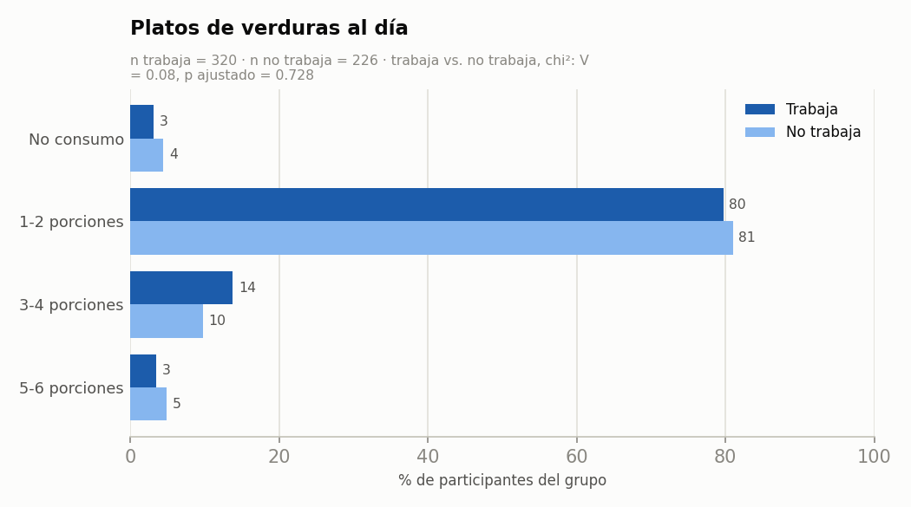

*n trabaja = 320 · n no trabaja = 226 · trabaja vs. no trabaja, chi²: V = 0.08, p ajustado = 0.728*

**Qué interpretar.** V = 0.08: diferencia despreciable; p ajustado = 0.728 (0,05 o más). Quienes trabajan y quienes no responden de forma parecida: las diferencias que se ven entre las barras pueden ser azar. No dice nada sobre la relación con los síntomas.

**Figura 26. Frutas al día**

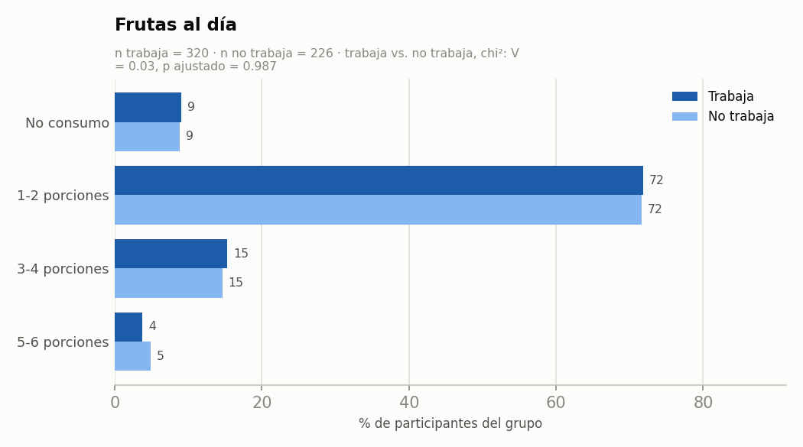

*n trabaja = 320 · n no trabaja = 226 · trabaja vs. no trabaja, chi²: V = 0.03, p ajustado = 0.987*

**Qué interpretar.** V = 0.03: diferencia despreciable; p ajustado = 0.987 (0,05 o más). Quienes trabajan y quienes no responden de forma parecida: las diferencias que se ven entre las barras pueden ser azar. No dice nada sobre la relación con los síntomas.

**Figura 27. Panes al día**

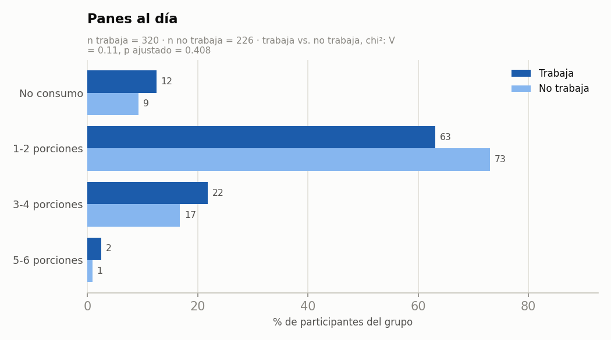

*n trabaja = 320 · n no trabaja = 226 · trabaja vs. no trabaja, chi²: V = 0.11, p ajustado = 0.408*

**Qué interpretar.** V = 0.11: diferencia pequeña; p ajustado = 0.408 (0,05 o más). Quienes trabajan y quienes no responden de forma parecida: las diferencias que se ven entre las barras pueden ser azar. No dice nada sobre la relación con los síntomas.

**Figura 28. Lácteos al día**

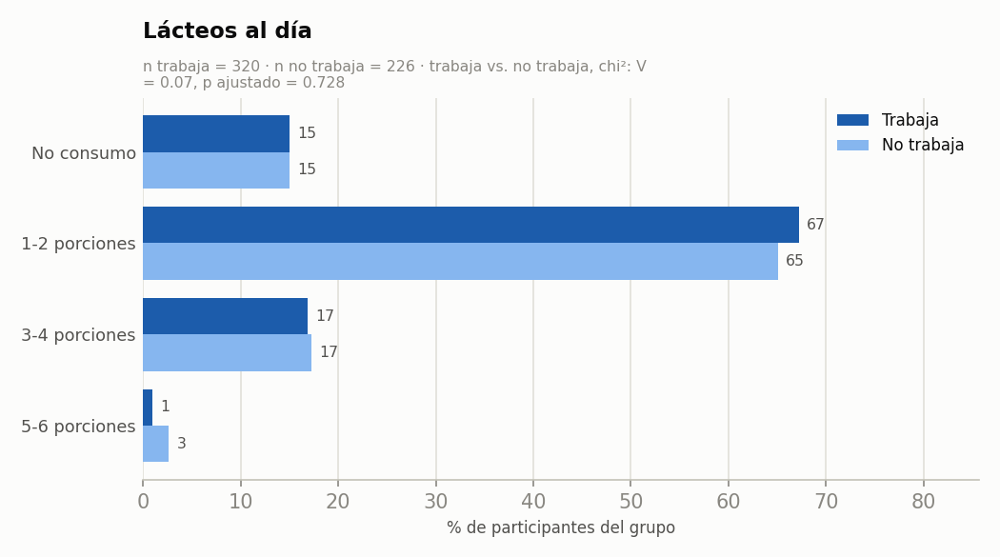

*n trabaja = 320 · n no trabaja = 226 · trabaja vs. no trabaja, chi²: V = 0.07, p ajustado = 0.728*

**Qué interpretar.** V = 0.07: diferencia despreciable; p ajustado = 0.728 (0,05 o más). Quienes trabajan y quienes no responden de forma parecida: las diferencias que se ven entre las barras pueden ser azar. No dice nada sobre la relación con los síntomas.

**Figura 29. Jugos y gaseosas al día**

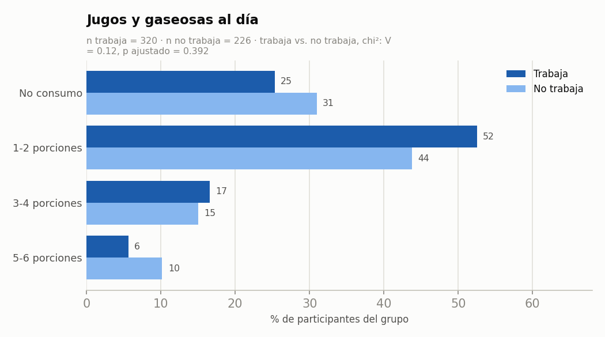

*n trabaja = 320 · n no trabaja = 226 · trabaja vs. no trabaja, chi²: V = 0.12, p ajustado = 0.392*

**Qué interpretar.** V = 0.12: diferencia pequeña; p ajustado = 0.392 (0,05 o más). Quienes trabajan y quienes no responden de forma parecida: las diferencias que se ven entre las barras pueden ser azar. No dice nada sobre la relación con los síntomas.

**Figura 30. Bebidas energéticas al día**

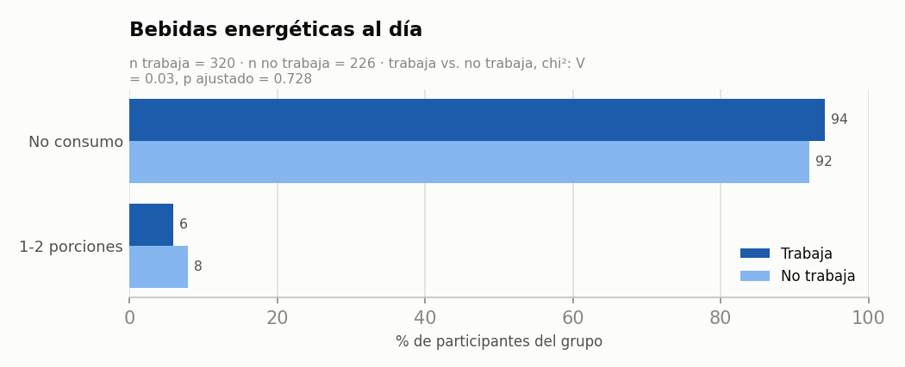

*n trabaja = 320 · n no trabaja = 226 · trabaja vs. no trabaja, chi²: V = 0.03, p ajustado = 0.728*

**Qué interpretar.** V = 0.03: diferencia despreciable; p ajustado = 0.728 (0,05 o más). Quienes trabajan y quienes no responden de forma parecida: las diferencias que se ven entre las barras pueden ser azar. No dice nada sobre la relación con los síntomas.

**Figura 31. Pescado a la semana**

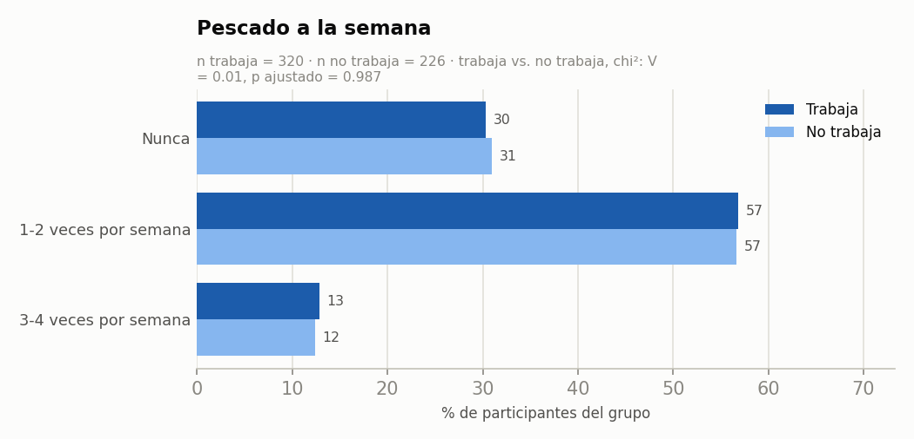

*n trabaja = 320 · n no trabaja = 226 · trabaja vs. no trabaja, chi²: V = 0.01, p ajustado = 0.987*

**Qué interpretar.** V = 0.01: diferencia despreciable; p ajustado = 0.987 (0,05 o más). Quienes trabajan y quienes no responden de forma parecida: las diferencias que se ven entre las barras pueden ser azar. No dice nada sobre la relación con los síntomas.

**Figura 32. Legumbres a la semana**

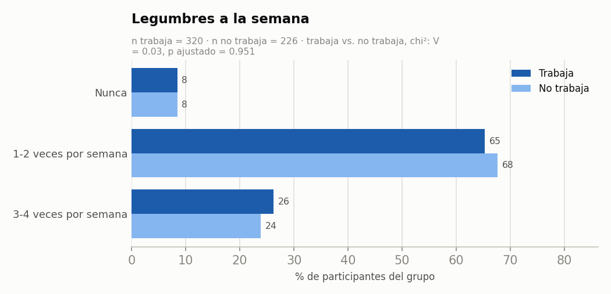

*n trabaja = 320 · n no trabaja = 226 · trabaja vs. no trabaja, chi²: V = 0.03, p ajustado = 0.951*

**Qué interpretar.** V = 0.03: diferencia despreciable; p ajustado = 0.951 (0,05 o más). Quienes trabajan y quienes no responden de forma parecida: las diferencias que se ven entre las barras pueden ser azar. No dice nada sobre la relación con los síntomas.

**Figura 33. Carnes a la semana**

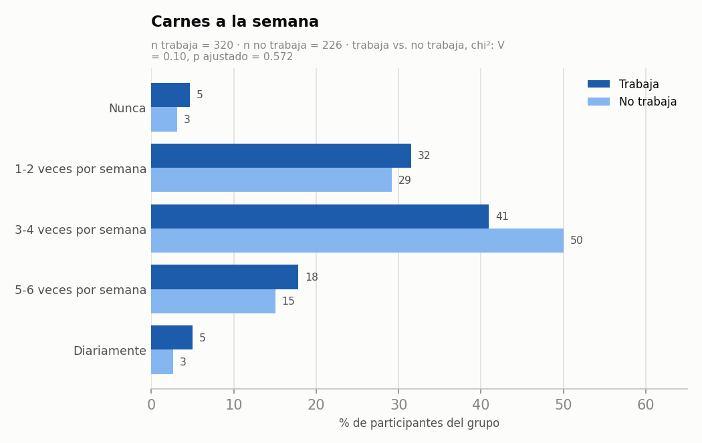

*n trabaja = 320 · n no trabaja = 226 · trabaja vs. no trabaja, chi²: V = 0.10, p ajustado = 0.572*

**Qué interpretar.** V = 0.10: diferencia pequeña; p ajustado = 0.572 (0,05 o más). Quienes trabajan y quienes no responden de forma parecida: las diferencias que se ven entre las barras pueden ser azar. No dice nada sobre la relación con los síntomas.

**Figura 34. Dulces y snacks a la semana**

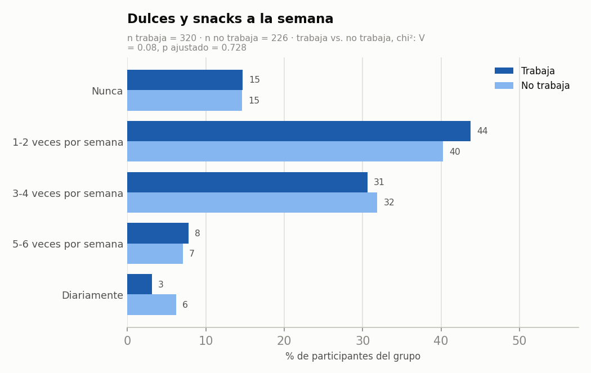

*n trabaja = 320 · n no trabaja = 226 · trabaja vs. no trabaja, chi²: V = 0.08, p ajustado = 0.728*

**Qué interpretar.** V = 0.08: diferencia despreciable; p ajustado = 0.728 (0,05 o más). Quienes trabajan y quienes no responden de forma parecida: las diferencias que se ven entre las barras pueden ser azar. No dice nada sobre la relación con los síntomas.

### 3.5 Sustancias

**Figura 35. Tabaco**

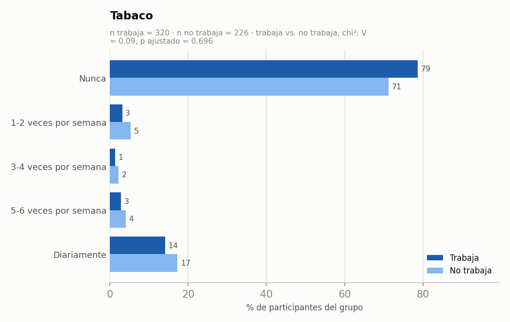

*n trabaja = 320 · n no trabaja = 226 · trabaja vs. no trabaja, chi²: V = 0.09, p ajustado = 0.696*

**Qué interpretar.** V = 0.09: diferencia despreciable; p ajustado = 0.696 (0,05 o más). Quienes trabajan y quienes no responden de forma parecida: las diferencias que se ven entre las barras pueden ser azar. No dice nada sobre la relación con los síntomas.

**Figura 36. Alcohol**

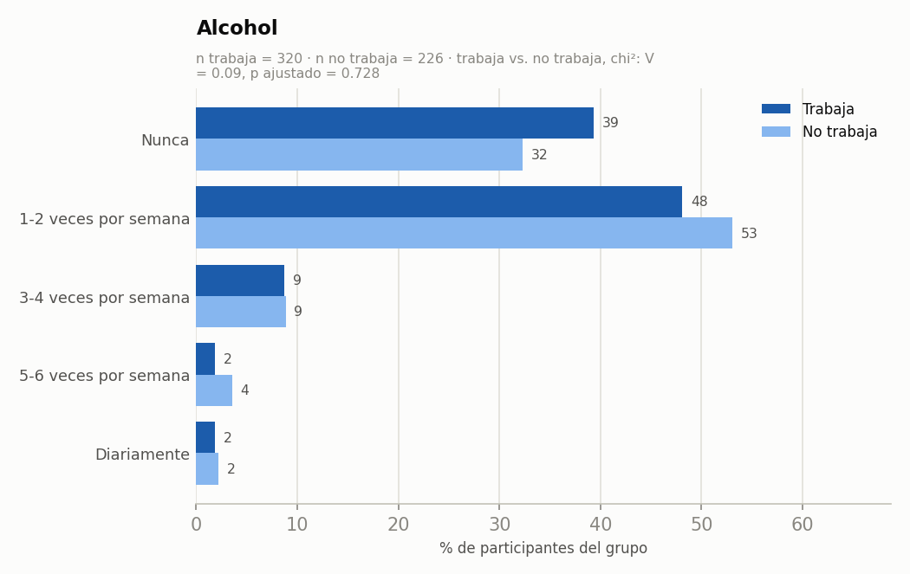

*n trabaja = 320 · n no trabaja = 226 · trabaja vs. no trabaja, chi²: V = 0.09, p ajustado = 0.728*

**Qué interpretar.** V = 0.09: diferencia despreciable; p ajustado = 0.728 (0,05 o más). Quienes trabajan y quienes no responden de forma parecida: las diferencias que se ven entre las barras pueden ser azar. No dice nada sobre la relación con los síntomas.

**Figura 37. Marihuana**

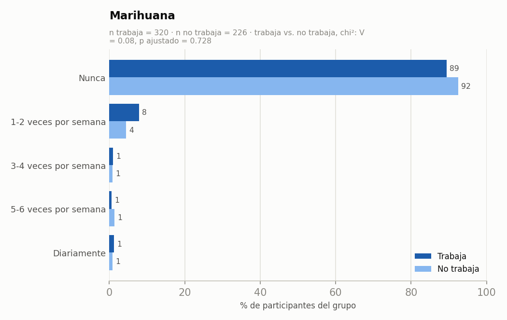

*n trabaja = 320 · n no trabaja = 226 · trabaja vs. no trabaja, chi²: V = 0.08, p ajustado = 0.728*

**Qué interpretar.** V = 0.08: diferencia despreciable; p ajustado = 0.728 (0,05 o más). Quienes trabajan y quienes no responden de forma parecida: las diferencias que se ven entre las barras pueden ser azar. No dice nada sobre la relación con los síntomas.

### 3.6 Cuidado de otras personas

**Figura 38. Cuida a otras personas**

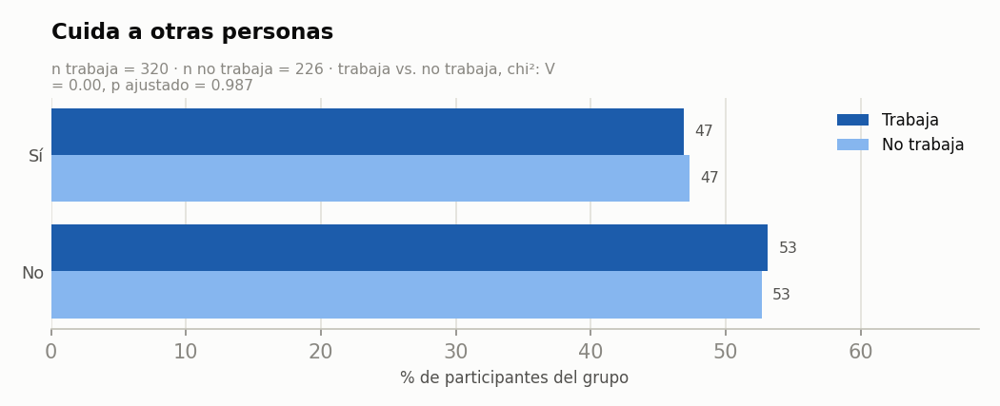

*n trabaja = 320 · n no trabaja = 226 · trabaja vs. no trabaja, chi²: V = 0.00, p ajustado = 0.987*

**Qué interpretar.** V = 0.00: diferencia despreciable; p ajustado = 0.987 (0,05 o más). Quienes trabajan y quienes no responden de forma parecida: las diferencias que se ven entre las barras pueden ser azar. No dice nada sobre la relación con los síntomas.

**Figura 39. Cantidad de personas que cuida**

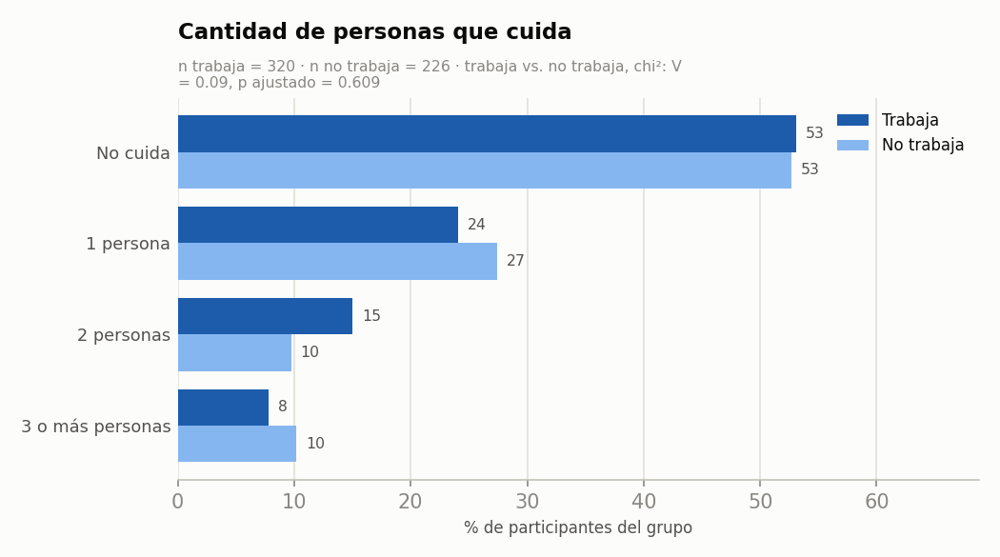

*n trabaja = 320 · n no trabaja = 226 · trabaja vs. no trabaja, chi²: V = 0.09, p ajustado = 0.609*

**Qué interpretar.** V = 0.09: diferencia despreciable; p ajustado = 0.609 (0,05 o más). Quienes trabajan y quienes no responden de forma parecida: las diferencias que se ven entre las barras pueden ser azar. No dice nada sobre la relación con los síntomas.

**Figura 40. A quién cuida**

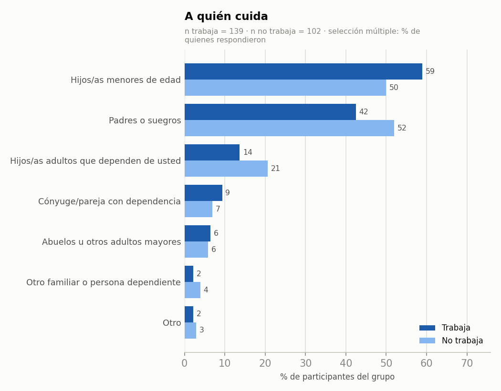

*n trabaja = 139 · n no trabaja = 102 · selección múltiple: % de quienes respondieron*

**Qué interpretar.** Pregunta de selección múltiple: no lleva prueba. Compare a simple vista qué opciones marcan más quienes trabajan y quienes no.

**Figura 41. Sobrecarga por trabajo y cuidado**

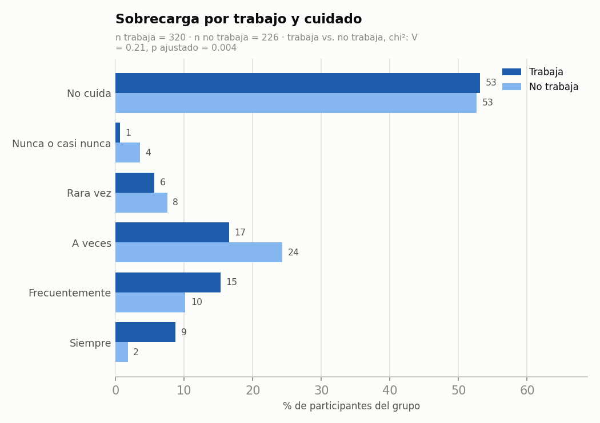

*n trabaja = 320 · n no trabaja = 226 · trabaja vs. no trabaja, chi²: V = 0.21, p ajustado = 0.004*

**Qué interpretar.** V = 0.21: diferencia pequeña; p ajustado = 0.004 (menor que 0,05). Los dos grupos **sí** responden distinto y es poco probable que sea azar: mire en las barras qué respuestas concentra cada grupo. Esto no significa por sí solo que la variable se relacione con los síntomas.

### 3.7 Trabajo (solo quienes trabajan)

**Figura 42. Estrés del entorno laboral**

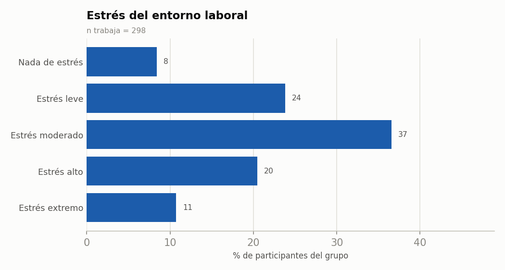

*n trabaja = 298*

**Qué interpretar.** Solo responden quienes trabajan, así que no hay dos grupos que comparar. Mire cómo se reparten las respuestas y si alguna concentra a casi todas.

**Figura 43. Lugar de trabajo comprensivo**

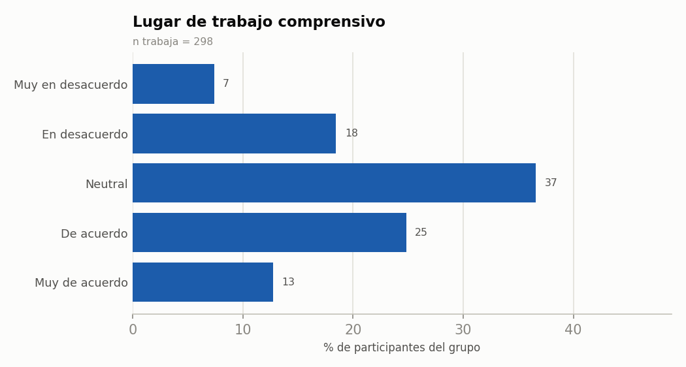

*n trabaja = 298*

**Qué interpretar.** Solo responden quienes trabajan, así que no hay dos grupos que comparar. Mire cómo se reparten las respuestas y si alguna concentra a casi todas.

### 3.8 Salud ginecológica

**Figura 44. Regularidad de la menstruación**

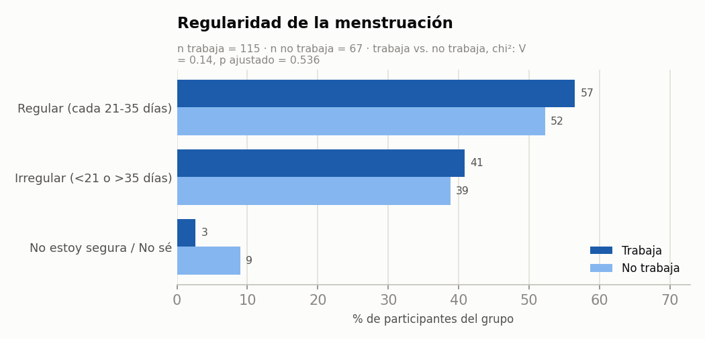

*n trabaja = 115 · n no trabaja = 67 · trabaja vs. no trabaja, chi²: V = 0.14, p ajustado = 0.536*

**Qué interpretar.** V = 0.14: diferencia pequeña; p ajustado = 0.536 (0,05 o más). Quienes trabajan y quienes no responden de forma parecida: las diferencias que se ven entre las barras pueden ser azar. No dice nada sobre la relación con los síntomas.

**Figura 45. Tipo de sangrado**

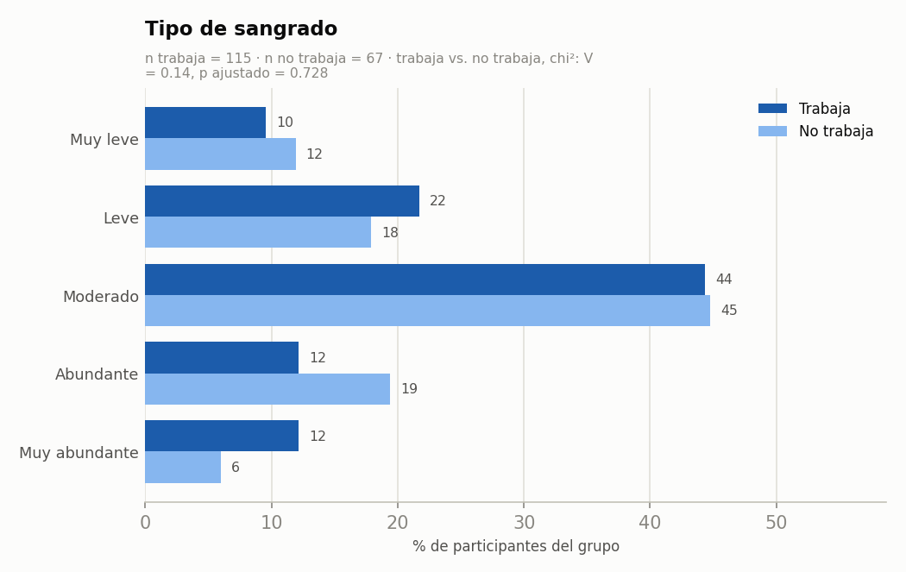

*n trabaja = 115 · n no trabaja = 67 · trabaja vs. no trabaja, chi²: V = 0.14, p ajustado = 0.728*

**Qué interpretar.** V = 0.14: diferencia pequeña; p ajustado = 0.728 (0,05 o más). Quienes trabajan y quienes no responden de forma parecida: las diferencias que se ven entre las barras pueden ser azar. No dice nada sobre la relación con los síntomas.

**Figura 46. Usa método anticonceptivo**

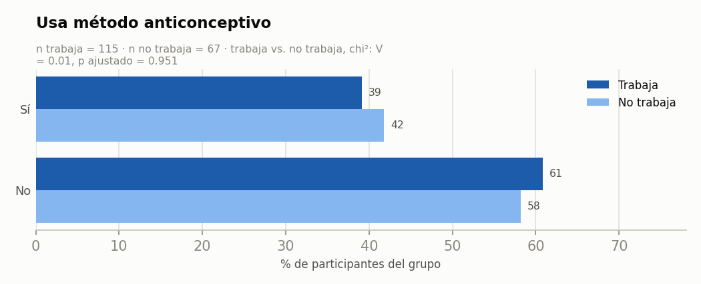

*n trabaja = 115 · n no trabaja = 67 · trabaja vs. no trabaja, chi²: V = 0.01, p ajustado = 0.951*

**Qué interpretar.** V = 0.01: diferencia despreciable; p ajustado = 0.951 (0,05 o más). Quienes trabajan y quienes no responden de forma parecida: las diferencias que se ven entre las barras pueden ser azar. No dice nada sobre la relación con los síntomas.

**Figura 47. Método anticonceptivo**

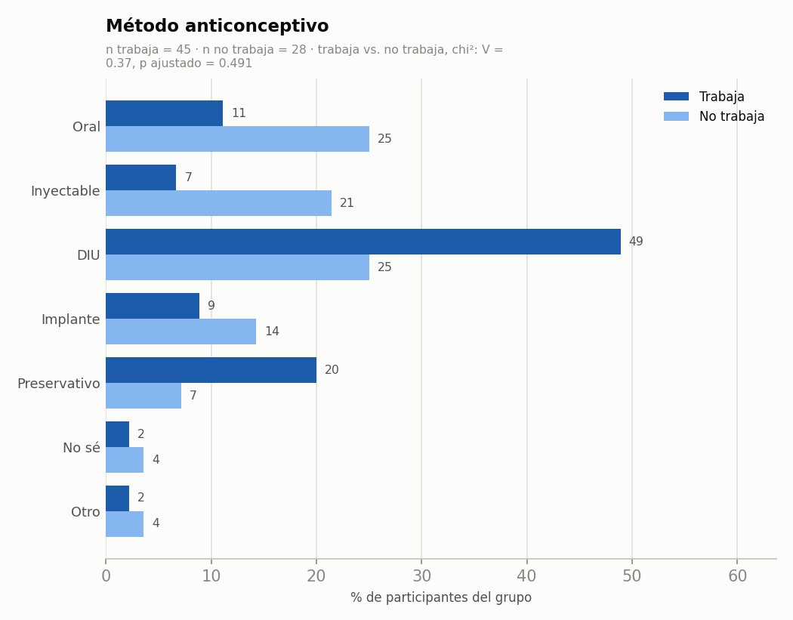

*n trabaja = 45 · n no trabaja = 28 · trabaja vs. no trabaja, chi²: V = 0.37, p ajustado = 0.491*

**Qué interpretar.** V = 0.37: diferencia mediana; p ajustado = 0.491 (0,05 o más). Quienes trabajan y quienes no responden de forma parecida: las diferencias que se ven entre las barras pueden ser azar. No dice nada sobre la relación con los síntomas.

**Figura 48. Operada para no tener más hijos**

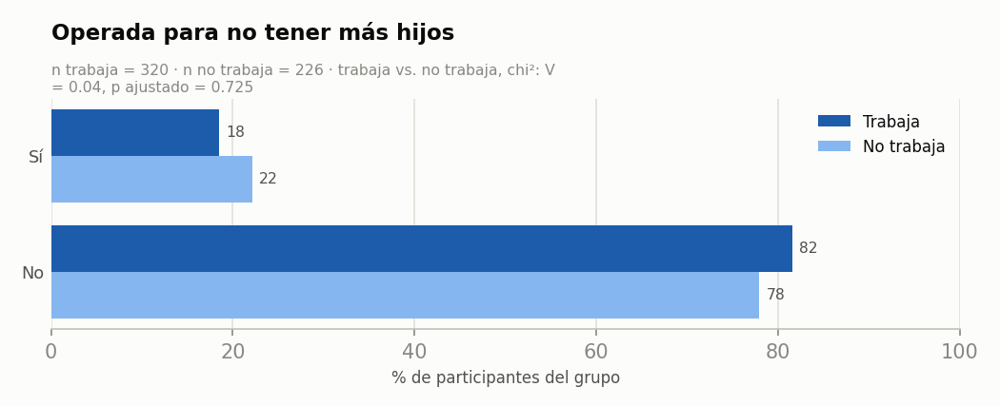

*n trabaja = 320 · n no trabaja = 226 · trabaja vs. no trabaja, chi²: V = 0.04, p ajustado = 0.725*

**Qué interpretar.** V = 0.04: diferencia despreciable; p ajustado = 0.725 (0,05 o más). Quienes trabajan y quienes no responden de forma parecida: las diferencias que se ven entre las barras pueden ser azar. No dice nada sobre la relación con los síntomas.

**Figura 49. Tiene útero**

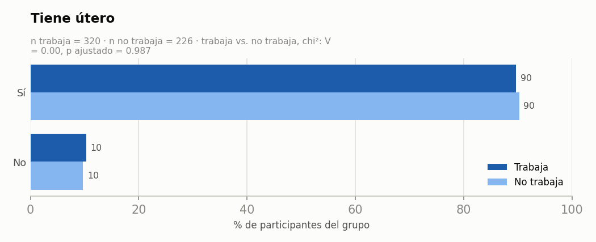

*n trabaja = 320 · n no trabaja = 226 · trabaja vs. no trabaja, chi²: V = 0.00, p ajustado = 0.987*

**Qué interpretar.** V = 0.00: diferencia despreciable; p ajustado = 0.987 (0,05 o más). Quienes trabajan y quienes no responden de forma parecida: las diferencias que se ven entre las barras pueden ser azar. No dice nada sobre la relación con los síntomas.

**Figura 50. Tiene ovarios**

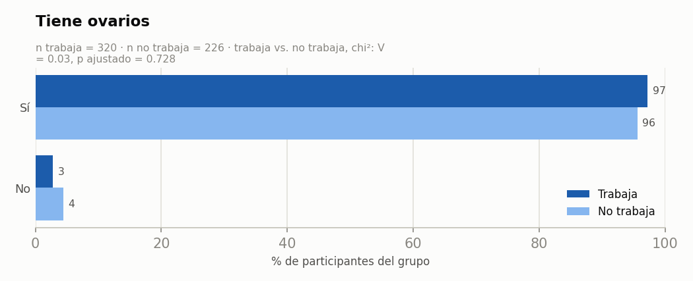

*n trabaja = 320 · n no trabaja = 226 · trabaja vs. no trabaja, chi²: V = 0.03, p ajustado = 0.728*

**Qué interpretar.** V = 0.03: diferencia despreciable; p ajustado = 0.728 (0,05 o más). Quienes trabajan y quienes no responden de forma parecida: las diferencias que se ven entre las barras pueden ser azar. No dice nada sobre la relación con los síntomas.

### 3.9 Medicamentos y digestión

**Figura 51. Medicamentos para la presión**

*n trabaja = 320 · n no trabaja = 226 · trabaja vs. no trabaja, chi²: V = 0.01, p ajustado = 0.951*

**Qué interpretar.** V = 0.01: diferencia despreciable; p ajustado = 0.951 (0,05 o más). Quienes trabajan y quienes no responden de forma parecida: las diferencias que se ven entre las barras pueden ser azar. No dice nada sobre la relación con los síntomas.

**Figura 52. Frecuencia de evacuación intestinal**

*n trabaja = 320 · n no trabaja = 226 · trabaja vs. no trabaja, chi²: V = 0.12, p ajustado = 0.309*

**Qué interpretar.** V = 0.12: diferencia pequeña; p ajustado = 0.309 (0,05 o más). Quienes trabajan y quienes no responden de forma parecida: las diferencias que se ven entre las barras pueden ser azar. No dice nada sobre la relación con los síntomas.

**Figura 53. Distensión abdominal**

*n trabaja = 320 · n no trabaja = 226 · trabaja vs. no trabaja, chi²: V = 0.07, p ajustado = 0.728*

**Qué interpretar.** V = 0.07: diferencia despreciable; p ajustado = 0.728 (0,05 o más). Quienes trabajan y quienes no responden de forma parecida: las diferencias que se ven entre las barras pueden ser azar. No dice nada sobre la relación con los síntomas.

### 3.10 Otras características

**Figura 54. Género**

*n trabaja = 320 · n no trabaja = 226 · trabaja vs. no trabaja, chi²: V = 0.04, p ajustado = 0.728*

**Qué interpretar.** V = 0.04: diferencia despreciable; p ajustado = 0.728 (0,05 o más). Quienes trabajan y quienes no responden de forma parecida: las diferencias que se ven entre las barras pueden ser azar. No dice nada sobre la relación con los síntomas.

**Figura 55. Origen**

*n trabaja = 320 · n no trabaja = 226 · trabaja vs. no trabaja, chi²: V = 0.13, p ajustado = 0.536*

**Qué interpretar.** V = 0.13: diferencia pequeña; p ajustado = 0.536 (0,05 o más). Quienes trabajan y quienes no responden de forma parecida: las diferencias que se ven entre las barras pueden ser azar. No dice nada sobre la relación con los síntomas.

**Figura 56. Pueblo originario / afro**

*n trabaja = 320 · n no trabaja = 226 · trabaja vs. no trabaja, chi²: V = 0.07, p ajustado = 0.930*

**Qué interpretar.** V = 0.07: diferencia despreciable; p ajustado = 0.930 (0,05 o más). Quienes trabajan y quienes no responden de forma parecida: las diferencias que se ven entre las barras pueden ser azar. No dice nada sobre la relación con los síntomas.

**Figura 57. Comuna**

*n trabaja = 320 · n no trabaja = 226 · trabaja vs. no trabaja, chi²: V = 0.11, p ajustado = 0.987*

**Qué interpretar.** V = 0.11: diferencia pequeña; p ajustado = 0.987 (0,05 o más). Quienes trabajan y quienes no responden de forma parecida: las diferencias que se ven entre las barras pueden ser azar. No dice nada sobre la relación con los síntomas.

**Figura 58. Tiene pareja**

*n trabaja = 320 · n no trabaja = 226 · trabaja vs. no trabaja, chi²: V = 0.01, p ajustado = 0.939*

**Qué interpretar.** V = 0.01: diferencia despreciable; p ajustado = 0.939 (0,05 o más). Quienes trabajan y quienes no responden de forma parecida: las diferencias que se ven entre las barras pueden ser azar. No dice nada sobre la relación con los síntomas.

**Figura 59. Tiene actividad sexual**

*n trabaja = 320 · n no trabaja = 226 · trabaja vs. no trabaja, chi²: V = 0.01, p ajustado = 0.951*

**Qué interpretar.** V = 0.01: diferencia despreciable; p ajustado = 0.951 (0,05 o más). Quienes trabajan y quienes no responden de forma parecida: las diferencias que se ven entre las barras pueden ser azar. No dice nada sobre la relación con los síntomas.

### 3.11 Síntomas del MRS

**Figura 60. Bochornos y sudoración**

*n trabaja = 320 · n no trabaja = 225 · trabaja vs. no trabaja, chi²: V = 0.10, p ajustado = 0.696*

**Qué interpretar.** V = 0.10: diferencia despreciable; p ajustado = 0.696 (0,05 o más). Quienes trabajan y quienes no responden de forma parecida: las diferencias que se ven entre las barras pueden ser azar. No dice nada sobre la relación con los síntomas.

**Figura 61. Molestias al corazón**

*n trabaja = 319 · n no trabaja = 226 · trabaja vs. no trabaja, chi²: V = 0.12, p ajustado = 0.488*

**Qué interpretar.** V = 0.12: diferencia pequeña; p ajustado = 0.488 (0,05 o más). Quienes trabajan y quienes no responden de forma parecida: las diferencias que se ven entre las barras pueden ser azar. No dice nada sobre la relación con los síntomas.

**Figura 62. Dolor muscular y articular**

*n trabaja = 320 · n no trabaja = 226 · trabaja vs. no trabaja, chi²: V = 0.14, p ajustado = 0.286*

**Qué interpretar.** V = 0.14: diferencia pequeña; p ajustado = 0.286 (0,05 o más). Quienes trabajan y quienes no responden de forma parecida: las diferencias que se ven entre las barras pueden ser azar. No dice nada sobre la relación con los síntomas.

**Figura 63. Problemas de sueño**

*n trabaja = 317 · n no trabaja = 226 · trabaja vs. no trabaja, chi²: V = 0.13, p ajustado = 0.392*

**Qué interpretar.** V = 0.13: diferencia pequeña; p ajustado = 0.392 (0,05 o más). Quienes trabajan y quienes no responden de forma parecida: las diferencias que se ven entre las barras pueden ser azar. No dice nada sobre la relación con los síntomas.

**Figura 64. Ánimo depresivo**

*n trabaja = 320 · n no trabaja = 223 · trabaja vs. no trabaja, chi²: V = 0.11, p ajustado = 0.536*

**Qué interpretar.** V = 0.11: diferencia pequeña; p ajustado = 0.536 (0,05 o más). Quienes trabajan y quienes no responden de forma parecida: las diferencias que se ven entre las barras pueden ser azar. No dice nada sobre la relación con los síntomas.

**Figura 65. Irritabilidad**

*n trabaja = 319 · n no trabaja = 225 · trabaja vs. no trabaja, chi²: V = 0.13, p ajustado = 0.408*

**Qué interpretar.** V = 0.13: diferencia pequeña; p ajustado = 0.408 (0,05 o más). Quienes trabajan y quienes no responden de forma parecida: las diferencias que se ven entre las barras pueden ser azar. No dice nada sobre la relación con los síntomas.

**Figura 66. Ansiedad**

*n trabaja = 319 · n no trabaja = 226 · trabaja vs. no trabaja, chi²: V = 0.11, p ajustado = 0.535*

**Qué interpretar.** V = 0.11: diferencia pequeña; p ajustado = 0.535 (0,05 o más). Quienes trabajan y quienes no responden de forma parecida: las diferencias que se ven entre las barras pueden ser azar. No dice nada sobre la relación con los síntomas.

**Figura 67. Cansancio físico y mental**

*n trabaja = 319 · n no trabaja = 226 · trabaja vs. no trabaja, chi²: V = 0.14, p ajustado = 0.286*

**Qué interpretar.** V = 0.14: diferencia pequeña; p ajustado = 0.286 (0,05 o más). Quienes trabajan y quienes no responden de forma parecida: las diferencias que se ven entre las barras pueden ser azar. No dice nada sobre la relación con los síntomas.

**Figura 68. Problemas sexuales**

*n trabaja = 319 · n no trabaja = 226 · trabaja vs. no trabaja, chi²: V = 0.09, p ajustado = 0.696*

**Qué interpretar.** V = 0.09: diferencia despreciable; p ajustado = 0.696 (0,05 o más). Quienes trabajan y quienes no responden de forma parecida: las diferencias que se ven entre las barras pueden ser azar. No dice nada sobre la relación con los síntomas.

**Figura 69. Problemas urinarios**

*n trabaja = 320 · n no trabaja = 226 · trabaja vs. no trabaja, chi²: V = 0.11, p ajustado = 0.544*

**Qué interpretar.** V = 0.11: diferencia pequeña; p ajustado = 0.544 (0,05 o más). Quienes trabajan y quienes no responden de forma parecida: las diferencias que se ven entre las barras pueden ser azar. No dice nada sobre la relación con los síntomas.

**Figura 70. Sequedad vaginal**

*n trabaja = 317 · n no trabaja = 225 · trabaja vs. no trabaja, chi²: V = 0.06, p ajustado = 0.930*

**Qué interpretar.** V = 0.06: diferencia despreciable; p ajustado = 0.930 (0,05 o más). Quienes trabajan y quienes no responden de forma parecida: las diferencias que se ven entre las barras pueden ser azar. No dice nada sobre la relación con los síntomas.

### 3.12 Consecuencias de los síntomas

**Figura 71. Rendimiento laboral afectado**

*n trabaja = 298*

**Qué interpretar.** Solo responden quienes trabajan, así que no hay dos grupos que comparar. Mire cómo se reparten las respuestas y si alguna concentra a casi todas.

**Figura 72. Bienestar en el trabajo afectado**

*n trabaja = 298*

**Qué interpretar.** Solo responden quienes trabajan, así que no hay dos grupos que comparar. Mire cómo se reparten las respuestas y si alguna concentra a casi todas.

**Figura 73. Ausencias o atrasos por síntomas**

*n trabaja = 298*

**Qué interpretar.** Solo responden quienes trabajan, así que no hay dos grupos que comparar. Mire cómo se reparten las respuestas y si alguna concentra a casi todas.

**Figura 74. Cambio en la relación de pareja**

*n trabaja = 196 · n no trabaja = 143 · trabaja vs. no trabaja, chi²: V = 0.12, p ajustado = 0.696*

**Qué interpretar.** V = 0.12: diferencia pequeña; p ajustado = 0.696 (0,05 o más). Quienes trabajan y quienes no responden de forma parecida: las diferencias que se ven entre las barras pueden ser azar. No dice nada sobre la relación con los síntomas.

**Figura 75. Usa antidepresivos o medicamentos para dormir**

*n trabaja = 320 · n no trabaja = 226 · trabaja vs. no trabaja, chi²: V = 0.02, p ajustado = 0.904*

**Qué interpretar.** V = 0.02: diferencia despreciable; p ajustado = 0.904 (0,05 o más). Quienes trabajan y quienes no responden de forma parecida: las diferencias que se ven entre las barras pueden ser azar. No dice nada sobre la relación con los síntomas.

### 3.13 Diferencias entre quienes trabajan y quienes no

De 66 variables comparadas, **3** difieren con FDR < 0,05:

| Variable | Prueba | Efecto | p ajustado |
|---|---|---|---|
| Comidas fuera del hogar | chi² | V = 0.31 | < 0,001 |
| Falta de tiempo influye en lo que come | chi² | V = 0.25 | < 0,001 |
| Sobrecarga por trabajo y cuidado | chi² | V = 0.21 | 0.004 |

Las que trabajan comen fuera del hogar con más frecuencia y sienten más que la falta de tiempo
influye en lo que comen; la sobrecarga por cuidado también es mayor (suma trabajo y cuidado). El
resto de los hábitos no cambia según la situación laboral, así que las diferencias de severidad
entre ambos grupos (sección 5) no se explican por un estilo de vida distinto en general.

### 3.14 Variables con poca variación

Una variable donde casi todas responden lo mismo aporta poca información para separar perfiles.
Se marcan las que tienen una respuesta con 90 % o más:

| Variable | Respuesta dominante | % |
|---|---|---|
| Género | Femenino | 98.5 |
| Tiene ovarios | Sí | 96.5 |
| Origen | Chileno/a | 96.3 |
| Usa terapia hormonal | No | 93.8 |
| Bebidas energéticas al día | No consumo | 93.2 |
| Pueblo originario / afro | Ninguno | 92.3 |
| Marihuana | Nunca | 90.7 |

No se eliminan aquí: la decisión se toma en la Fase 35 con la entropía, que mide justamente esa
falta de variación.

## 4. Calidad de los datos

### 4.1 Datos faltantes

Los vacíos de preguntas que la encuesta no mostró ("no aplica") no cuentan como faltantes. Sobre las
filas donde la pregunta aplica:

- **Más del 30 %:** cintura (cm) (52.4 %), peso (kg) (46.9 %), talla (cm) (39.4 %). No se imputan ni se modelan; el IMC entra como categoría con "no informado".
- **Resto:** 70 variables entre 0.4 % y 16.2 %, imputadas en la limpieza (moda o mediana; con marca
  `_imputado` cuando superan el 5 %). Las más altas son las preguntas de menstruación, que quedan
  sin dato cuando falta la fecha de última menstruación.

El detalle por variable está en `resultados/usuaria/faltantes.csv` y en el informe de limpieza.

### 4.2 Distribución y atípicos de las variables continuas

Valores medidos (sin imputados); peso, talla e IMC solo de quienes los informaron.

| Variable | n | Media | DE | Mediana | Mín. | Máx. | Asimetría |
|---|---|---|---|---|---|---|---|
| Edad | 546 | 51.0 | 7.7 | 50.0 | 36.0 | 65.0 | +0.11 |
| IMC | 277 | 29.2 | 6.3 | 28.5 | 18.2 | 45.7 | +0.35 |
| Peso (kg) | 290 | 71.3 | 16.0 | 69.4 | 40.4 | 122.8 | +0.42 |
| Talla (cm) | 331 | 155.6 | 5.8 | 156.0 | 140.0 | 176.0 | +0.10 |
| Horas sentada al día | 546 | 6.3 | 2.4 | 6.0 | 1.0 | 14.0 | +0.04 |

**Figura 76. Distribución de las variables continuas**

*Histogramas de 25 intervalos; n = participantes con el dato.*

**Cómo leerla.** La asimetría cerca de 0 indica una distribución simétrica; positiva, una cola hacia los valores altos; negativa, hacia los bajos.

Regla de Tukey (fuera de Q1 − 1,5 × RIC o Q3 + 1,5 × RIC) sobre los valores medidos. Igual que en
la Fase 34, un atípico estadístico no es un error: se conserva si es clínicamente posible.

| Variable | n | Límites | Bajos | Altos | Valores altos | Decisión |
|---|---|---|---|---|---|---|
| Edad | 546 | 27.0 a 75.0 | 0 | 0 | - | se conserva |
| IMC | 277 | 12.1 a 46.8 | 0 | 0 | - | se conserva |
| Peso (kg) | 290 | 27.1 a 115.5 | 0 | 1 | 122.8 | se conserva |
| Talla (cm) | 331 | 141.5 a 169.5 | 1 | 3 | 170, 171, 176 | se conserva |
| Horas sentada al día | 546 | 0.5 a 12.5 | 0 | 2 | 13, 14 | se conserva |

**Figura 77. Atípicos en las variables continuas**

*Cajas con la regla de Tukey; puntos rojos = atípicos.*

**Qué muestra.** Hay muy pocos atípicos y todos son valores posibles (un peso de 122,8 kg, tallas de 170-176 cm, 13-14 horas sentada). Ninguno se elimina.

### 4.3 ¿Las que no informaron peso y talla son distintas?

Si el IMC falta por una razón relacionada con los síntomas, la categoría "no informado" estaría
sesgada. Se compara la severidad de ambos grupos:

| Grupo | n | Sin síntomas o muy leves | Leve | Moderada | Severa | MRS medio |
|---|---|---|---|---|---|---|
| IMC informado | 267 | 9.7 % | 15.0 % | 22.5 % | 52.8 % | 16.4 |
| IMC no informado | 262 | 11.5 % | 13.0 % | 22.1 % | 53.4 % | 16.4 |

Chi² = 0.76 (gl = 3), p = 0.858, V de Cramér = 0.04; Mann-Whitney sobre el MRS total, p = 0.851.

| Rasgo | IMC informado | IMC no informado |
|---|---|---|
| Trabaja | 55.2 % | 62.1 % |
| Usa terapia hormonal | 5.1 % | 7.4 % |
| Medicamentos para la diabetes | 13.7 % | 10.8 % |
| Edad media | 51.3 | 50.7 |

**Figura 78. Severidad según si informó peso y talla**

*Barras 100 % apiladas por clase de severidad.*

**Qué muestra.** La severidad es prácticamente igual en ambos grupos. La falta de peso y talla parece no estar relacionada con los síntomas, así que la categoría "no informado" no introduce un sesgo evidente.

### 4.4 Incoherencias marcadas en la limpieza

- Ejercicio sin tipo: 4 participantes dicen hacer ejercicio pero no marcan
  ningún tipo. Se conservan con la marca `incoherencia_ejercicio`.
- Píldora anticonceptiva con terapia hormonal: 2 participantes. Se
  conservan con la marca `incoherencia_pildora_th`.

## 5. Severidad según edad y situación laboral

**Figura 79. Severidad según tramo de edad**

*Barras 100 % apiladas; entre paréntesis, participantes por tramo.*

**Qué muestra.** La distribución es parecida en todos los tramos (chi² = 12.3, gl = 15, p = 0.656; Kruskal-Wallis sobre el MRS total, p = 0.967). En este rango de edad, la edad por sí sola no ordena la severidad; la etapa menopáusica tampoco se asocia con ella (sección 6, p ajustado = 0.310).

**Figura 80. Severidad según situación laboral**

*Barras 100 % apiladas por clase de severidad.*

**Qué muestra.** Las que trabajan tienen más casos severos (58 % contra 47 %; MRS medio 17.3 contra 15.2). La diferencia no alcanza significación con chi² (p = 0.060, V = 0.12). En la sección 6 se ve que dentro del trabajo pesan el estrés y la falta de comprensión del lugar de trabajo.

**Figura 81. Severidad según edad y situación laboral**

*Cada barra es un tramo de edad dentro de un grupo; los tramos con pocas participantes deben leerse con cautela.*

**Qué muestra.** En todos los tramos las que trabajan tienen una proporción de casos severos igual o mayor que las que no trabajan; el patrón no depende de la edad.

## 6. Asociación de cada variable con la severidad

Ordinales, continuas y binarias: correlación de Spearman con la severidad (0-3). Categóricas de más
de dos valores: Kruskal-Wallis con épsilon² como tamaño de efecto. Las preguntas que dependen de
otra valen 0 cuando la madre es "no". Corrección FDR sobre las pruebas principales (sección 6.1).
El IMC numérico se prueba solo en quienes lo informaron.

### 6.1 Valor p, p ajustado y corrección FDR

**El valor p.** Cada prueba entrega un valor p, que responde: si en realidad no hubiera ninguna
relación entre la variable y la severidad, ¿qué tan probable sería ver por casualidad una asociación
tan fuerte como la encontrada? Un p chico (por ejemplo, 0,001) indica que sería muy raro verla por
azar, así que probablemente la relación es real; un p grande (por ejemplo, 0,60), que es fácil verla
por azar y no hay evidencia de relación. El límite habitual es 0,05: bajo ese valor el resultado se
llama significativo.

**Por qué se hacen tantas pruebas.** La pregunta de esta sección es qué variables se relacionan con
la severidad. No se sabe de antemano cuáles importan, así que se prueba cada una por separado contra
la severidad: una prueba por variable.

| Bloque | Pruebas |
|---|---|
| Variables de control | 8 |
| Actividad física | 5 |
| Alimentación (contexto) | 3 |
| Alimentación (consumo) | 11 |
| Sustancias | 3 |
| Cuidado de otras personas | 4 |
| Trabajo (solo quienes trabajan) | 2 |
| Otras características | 5 |
| **Total (principales)** | **41** |

A ellas se suman 10 pruebas de salud ginecológica y general (ver más abajo).
No se prueban solo algunas porque:

- la profesora pidió revisar todas las variables relacionadas con los síntomas (reunión del 20-10),
  no solo las 14 del primer análisis;
- es la etapa exploratoria: el objetivo es mirarlo todo antes de elegir; probar solo las que se
  cree que importan podría dejar fuera algo inesperado;
- prepara la Fase 35: la selección por entropía necesita saber qué variables muestran relación con
  la severidad y cuáles no.

Hacer muchas pruebas no es un error: es lo normal en un análisis exploratorio. Lo importante es
corregir por ello, y para eso está el p ajustado. Más adelante, en la Fase 37 (PCA y clústeres), las
variables se analizan todas juntas en un solo modelo, en vez de una por una.

**El problema de hacer muchas pruebas.** El límite de 0,05 está pensado para una sola prueba: acepta
un 5 % de probabilidad de encontrar una asociación que no existe. En esta sección se hacen 41
pruebas principales. Es como comprar muchos boletos de lotería: aunque ninguna variable tuviera
relación real con la severidad, se esperaría que unas 2 salieran "significativas" por
casualidad (41 × 0,05 = 2,05).

**El p ajustado.** Es el valor p corregido para tomar en cuenta cuántas pruebas se hicieron. Se usa
la corrección FDR (*False Discovery Rate*, tasa de falsos descubrimientos) de Benjamini-Hochberg: las
pruebas se ordenan de menor a mayor p y a cada una se le calcula

> p ajustado = p × (número total de pruebas) / (posición en el orden)

(además, el p ajustado nunca baja al avanzar en el orden). Se interpreta igual que el p normal: bajo
0,05 es significativo. La diferencia es que, entre todas las variables declaradas significativas, se
espera que a lo más un 5 % lo sean por azar. Por eso en este informe las decisiones se toman con el
p ajustado. Ejemplos:

| Variable | p original | p ajustado | Conclusión |
|---|---|---|---|
| Frecuencia de ejercicio de bajo impacto | < 0,001 | 0.002 | significativa: aun corregida queda muy por debajo de 0,05 |
| Tabaco | 0.008 | 0.043 | significativa, pero cerca del límite |
| Alcohol | 0.016 | 0.071 | **no** significativa: sin corregir lo parecía; corregida, no |

El último ejemplo (alcohol) muestra para qué sirve el ajuste: con su p original
(0.016) se habría concluido que se asocia con la severidad; corregido
(0.071), esa evidencia no alcanza: podría ser uno de los resultados que
aparecen por azar al probar muchas variables.

**Por qué hay dos familias de pruebas.** Como el número total de pruebas multiplica al p, mientras más
pruebas entran en la misma corrección, más exigente se vuelve. A las 41 pruebas principales
(hábitos, trabajo, cuidado, control y otras características) se suman 10 pruebas de
salud ginecológica y general, que responden otra pregunta: si la severidad depende de la situación
ginecológica o de otros problemas de salud.
Si se corrigieran todas juntas, estas variables dejarían de ser significativas aunque sus datos
no cambien:

| Variable | p original | p ajustado (41 principales) | p ajustado (las 51 juntas) |
|---|---|---|---|
| Tabaco | 0.008 | 0.043 | 0.053 |
| Vasos de agua al día | 0.008 | 0.043 | 0.053 |

Por ejemplo, vasos de agua al día (p = 0.00833) queda en el puesto 8 con las 41 principales: 0.00833 × 41 / 8 = 0.043. Las pruebas nuevas tienen p grandes y quedan al final del orden, así que sigue en el puesto 8, pero ahora se multiplica por 51: 0.00833 × 51 / 8 = 0.053, y cruza el límite de 0,05. Agregar pruebas que no encuentran nada sube la exigencia para todas, y las primeras en caer son las que estaban cerca del borde.

Por eso cada familia se corrige por separado. Es una decisión metodológica que conviene validar con
la profesora.

### 6.2 Resultados

**Figura 82. Correlación de cada variable con la severidad**

*Rojo: más severidad; azul: menos severidad; gris: no significativa.*

**Cómo leerla.** Cada barra es la rho de Spearman y su valor va al final de la barra (en gris claro si no es significativa). Una rho de 0,2 es una asociación débil pero real con este tamaño de muestra. Las barras grises cercanas a ±0,10 (como alcohol) quedaron cerca del límite de significancia: su p ajustado está en la tabla siguiente.

**8 de 42** correlaciones son significativas (FDR < 0,05):

| Variable | Rol | n | rho | p ajustado |
|---|---|---|---|---|
| Frecuencia de ejercicio de bajo impacto | predictor | 529 | -0.17 | 0.002 |
| Lugar de trabajo comprensivo | predictor (trabajo) | 287 | -0.23 | 0.002 |
| IMC (solo informadas) | control | 267 | +0.22 | 0.004 |
| Días de ejercicio a la semana | predictor | 529 | -0.15 | 0.005 |
| Estrés del entorno laboral | predictor (trabajo) | 287 | +0.20 | 0.007 |
| Medicamentos para la diabetes | control | 529 | +0.13 | 0.020 |
| Vasos de agua al día | predictor | 529 | -0.11 | 0.043 |
| Tabaco | predictor | 529 | +0.11 | 0.043 |

Las variables categóricas de más de dos valores:

| Variable | n | ε² | p ajustado |
|---|---|---|---|
| IMC (categoría) | 527 | 0.013 | 0.073 |
| Etapa menopáusica | 527 | 0.006 | 0.310 |
| Quién prepara las comidas | 529 | 0.004 | 0.385 |
| Previsión de salud | 527 | 0.002 | 0.429 |
| Comuna | 521 | 0.006 | 0.429 |
| Origen | 523 | -0.001 | 0.667 |
| Pueblo originario / afro | 521 | -0.002 | 0.702 |
| Regularidad de la menstruación | 175 | -0.009 | 0.801 |
| Método anticonceptivo | 68 | -0.005 | 0.801 |

**Lectura.** El ejercicio (en días y en bajo impacto), el agua y un lugar de trabajo comprensivo
van con menos severidad; el IMC, el estrés laboral, la diabetes y el tabaco, con más. Es lo que se
esperaba del diseño del conjunto sintético (supuestos §13), con efectos débiles como en la
literatura. Ningún alimento sale protector. El alcohol va en la dirección esperada (rho = +0.11) pero no alcanza significación tras la corrección (p ajustado = 0.071).

**Salud ginecológica y general.** Se agregan para ver si la severidad depende de la situación
ginecológica o de otros problemas de salud. Su corrección FDR se hace aparte, por las razones de la
sección 6.1. Las preguntas de menstruación, sangrado y método
anticonceptivo solo las responde quien aún menstrúa, por eso su n es menor.

| Variable | n | Prueba | Efecto | p ajustado |
|---|---|---|---|---|
| Usa método anticonceptivo | 175 | Spearman | rho = -0.037 | 0.801 |
| Tipo de sangrado | 175 | Spearman | rho = -0.021 | 0.801 |
| Regularidad de la menstruación | 175 | Kruskal-Wallis | ε² = -0.009 | 0.801 |
| Tiene útero | 529 | Spearman | rho = +0.015 | 0.801 |
| Operada para no tener más hijos | 529 | Spearman | rho = +0.033 | 0.801 |
| Tiene ovarios | 529 | Spearman | rho = +0.015 | 0.801 |
| Método anticonceptivo | 68 | Kruskal-Wallis | ε² = -0.005 | 0.801 |
| Frecuencia de evacuación intestinal | 529 | Spearman | rho = -0.033 | 0.801 |
| Distensión abdominal | 529 | Spearman | rho = -0.050 | 0.801 |
| Medicamentos para la presión | 529 | Spearman | rho = +0.068 | 0.801 |

Ninguna se asocia con la severidad. Es lo esperable en este conjunto: el simulador (Fase 34A,
supuestos §13) no les dio efecto sobre el MRS, porque la profesora no las validó como factores. Con
datos reales podrían aparecer (por ejemplo, el sangrado abundante en la perimenopausia), así que no
se descartan como variables: el resultado nulo es del diseño de la simulación, no un hallazgo.

**Figura 83. Matriz de Spearman entre la severidad y las variables significativas**

*Azul: correlación negativa; rojo: positiva.*

**Qué muestra.** Las variables significativas casi no se correlacionan entre sí: cada una aporta información distinta.

**Redundancia.** En la matriz completa (42 variables, Anexo B) los pares con |rho| ≥ 0,8 son: sobrecarga por trabajo y cuidado y cuida a otras personas (+0.94); sobrecarga por trabajo y cuidado y cantidad de personas que cuida (+0.92); cuida a otras personas y cantidad de personas que cuida (+0.95). Los del cuidado son esperables, porque valen 0 para quien no cuida. La Fase 35 debe quedarse con una variable de cada grupo redundante.

## 7. Dirección de las asociaciones

**Figura 84. Media de cada variable significativa según la severidad**

*Puntos: media en cada clase; barras: IC 95 %.*

**Cómo leerla.** Si la línea sube, a mayor severidad mayor valor de la variable.

Las variables no significativas tienen el mismo gráfico en el Anexo A, agrupadas por bloque.

### 7.1 Variables numéricas por clase de severidad (violín y caja)

La figura anterior muestra solo la media de cada clase. Aquí se ve cómo se reparten los valores dentro
de cada clase de severidad, para las cinco variables numéricas (valores medidos, sin imputados: peso,
talla e IMC solo de quienes los informaron). Peso y talla no tienen prueba propia porque el IMC, que se
calcula con ambos, las representa en la asociación.

| Variable | Mediana: sin síntomas o muy leves | Mediana: leve | Mediana: moderada | Mediana: severa | Asociación con la severidad |
|---|---|---|---|---|---|
| Edad | 48.5 | 49.5 | 52.0 | 51.0 | rho = +0.05; p ajustado = 0.431 |
| IMC | 27.9 | 25.8 | 27.6 | 29.7 | rho = +0.22; p ajustado = 0.004 |
| Peso (kg) | 67.4 | 65.9 | 66.1 | 73.1 | sin prueba (la representa el IMC) |
| Talla (cm) | 155.0 | 155.0 | 156.0 | 156.0 | sin prueba (la representa el IMC) |
| Horas sentada al día | 6.0 | 6.0 | 6.0 | 6.0 | rho = -0.03; p ajustado = 0.702 |

**Figura 85. Variables numéricas según la severidad del MRS**

*Violín: densidad de los valores en cada clase (más ancho = más participantes con ese valor; se recorta al mínimo y máximo observados). Caja: mediana (línea) y cuartiles; bigotes hasta 1,5 × RIC. Bajo cada clase, n con el dato.*

**Cómo leerla.** Si las cajas y los violines suben de izquierda a derecha, las participantes con síntomas más severos tienen valores más altos de la variable; si se ven a la misma altura, la variable no distingue entre clases. Formas muy distintas entre clases (más anchas, con dos jorobas o colas largas) indican que el grupo no es homogéneo aunque la mediana sea parecida.

**Qué muestra.** El IMC es la única numérica asociada a la severidad, y la diferencia está sobre todo en la clase severa: su mediana ahí es la más alta (29.7 kg/m²) y el violín se estira hacia valores altos, mientras que entre las tres primeras clases no sube de forma ordenada (27.9 / 25.8 / 27.6). El peso repite ese patrón (mediana 73.1 kg en la severa) y la talla casi no cambia, lo que confirma que la señal viene del peso y no de la estatura. Edad y horas sentada se ven parecidas en las cuatro clases, en línea con su rho no significativo.

### 7.2 Severidad dentro de cada respuesta (variables significativas)

Las 7 variables significativas que no son numéricas (escalas, frecuencias y sí/no)
no se grafican con violín: con pocas opciones, la curva de densidad dibujaría valores intermedios que
no existen. En su lugar se muestra, para cada respuesta, cómo se reparten las participantes en las
cuatro clases de severidad. Las preguntas de trabajo incluyen solo a quienes trabajan.

**Figura 86. Severidad del MRS dentro de cada respuesta (variables significativas)**

*Barras 100 % apiladas; cada barra es una respuesta y suma 100 %. Números dentro de las barras: % (se omiten bajo 12 %). Tabla completa en `resultados/usuaria/severidad_por_respuesta.csv`.*

**Cómo leerla.** Compare el tramo más oscuro (severa) entre las respuestas de una misma variable. Si crece hacia abajo o hacia arriba de forma ordenada, la variable se asocia con más síntomas en ese sentido. Fíjese en el n de cada barra: las respuestas con pocas participantes cambian mucho por azar.

**Qué muestra.** En todas se ve el sentido que indica su rho, con diferencias moderadas (ninguna respuesta concentra a todas las severas). Primera y última respuesta con al menos 10 participantes:

- **Lugar de trabajo comprensivo** (rho = -0.23; p ajustado = 0.002): clase severa 74 % en «Muy en desacuerdo» (n = 19) y 42 % en «Muy de acuerdo» (n = 36).
- **Estrés del entorno laboral** (rho = +0.20; p ajustado = 0.007): clase severa 50 % en «Nada de estrés» (n = 24) y 75 % en «Estrés extremo» (n = 32).
- **Frecuencia de ejercicio de bajo impacto** (rho = -0.17; p ajustado = 0.002): clase severa 59 % en «No lo realiza» (n = 305) y 19 % en «Siempre» (n = 16).
- **Días de ejercicio a la semana** (rho = -0.15; p ajustado = 0.005): clase severa 59 % en «0 días» (n = 302) y 25 % en «Todos los días» (n = 12).
- **Medicamentos para la diabetes** (rho = +0.13; p ajustado = 0.020): clase severa 67 % en «Sí» (n = 66) y 51 % en «No» (n = 463).
- **Tabaco** (rho = +0.11; p ajustado = 0.043): clase severa 50 % en «Nunca» (n = 399) y 61 % en «Diariamente» (n = 82).
- **Vasos de agua al día** (rho = -0.11; p ajustado = 0.043): clase severa 71 % en «No consumo» (n = 24) y 44 % en «7 o más porciones» (n = 66).

### 7.3 Ejercicio

| Días de ejercicio | n | Sin síntomas o muy leves | Leve | Moderada | Severa | MRS medio |
|---|---|---|---|---|---|---|
| 0 días | 302 | 8.9 % | 12.3 % | 20.2 % | 58.6 % | 17.5 |
| 1-2 días | 148 | 8.1 % | 18.9 % | 20.3 % | 52.7 % | 15.7 |
| 3-4 días | 52 | 25.0 % | 15.4 % | 25.0 % | 34.6 % | 12.9 |
| 5-6 días | 15 | 13.3 % | 0.0 % | 53.3 % | 33.3 % | 15.9 |
| Todos los días | 12 | 16.7 % | 8.3 % | 50.0 % | 25.0 % | 13.2 |

**Figura 87. Severidad según días de ejercicio a la semana**

*Barras 100 % apiladas por clase de severidad.*

**Qué muestra.** De las que no hacen ejercicio, 59 % está en la clase severa; con 3 días o más baja a alrededor de un tercio. Más de la mitad de la muestra (57.1 %) no hace ejercicio, y los grupos de 5-6 días y todos los días son pequeños.

## 8. Consecuencias de los síntomas

Estas preguntas miden qué les pasa a las participantes *por* los síntomas. No se usan para explicar
la severidad (sería circular), pero muestran cuánto pesa el climaterio en el trabajo y la pareja.
Las preguntas laborales solo las responden quienes trabajan.

| Consecuencia | n | rho con la severidad | p ajustado |
|---|---|---|---|
| Rendimiento laboral afectado | 287 | +0.57 | < 0,001 |
| Bienestar en el trabajo afectado | 287 | +0.53 | < 0,001 |
| Cambio en la relación de pareja | 328 | +0.49 | < 0,001 |
| Ausencias o atrasos por síntomas | 287 | +0.46 | < 0,001 |
| Usa antidepresivos o medicamentos para dormir | 529 | +0.22 | < 0,001 |

**Figura 88. Consecuencias según la severidad**

*Media de cada consecuencia en cada clase (IC 95 %).*

**Qué muestra.** Todas suben con la severidad, y con correlaciones mucho más fuertes que las de los hábitos: el rendimiento y el bienestar en el trabajo son los más afectados.

## 9. Salida para la Fase 35

`datos/analitico/conjunto_eda_usuaria.csv`: las 529 participantes con MRS completo, con la
columna `severidad` (0 = sin síntomas o muy leves … 3 = severa). Es la entrada de la selección de
variables por entropía.

**Para llevar a la Fase 35:**

- Variables con poca variación (una respuesta ≥ 90 %): usa terapia hormonal, bebidas energéticas al día, marihuana, tiene ovarios, género, origen, pueblo originario / afro.
- Pares redundantes (|rho| ≥ 0,8): sobrecarga por trabajo y cuidado y cuida a otras personas (+0.94); sobrecarga por trabajo y cuidado y cantidad de personas que cuida (+0.92); cuida a otras personas y cantidad de personas que cuida (+0.95).
- El IMC entra como categoría con "no informado"; el IMC numérico solo sirve en quienes lo informaron.
- Las variables de trabajo solo existen para quienes trabajan: van en un análisis aparte o con un
  nivel "no trabaja".

**Decisiones que conviene validar con la profesora:**

- Si la clase severa (cerca de la mitad) es aceptable o conviene revisar los cortes para el modelado.
- Si comuna, origen y pueblo originario se mantienen: tienen muchas categorías con pocos casos.
- La definición de etapa menopáusica (STRAW+10 simplificado) es nuestra: se mantiene como variable
  de control (decisión 2026-10-26), pero conviene que la profesora la valide.

## Anexo A. Dirección de las variables no significativas

Mismo gráfico que la figura de la sección 7, para las 34 variables cuya correlación con la
severidad **no** fue significativa (p ajustado ≥ 0,05), agrupadas por bloque. Sirve para comprobar
que se revisaron todas y para ver tendencias cercanas al límite.

**Cómo leerlas.** Cada punto es la media de la variable en una clase de severidad y la barra
vertical, su intervalo de confianza del 95 %. Bajo el título de cada panel van la rho y el p
ajustado de la sección 6.2. El eje vertical muestra la escala completa de cada pregunta (por
ejemplo, 1 a 5, o 0 a 1 en las de sí/no), igual que en la sección 7, para no exagerar diferencias
chicas; en edad, IMC y horas sentada se ajusta a los datos. Como estas asociaciones no son significativas, una línea que sube o baja
no permite afirmar una relación: si los intervalos se superponen, las diferencias entre clases
pueden ser azar. Las de p ajustado cercano a 0,05 son las únicas que vale la pena mirar con más
atención.

Las variables nominales (etapa menopáusica, IMC por categoría, previsión, comuna, entre otras) no
tienen una media con sentido: se compararon con Kruskal-Wallis y no aparecen aquí.

**Figura 89. Variables de control**

*Puntos: media en cada clase; barras: IC 95 %.*

**Qué muestra.** Cerca del límite (p ajustado < 0,10): trabaja actualmente.

**Figura 90. Actividad física**

*Puntos: media en cada clase; barras: IC 95 %.*

**Figura 91. Alimentación (contexto)**

*Puntos: media en cada clase; barras: IC 95 %.*

**Figura 92. Alimentación (consumo)**

*Puntos: media en cada clase; barras: IC 95 %.*

**Figura 93. Sustancias**

*Puntos: media en cada clase; barras: IC 95 %.*

**Qué muestra.** Cerca del límite (p ajustado < 0,10): alcohol.

**Figura 94. Cuidado de otras personas**

*Puntos: media en cada clase; barras: IC 95 %.*

**Figura 95. Salud ginecológica**

*Puntos: media en cada clase; barras: IC 95 %.*

**Figura 96. Medicamentos y digestión**

*Puntos: media en cada clase; barras: IC 95 %.*

**Figura 97. Otras características**

*Puntos: media en cada clase; barras: IC 95 %.*

## Anexo B. Matriz de Spearman con todas las variables

Las 42 variables de la sección 6.2 más la severidad (primera fila y columna), ordenadas
por bloque como en la sección 3. Se calcula con las participantes que tienen MRS completo y, para
cada par, con quienes tienen ambos datos. Los valores exactos están en
`resultados/usuaria/matriz_spearman.csv`.

**Figura 98. Matriz de Spearman con todas las variables**

*Azul: correlación negativa; rojo: positiva; blanco: cercana a 0.*

**Cómo leerla.** Cada casilla es la rho entre la variable de la fila y la de la columna. La primera fila es la correlación con la severidad (la misma de la figura de la sección 6.2). Los cuadros de color intenso fuera de la diagonal señalan variables redundantes entre sí.
