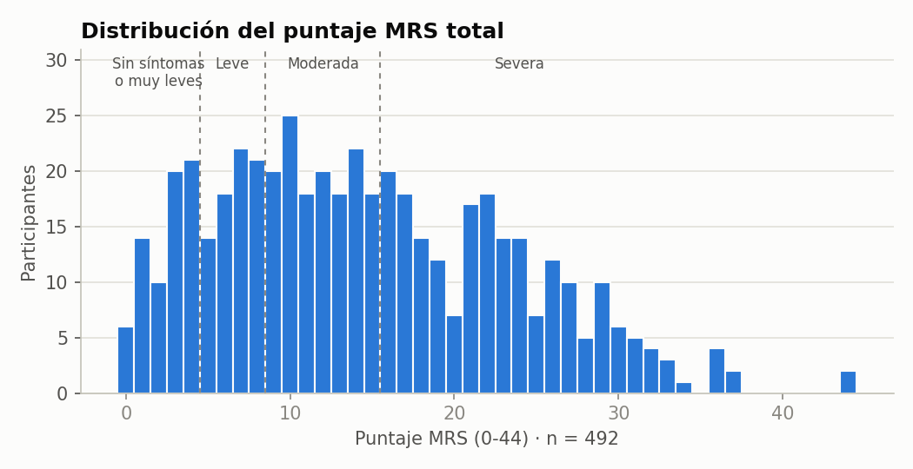
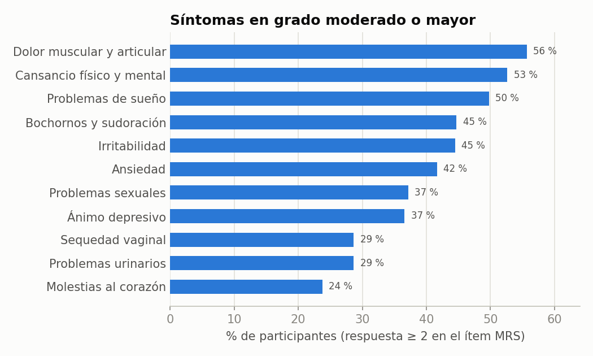
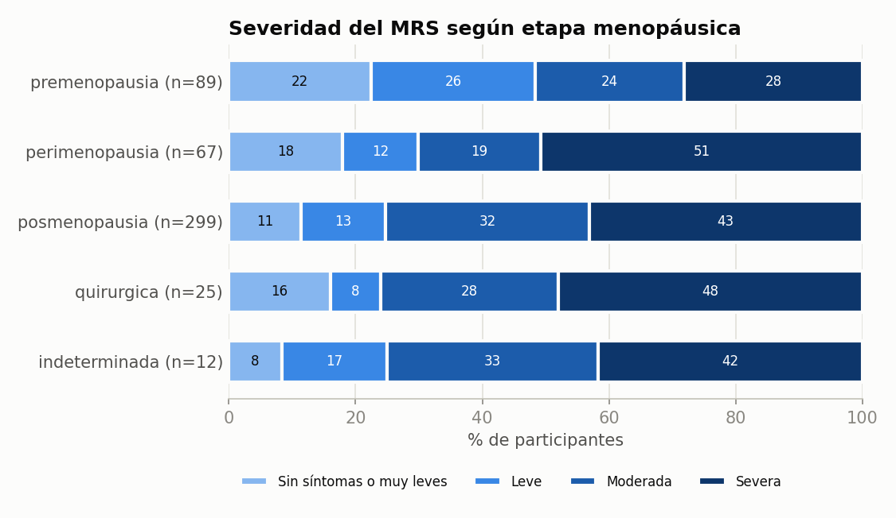
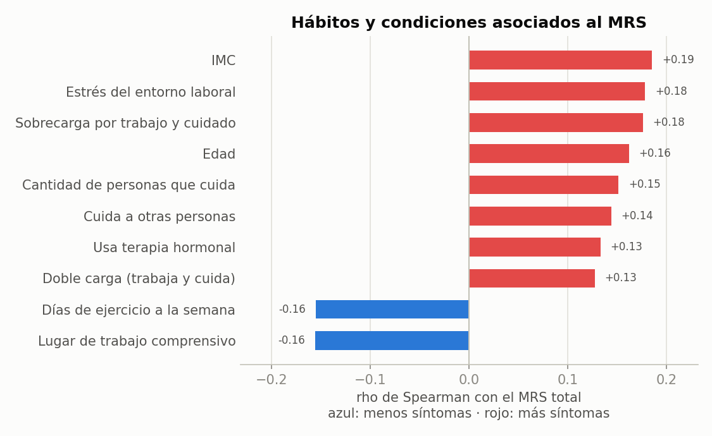
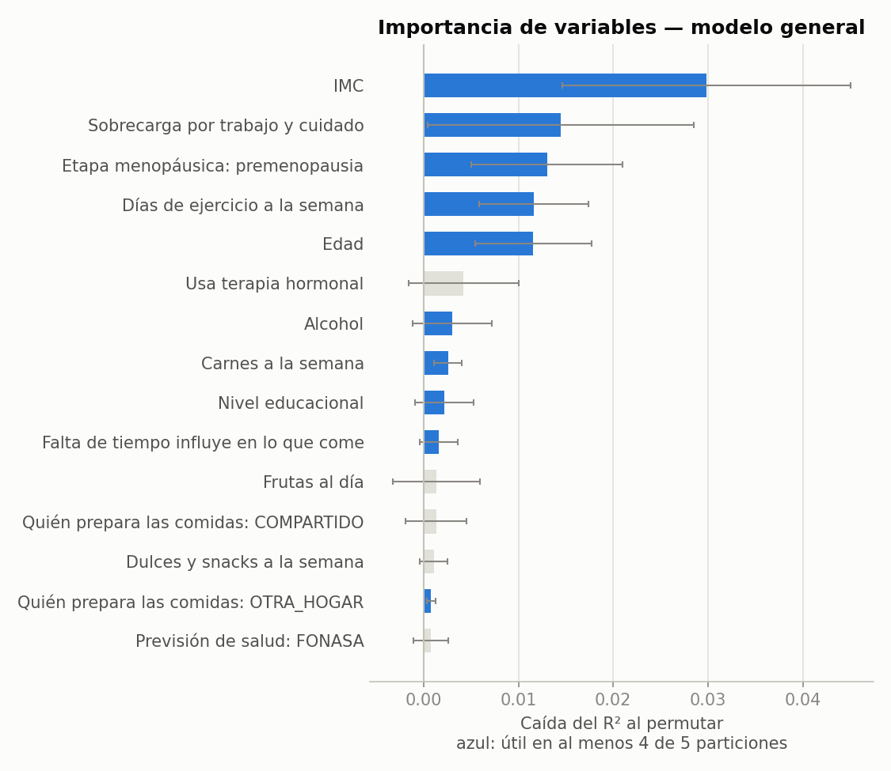
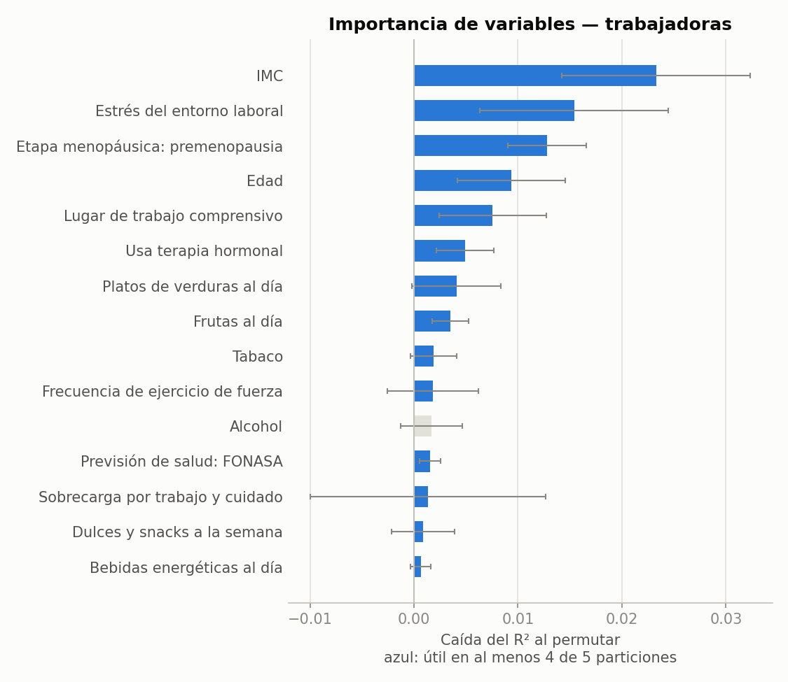

# Análisis exploratorio de datos (Fase 33)

Generado por `analisis/exploratorio.py` el 2026-10-11 a partir de
`datos/limpio/dataset_menopausia_limpio.csv` (Fase 32). Corresponde a OB2, Actividad 1
del documento del seminario.

- Participantes: **495**; con MRS completo: **492**.
- Encuestas aplicadas por personal de salud (MEDICO o API): 259.
- Trabajan actualmente y respondieron la sección Trabajo: 305 (quedan fuera del modelo de trabajadoras los participante_id 179, 300: "¿trabaja?" venía vacío, se imputó "sí" en la limpieza y no respondieron la sección).
- Frecuencias completas de todas las variables: [`resultados/frecuencias.md`](resultados/frecuencias.md).

## 1. Variables continuas

| Variable | n | Media ± DE | Mediana [Q1-Q3] | Mín-Máx |
|---|---|---|---|---|
| Edad | 495 | 50.6 ± 5.8 | 51.0 [47.0-55.0] | 34.0-64.0 |
| IMC | 495 | 29.2 ± 4.9 | 29.0 [25.8-32.1] | 17.5-46.4 |
| Talla (cm) | 495 | 156.4 ± 6.3 | 156.0 [152.0-161.0] | 140.0-175.0 |
| Peso (kg) | 495 | 71.5 ± 13.0 | 71.0 [61.8-79.0] | 41.5-127.9 |
| Cintura (cm) | 495 | 92.3 ± 12.1 | 92.5 [84.8-98.7] | 53.0-132.0 |
| Horas sentada al día | 495 | 7.1 ± 2.5 | 7.0 [5.0-9.0] | 1.0-15.0 |
| MRS total | 492 | 14.4 ± 8.8 | 13.0 [7.0-21.0] | 0.0-44.0 |
| MRS somático | 492 | 5.6 ± 3.7 | 5.0 [3.0-8.0] | 0.0-16.0 |
| MRS psicológico | 492 | 5.7 ± 4.3 | 5.0 [2.0-9.0] | 0.0-16.0 |
| MRS urogenital | 492 | 3.1 ± 3.0 | 2.0 [1.0-5.0] | 0.0-12.0 |

## 2. Perfil sintomático

| Síntoma (ítem MRS) | % moderado o mayor | Media (0-4) |
|---|---|---|
| Dolor muscular y articular | 55.7 | 1.75 |
| Cansancio físico y mental | 52.6 | 1.64 |
| Problemas de sueño | 49.8 | 1.58 |
| Bochornos y sudoración | 44.7 | 1.45 |
| Irritabilidad | 44.5 | 1.45 |
| Ansiedad | 41.7 | 1.36 |
| Problemas sexuales | 37.2 | 1.21 |
| Ánimo depresivo | 36.6 | 1.22 |
| Problemas urinarios | 28.7 | 0.97 |
| Sequedad vaginal | 28.7 | 0.97 |
| Molestias al corazón | 23.8 | 0.85 |

### Severidad según etapa y edad

| Etapa menopáusica | n | MRS medio | Sin síntomas o muy leves | Leve | Moderada | Severa |
|---|---|---|---|---|---|---|
| premenopausia | 89 | 11.2 | 22 % | 26 % | 24 % | 28 % |
| perimenopausia | 67 | 15.0 | 18 % | 12 % | 19 % | 51 % |
| posmenopausia | 299 | 15.1 | 11 % | 13 % | 32 % | 43 % |
| quirurgica | 25 | 15.5 | 16 % | 8 % | 28 % | 48 % |
| indeterminada | 12 | 17.2 | 8 % | 17 % | 33 % | 42 % |

| Tramo de edad | n | MRS medio | Sin síntomas o muy leves | Leve | Moderada | Severa |
|---|---|---|---|---|---|---|
| <40 | 13 | 12.7 | 15 % | 8 % | 46 % | 31 % |
| 40-44 | 57 | 11.5 | 21 % | 23 % | 30 % | 26 % |
| 45-49 | 140 | 14.6 | 16 % | 18 % | 21 % | 45 % |
| 50-54 | 151 | 13.5 | 16 % | 15 % | 32 % | 37 % |
| 55-59 | 98 | 16.5 | 9 % | 10 % | 32 % | 49 % |
| 60-65 | 33 | 17.4 | 6 % | 12 % | 24 % | 58 % |

| Trabaja actualmente | n | MRS medio | Sin síntomas o muy leves | Leve | Moderada | Severa |
|---|---|---|---|---|---|---|
| False | 185 | 13.7 | 16 % | 15 % | 30 % | 39 % |
| True | 307 | 14.9 | 14 % | 15 % | 28 % | 43 % |

## 3. Relación de cada variable con el MRS total

Spearman para variables ordinales, continuas y binarias (rho > 0: más síntomas); Kruskal-Wallis
para categóricas de más de dos valores (ε² = tamaño de efecto). Los valores p se ajustan por
comparaciones múltiples (Benjamini-Hochberg) sobre las 53 pruebas. Las variables de
rol **impacto** son consecuencias de los síntomas: se muestran para describir su efecto en la
vida laboral y de pareja, no como causas.

**22 asociaciones significativas** (p ajustado < 0,05):

| Variable | Rol | n | Prueba | Efecto | p | p ajustado (FDR) |
|---|---|---|---|---|---|---|
| Rendimiento laboral afectado | impacto | 305 | Spearman | rho = +0.53 | < 0,001 | < 0,001 |
| Usa antidepresivos o medicamentos para dormir | impacto | 492 | Spearman | rho = +0.35 | < 0,001 | < 0,001 |
| Bienestar en el trabajo afectado | impacto | 305 | Spearman | rho = +0.43 | < 0,001 | < 0,001 |
| Cambio en la relación de pareja | impacto | 322 | Spearman | rho = +0.41 | < 0,001 | < 0,001 |
| Ausencias o atrasos por síntomas | impacto | 305 | Spearman | rho = +0.38 | < 0,001 | < 0,001 |
| Ha consultado por síntomas | otra | 357 | Kruskal-Wallis | ε² = +0.10 | < 0,001 | < 0,001 |
| Siente que toman en serio sus síntomas | otra | 492 | Spearman | rho = -0.20 | < 0,001 | < 0,001 |
| IMC | control | 492 | Spearman | rho = +0.19 | < 0,001 | < 0,001 |
| Distensión abdominal | otra | 492 | Spearman | rho = +0.18 | < 0,001 | < 0,001 |
| Sobrecarga por trabajo y cuidado | predictor | 492 | Spearman | rho = +0.18 | < 0,001 | < 0,001 |
| Edad | control | 492 | Spearman | rho = +0.16 | < 0,001 | 0.001 |
| Cintura (cm) | otra | 492 | Spearman | rho = +0.16 | < 0,001 | 0.002 |
| Días de ejercicio a la semana | predictor | 492 | Spearman | rho = -0.16 | < 0,001 | 0.002 |
| Cantidad de personas que cuida | predictor | 492 | Spearman | rho = +0.15 | < 0,001 | 0.003 |
| Cuida a otras personas | predictor | 492 | Spearman | rho = +0.14 | 0.001 | 0.005 |
| Estrés del entorno laboral | predictor | 305 | Spearman | rho = +0.18 | 0.002 | 0.006 |
| Qué tan informada se siente | otra | 357 | Spearman | rho = +0.16 | 0.002 | 0.007 |
| Etapa menopáusica | control | 492 | Kruskal-Wallis | ε² = +0.03 | 0.002 | 0.007 |
| Usa terapia hormonal | control | 492 | Spearman | rho = +0.13 | 0.003 | 0.009 |
| Doble carga (trabaja y cuida) | predictor | 492 | Spearman | rho = +0.13 | 0.005 | 0.012 |
| Lugar de trabajo comprensivo | predictor | 305 | Spearman | rho = -0.16 | 0.006 | 0.016 |
| Información del sistema suficiente | otra | 357 | Spearman | rho = +0.13 | 0.012 | 0.028 |

Sin asociación significativa: Medicamentos para la presión, Falta de tiempo influye en lo que come, Pueblo originario / afro, Tiene pareja, Medicamentos para la diabetes, Quién prepara las comidas, Frecuencia de ejercicio aeróbico, Frecuencia de ejercicio de bajo impacto, Bebidas energéticas al día, Trabaja actualmente, Frutas al día, Horas sentada al día, Frecuencia de ejercicio de fuerza, Alcohol, Frecuencia de evacuación intestinal, Panes al día, Vasos de agua al día, Dulces y snacks a la semana, Tiene actividad sexual, Jugos y gaseosas al día, Lácteos al día, Origen, Marihuana, Carnes a la semana, Previsión de salud, Platos de verduras al día, Nivel educacional, Comidas fuera del hogar, Pescado a la semana, Legumbres a la semana, Tabaco.

## 4. Valores atípicos (regla de Tukey, 1,5 × RIC)

Se informan y **no se eliminan**: los valores imposibles ya se trataron en la limpieza, así que
estos son extremos plausibles.

| Variable | n | Rango esperado | Atípicos | % | Valores |
|---|---|---|---|---|---|
| Edad | 495 | 35.0 a 67.0 | 2 | 0.4 | 34 |
| IMC | 495 | 16.4 a 41.6 | 9 | 1.8 | 41.6, 41.7, 41.8, 42.1, 42.5, 42.7, 44.3, 46.4 |
| Talla (cm) | 495 | 138.5 a 174.5 | 2 | 0.4 | 175 |
| Peso (kg) | 495 | 36.1 a 104.7 | 8 | 1.6 | 104.9, 106.5, 106.7, 109, 109.9, 110.5, 121.8, 127.9 |
| Cintura (cm) | 495 | 64.1 a 119.4 | 18 | 3.6 | 53, 56, 57.5, 61, 63.1, 119.6, 120, 121.1 |
| Horas sentada al día | 495 | -1.0 a 15.0 | 0 | 0.0 |  |
| MRS total | 492 | -14.0 a 42.0 | 2 | 0.4 | 44 |
| MRS somático | 492 | -4.5 a 15.5 | 3 | 0.6 | 16 |
| MRS psicológico | 492 | -8.5 a 19.5 | 0 | 0.0 |  |
| MRS urogenital | 492 | -5.0 a 11.0 | 3 | 0.6 | 12 |

## 5. Random Forest: importancia de las variables

Bosques de 500 árboles (hojas de al menos 5 casos, semilla 2026), validación cruzada de
5 particiones. La importancia es por **permutación** en cada partición de prueba
(20 repeticiones): cuánto empeora el modelo al desordenar la variable en datos que
no vio. También se informa la importancia por impureza, que tiende a favorecer variables
continuas con muchos valores.

**Criterio de selección.** Una variable entra a la selección final si cumple cualquiera de:

1. el bosque de regresión la encuentra útil (importancia positiva) en al menos 4 de las 5 particiones, o
2. tiene relación significativa con el MRS en el análisis bivariado (sección 3, p ajustado < 0,05).

Con relaciones débiles, una variable útil puede no aportar en alguna partición solo por qué
participantes cayeron en ella; combinar las dos fuentes evita perderla por azar. Al final se
quitan las redundantes (|rho| ≥ 0,8 entre sí).

Entradas: **predictores** (hábitos, actividad física, alimentación, sustancias, cuidado) y
**variables de control** (edad, etapa, IMC, terapia hormonal, educación, previsión, trabajo).
Las variables de impacto no entran.

### Modelo general (n = 492, 45 variables)

- Regresión sobre el MRS total: R2 = 0.06 ± 0.03, MAE = 7.02 ± 0.20.
- Clasificación severa (MRS ≥ 16) vs. no severa (42 % severas): AUC = 0.62 ± 0.06, exactitud_balanceada = 0.61 ± 0.04.

**Regresión (MRS total):**

| Variable | Importancia (perm.) | Positiva en | Impureza | Útil para el bosque |
|---|---|---|---|---|
| IMC | 0.0298 ± 0.0152 | 5/5 | 0.123 | sí |
| Sobrecarga por trabajo y cuidado | 0.0145 ± 0.0140 | 4/5 | 0.053 | sí |
| Etapa menopáusica: premenopausia | 0.0130 ± 0.0080 | 5/5 | 0.028 | sí |
| Días de ejercicio a la semana | 0.0116 ± 0.0058 | 5/5 | 0.042 | sí |
| Edad | 0.0116 ± 0.0061 | 5/5 | 0.089 | sí |
| Usa terapia hormonal | 0.0042 ± 0.0058 | 3/5 | 0.018 | no |
| Alcohol | 0.0030 ± 0.0042 | 4/5 | 0.031 | sí |
| Carnes a la semana | 0.0026 ± 0.0014 | 5/5 | 0.031 | sí |
| Nivel educacional | 0.0022 ± 0.0031 | 4/5 | 0.041 | sí |
| Falta de tiempo influye en lo que come | 0.0016 ± 0.0020 | 4/5 | 0.041 | sí |
| Frutas al día | 0.0013 ± 0.0046 | 3/5 | 0.025 | no |
| Quién prepara las comidas: COMPARTIDO | 0.0013 ± 0.0032 | 3/5 | 0.014 | no |
| Dulces y snacks a la semana | 0.0011 ± 0.0015 | 3/5 | 0.030 | no |
| Quién prepara las comidas: OTRA_HOGAR | 0.0008 ± 0.0005 | 4/5 | 0.002 | sí |
| Previsión de salud: FONASA | 0.0008 ± 0.0018 | 3/5 | 0.012 | no |

**Clasificación (severa / no severa):**

| Variable | Importancia (perm.) | Positiva en | Impureza | Útil para el bosque |
|---|---|---|---|---|
| Sobrecarga por trabajo y cuidado | 0.0207 ± 0.0179 | 4/5 | 0.049 | sí |
| Frutas al día | 0.0185 ± 0.0120 | 5/5 | 0.036 | sí |
| Edad | 0.0165 ± 0.0092 | 5/5 | 0.087 | sí |
| Alcohol | 0.0111 ± 0.0083 | 5/5 | 0.037 | sí |
| Días de ejercicio a la semana | 0.0091 ± 0.0144 | 4/5 | 0.038 | sí |
| Etapa menopáusica: premenopausia | 0.0087 ± 0.0069 | 4/5 | 0.020 | sí |
| Frecuencia de ejercicio aeróbico | 0.0078 ± 0.0033 | 5/5 | 0.026 | sí |
| Nivel educacional | 0.0073 ± 0.0072 | 4/5 | 0.045 | sí |
| Dulces y snacks a la semana | 0.0070 ± 0.0070 | 4/5 | 0.038 | sí |
| IMC | 0.0067 ± 0.0092 | 3/5 | 0.102 | no |
| Quién prepara las comidas: YO_MAYORIA | 0.0057 ± 0.0071 | 3/5 | 0.021 | no |
| Jugos y gaseosas al día | 0.0054 ± 0.0081 | 4/5 | 0.033 | sí |
| Carnes a la semana | 0.0043 ± 0.0048 | 3/5 | 0.035 | no |
| Quién prepara las comidas: COMPARTIDO | 0.0043 ± 0.0059 | 3/5 | 0.012 | no |
| Previsión de salud: FONASA | 0.0028 ± 0.0022 | 5/5 | 0.012 | sí |

Pares redundantes (|rho| ≥ 0,8) entre las seleccionadas; se descarta la menos importante:

| Variable A | Variable B | |rho| | Descartada |
|---|---|---|---|
| Sobrecarga por trabajo y cuidado | Cuida a otras personas | 0.95 | Cuida a otras personas |
| Sobrecarga por trabajo y cuidado | Cantidad de personas que cuida | 0.93 | Cantidad de personas que cuida |
| Cuida a otras personas | Cantidad de personas que cuida | 0.96 | Cantidad de personas que cuida |

**Selección final (17 variables):**

| Variable | Seleccionada por |
|---|---|
| IMC | Random Forest + bivariado |
| Sobrecarga por trabajo y cuidado | Random Forest + bivariado |
| Etapa menopáusica: premenopausia | Random Forest + bivariado |
| Días de ejercicio a la semana | Random Forest + bivariado |
| Edad | Random Forest + bivariado |
| Usa terapia hormonal | bivariado |
| Alcohol | Random Forest |
| Carnes a la semana | Random Forest |
| Nivel educacional | Random Forest |
| Falta de tiempo influye en lo que come | Random Forest |
| Quién prepara las comidas: OTRA_HOGAR | Random Forest |
| Jugos y gaseosas al día | Random Forest |
| Etapa menopáusica: perimenopausia | bivariado |
| Etapa menopáusica: indeterminada | bivariado |
| Etapa menopáusica: quirurgica | bivariado |
| Doble carga (trabaja y cuida) | bivariado |
| Etapa menopáusica: posmenopausia | bivariado |

### Modelo de trabajadoras (n = 305, 46 variables)

- Regresión sobre el MRS total: R2 = 0.03 ± 0.05, MAE = 7.40 ± 0.59.
- Clasificación severa (MRS ≥ 16) vs. no severa (43 % severas): AUC = 0.57 ± 0.08, exactitud_balanceada = 0.55 ± 0.06.

**Regresión (MRS total):**

| Variable | Importancia (perm.) | Positiva en | Impureza | Útil para el bosque |
|---|---|---|---|---|
| IMC | 0.0233 ± 0.0091 | 5/5 | 0.124 | sí |
| Estrés del entorno laboral | 0.0154 ± 0.0090 | 4/5 | 0.054 | sí |
| Etapa menopáusica: premenopausia | 0.0128 ± 0.0038 | 5/5 | 0.023 | sí |
| Edad | 0.0093 ± 0.0052 | 5/5 | 0.083 | sí |
| Lugar de trabajo comprensivo | 0.0076 ± 0.0052 | 4/5 | 0.044 | sí |
| Usa terapia hormonal | 0.0049 ± 0.0028 | 5/5 | 0.013 | sí |
| Platos de verduras al día | 0.0041 ± 0.0043 | 4/5 | 0.022 | sí |
| Frutas al día | 0.0035 ± 0.0017 | 5/5 | 0.021 | sí |
| Tabaco | 0.0019 ± 0.0022 | 4/5 | 0.012 | sí |
| Frecuencia de ejercicio de fuerza | 0.0018 ± 0.0044 | 4/5 | 0.013 | sí |
| Alcohol | 0.0017 ± 0.0030 | 3/5 | 0.030 | no |
| Previsión de salud: FONASA | 0.0016 ± 0.0010 | 5/5 | 0.011 | sí |
| Sobrecarga por trabajo y cuidado | 0.0014 ± 0.0113 | 4/5 | 0.032 | sí |
| Dulces y snacks a la semana | 0.0009 ± 0.0030 | 4/5 | 0.028 | sí |
| Bebidas energéticas al día | 0.0006 ± 0.0010 | 4/5 | 0.004 | sí |

**Clasificación (severa / no severa):**

| Variable | Importancia (perm.) | Positiva en | Impureza | Útil para el bosque |
|---|---|---|---|---|
| Estrés del entorno laboral | 0.0292 ± 0.0302 | 3/5 | 0.050 | no |
| Edad | 0.0147 ± 0.0075 | 5/5 | 0.076 | sí |
| Etapa menopáusica: premenopausia | 0.0145 ± 0.0078 | 5/5 | 0.017 | sí |
| Días de ejercicio a la semana | 0.0124 ± 0.0296 | 4/5 | 0.036 | sí |
| Frutas al día | 0.0114 ± 0.0098 | 4/5 | 0.033 | sí |
| IMC | 0.0088 ± 0.0491 | 4/5 | 0.101 | sí |
| Platos de verduras al día | 0.0078 ± 0.0124 | 3/5 | 0.023 | no |
| Jugos y gaseosas al día | 0.0072 ± 0.0092 | 3/5 | 0.032 | no |
| Cantidad de personas que cuida | 0.0068 ± 0.0087 | 4/5 | 0.024 | sí |
| Sobrecarga por trabajo y cuidado | 0.0064 ± 0.0064 | 4/5 | 0.024 | sí |
| Doble carga (trabaja y cuida) | 0.0061 ± 0.0030 | 5/5 | 0.011 | sí |
| Dulces y snacks a la semana | 0.0059 ± 0.0101 | 4/5 | 0.035 | sí |
| Cuida a otras personas | 0.0057 ± 0.0036 | 5/5 | 0.010 | sí |
| Previsión de salud: ISAPRE | 0.0057 ± 0.0061 | 4/5 | 0.010 | sí |
| Alcohol | 0.0052 ± 0.0162 | 4/5 | 0.037 | sí |

Pares redundantes (|rho| ≥ 0,8) entre las seleccionadas; se descarta la menos importante:

| Variable A | Variable B | |rho| | Descartada |
|---|---|---|---|
| Sobrecarga por trabajo y cuidado | Doble carga (trabaja y cuida) | 0.96 | Doble carga (trabaja y cuida) |
| Sobrecarga por trabajo y cuidado | Cuida a otras personas | 0.96 | Cuida a otras personas |
| Sobrecarga por trabajo y cuidado | Cantidad de personas que cuida | 0.94 | Cantidad de personas que cuida |
| Doble carga (trabaja y cuida) | Cuida a otras personas | 1.00 | Cuida a otras personas |
| Doble carga (trabaja y cuida) | Cantidad de personas que cuida | 0.96 | Cantidad de personas que cuida |
| Cuida a otras personas | Cantidad de personas que cuida | 0.96 | Cantidad de personas que cuida |

**Selección final (20 variables):**

| Variable | Seleccionada por |
|---|---|
| IMC | Random Forest + bivariado |
| Estrés del entorno laboral | Random Forest + bivariado |
| Etapa menopáusica: premenopausia | Random Forest + bivariado |
| Edad | Random Forest + bivariado |
| Lugar de trabajo comprensivo | Random Forest + bivariado |
| Usa terapia hormonal | Random Forest + bivariado |
| Platos de verduras al día | Random Forest |
| Frutas al día | Random Forest |
| Tabaco | Random Forest |
| Frecuencia de ejercicio de fuerza | Random Forest |
| Previsión de salud: FONASA | Random Forest |
| Sobrecarga por trabajo y cuidado | Random Forest + bivariado |
| Dulces y snacks a la semana | Random Forest |
| Bebidas energéticas al día | Random Forest |
| Etapa menopáusica: quirurgica | Random Forest + bivariado |
| Previsión de salud: NS | Random Forest |
| Etapa menopáusica: indeterminada | bivariado |
| Días de ejercicio a la semana | bivariado |
| Etapa menopáusica: perimenopausia | bivariado |
| Etapa menopáusica: posmenopausia | bivariado |

La lista completa está en `analisis/resultados/importancia_variables.csv` y es la entrada de
la Fase 34 (codificación, escalado y PCA).

## 6. Subgrupo de personal de salud

Laboratorio, presión y tamizaje solo existen en las 259 encuestas aplicadas por
personal de salud. Se analizan aparte (FDR propio) y no entran al Random Forest principal.

| Variable | n | Media ± DE | Mediana [Q1-Q3] |
|---|---|---|---|
| Presión sistólica | 259 | 120.9 ± 10.9 | 120.0 [114.0-127.0] |
| Presión diastólica | 259 | 75.4 ± 8.5 | 75.0 [70.0-80.0] |
| Colesterol total | 259 | 201.8 ± 33.0 | 200.0 [184.0-221.0] |
| Colesterol HDL | 259 | 53.5 ± 9.9 | 54.0 [47.0-60.0] |
| Triglicéridos | 259 | 157.3 ± 71.6 | 146.0 [112.5-177.5] |
| Glicemia | 259 | 99.5 ± 19.1 | 95.0 [90.0-101.0] |
| Pérdida de talla (cm) | 254 | 1.0 ± 1.1 | 1.0 [0.0-1.0] |

| Variable | Rol | n | Prueba | Efecto | p | p ajustado (FDR) |
|---|---|---|---|---|---|---|
| Glicemia | subgrupo profesional | 259 | Spearman | rho = +0.16 | 0.008 | 0.063 |
| Presión diastólica | subgrupo profesional | 259 | Spearman | rho = +0.14 | 0.020 | 0.072 |
| Triglicéridos | subgrupo profesional | 259 | Spearman | rho = +0.12 | 0.045 | 0.072 |
| Colesterol total | subgrupo profesional | 259 | Spearman | rho = +0.13 | 0.034 | 0.072 |
| Riesgo cardiovascular | subgrupo profesional | 259 | Kruskal-Wallis | ε² = +0.02 | 0.036 | 0.072 |
| Presión sistólica | subgrupo profesional | 259 | Spearman | rho = +0.06 | 0.327 | 0.436 |
| Colesterol HDL | subgrupo profesional | 259 | Spearman | rho = +0.05 | 0.431 | 0.492 |
| Pérdida de talla (cm) | subgrupo profesional | 254 | Spearman | rho = +0.04 | 0.492 | 0.492 |

## 7. Limitaciones

- Diseño transversal (una sola ronda): las asociaciones no prueban causalidad.
- Los cortes de severidad del MRS y la definición de etapa están pendientes de validar con la profesora.
- La importancia por permutación se reparte entre variables correlacionadas (p. ej. tipos de
  ejercicio entre sí); por eso se revisan también las asociaciones bivariadas.
