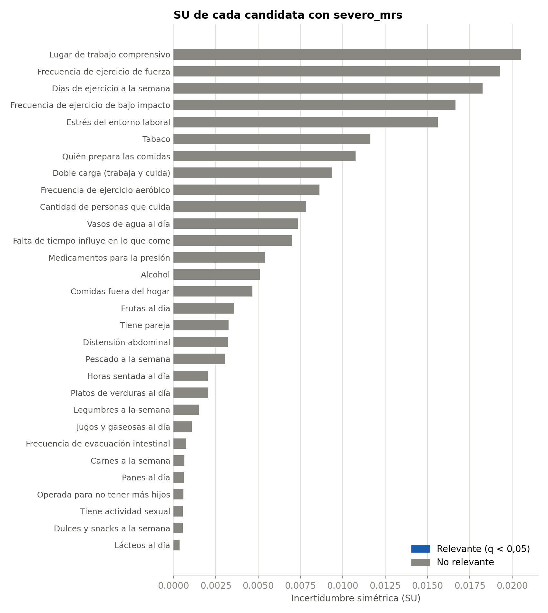
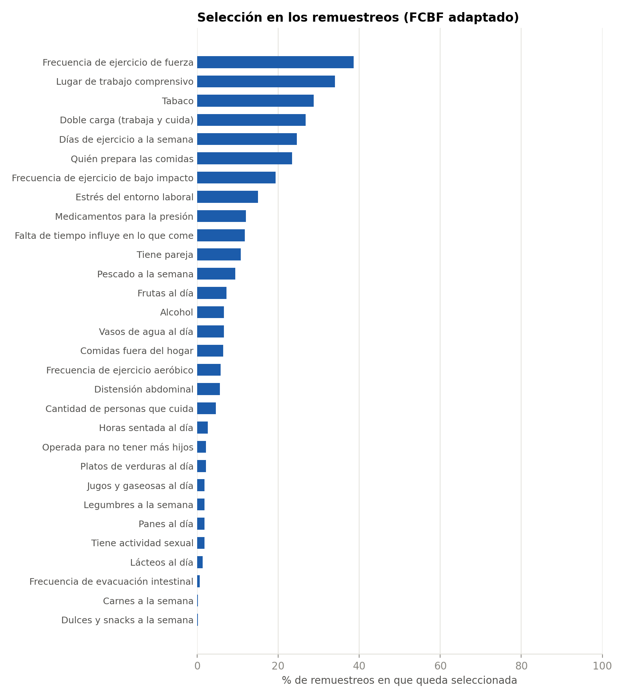

# Fase 35B. Selección entrópica de variables

*Generado por `analisis/seleccionar_fase35b.py` el 02-11-2026. Protocolo: `analisis/protocolo_fase35b.md`. Este informe no interpreta causalidad.*

## 1. Resultado

De las 30 candidatas, **0 quedan seleccionadas** con el FCBF adaptado por cobertura: ninguna.

Pasan además a la Fase 36, sin filtro, las 4 variables de control: Edad, IMC, Medicamentos para la diabetes, Trabaja actualmente. Previsión de salud queda pendiente de consultar a la profesora y no pasa a la Fase 36.

## 2. Las tres variantes

| Variante | Personas | Regla de redundancia | Función | Seleccionadas |
|---|---|---|---|---|
| FCBF adaptado por cobertura | 529 y 287, en dos etapas | Con q < 0,05 | **Selección definitiva** | 0 |
| FCBF estándar por cobertura | 529 y 287, en dos etapas | Sin exigir q < 0,05 | Comparación | 0 |
| FCBF completo con n = 287 (S5) | 287 en todo, con una sola lista | Con q < 0,05 | Sensibilidad | 0 |

Las dos primeras comparten el filtro de relevancia. Diferencias entre ambas: entran con la estándar ninguna; salen con la estándar ninguna.

## 3. Relevancia de las candidatas

5000 permutaciones de la severidad, semilla 42 y corrección de Benjamini-Hochberg sobre 30 pruebas. Relevante = q < 0,05.

| Variable | Grupo | n | SU | p | q | Relevante |
|---|---|---|---|---|---|---|
| Lugar de trabajo comprensivo | laboral | 287 | 0,0205 | 0,014 | 0,085 | no |
| Frecuencia de ejercicio de fuerza | no laboral | 529 | 0,0193 | 0,011 | 0,085 | no |
| Días de ejercicio a la semana | no laboral | 529 | 0,0183 | 0,003 | 0,051 | no |
| Frecuencia de ejercicio de bajo impacto | no laboral | 529 | 0,0167 | 0,002 | 0,051 | no |
| Estrés del entorno laboral | laboral | 287 | 0,0156 | 0,052 | 0,209 | no |
| Tabaco | no laboral | 529 | 0,0116 | 0,063 | 0,209 | no |
| Quién prepara las comidas | no laboral | 529 | 0,0107 | 0,063 | 0,209 | no |
| Doble carga (trabaja y cuida) | no laboral | 529 | 0,0094 | 0,012 | 0,085 | no |
| Frecuencia de ejercicio aeróbico | no laboral | 529 | 0,0086 | 0,166 | 0,357 | no |
| Cantidad de personas que cuida | no laboral | 529 | 0,0078 | 0,052 | 0,209 | no |
| Vasos de agua al día | no laboral | 529 | 0,0073 | 0,089 | 0,242 | no |
| Falta de tiempo influye en lo que come | no laboral | 529 | 0,0070 | 0,111 | 0,276 | no |
| Medicamentos para la presión | no laboral | 529 | 0,0054 | 0,077 | 0,230 | no |
| Alcohol | no laboral | 529 | 0,0051 | 0,312 | 0,550 | no |
| Comidas fuera del hogar | no laboral | 529 | 0,0047 | 0,209 | 0,418 | no |
| Frutas al día | no laboral | 529 | 0,0036 | 0,399 | 0,630 | no |
| Tiene pareja | no laboral | 529 | 0,0032 | 0,142 | 0,327 | no |
| Distensión abdominal | no laboral | 529 | 0,0032 | 0,378 | 0,630 | no |
| Pescado a la semana | no laboral | 529 | 0,0030 | 0,272 | 0,510 | no |
| Horas sentada al día | no laboral | 529 | 0,0020 | 0,523 | 0,746 | no |
| Platos de verduras al día | no laboral | 529 | 0,0020 | 0,704 | 0,881 | no |
| Legumbres a la semana | no laboral | 529 | 0,0015 | 0,547 | 0,746 | no |
| Jugos y gaseosas al día | no laboral | 529 | 0,0011 | 0,787 | 0,945 | no |
| Frecuencia de evacuación intestinal | no laboral | 529 | 0,0008 | 0,866 | 0,963 | no |
| Carnes a la semana | no laboral | 529 | 0,0006 | 0,955 | 0,963 | no |
| Panes al día | no laboral | 529 | 0,0006 | 0,912 | 0,963 | no |
| Operada para no tener más hijos | no laboral | 529 | 0,0006 | 0,582 | 0,759 | no |
| Tiene actividad sexual | no laboral | 529 | 0,0006 | 0,534 | 0,746 | no |
| Dulces y snacks a la semana | no laboral | 529 | 0,0005 | 0,962 | 0,963 | no |
| Lácteos al día | no laboral | 529 | 0,0004 | 0,963 | 0,963 | no |

**SU descriptivas (no deciden).** Variables de control y pendientes:

| Variable | Grupo | n | SU | p | Nota |
|---|---|---|---|---|---|
| Edad | control | 529 | 0,0010 | 0,940 | descriptiva; no decide |
| IMC | control | 529 | 0,0176 | 0,007 | descriptiva; no decide |
| IMC | control | 267 | 0,0284 | 0,007 | descriptiva; solo IMC observado |
| Medicamentos para la diabetes | control | 529 | 0,0101 | 0,025 | descriptiva; no decide |
| Trabaja actualmente | control | 529 | 0,0083 | 0,017 | descriptiva; no decide |
| Previsión de salud | pendiente | 529 | 0,0082 | 0,296 | descriptiva; no decide |

## 4. Decisiones del FCBF adaptado por cobertura

| Variable | Etapa | Decisión | Eliminada por | SU con severidad | SU del par | q del par |
|---|---|---|---|---|---|---|
| Alcohol | - | no relevante | - | 0,0051 | - | - |
| Cantidad de personas que cuida | - | no relevante | - | 0,0078 | - | - |
| Carnes a la semana | - | no relevante | - | 0,0006 | - | - |
| Días de ejercicio a la semana | - | no relevante | - | 0,0183 | - | - |
| Distensión abdominal | - | no relevante | - | 0,0032 | - | - |
| Doble carga (trabaja y cuida) | - | no relevante | - | 0,0094 | - | - |
| Estrés del entorno laboral | - | no relevante | - | 0,0156 | - | - |
| Frecuencia de evacuación intestinal | - | no relevante | - | 0,0008 | - | - |
| Falta de tiempo influye en lo que come | - | no relevante | - | 0,0070 | - | - |
| Frecuencia de ejercicio aeróbico | - | no relevante | - | 0,0086 | - | - |
| Frecuencia de ejercicio de bajo impacto | - | no relevante | - | 0,0167 | - | - |
| Comidas fuera del hogar | - | no relevante | - | 0,0047 | - | - |
| Frecuencia de ejercicio de fuerza | - | no relevante | - | 0,0193 | - | - |
| Frutas al día | - | no relevante | - | 0,0036 | - | - |
| Dulces y snacks a la semana | - | no relevante | - | 0,0005 | - | - |
| Horas sentada al día | - | no relevante | - | 0,0020 | - | - |
| Jugos y gaseosas al día | - | no relevante | - | 0,0011 | - | - |
| Lácteos al día | - | no relevante | - | 0,0004 | - | - |
| Legumbres a la semana | - | no relevante | - | 0,0015 | - | - |
| Lugar de trabajo comprensivo | - | no relevante | - | 0,0205 | - | - |
| Operada para no tener más hijos | - | no relevante | - | 0,0006 | - | - |
| Panes al día | - | no relevante | - | 0,0006 | - | - |
| Pescado a la semana | - | no relevante | - | 0,0030 | - | - |
| Platos de verduras al día | - | no relevante | - | 0,0020 | - | - |
| Quién prepara las comidas | - | no relevante | - | 0,0107 | - | - |
| Tabaco | - | no relevante | - | 0,0116 | - | - |
| Tiene actividad sexual | - | no relevante | - | 0,0006 | - | - |
| Tiene pareja | - | no relevante | - | 0,0032 | - | - |
| Medicamentos para la presión | - | no relevante | - | 0,0054 | - | - |
| Vasos de agua al día | - | no relevante | - | 0,0073 | - | - |

**Pares laboral-no laboral que la regla de cobertura no permite eliminar.** Parecen redundantes entre las trabajadoras, pero la variable laboral no tiene datos para las demás participantes.

No hay pares en esta situación.

## 5. Estabilidad (complementaria)

500 remuestreos bootstrap estratificados por `severo_mrs`, con 5000 permutaciones en cada uno. No modifica la selección. Las permutaciones tratan las filas repetidas como distintas, lo que puede favorecer la significancia, por lo que estos valores son descriptivos.

| Variante | Índice de Nogueira | IC 95 % | Jaccard promedio | Tamaño medio | Mín. | Máx. |
|---|---|---|---|---|---|---|
| FCBF adaptado por cobertura (selección definitiva) | 0,121 | 0,109 a 0,132 | 0,133 | 3,1 | 0 | 7 |
| FCBF estándar por cobertura (comparación) | 0,126 | 0,114 a 0,139 | 0,135 | 2,3 | 0 | 6 |

| Variable | % seleccionada | % no relevante | % redundante | Eliminadora más frecuente | Banda |
|---|---|---|---|---|---|
| Frecuencia de ejercicio de fuerza | 38,6 | 29,2 | 32,2 | Días de ejercicio a la semana | < 50 % |
| Lugar de trabajo comprensivo | 34,0 | 34,4 | 31,6 | Tabaco | < 50 % |
| Tabaco | 28,8 | 52,2 | 19,0 | Frecuencia de ejercicio de fuerza | < 50 % |
| Doble carga (trabaja y cuida) | 26,8 | 53,4 | 19,8 | Tabaco | < 50 % |
| Días de ejercicio a la semana | 24,6 | 17,8 | 57,6 | Frecuencia de ejercicio de fuerza | < 50 % |
| Quién prepara las comidas | 23,4 | 48,4 | 28,2 | Frecuencia de ejercicio de fuerza | < 50 % |
| Frecuencia de ejercicio de bajo impacto | 19,4 | 20,2 | 60,4 | Frecuencia de ejercicio de fuerza | < 50 % |
| Estrés del entorno laboral | 15,0 | 48,4 | 36,6 | Frecuencia de ejercicio de fuerza | < 50 % |
| Medicamentos para la presión | 12,0 | 74,8 | 13,2 | Frecuencia de ejercicio de fuerza | < 50 % |
| Falta de tiempo influye en lo que come | 11,8 | 65,4 | 22,8 | Doble carga (trabaja y cuida) | < 50 % |
| Tiene pareja | 10,8 | 82,4 | 6,8 | Frecuencia de ejercicio de fuerza | < 50 % |
| Pescado a la semana | 9,4 | 83,0 | 7,6 | Frecuencia de ejercicio de fuerza | < 50 % |
| Frutas al día | 7,2 | 86,2 | 6,6 | Quién prepara las comidas | < 50 % |
| Alcohol | 6,6 | 77,4 | 16,0 | Días de ejercicio a la semana | < 50 % |
| Vasos de agua al día | 6,6 | 57,0 | 36,4 | Días de ejercicio a la semana | < 50 % |
| Comidas fuera del hogar | 6,4 | 80,0 | 13,6 | Frecuencia de ejercicio de bajo impacto | < 50 % |
| Frecuencia de ejercicio aeróbico | 5,8 | 65,0 | 29,2 | Frecuencia de ejercicio de fuerza | < 50 % |
| Distensión abdominal | 5,6 | 82,6 | 11,8 | Frecuencia de ejercicio de fuerza | < 50 % |
| Cantidad de personas que cuida | 4,6 | 54,0 | 41,4 | Frecuencia de ejercicio de fuerza | < 50 % |
| Horas sentada al día | 2,6 | 91,6 | 5,8 | Frecuencia de ejercicio de fuerza | < 50 % |
| Operada para no tener más hijos | 2,2 | 96,0 | 1,8 | Días de ejercicio a la semana | < 50 % |
| Platos de verduras al día | 2,2 | 92,8 | 5,0 | Frecuencia de ejercicio de fuerza | < 50 % |
| Jugos y gaseosas al día | 1,8 | 93,4 | 4,8 | Frecuencia de ejercicio de bajo impacto | < 50 % |
| Legumbres a la semana | 1,8 | 91,8 | 6,4 | Quién prepara las comidas | < 50 % |
| Panes al día | 1,8 | 96,6 | 1,6 | Días de ejercicio a la semana | < 50 % |
| Tiene actividad sexual | 1,8 | 96,6 | 1,6 | Quién prepara las comidas | < 50 % |
| Lácteos al día | 1,4 | 97,4 | 1,2 | Días de ejercicio a la semana | < 50 % |
| Frecuencia de evacuación intestinal | 0,6 | 97,0 | 2,4 | Frecuencia de ejercicio de bajo impacto | < 50 % |
| Carnes a la semana | 0,2 | 96,4 | 3,4 | Frecuencia de ejercicio de fuerza | < 50 % |
| Dulces y snacks a la semana | 0,2 | 98,6 | 1,2 | Frecuencia de ejercicio de fuerza | < 50 % |

## 6. Sensibilidad (complementaria)

Lista cerrada del protocolo, con la regla adaptada. No modifica la selección. El detalle con la regla estándar está en `resultados/usuaria/sensibilidad_fcbf.csv`.

| Escenario | Relevantes | Seleccionadas | Entran | Salen | Jaccard |
|---|---|---|---|---|---|
| S1 horas en terciles | 2 | 1 | Días de ejercicio a la semana | - | 0,00 |
| S1 horas en valores originales | 0 | 0 | - | - | 1,00 |
| S2 severidad en 4 clases | 2 | 2 | Días de ejercicio a la semana, Lugar de trabajo comprensivo | - | 0,00 |
| S3 laborales con las trabajadoras, incluidas las imputadas | 2 | 1 | Días de ejercicio a la semana | - | 0,00 |
| S4 lista única con "no aplica" como categoría | 3 | 2 | Días de ejercicio a la semana, Lugar de trabajo comprensivo | - | 0,00 |
| S5 FCBF completo con las respuestas laborales reales | 0 | 0 | - | - | 1,00 |

## 7. Comparación con los efectos del simulador (descriptiva)

Compara la selección con los efectos programados en la simulación. No es un descubrimiento sobre la población.

| Variable | Efecto programado | ¿Seleccionada? |
|---|---|---|
| Doble carga (trabaja y cuida) | aumenta | no |
| Estrés del entorno laboral | aumenta | no |
| Lugar de trabajo comprensivo | protege | no |
| Días de ejercicio a la semana | protege | no |
| Vasos de agua al día | protege | no |
| Tabaco | aumenta | no |
| Alcohol | aumenta | no |
| Operada para no tener más hijos | sin efecto | no |
| Medicamentos para la presión | sin efecto | no |
| Frecuencia de evacuación intestinal | sin efecto | no |
| Distensión abdominal | sin efecto | no |

## 8. Advertencias y limitaciones

- **Carácter sintético:** la selección refleja lo que generó el simulador, no evidencia sobre la población.
- **Circularidad:** seleccionar por severidad puede hacer que los clústeres difieran en severidad por esa misma selección. Esa diferencia no es una confirmación independiente.
- **Interpretación:** seleccionada no significa causal, y eliminada no significa irrelevante.
- **Adaptaciones propias:** la prueba de azar entre predictoras y la regla de cobertura se apartan del FCBF original.
- **Límite de la preespecificación:** ya se habían visto relaciones bivariadas con la severidad (34C y 34E), la SU de `prevision` y la SU del par laboral.
- **Poblaciones distintas:** la SU laboral describe a trabajadoras y la no laboral a todas, y la Etapa 2 tiene menos potencia.
- **Redundancia conservada:** puede quedar redundancia entre variables laborales y no laborales.
- **`doble_carga`:** es función exacta de `trabaja_actualmente` y `cantidad_personas_cuida`. Los filtros por pares no detectan esa dependencia conjunta.
- **`prevision`:** el diccionario de la 35A la sigue llamando "predictora". Está pendiente y no pasa a la Fase 36.
- **Fase 37:** se mantiene la comparación de la segmentación con y sin edad.
- **Límite de los valores p:** desde 23 variables relevantes, un par aislado no puede alcanzar q < 0,05, lo que hace eliminar menos. En esta ejecución hay 0 relevantes.
- **Duplicados en el bootstrap:** las permutaciones tratan las filas repetidas como distintas, lo que puede favorecer la significancia en los remuestreos. Por eso la estabilidad es descriptiva y no un valor inferencial.

## 9. Tiempo de ejecución

Tiempo real: 26,6 min con 11 procesos. Los tiempos estimados antes de ejecutar eran extrapolaciones de mediciones breves (cerca de 14 µs por SU).
