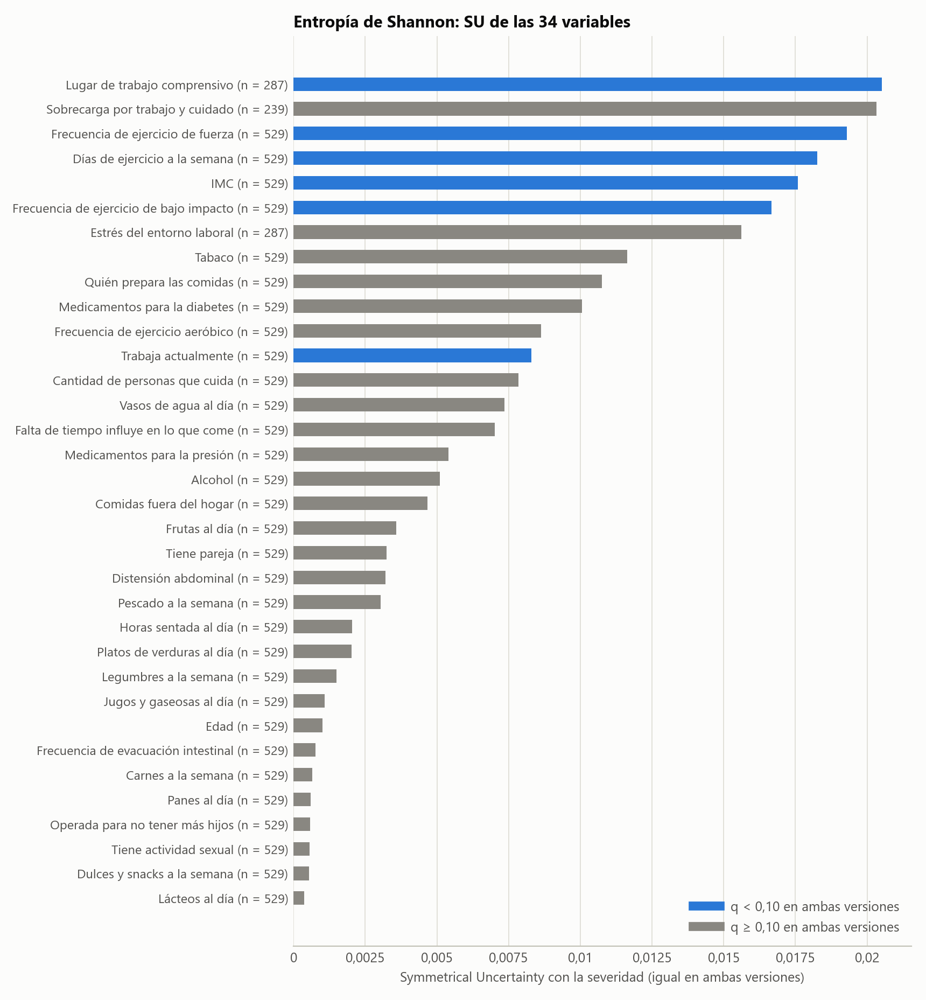
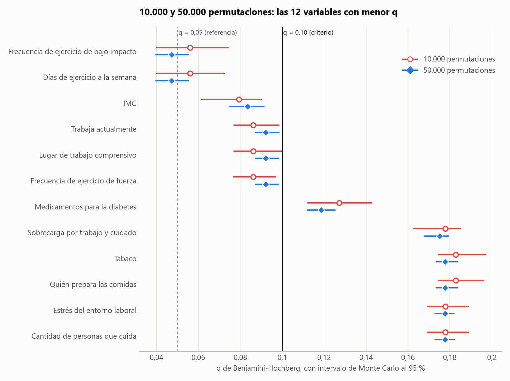
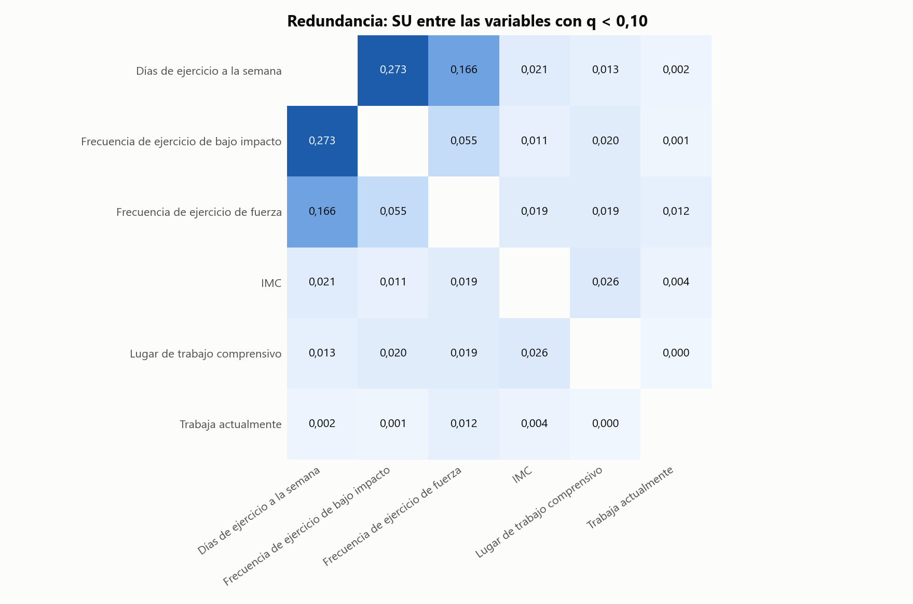
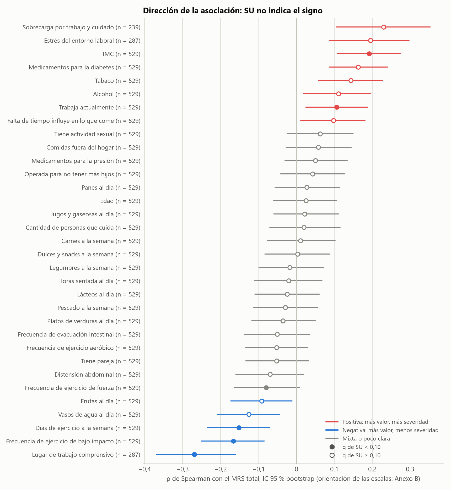
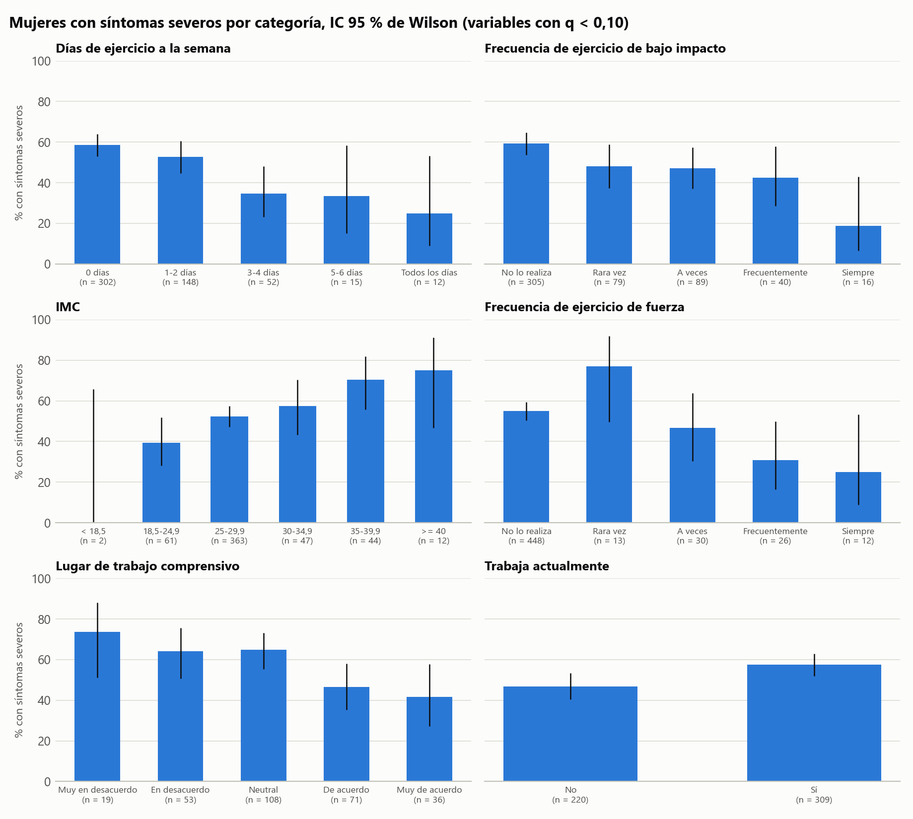

# Fase 35B. Análisis entrópico de asociación con la severidad de los síntomas

*Informe integrado de la revisión metodológica de la reunión del 03-11-2026. Generado por `analisis/informe_integrado_35b.py` el 03-11-2026 a partir de archivos guardados.*

> **Carácter del análisis.** Los resultados son exploratorios e informativos, sobre un conjunto de datos sintético. Describen lo que generó el simulador, no evidencia sobre la población, y **ninguna asociación se interpreta como causal**. Ninguna variable se elimina: las 34 quedan como conjunto inicial de la Fase 36.

## Resumen

Se evaluó la asociación de 34 variables con la severidad de los síntomas (`severo_mrs`, MRS ≥ 16) mediante la entropía de Shannon, la información mutua y la Symmetrical Uncertainty (SU), con pruebas de permutación y corrección de Benjamini-Hochberg. El análisis se hizo en dos versiones que solo difieren en el número de permutaciones: **A (10.000)** y **B (50.000)**. Con el criterio exploratorio q < 0,10, A identificó 6 variables y B identificó 6; son las mismas: `dias_ejercicio_semana`, `frecuencia_bajo_impacto`, `frecuencia_fuerza`, `imc`, `lugar_trabajo_comprensivo`, `trabaja_actualmente`. Ninguna variable cambió de clasificación de relevancia ni de clase descriptiva. Las diferencias entre versiones son compatibles con la precisión de Monte Carlo. Las asociaciones son débiles: la mayor SU es 0,0205.

## 1. Objetivo

Identificar variables asociadas con la severidad y describir la dirección de esa asociación, para distinguir posibles factores de riesgo y de protección. La fase no busca eliminar variables de forma automática. Esta revisión sigue las indicaciones de la profesora del 03-11-2026 y no reemplaza las versiones previas (sección 8).

## 2. Metodología

### 2.1 Variables

Se analizan 34 variables: las 30 candidatas actualizadas (sin `doble_carga` y con `sobrecarga_fisica_emocional`) y las cuatro antiguas variables de control (`edad`, `imc`, `usa_medicamentos_diabetes` y `trabaja_actualmente`). `prevision` queda excluida del modelado. El conjunto de datos es `datos/analitico/dataset_fase35.csv`, sin regenerar; la sobrecarga se incorpora en memoria desde el conjunto limpio.

### 2.2 Poblaciones

| Población | n | Variables | Definición |
|---|---|---|---|
| General | 529 | 31 | Participantes con MRS completo |
| Laboral | 287 | 2 | `lugar_trabajo_comprensivo` y `estres_entorno_laboral`: con valor en ambas preguntas |
| Cuidadoras | 239 | 1 | `sobrecarga_fisica_emocional`: cuidadoras con respuesta válida observada |

### 2.3 Entropía de Shannon, información mutua y SU

Con frecuencias observadas p, logaritmo en **base 2** (bits) y 0·log₂0 = 0, sin corrección de sesgo:

- **Entropía de Shannon:** H(X) = −Σₓ p(x) log₂ p(x)
- **Entropía conjunta:** H(X,Y) = −Σₓ Σᵧ p(x,y) log₂ p(x,y)
- **Información mutua:** I(X;Y) = H(X) + H(Y) − H(X,Y)
- **Symmetrical Uncertainty:** SU(X,Y) = 2·I(X;Y) / [H(X) + H(Y)], entre 0 y 1

La implementación se verificó frente a scipy y scikit-learn, y con casos de valor conocido. El Anexo A presenta los componentes de cada variable.

### 2.4 Tratamiento de los datos

- **Numéricas:** para SU, `edad` usa tramos fijos, `imc` las categorías OMS y `horas_sedentarismo` sus cuartiles. Spearman usa los valores originales.
- **Categóricas y ordinales:** SU usa sus categorías sin orden.
- **Constantes:** si H(X) = 0 o H(Y) = 0, entonces SU = 0 y p = 1. Ocurre con `trabaja_actualmente` entre las 287.
- **Faltantes y «no aplica»:** nunca entran como categoría ni se convierten en cero. Quien no trabaja queda fuera de las laborales, y quien no cuida o no respondió queda fuera de la sobrecarga. Las imputaciones de la Fase 34B se conservan y se declaran como limitación.
- **Ceros con significado real:** en las frecuencias de ejercicio, 0 = no lo realiza; en `cantidad_personas_cuida`, 0 = no cuida.

### 2.5 Prueba de permutación y Benjamini-Hochberg

Para cada variable, `severo_mrs` se permuta entre las personas de su población. p = (1 + k) / (N + 1), donde k es el número de permutaciones con SU mayor o igual a la observada, con tolerancia numérica de 1e-12. Benjamini-Hochberg se aplica a una **única familia de 34 pruebas**, sin reutilizar valores q históricos. **Criterio exploratorio: q < 0,10.** q < 0,05 se informa solo como referencia.

### 2.6 FCBF informativo

Se conservan las reglas validadas por cobertura: Etapa 1 con las generales (n = 529), Etapa 2 con las laborales (n = 287) y Etapa 3 con la sobrecarga (n = 239, o 130 frente a una laboral). Una variable con menor cobertura no elimina a una con mayor cobertura. La variante adaptada exige además q del par < 0,10; la estándar, no. «Seleccionada» y «redundante» son rótulos descriptivos.

### 2.7 Dirección

SU mide asociación, pero **no determina si una variable es protectora o de riesgo**. Por eso se agregan Spearman con el MRS total (IC 95 % bootstrap de 2.000 remuestreos), Kruskal-Wallis, MRS y porcentaje de síntomas severos por categoría (Anexo C). La orientación de las escalas se comprobó contra el modelo de la encuesta. Dirección y clases se fijaron antes de calcular:

| Clase | Condición |
|---|---|
| Posible factor de riesgo / protección | q de SU < 0,10 y dirección positiva / negativa |
| Indicio de riesgo / protección (solo orden) | q de SU ≥ 0,10, q de Spearman < 0,10 y dirección positiva / negativa |
| Asociación sin dirección clara | q de SU < 0,10 y dirección mixta o poco clara |
| Sin respaldo tras la corrección | Las demás |

### 2.8 Justificación de las dos ejecuciones

El valor p por permutación tiene un error de estimación que disminuye al aumentar los sorteos. Antes de ver los resultados de A se fijó una regla: recomendar 50.000 si el intervalo de Monte Carlo al 95 % de algún q contenía 0,10. Ese intervalo se obtiene con una posterior de Jeffreys para cada p y 20.000 sorteos propagados por Benjamini-Hochberg. En A la regla se activó por `lugar_trabajo_comprensivo`. La versión B no modifica ningún otro parámetro y **sirve para evaluar la precisión y consistencia de A, sin reemplazarla**.

### 2.9 Reproducibilidad

B extiende A con las mismas semillas: sus primeros 10.000 sorteos son los de A. Antes de aceptar B se comprobó que: las tablas de A se reproducen byte a byte; en las 34 variables y los pares, los primeros sorteos dan el k guardado, y el k de los primeros 10.000 más el de los 40.000 siguientes da el k total; la SU es idéntica; dos corridas de B coinciden; y A, los resultados históricos y los conjuntos de datos no cambiaron.

## 3. Resultados de la versión A: 10.000 permutaciones

**q < 0,10 (6):** `dias_ejercicio_semana`, `frecuencia_bajo_impacto`, `imc`, `frecuencia_fuerza`, `lugar_trabajo_comprensivo`, `trabaja_actualmente`. **q < 0,05 (referencia, 0):** ninguna.

| Variable | Población | n | SU | k | p | EE de p | q | IC Monte Carlo de q | P(q < 0,10) | q < 0,10 | q < 0,05 |
|---|---|---|---|---|---|---|---|---|---|---|---|
| `dias_ejercicio_semana` | general | 529 | 0,0183 | 23 | 0,00240 | 0,00048 | 0,05609 | 0,04003 a 0,07241 | 1,000 | sí | no |
| `frecuencia_bajo_impacto` | general | 529 | 0,0167 | 32 | 0,00330 | 0,00057 | 0,05609 | 0,04020 a 0,07414 | 1,000 | sí | no |
| `imc` | general | 529 | 0,0176 | 69 | 0,00700 | 0,00083 | 0,07933 | 0,06144 a 0,09019 | 1,000 | sí | no |
| `frecuencia_fuerza` | general | 529 | 0,0193 | 117 | 0,01180 | 0,00108 | 0,08612 | 0,07671 a 0,09694 | 0,994 | sí | no |
| `trabaja_actualmente` | general | 529 | 0,0083 | 143 | 0,01440 | 0,00119 | 0,08612 | 0,07696 a 0,09850 | 0,987 | sí | no |
| `lugar_trabajo_comprensivo` | laboral | 287 | 0,0205 | 151 | 0,01520 | 0,00122 | 0,08612 | 0,07702 a 0,10013 | 0,974 | sí | no |
| `usa_medicamentos_diabetes` | general | 529 | 0,0101 | 261 | 0,02620 | 0,00160 | 0,12724 | 0,11210 a 0,14275 | 0,000 | no | no |
| `sobrecarga_fisica_emocional` | cuidadoras | 239 | 0,0203 | 421 | 0,04220 | 0,00201 | 0,17780 | 0,16250 a 0,18509 | 0,000 | no | no |
| `estres_entorno_laboral` | laboral | 287 | 0,0156 | 517 | 0,05180 | 0,00221 | 0,17780 | 0,16933 a 0,18869 | 0,000 | no | no |
| `cantidad_personas_cuida` | general | 529 | 0,0078 | 522 | 0,05230 | 0,00222 | 0,17780 | 0,16933 a 0,18887 | 0,000 | no | no |
| `quien_prepara_comidas` | general | 529 | 0,0107 | 635 | 0,06359 | 0,00244 | 0,18273 | 0,17447 a 0,19606 | 0,000 | no | no |
| `tabaco_frecuencia` | general | 529 | 0,0116 | 644 | 0,06449 | 0,00246 | 0,18273 | 0,17458 a 0,19699 | 0,000 | no | no |
| `usa_medicamentos_presion` | general | 529 | 0,0054 | 849 | 0,08499 | 0,00279 | 0,21588 | 0,20431 a 0,22567 | 0,000 | no | no |
| `vasos_agua_dia` | general | 529 | 0,0073 | 888 | 0,08889 | 0,00284 | 0,21588 | 0,20487 a 0,22938 | 0,000 | no | no |
| `falta_tiempo_influye` | general | 529 | 0,0070 | 1122 | 0,11229 | 0,00316 | 0,25452 | 0,24041 a 0,26878 | 0,000 | no | no |
| `tiene_pareja` | general | 529 | 0,0032 | 1371 | 0,13719 | 0,00344 | 0,29152 | 0,27705 a 0,30561 | 0,000 | no | no |
| `frecuencia_aerobico` | general | 529 | 0,0086 | 1668 | 0,16688 | 0,00373 | 0,33377 | 0,31900 a 0,34825 | 0,000 | no | no |
| `frecuencia_comida_fuera` | general | 529 | 0,0047 | 2081 | 0,20818 | 0,00406 | 0,39323 | 0,37832 a 0,40849 | 0,000 | no | no |
| `pescado_semana` | general | 529 | 0,0030 | 2723 | 0,27237 | 0,00445 | 0,48740 | 0,47169 a 0,50303 | 0,000 | no | no |
| `alcohol_frecuencia` | general | 529 | 0,0051 | 3218 | 0,32187 | 0,00467 | 0,54717 | 0,53156 a 0,56284 | 0,000 | no | no |
| `distension_abdominal` | general | 529 | 0,0032 | 3741 | 0,37416 | 0,00484 | 0,60579 | 0,59043 a 0,62053 | 0,000 | no | no |
| `frutas_dia` | general | 529 | 0,0036 | 4064 | 0,40646 | 0,00491 | 0,62816 | 0,61329 a 0,64294 | 0,000 | no | no |
| `horas_sedentarismo` | general | 529 | 0,0020 | 5358 | 0,53585 | 0,00499 | 0,75201 | 0,73897 a 0,76169 | 0,000 | no | no |
| `tiene_actividad_sexual` | general | 529 | 0,0006 | 5361 | 0,53615 | 0,00499 | 0,75201 | 0,73897 a 0,76169 | 0,000 | no | no |
| `legumbres_semana` | general | 529 | 0,0015 | 5529 | 0,55295 | 0,00497 | 0,75201 | 0,73897 a 0,76296 | 0,000 | no | no |
| `operada_no_mas_hijos` | general | 529 | 0,0006 | 5832 | 0,58324 | 0,00493 | 0,76270 | 0,74992 a 0,77511 | 0,000 | no | no |
| `platos_verduras_dia` | general | 529 | 0,0020 | 6990 | 0,69903 | 0,00459 | 0,88026 | 0,86879 a 0,89152 | 0,000 | no | no |
| `jugos_gaseosas_dia` | general | 529 | 0,0011 | 7842 | 0,78422 | 0,00411 | 0,95227 | 0,94244 a 0,96197 | 0,000 | no | no |
| `evacuacion_intestinal` | general | 529 | 0,0008 | 8676 | 0,86761 | 0,00339 | 0,96440 | 0,96195 a 0,96800 | 0,000 | no | no |
| `panes_dia` | general | 529 | 0,0006 | 9193 | 0,91931 | 0,00272 | 0,96440 | 0,96195 a 0,96800 | 0,000 | no | no |
| `edad` | general | 529 | 0,0010 | 9363 | 0,93631 | 0,00244 | 0,96440 | 0,96195 a 0,96800 | 0,000 | no | no |
| `carnes_semana` | general | 529 | 0,0006 | 9582 | 0,95820 | 0,00200 | 0,96440 | 0,96195 a 0,96800 | 0,000 | no | no |
| `lacteos_dia` | general | 529 | 0,0004 | 9632 | 0,96320 | 0,00188 | 0,96440 | 0,96195 a 0,96800 | 0,000 | no | no |
| `golosinas_semana` | general | 529 | 0,0005 | 9644 | 0,96440 | 0,00185 | 0,96440 | 0,96195 a 0,96800 | 0,000 | no | no |

**FCBF informativo.** Variante adaptada, no redundantes: `frecuencia_fuerza`, `imc`, `lugar_trabajo_comprensivo`, `trabaja_actualmente`. Variante estándar, no redundantes: `frecuencia_fuerza`, `lugar_trabajo_comprensivo`.

*Figura 1. SU de las 34 variables con la severidad. La SU es igual en ambas versiones, porque no depende de las permutaciones.*

**El orden por SU y el orden por q no coinciden.** La SU observada no descuenta lo que el azar produce por sí solo, y eso depende del tamaño de la población y del número de categorías. Por eso `sobrecarga_fisica_emocional` (n = 239) tiene la segunda mayor SU y no supera el criterio, mientras que `trabaja_actualmente` (binaria, n = 529) lo supera con una SU menor.

## 4. Resultados de la versión B: 50.000 permutaciones

**q < 0,10 (6):** `dias_ejercicio_semana`, `frecuencia_bajo_impacto`, `imc`, `frecuencia_fuerza`, `lugar_trabajo_comprensivo`, `trabaja_actualmente`. **q < 0,05 (referencia, 2):** `dias_ejercicio_semana`, `frecuencia_bajo_impacto`. **Intervalo de q que contiene 0,10:** ninguna.

| Variable | Población | n | SU | k | p | EE de p | q | IC Monte Carlo de q | P(q < 0,10) | q < 0,10 | q < 0,05 |
|---|---|---|---|---|---|---|---|---|---|---|---|
| `dias_ejercicio_semana` | general | 529 | 0,0183 | 102 | 0,00206 | 0,00020 | 0,04726 | 0,03974 a 0,05516 | 1,000 | sí | sí |
| `frecuencia_bajo_impacto` | general | 529 | 0,0167 | 138 | 0,00278 | 0,00023 | 0,04726 | 0,03974 a 0,05519 | 1,000 | sí | sí |
| `imc` | general | 529 | 0,0176 | 367 | 0,00736 | 0,00038 | 0,08341 | 0,07498 a 0,09128 | 1,000 | sí | no |
| `frecuencia_fuerza` | general | 529 | 0,0193 | 596 | 0,01194 | 0,00049 | 0,09214 | 0,08728 a 0,09807 | 0,996 | sí | no |
| `lugar_trabajo_comprensivo` | laboral | 287 | 0,0205 | 776 | 0,01554 | 0,00055 | 0,09214 | 0,08728 a 0,09840 | 0,994 | sí | no |
| `trabaja_actualmente` | general | 529 | 0,0083 | 812 | 0,01626 | 0,00056 | 0,09214 | 0,08728 a 0,09842 | 0,993 | sí | no |
| `usa_medicamentos_diabetes` | general | 529 | 0,0101 | 1219 | 0,02440 | 0,00069 | 0,11851 | 0,11193 a 0,12518 | 0,000 | no | no |
| `sobrecarga_fisica_emocional` | cuidadoras | 239 | 0,0203 | 2059 | 0,04120 | 0,00089 | 0,17510 | 0,16773 a 0,17942 | 0,000 | no | no |
| `estres_entorno_laboral` | laboral | 287 | 0,0156 | 2447 | 0,04896 | 0,00097 | 0,17770 | 0,17290 a 0,18195 | 0,000 | no | no |
| `cantidad_personas_cuida` | general | 529 | 0,0078 | 2656 | 0,05314 | 0,00100 | 0,17770 | 0,17291 a 0,18222 | 0,000 | no | no |
| `tabaco_frecuencia` | general | 529 | 0,0116 | 3087 | 0,06176 | 0,00108 | 0,17770 | 0,17340 a 0,18382 | 0,000 | no | no |
| `quien_prepara_comidas` | general | 529 | 0,0107 | 3135 | 0,06272 | 0,00108 | 0,17770 | 0,17340 a 0,18384 | 0,000 | no | no |
| `usa_medicamentos_presion` | general | 529 | 0,0054 | 4006 | 0,08014 | 0,00121 | 0,20783 | 0,20164 a 0,21179 | 0,000 | no | no |
| `vasos_agua_dia` | general | 529 | 0,0073 | 4278 | 0,08558 | 0,00125 | 0,20783 | 0,20198 a 0,21382 | 0,000 | no | no |
| `falta_tiempo_influye` | general | 529 | 0,0070 | 5495 | 0,10992 | 0,00140 | 0,24915 | 0,24295 a 0,25531 | 0,000 | no | no |
| `tiene_pareja` | general | 529 | 0,0032 | 6824 | 0,13650 | 0,00153 | 0,29006 | 0,28361 a 0,29640 | 0,000 | no | no |
| `frecuencia_aerobico` | general | 529 | 0,0086 | 8247 | 0,16496 | 0,00166 | 0,32991 | 0,32358 a 0,33642 | 0,000 | no | no |
| `frecuencia_comida_fuera` | general | 529 | 0,0047 | 10605 | 0,21212 | 0,00183 | 0,40066 | 0,39392 a 0,40737 | 0,000 | no | no |
| `pescado_semana` | general | 529 | 0,0030 | 13508 | 0,27017 | 0,00199 | 0,48347 | 0,47650 a 0,49038 | 0,000 | no | no |
| `alcohol_frecuencia` | general | 529 | 0,0051 | 15882 | 0,31765 | 0,00208 | 0,54001 | 0,53306 a 0,54705 | 0,000 | no | no |
| `distension_abdominal` | general | 529 | 0,0032 | 18406 | 0,36813 | 0,00216 | 0,59602 | 0,58910 a 0,60291 | 0,000 | no | no |
| `frutas_dia` | general | 529 | 0,0036 | 20104 | 0,40209 | 0,00219 | 0,62142 | 0,61463 a 0,62812 | 0,000 | no | no |
| `horas_sedentarismo` | general | 529 | 0,0020 | 26548 | 0,53097 | 0,00223 | 0,74820 | 0,74230 a 0,75412 | 0,000 | no | no |
| `tiene_actividad_sexual` | general | 529 | 0,0006 | 27059 | 0,54119 | 0,00223 | 0,74820 | 0,74230 a 0,75412 | 0,000 | no | no |
| `legumbres_semana` | general | 529 | 0,0015 | 27507 | 0,55015 | 0,00222 | 0,74820 | 0,74230 a 0,75412 | 0,000 | no | no |
| `operada_no_mas_hijos` | general | 529 | 0,0006 | 29176 | 0,58353 | 0,00220 | 0,76308 | 0,75737 a 0,76866 | 0,000 | no | no |
| `platos_verduras_dia` | general | 529 | 0,0020 | 35004 | 0,70009 | 0,00205 | 0,88159 | 0,87653 a 0,88657 | 0,000 | no | no |
| `jugos_gaseosas_dia` | general | 529 | 0,0011 | 39247 | 0,78494 | 0,00184 | 0,95315 | 0,94874 a 0,95745 | 0,000 | no | no |
| `evacuacion_intestinal` | general | 529 | 0,0008 | 43403 | 0,86806 | 0,00151 | 0,96374 | 0,96205 a 0,96538 | 0,000 | no | no |
| `panes_dia` | general | 529 | 0,0006 | 45878 | 0,91756 | 0,00123 | 0,96374 | 0,96205 a 0,96538 | 0,000 | no | no |
| `edad` | general | 529 | 0,0010 | 46905 | 0,93810 | 0,00108 | 0,96374 | 0,96205 a 0,96538 | 0,000 | no | no |
| `carnes_semana` | general | 529 | 0,0006 | 47872 | 0,95744 | 0,00090 | 0,96374 | 0,96205 a 0,96538 | 0,000 | no | no |
| `lacteos_dia` | general | 529 | 0,0004 | 48024 | 0,96048 | 0,00087 | 0,96374 | 0,96205 a 0,96538 | 0,000 | no | no |
| `golosinas_semana` | general | 529 | 0,0005 | 48187 | 0,96374 | 0,00084 | 0,96374 | 0,96205 a 0,96538 | 0,000 | no | no |

**FCBF informativo.** Variante adaptada, no redundantes: `frecuencia_fuerza`, `imc`, `lugar_trabajo_comprensivo`, `trabaja_actualmente`. Variante estándar, no redundantes: `frecuencia_fuerza`, `lugar_trabajo_comprensivo`.

## 5. Comparación de las dos versiones

| Variable | SU | p 10.000 | q 10.000 | p 50.000 | q 50.000 | < 0,10 A | < 0,10 B | ¿Cambia? | z | Interpretación |
|---|---|---|---|---|---|---|---|---|---|---|
| `dias_ejercicio_semana` | 0,0183 | 0,00240 | 0,05609 | 0,00206 | 0,04726 | sí | sí | no | +0,64 | Se mantiene bajo 0,10. Diferencia de 0,0088, compatible con Monte Carlo; no es un cambio en la asociación. |
| `frecuencia_bajo_impacto` | 0,0167 | 0,00330 | 0,05609 | 0,00278 | 0,04726 | sí | sí | no | +0,93 | Se mantiene bajo 0,10. Diferencia de 0,0088, compatible con Monte Carlo; no es un cambio en la asociación. |
| `imc` | 0,0176 | 0,00700 | 0,07933 | 0,00736 | 0,08341 | sí | sí | no | -0,58 | Se mantiene bajo 0,10. Diferencia de 0,0041, compatible con Monte Carlo; no es un cambio en la asociación. |
| `frecuencia_fuerza` | 0,0193 | 0,01180 | 0,08612 | 0,01194 | 0,09214 | sí | sí | no | -0,23 | Se mantiene bajo 0,10. Diferencia de 0,0060, compatible con Monte Carlo; no es un cambio en la asociación. |
| `lugar_trabajo_comprensivo` | 0,0205 | 0,01520 | 0,08612 | 0,01554 | 0,09214 | sí | sí | no | -0,38 | Se mantiene bajo 0,10. Diferencia de 0,0060, compatible con Monte Carlo; no es un cambio en la asociación. |
| `trabaja_actualmente` | 0,0083 | 0,01440 | 0,08612 | 0,01626 | 0,09214 | sí | sí | no | -1,71 | Se mantiene bajo 0,10. Diferencia de 0,0060, compatible con Monte Carlo; no es un cambio en la asociación. |
| `usa_medicamentos_diabetes` | 0,0101 | 0,02620 | 0,12724 | 0,02440 | 0,11851 | no | no | no | +1,25 | Se mantiene sobre 0,10. Diferencia de 0,0087, compatible con Monte Carlo; no es un cambio en la asociación. |
| `sobrecarga_fisica_emocional` | 0,0203 | 0,04220 | 0,17780 | 0,04120 | 0,17510 | no | no | no | +0,52 | Se mantiene sobre 0,10. Diferencia de 0,0027, compatible con Monte Carlo; no es un cambio en la asociación. |
| `cantidad_personas_cuida` | 0,0078 | 0,05230 | 0,17780 | 0,05314 | 0,17770 | no | no | no | -0,46 | Se mantiene sobre 0,10. Diferencia de 0,0001, compatible con Monte Carlo; no es un cambio en la asociación. |
| `estres_entorno_laboral` | 0,0156 | 0,05180 | 0,17780 | 0,04896 | 0,17770 | no | no | no | +1,43 | Se mantiene sobre 0,10. Diferencia de 0,0001, compatible con Monte Carlo; no es un cambio en la asociación. |
| `quien_prepara_comidas` | 0,0107 | 0,06359 | 0,18273 | 0,06272 | 0,17770 | no | no | no | +0,37 | Se mantiene sobre 0,10. Diferencia de 0,0050, compatible con Monte Carlo; no es un cambio en la asociación. |
| `tabaco_frecuencia` | 0,0116 | 0,06449 | 0,18273 | 0,06176 | 0,17770 | no | no | no | +1,24 | Se mantiene sobre 0,10. Diferencia de 0,0050, compatible con Monte Carlo; no es un cambio en la asociación. |
| `usa_medicamentos_presion` | 0,0054 | 0,08499 | 0,21588 | 0,08014 | 0,20783 | no | no | no | +1,97 | Se mantiene sobre 0,10. Diferencia de 0,0080, compatible con Monte Carlo; no es un cambio en la asociación. |
| `vasos_agua_dia` | 0,0073 | 0,08889 | 0,21588 | 0,08558 | 0,20783 | no | no | no | +1,29 | Se mantiene sobre 0,10. Diferencia de 0,0080, compatible con Monte Carlo; no es un cambio en la asociación. |
| `falta_tiempo_influye` | 0,0070 | 0,11229 | 0,25452 | 0,10992 | 0,24915 | no | no | no | +0,82 | Se mantiene sobre 0,10. Diferencia de 0,0054, compatible con Monte Carlo; no es un cambio en la asociación. |
| `tiene_pareja` | 0,0032 | 0,13719 | 0,29152 | 0,13650 | 0,29006 | no | no | no | +0,20 | Se mantiene sobre 0,10. Diferencia de 0,0015, compatible con Monte Carlo; no es un cambio en la asociación. |
| `frecuencia_aerobico` | 0,0086 | 0,16688 | 0,33377 | 0,16496 | 0,32991 | no | no | no | +0,56 | Se mantiene sobre 0,10. Diferencia de 0,0039, compatible con Monte Carlo; no es un cambio en la asociación. |
| `frecuencia_comida_fuera` | 0,0047 | 0,20818 | 0,39323 | 0,21212 | 0,40066 | no | no | no | -1,09 | Se mantiene sobre 0,10. Diferencia de 0,0074, compatible con Monte Carlo; no es un cambio en la asociación. |
| `pescado_semana` | 0,0030 | 0,27237 | 0,48740 | 0,27017 | 0,48347 | no | no | no | +0,54 | Se mantiene sobre 0,10. Diferencia de 0,0039, compatible con Monte Carlo; no es un cambio en la asociación. |
| `alcohol_frecuencia` | 0,0051 | 0,32187 | 0,54717 | 0,31765 | 0,54001 | no | no | no | +1,00 | Se mantiene sobre 0,10. Diferencia de 0,0072, compatible con Monte Carlo; no es un cambio en la asociación. |
| `distension_abdominal` | 0,0032 | 0,37416 | 0,60579 | 0,36813 | 0,59602 | no | no | no | +1,39 | Se mantiene sobre 0,10. Diferencia de 0,0098, compatible con Monte Carlo; no es un cambio en la asociación. |
| `frutas_dia` | 0,0036 | 0,40646 | 0,62816 | 0,40209 | 0,62142 | no | no | no | +0,99 | Se mantiene sobre 0,10. Diferencia de 0,0067, compatible con Monte Carlo; no es un cambio en la asociación. |
| `horas_sedentarismo` | 0,0020 | 0,53585 | 0,75201 | 0,53097 | 0,74820 | no | no | no | +1,08 | Se mantiene sobre 0,10. Diferencia de 0,0038, compatible con Monte Carlo; no es un cambio en la asociación. |
| `legumbres_semana` | 0,0015 | 0,55295 | 0,75201 | 0,55015 | 0,74820 | no | no | no | +0,62 | Se mantiene sobre 0,10. Diferencia de 0,0038, compatible con Monte Carlo; no es un cambio en la asociación. |
| `tiene_actividad_sexual` | 0,0006 | 0,53615 | 0,75201 | 0,54119 | 0,74820 | no | no | no | -1,14 | Se mantiene sobre 0,10. Diferencia de 0,0038, compatible con Monte Carlo; no es un cambio en la asociación. |
| `operada_no_mas_hijos` | 0,0006 | 0,58324 | 0,76270 | 0,58353 | 0,76308 | no | no | no | -0,07 | Se mantiene sobre 0,10. Diferencia de 0,0004, compatible con Monte Carlo; no es un cambio en la asociación. |
| `platos_verduras_dia` | 0,0020 | 0,69903 | 0,88026 | 0,70009 | 0,88159 | no | no | no | -0,26 | Se mantiene sobre 0,10. Diferencia de 0,0013, compatible con Monte Carlo; no es un cambio en la asociación. |
| `jugos_gaseosas_dia` | 0,0011 | 0,78422 | 0,95227 | 0,78494 | 0,95315 | no | no | no | -0,20 | Se mantiene sobre 0,10. Diferencia de 0,0009, compatible con Monte Carlo; no es un cambio en la asociación. |
| `carnes_semana` | 0,0006 | 0,95820 | 0,96440 | 0,95744 | 0,96374 | no | no | no | +0,42 | Se mantiene sobre 0,10. Diferencia de 0,0007, compatible con Monte Carlo; no es un cambio en la asociación. |
| `edad` | 0,0010 | 0,93631 | 0,96440 | 0,93810 | 0,96374 | no | no | no | -0,84 | Se mantiene sobre 0,10. Diferencia de 0,0007, compatible con Monte Carlo; no es un cambio en la asociación. |
| `evacuacion_intestinal` | 0,0008 | 0,86761 | 0,96440 | 0,86806 | 0,96374 | no | no | no | -0,15 | Se mantiene sobre 0,10. Diferencia de 0,0007, compatible con Monte Carlo; no es un cambio en la asociación. |
| `golosinas_semana` | 0,0005 | 0,96440 | 0,96440 | 0,96374 | 0,96374 | no | no | no | +0,39 | Se mantiene sobre 0,10. Diferencia de 0,0007, compatible con Monte Carlo; no es un cambio en la asociación. |
| `lacteos_dia` | 0,0004 | 0,96320 | 0,96440 | 0,96048 | 0,96374 | no | no | no | +1,56 | Se mantiene sobre 0,10. Diferencia de 0,0007, compatible con Monte Carlo; no es un cambio en la asociación. |
| `panes_dia` | 0,0006 | 0,91931 | 0,96440 | 0,91756 | 0,96374 | no | no | no | +0,71 | Se mantiene sobre 0,10. Diferencia de 0,0007, compatible con Monte Carlo; no es un cambio en la asociación. |

*Figura 2. q de las 12 variables más cercanas al criterio, con su intervalo de Monte Carlo en cada versión.*

### 5.1 Origen de las diferencias

- **Precisión de Monte Carlo.** Los primeros 10.000 sorteos y los 40.000 siguientes son independientes. La mayor discrepancia es |z| = 1,97 (`usa_medicamentos_presion`), y 34 de 34 están dentro del límite fijado de 3,19. No hay indicios de otra causa técnica.

- **Magnitud.** La mayor diferencia de p es 0,00603 y la mayor de q es 0,00976 (`distension_abdominal`). La mediana de |q₅₀.₀₀₀ − q₁₀.₀₀₀| es 0,00389.

- **Efecto de la familia.** En Benjamini-Hochberg, q depende también de los demás valores p, porque se ordenan y se igualan por tramos. Por eso una variable puede cambiar su q aunque su propio p casi no cambie (columnas `dif_q_efecto_propio` y `dif_q_efecto_resto` de `comparacion_10000_50000.csv`).

- **Asociación.** La SU, la correlación y las comparaciones por categoría son idénticas en ambas versiones. Una diferencia pequeña de q **no es un cambio en la relación entre la variable y la severidad**.

- **Referencia q < 0,05.** Pasa de ninguna en A a `dias_ejercicio_semana`, `frecuencia_bajo_impacto` en B. Sus intervalos de Monte Carlo en B siguen cruzando 0,05, así que esto no debe leerse como un hallazgo más fuerte.

### 5.2 Asociaciones que se mantuvieron y que cambiaron

- **Se mantuvieron bajo q < 0,10:** `dias_ejercicio_semana`, `frecuencia_bajo_impacto`, `frecuencia_fuerza`, `imc`, `lugar_trabajo_comprensivo`, `trabaja_actualmente`.
- **Cambiaron de clasificación de relevancia:** ninguna.
- **Cambiaron de clase descriptiva:** ninguna.

### 5.3 Sensibilidades, fuera de la familia

| Variable | Versión | n | SU | ρ con MRS | p 10.000 | q 10.000 al reemplazar | p 50.000 | q 50.000 al reemplazar |
|---|---|---|---|---|---|---|---|---|
| `imc` | solo observados | 267 | 0,0284 | +0,250 | 0,00600 | 0,06799 | 0,00612 | 0,06936 |
| `sobrecarga_fisica_emocional` | cuidadoras, con 12 imputadas | 251 | 0,0213 | +0,230 | 0,03020 | 0,12834 | 0,03010 | 0,12792 |

## 6. Relevancia y redundancia

| Variable | Variante | Decisión A | Redundante con (A) | Decisión B | Redundante con (B) |
|---|---|---|---|---|---|
| `dias_ejercicio_semana` | adaptado | redundante | `frecuencia_fuerza` | redundante | `frecuencia_fuerza` |
| `frecuencia_bajo_impacto` | adaptado | redundante | `frecuencia_fuerza` | redundante | `frecuencia_fuerza` |
| `frecuencia_fuerza` | adaptado | seleccionada | - | seleccionada | - |
| `imc` | adaptado | seleccionada | - | seleccionada | - |
| `lugar_trabajo_comprensivo` | adaptado | seleccionada | - | seleccionada | - |
| `trabaja_actualmente` | adaptado | seleccionada | - | seleccionada | - |
| `dias_ejercicio_semana` | estándar | redundante | `frecuencia_fuerza` | redundante | `frecuencia_fuerza` |
| `frecuencia_bajo_impacto` | estándar | redundante | `frecuencia_fuerza` | redundante | `frecuencia_fuerza` |
| `imc` | estándar | redundante | `frecuencia_fuerza` | redundante | `frecuencia_fuerza` |
| `trabaja_actualmente` | estándar | redundante | `frecuencia_fuerza` | redundante | `frecuencia_fuerza` |
| `frecuencia_fuerza` | estándar | seleccionada | - | seleccionada | - |
| `lugar_trabajo_comprensivo` | estándar | seleccionada | - | seleccionada | - |

**Pares entre variables relevantes:**

| Variable 1 | Variable 2 | n | SU | q 10.000 | q 50.000 |
|---|---|---|---|---|---|
| `dias_ejercicio_semana` | `frecuencia_bajo_impacto` | 529 | 0,2733 | 0,00050 | 0,00010 |
| `dias_ejercicio_semana` | `frecuencia_fuerza` | 529 | 0,1655 | 0,00050 | 0,00010 |
| `dias_ejercicio_semana` | `imc` | 529 | 0,0205 | 0,80572 | 0,80488 |
| `dias_ejercicio_semana` | `lugar_trabajo_comprensivo` | 287 | 0,0129 | 1,00000 | 1,00000 |
| `dias_ejercicio_semana` | `trabaja_actualmente` | 529 | 0,0022 | 1,00000 | 1,00000 |
| `frecuencia_bajo_impacto` | `frecuencia_fuerza` | 529 | 0,0555 | 0,00050 | 0,00010 |
| `frecuencia_bajo_impacto` | `imc` | 529 | 0,0110 | 1,00000 | 1,00000 |
| `frecuencia_bajo_impacto` | `lugar_trabajo_comprensivo` | 287 | 0,0199 | 1,00000 | 1,00000 |
| `frecuencia_bajo_impacto` | `trabaja_actualmente` | 529 | 0,0012 | 1,00000 | 1,00000 |
| `frecuencia_fuerza` | `imc` | 529 | 0,0193 | 1,00000 | 1,00000 |
| `frecuencia_fuerza` | `lugar_trabajo_comprensivo` | 287 | 0,0195 | 1,00000 | 1,00000 |
| `frecuencia_fuerza` | `trabaja_actualmente` | 529 | 0,0118 | 0,35584 | 0,35572 |
| `imc` | `lugar_trabajo_comprensivo` | 287 | 0,0258 | 1,00000 | 1,00000 |
| `imc` | `trabaja_actualmente` | 529 | 0,0043 | 1,00000 | 1,00000 |
| `lugar_trabajo_comprensivo` | `trabaja_actualmente` | 287 | 0,0000 | 1,00000 | 1,00000 |

*Figura 3. SU entre las seis variables con q < 0,10. Los pares con una variable laboral se miden con n = 287.*

**Lectura.** La redundancia se concentra en las variables de actividad física: la variante adaptada marca `dias_ejercicio_semana`, `frecuencia_bajo_impacto` como redundantes con `frecuencia_fuerza`. Esto no significa que sobren. `frecuencia_fuerza` queda por delante por una SU apenas mayor, mientras que días de ejercicio y bajo impacto muestran una dirección más clara (sección 7). La variante estándar marca además `imc` y `trabaja_actualmente`, aunque esos pares no superan el azar; por eso se prefiere leer la adaptada. Las parejas de las 34 variables están en `su_todas_las_parejas.csv`.

## 7. Posibles factores de riesgo y de protección

SU indica que hay asociación; el signo viene de Spearman y de las comparaciones por categoría. Ninguna de estas columnas depende del número de permutaciones, salvo q. «Dif. % severas» compara la categoría más alta con la más baja con n ≥ 10.

*Figura 4. ρ de Spearman con el MRS total. `quien_prepara_comidas` es nominal y no tiene signo.*

### 7.1 Asociadas con mayor severidad

| Variable | Un valor mayor significa | n | ρ con MRS | IC 95 % | Dif. % severas | q SU 10.000 | q SU 50.000 | Clase |
|---|---|---|---|---|---|---|---|---|
| `imc` | mayor IMC | 529 | +0,192 | +0,108 a +0,274 | +35,7 | 0,07933 | 0,08341 | Posible factor de riesgo |
| `trabaja_actualmente` | trabaja actualmente | 529 | +0,106 | +0,025 a +0,189 | +10,8 | 0,08612 | 0,09214 | Posible factor de riesgo |
| `usa_medicamentos_diabetes` | usa medicamentos para la diabetes | 529 | +0,163 | +0,087 a +0,240 | +15,5 | 0,12724 | 0,11851 | Indicio de riesgo (solo orden) |
| `sobrecarga_fisica_emocional` | sobrecarga más frecuente | 239 | +0,230 | +0,105 a +0,353 | +5,6 | 0,17780 | 0,17510 | Indicio de riesgo (solo orden) |
| `estres_entorno_laboral` | más estrés del entorno laboral | 287 | +0,195 | +0,087 a +0,297 | +25,0 | 0,17780 | 0,17770 | Indicio de riesgo (solo orden) |
| `tabaco_frecuencia` | fuma con mayor frecuencia | 529 | +0,144 | +0,059 a +0,227 | +11,1 | 0,18273 | 0,17770 | Indicio de riesgo (solo orden) |
| `falta_tiempo_influye` | la falta de tiempo influye más en la alimentación | 529 | +0,098 | +0,011 a +0,181 | -0,3 | 0,25452 | 0,24915 | Indicio de riesgo (solo orden) |
| `alcohol_frecuencia` | consume alcohol con mayor frecuencia | 529 | +0,111 | +0,019 a +0,196 | +7,2 | 0,54717 | 0,54001 | Indicio de riesgo (solo orden) |

### 7.2 Asociadas con menor severidad

| Variable | Un valor mayor significa | n | ρ con MRS | IC 95 % | Dif. % severas | q SU 10.000 | q SU 50.000 | Clase |
|---|---|---|---|---|---|---|---|---|
| `dias_ejercicio_semana` | más días de ejercicio a la semana (1 = 0 días) | 529 | -0,151 | -0,235 a -0,070 | -33,6 | 0,05609 | 0,04726 | Posible factor de protección |
| `frecuencia_bajo_impacto` | ejercicio de bajo impacto más frecuente (0 = no lo realiza) | 529 | -0,166 | -0,250 a -0,085 | -40,6 | 0,05609 | 0,04726 | Posible factor de protección |
| `lugar_trabajo_comprensivo` | lugar de trabajo percibido como más comprensivo | 287 | -0,269 | -0,368 a -0,159 | -32,0 | 0,08612 | 0,09214 | Posible factor de protección |
| `vasos_agua_dia` | más vasos de agua al día | 529 | -0,125 | -0,208 a -0,044 | -26,9 | 0,21588 | 0,20783 | Indicio de protección (solo orden) |
| `frutas_dia` | más frutas al día | 529 | -0,091 | -0,173 a -0,011 | -12,8 | 0,62816 | 0,62142 | Indicio de protección (solo orden) |

### 7.3 Asociaciones mixtas o poco claras

| Variable | Un valor mayor significa | n | ρ con MRS | IC 95 % | Dif. % severas | q SU 10.000 | q SU 50.000 | Clase |
|---|---|---|---|---|---|---|---|---|
| `frecuencia_fuerza` | ejercicio de fuerza más frecuente (0 = no lo realiza) | 529 | -0,080 | -0,164 a +0,009 | -29,9 | 0,08612 | 0,09214 | Asociación sin dirección clara |

Las demás variables mixtas o poco claras no alcanzan q < 0,10; se listan en la sección 7.4. `frecuencia_fuerza` no es monótona: quienes hacen fuerza «Rara vez» (n = 13) tienen el mayor porcentaje de severas.

*Figura 5. Porcentaje de síntomas severos por categoría en las variables con q < 0,10. Las categorías con pocas personas tienen intervalos amplios.*

### 7.4 Variables que no superan el criterio entrópico

En ambas versiones, 28 variables tienen q ≥ 0,10: `usa_medicamentos_diabetes`, `sobrecarga_fisica_emocional`, `cantidad_personas_cuida`, `estres_entorno_laboral`, `quien_prepara_comidas`, `tabaco_frecuencia`, `vasos_agua_dia`, `usa_medicamentos_presion`, `falta_tiempo_influye`, `tiene_pareja`, `frecuencia_aerobico`, `frecuencia_comida_fuera`, `pescado_semana`, `alcohol_frecuencia`, `distension_abdominal`, `frutas_dia`, `tiene_actividad_sexual`, `legumbres_semana`, `horas_sedentarismo`, `operada_no_mas_hijos`, `platos_verduras_dia`, `jugos_gaseosas_dia`, `carnes_semana`, `evacuacion_intestinal`, `lacteos_dia`, `golosinas_semana`, `edad`, `panes_dia`. No alcanzar el criterio no prueba ausencia de asociación. Varias muestran una tendencia ordinal (secciones 7.1 y 7.2) que SU puede no captar, porque trata las escalas como nominales.

### 7.5 Variables cuya interpretación cambia entre ejecuciones

**Ninguna.** La clase descriptiva de las 34 variables es la misma con 10.000 y con 50.000 permutaciones.

### 7.6 Advertencias de lectura

- **`lugar_trabajo_comprensivo` y la sobrecarga** describen solo a sus poblaciones (287 y 239).
- **`trabaja_actualmente`** tiene 22 valores imputados como «sí»; su asociación puede reflejar la carga conjunta de trabajo y cuidado, y el simulador no le programa un efecto directo.
- **`frecuencia_fuerza` y `frecuencia_bajo_impacto`** tampoco tienen efecto programado propio: el simulador programa los días de ejercicio y estas variables se relacionan con ellos.
- **`imc`** tiene 262 de 529 valores imputados; con las 267 observadas la asociación se mantiene (sección 5.3).
- **`usa_medicamentos_diabetes`** y otros tratamientos pueden indicar una condición de salud, no un efecto del medicamento.
- **`falta_tiempo_influye`** tiene ρ positiva, pero el porcentaje de severas casi no difiere entre sus extremos (−0,3 puntos): su indicio es débil.
- **`evacuacion_intestinal`** es inversa: un valor mayor significa evacuaciones menos frecuentes.
- **Efectos del simulador:** se mencionan solo para interpretar, sin usarlos para clasificar variables. `tabaco_frecuencia` y `alcohol_frecuencia` tienen efecto programado y no superan q < 0,10, lo que muestra que este criterio no recupera todos los efectos presentes con estos tamaños y estas discretizaciones.

## 8. Versiones previas

**Se conservan sin cambios y corresponden a otra composición de variables**, sin las cuatro antiguas de control en la familia y con `doble_carga`. Sus q no son comparables con los de esta revisión ni se reutilizan.

| Versión previa | Estado | Composición | Familia | Permutaciones | q < | Relevantes | Seleccionadas (adaptado) |
|---|---|---|---|---|---|---|---|
| E1 | Oficial anterior | 30 candidatas: con doble_carga, sin sobrecarga, sin las 4 de control | 30 | 5.000 | 0,05 | ninguna | ninguna |
| E2 | Exploratoria anterior | 30 candidatas: con doble_carga, sin sobrecarga, sin las 4 de control | 30 | 5.000 | 0,10 | dias_ejercicio_semana, doble_carga, frecuencia_bajo_impacto, frecuencia_fuerza, lugar_trabajo_comprensivo | doble_carga, frecuencia_fuerza, lugar_trabajo_comprensivo |
| E3 | Exploratoria anterior | 30 candidatas: con doble_carga, sin sobrecarga, sin las 4 de control | 30 | 50.000 | 0,05 | dias_ejercicio_semana, frecuencia_bajo_impacto | dias_ejercicio_semana |
| E4 | Exploratoria anterior | 30 candidatas: con doble_carga, sin sobrecarga, sin las 4 de control | 30 | 50.000 | 0,10 | dias_ejercicio_semana, doble_carga, frecuencia_bajo_impacto, frecuencia_fuerza, lugar_trabajo_comprensivo | doble_carga, frecuencia_fuerza, lugar_trabajo_comprensivo |
| C3 | Exploratoria anterior | 31 candidatas: con doble_carga y sobrecarga, sin las 4 de control | 31 | 50.000 | 0,05 | dias_ejercicio_semana, frecuencia_bajo_impacto | dias_ejercicio_semana |
| C4 | Exploratoria anterior | 31 candidatas: con doble_carga y sobrecarga, sin las 4 de control | 31 | 50.000 | 0,10 | dias_ejercicio_semana, doble_carga, frecuencia_bajo_impacto, frecuencia_fuerza, lugar_trabajo_comprensivo | doble_carga, frecuencia_fuerza, lugar_trabajo_comprensivo |
| S3 | Exploratoria anterior | 31 candidatas: con doble_carga y sobrecarga, sin las 4 de control | 31 | 50.000 | 0,05 | dias_ejercicio_semana, frecuencia_bajo_impacto | dias_ejercicio_semana |
| S4 | Exploratoria anterior | 31 candidatas: con doble_carga y sobrecarga, sin las 4 de control | 31 | 50.000 | 0,10 | dias_ejercicio_semana, doble_carga, frecuencia_bajo_impacto, frecuencia_fuerza, lugar_trabajo_comprensivo | doble_carga, frecuencia_fuerza, lugar_trabajo_comprensivo |

**Efecto de la composición.** Con los mismos p de B, pero solo las 30 candidatas actualizadas, `frecuencia_fuerza`, `lugar_trabajo_comprensivo` tendrían q ≥ 0,10 (columna `q_familia_30`). Es decir, su posición respecto del umbral depende de qué pruebas integran la familia, no solo de su asociación con la severidad. Conviene declarar esta dependencia.

## 9. Limitaciones

- **Datos sintéticos:** los resultados reflejan lo programado en el simulador y no evidencia poblacional.
- **Análisis exploratorio:** la lista de variables y el umbral se fijaron conociendo resultados anteriores. q < 0,10 tolera que, en promedio, cerca de 1 de cada 10 declaradas relevantes sea un falso positivo.
- **Asociaciones débiles:** la mayor SU es cercana a 0,02.
- **SU ignora el orden:** puede no detectar tendencias que Spearman sí detecta.
- **Análisis marginal:** cada variable se evalúa por separado, sin ajustar por las demás.
- **Poblaciones distintas:** una SU con 239 o 287 personas no se compara directamente con una con 529.
- **Imputaciones:** se conservan las de la Fase 34B. Dentro de las 287, 263 tienen ambas preguntas laborales observadas.
- **Categorías pequeñas:** varias tienen n < 20, con intervalos amplios.
- **Pruebas descriptivas:** Kruskal-Wallis y las comparaciones por categoría no están corregidas por multiplicidad.
- **Pregunta de sobrecarga:** menciona «su trabajo» y se muestra también a cuidadoras que no trabajan (99 de las 239).
- **Sin evaluación de estabilidad:** esta revisión no incluye remuestreos bootstrap de la selección.

## 10. Conclusiones

1. **Consistencia.** Las versiones A y B identifican las mismas variables con q < 0,10, sin cambios de clase. Las diferencias son compatibles con la precisión de Monte Carlo; aumentar las permutaciones hizo más precisa la estimación sin cambiar las conclusiones.

2. **Posibles factores asociados con mayor severidad:** `imc`, `trabaja_actualmente`.

3. **Posibles factores asociados con menor severidad:** `dias_ejercicio_semana`, `frecuencia_bajo_impacto`, `lugar_trabajo_comprensivo`.

4. **Asociación sin dirección clara:** `frecuencia_fuerza`.

5. **Tendencias solo ordinales, que conviene conservar a la vista:** `usa_medicamentos_diabetes`, `sobrecarga_fisica_emocional`, `estres_entorno_laboral`, `tabaco_frecuencia`, `falta_tiempo_influye`, `alcohol_frecuencia` hacia mayor severidad; `vasos_agua_dia`, `frutas_dia` hacia menor severidad.

6. **Redundancia.** Se concentra en la actividad física. Por objetivo de la fase, no se usa para retirar variables.

7. **Fase 36.** Las 34 variables se mantienen como conjunto inicial, sin perjuicio de los tratamientos de codificación, escalado y cobertura que correspondan.

8. **Alcance.** Las asociaciones son débiles y descriptivas. No permiten afirmar causalidad.

## 11. Trazabilidad

| Elemento | Ubicación |
|---|---|
| Protocolo y adenda | `reunion_2026-11-03/protocolo_revision_35b.md`, `adenda_50000_permutaciones.md` |
| Versión A | `reunion_2026-11-03/permutaciones_10000/` |
| Versión B | `reunion_2026-11-03/permutaciones_50000/` |
| Comparación | `reunion_2026-11-03/informe_integrado/comparacion_10000_50000.csv`, `fcbf_10000_50000.csv`, `versiones_previas.csv` |
| Programas | `revision_35b_reunion_1103.py`, `revision_35b_50000.py`, `informe_integrado_35b.py` |
| Semilla | `SeedSequence(42, spawn_key=(1103, 0, tipo, índice))` |
| Commit de base | `745d689`; esta revisión no tiene commit |

## Anexo A. Componentes de Shannon

Bits, en la población de cada variable. H(severidad) varía porque cada población tiene otra proporción de severas.

| Variable | Población | n | Categorías | H(X) | H(severidad) | H(X, severidad) | I(X; severidad) | SU |
|---|---|---|---|---|---|---|---|---|
| `alcohol_frecuencia` | general | 529 | 5 | 1,5889 | 0,9972 | 2,5794 | 0,00660 | 0,0051 |
| `cantidad_personas_cuida` | general | 529 | 4 | 1,6833 | 0,9972 | 2,6700 | 0,01051 | 0,0078 |
| `carnes_semana` | general | 529 | 5 | 1,8524 | 0,9972 | 2,8487 | 0,00092 | 0,0006 |
| `dias_ejercicio_semana` | general | 529 | 5 | 1,5745 | 0,9972 | 2,5482 | 0,02347 | 0,0183 |
| `distension_abdominal` | general | 529 | 4 | 1,7121 | 0,9972 | 2,7049 | 0,00435 | 0,0032 |
| `edad` | general | 529 | 6 | 2,4614 | 0,9972 | 3,4568 | 0,00176 | 0,0010 |
| `estres_entorno_laboral` | laboral | 287 | 5 | 2,1361 | 0,9822 | 3,0939 | 0,02434 | 0,0156 |
| `evacuacion_intestinal` | general | 529 | 4 | 1,6015 | 0,9972 | 2,5977 | 0,00100 | 0,0008 |
| `falta_tiempo_influye` | general | 529 | 5 | 1,9676 | 0,9972 | 2,9544 | 0,01040 | 0,0070 |
| `frecuencia_aerobico` | general | 529 | 5 | 1,1022 | 0,9972 | 2,0903 | 0,00905 | 0,0086 |
| `frecuencia_bajo_impacto` | general | 529 | 5 | 1,7347 | 0,9972 | 2,7091 | 0,02276 | 0,0167 |
| `frecuencia_comida_fuera` | general | 529 | 4 | 1,6702 | 0,9972 | 2,6612 | 0,00623 | 0,0047 |
| `frecuencia_fuerza` | general | 529 | 5 | 0,9068 | 0,9972 | 1,8856 | 0,01836 | 0,0193 |
| `frutas_dia` | general | 529 | 4 | 1,2609 | 0,9972 | 2,2540 | 0,00404 | 0,0036 |
| `golosinas_semana` | general | 529 | 5 | 1,9413 | 0,9972 | 2,9377 | 0,00080 | 0,0005 |
| `horas_sedentarismo` | general | 529 | 4 | 1,9581 | 0,9972 | 2,9523 | 0,00301 | 0,0020 |
| `imc` | general | 529 | 6 | 1,4952 | 0,9972 | 2,4705 | 0,02192 | 0,0176 |
| `jugos_gaseosas_dia` | general | 529 | 4 | 1,7212 | 0,9972 | 2,7170 | 0,00147 | 0,0011 |
| `lacteos_dia` | general | 529 | 4 | 1,3367 | 0,9972 | 2,3335 | 0,00042 | 0,0004 |
| `legumbres_semana` | general | 529 | 3 | 1,1872 | 0,9972 | 2,1827 | 0,00164 | 0,0015 |
| `lugar_trabajo_comprensivo` | laboral | 287 | 5 | 2,1141 | 0,9822 | 3,0646 | 0,03177 | 0,0205 |
| `operada_no_mas_hijos` | general | 529 | 2 | 0,7151 | 0,9972 | 1,7118 | 0,00050 | 0,0006 |
| `panes_dia` | general | 529 | 4 | 1,3070 | 0,9972 | 2,3035 | 0,00070 | 0,0006 |
| `pescado_semana` | general | 529 | 3 | 1,3637 | 0,9972 | 2,3573 | 0,00359 | 0,0030 |
| `platos_verduras_dia` | general | 529 | 4 | 0,9661 | 0,9972 | 1,9613 | 0,00199 | 0,0020 |
| `quien_prepara_comidas` | general | 529 | 5 | 1,3868 | 0,9972 | 2,3711 | 0,01281 | 0,0107 |
| `sobrecarga_fisica_emocional` | cuidadoras | 239 | 5 | 2,0272 | 0,9862 | 2,9827 | 0,03064 | 0,0203 |
| `tabaco_frecuencia` | general | 529 | 5 | 1,1745 | 0,9972 | 2,1591 | 0,01263 | 0,0116 |
| `tiene_actividad_sexual` | general | 529 | 2 | 0,9981 | 0,9972 | 1,9948 | 0,00056 | 0,0006 |
| `tiene_pareja` | general | 529 | 2 | 0,9119 | 0,9972 | 1,9060 | 0,00310 | 0,0032 |
| `trabaja_actualmente` | general | 529 | 2 | 0,9795 | 0,9972 | 1,9685 | 0,00819 | 0,0083 |
| `usa_medicamentos_diabetes` | general | 529 | 2 | 0,5429 | 0,9972 | 1,5324 | 0,00774 | 0,0101 |
| `usa_medicamentos_presion` | general | 529 | 2 | 0,6537 | 0,9972 | 1,6464 | 0,00446 | 0,0054 |
| `vasos_agua_dia` | general | 529 | 5 | 2,0688 | 0,9972 | 3,0547 | 0,01127 | 0,0073 |

## Anexo B. Orientación de las escalas

| Variable | Tipo | Un valor mayor significa | Valores |
|---|---|---|---|
| `alcohol_frecuencia` | ordinal | consume alcohol con mayor frecuencia | 1 = Nunca; 2 = 1-2 veces por semana; 3 = 3-4 veces por semana; 4 = 5-6 veces por semana; 5 = Diariamente |
| `cantidad_personas_cuida` | ordinal | más personas cuidadas (0 = no cuida) | 0 = No cuida; 1 = 1 persona; 2 = 2 personas; 3 = 3 o más personas |
| `carnes_semana` | ordinal | más carnes a la semana | 1 = Nunca; 2 = 1-2 veces por semana; 3 = 3-4 veces por semana; 4 = 5-6 veces por semana; 5 = Diariamente |
| `dias_ejercicio_semana` | ordinal | más días de ejercicio a la semana (1 = 0 días) | 1 = 0 días; 2 = 1-2 días; 3 = 3-4 días; 4 = 5-6 días; 5 = Todos los días |
| `distension_abdominal` | ordinal | distensión abdominal más frecuente | 1 = Nunca o casi nunca; 2 = A veces; 3 = Frecuentemente; 4 = Siempre |
| `edad` | continua | mayor edad | 1 = 36-39; 2 = 40-44; 3 = 45-49; 4 = 50-54; 5 = 55-59; 6 = 60-65 |
| `estres_entorno_laboral` | ordinal | más estrés del entorno laboral | 1 = Nada de estrés; 2 = Estrés leve; 3 = Estrés moderado; 4 = Estrés alto; 5 = Estrés extremo |
| `evacuacion_intestinal` | ordinal | evacuaciones MENOS frecuentes (escala inversa a la frecuencia) | 1 = Más de una vez al día; 2 = 1 vez al día; 3 = Cada 2 días; 4 = 3 o más días entre evacuaciones |
| `falta_tiempo_influye` | ordinal | la falta de tiempo influye más en la alimentación | 1 = Nunca o casi nunca; 2 = Rara vez; 3 = A veces; 4 = Frecuentemente; 5 = Siempre |
| `frecuencia_aerobico` | ordinal | ejercicio aeróbico más frecuente (0 = no lo realiza) | 0 = No lo realiza; 2 = Rara vez; 3 = A veces; 4 = Frecuentemente; 5 = Siempre |
| `frecuencia_bajo_impacto` | ordinal | ejercicio de bajo impacto más frecuente (0 = no lo realiza) | 0 = No lo realiza; 2 = Rara vez; 3 = A veces; 4 = Frecuentemente; 5 = Siempre |
| `frecuencia_comida_fuera` | ordinal | más comidas preparadas fuera del hogar | 1 = Nunca; 2 = 1-2 veces por semana; 3 = 3-4 veces por semana; 4 = 5-6 veces por semana; 5 = Diariamente |
| `frecuencia_fuerza` | ordinal | ejercicio de fuerza más frecuente (0 = no lo realiza) | 0 = No lo realiza; 2 = Rara vez; 3 = A veces; 4 = Frecuentemente; 5 = Siempre |
| `frutas_dia` | ordinal | más frutas al día | 1 = No consumo; 2 = 1-2 porciones; 3 = 3-4 porciones; 4 = 5-6 porciones; 5 = 7 o más porciones |
| `golosinas_semana` | ordinal | más golosinas a la semana | 1 = Nunca; 2 = 1-2 veces por semana; 3 = 3-4 veces por semana; 4 = 5-6 veces por semana; 5 = Diariamente |
| `horas_sedentarismo` | continua | más horas sentada al día | 0 = <= 5; 1 = > 5 a 6; 2 = > 6 a 8; 3 = > 8 |
| `imc` | continua | mayor IMC | 0 = < 18,5; 1 = 18,5-24,9; 2 = 25-29,9; 3 = 30-34,9; 4 = 35-39,9; 5 = >= 40 |
| `jugos_gaseosas_dia` | ordinal | más jugos o gaseosas al día | 1 = No consumo; 2 = 1-2 porciones; 3 = 3-4 porciones; 4 = 5-6 porciones; 5 = 7 o más porciones |
| `lacteos_dia` | ordinal | más lácteos al día | 1 = No consumo; 2 = 1-2 porciones; 3 = 3-4 porciones; 4 = 5-6 porciones; 5 = 7 o más porciones |
| `legumbres_semana` | ordinal | más legumbres a la semana | 1 = Nunca; 2 = 1-2 veces por semana; 3 = 3-4 veces por semana; 4 = 5-6 veces por semana; 5 = Diariamente |
| `lugar_trabajo_comprensivo` | ordinal | lugar de trabajo percibido como más comprensivo | 1 = Muy en desacuerdo; 2 = En desacuerdo; 3 = Neutral; 4 = De acuerdo; 5 = Muy de acuerdo |
| `operada_no_mas_hijos` | binaria | operada para no tener más hijos | 0 = No; 1 = Sí |
| `panes_dia` | ordinal | más panes al día | 1 = No consumo; 2 = 1-2 porciones; 3 = 3-4 porciones; 4 = 5-6 porciones; 5 = 7 o más porciones |
| `pescado_semana` | ordinal | más pescado a la semana | 1 = Nunca; 2 = 1-2 veces por semana; 3 = 3-4 veces por semana; 4 = 5-6 veces por semana; 5 = Diariamente |
| `platos_verduras_dia` | ordinal | más platos de verduras al día | 1 = No consumo; 2 = 1-2 porciones; 3 = 3-4 porciones; 4 = 5-6 porciones; 5 = 7 o más porciones |
| `quien_prepara_comidas` | nominal | sin orden: no tiene signo | - |
| `sobrecarga_fisica_emocional` | ordinal | sobrecarga más frecuente | 1 = Nunca o casi nunca; 2 = Rara vez; 3 = A veces; 4 = Frecuentemente; 5 = Siempre |
| `tabaco_frecuencia` | ordinal | fuma con mayor frecuencia | 1 = Nunca; 2 = 1-2 veces por semana; 3 = 3-4 veces por semana; 4 = 5-6 veces por semana; 5 = Diariamente |
| `tiene_actividad_sexual` | binaria | tiene actividad sexual | 0 = No; 1 = Sí |
| `tiene_pareja` | binaria | tiene pareja | 0 = No; 1 = Sí |
| `trabaja_actualmente` | binaria | trabaja actualmente | 0 = No; 1 = Sí |
| `usa_medicamentos_diabetes` | binaria | usa medicamentos para la diabetes | 0 = No; 1 = Sí |
| `usa_medicamentos_presion` | binaria | usa medicamentos para la presión | 0 = No; 1 = Sí |
| `vasos_agua_dia` | ordinal | más vasos de agua al día | 1 = No consumo; 2 = 1-2 porciones; 3 = 3-4 porciones; 4 = 5-6 porciones; 5 = 7 o más porciones |

## Anexo C. Severidad por categoría

| Variable | Categoría | n | MRS medio (IC 95 %) | Mediana (Q1-Q3) | % severas (IC 95 %) |
|---|---|---|---|---|---|
| `alcohol_frecuencia` | Nunca | 190 | 15,0 (13,8 a 16,3) | 15,0 (8,0-22,0) | 47,4 (40,4 a 54,4) |
| `alcohol_frecuencia` | 1-2 veces por semana | 268 | 16,9 (15,8 a 18,0) | 17,0 (9,0-23,0) | 55,2 (49,2 a 61,1) |
| `alcohol_frecuencia` | 3-4 veces por semana | 46 | 17,7 (14,9 a 20,5) | 18,0 (10,2-24,8) | 60,9 (46,5 a 73,6) |
| `alcohol_frecuencia` | 5-6 veces por semana | 14 | 18,7 (12,3 a 25,1) | 18,0 (11,5-24,8) | 64,3 (38,8 a 83,7) |
| `alcohol_frecuencia` | Diariamente | 11 | 19,4 (12,1 a 26,6) | 19,0 (13,0-26,0) | 54,5 (28,0 a 78,7) |
| `cantidad_personas_cuida` | No cuida | 278 | 16,1 (15,0 a 17,2) | 16,0 (9,0-22,0) | 50,4 (44,5 a 56,2) |
| `cantidad_personas_cuida` | 1 persona | 136 | 17,1 (15,5 a 18,6) | 17,5 (9,0-23,0) | 57,4 (49,0 a 65,4) |
| `cantidad_personas_cuida` | 2 personas | 67 | 18,2 (15,9 a 20,6) | 18,0 (9,5-25,0) | 64,2 (52,2 a 74,6) |
| `cantidad_personas_cuida` | 3 o más personas | 48 | 13,8 (11,0 a 16,5) | 11,5 (6,0-21,2) | 41,7 (28,8 a 55,7) |
| `carnes_semana` | Nunca | 22 | 14,8 (11,0 a 18,6) | 15,5 (8,0-22,8) | 50,0 (30,7 a 69,3) |
| `carnes_semana` | 1-2 veces por semana | 165 | 16,2 (14,8 a 17,7) | 16,0 (8,0-23,0) | 53,9 (46,3 a 61,4) |
| `carnes_semana` | 3-4 veces por semana | 234 | 16,8 (15,6 a 18,0) | 16,0 (9,0-23,0) | 54,3 (47,9 a 60,5) |
| `carnes_semana` | 5-6 veces por semana | 86 | 15,9 (13,9 a 18,0) | 15,5 (8,0-24,0) | 50,0 (39,7 a 60,3) |
| `carnes_semana` | Diariamente | 22 | 16,8 (12,3 a 21,4) | 15,5 (11,0-22,5) | 50,0 (30,7 a 69,3) |
| `dias_ejercicio_semana` | 0 días | 302 | 17,5 (16,4 a 18,5) | 17,0 (10,0-24,0) | 58,6 (53,0 a 64,0) |
| `dias_ejercicio_semana` | 1-2 días | 148 | 15,7 (14,3 a 17,2) | 16,0 (8,0-21,0) | 52,7 (44,7 a 60,6) |
| `dias_ejercicio_semana` | 3-4 días | 52 | 12,9 (10,3 a 15,5) | 11,0 (4,8-19,0) | 34,6 (23,2 a 48,2) |
| `dias_ejercicio_semana` | 5-6 días | 15 | 15,9 (10,9 a 21,0) | 14,0 (11,0-21,0) | 33,3 (15,2 a 58,3) |
| `dias_ejercicio_semana` | Todos los días | 12 | 13,2 (8,5 a 17,8) | 13,5 (9,2-15,2) | 25,0 (8,9 a 53,2) |
| `distension_abdominal` | Nunca o casi nunca | 184 | 17,7 (16,2 a 19,1) | 17,0 (9,0-24,2) | 58,2 (50,9 a 65,0) |
| `distension_abdominal` | A veces | 226 | 15,6 (14,4 a 16,7) | 15,5 (8,2-21,0) | 50,0 (43,5 a 56,5) |
| `distension_abdominal` | Frecuentemente | 92 | 15,7 (13,8 a 17,6) | 15,5 (8,0-22,0) | 50,0 (40,0 a 60,0) |
| `distension_abdominal` | Siempre | 27 | 17,0 (13,2 a 20,8) | 16,0 (11,5-22,5) | 55,6 (37,3 a 72,4) |
| `edad` | 36-39 | 22 | 16,0 (12,0 a 20,1) | 16,5 (8,0-21,8) | 54,5 (34,7 a 73,1) |
| `edad` | 40-44 | 104 | 16,8 (14,9 a 18,6) | 16,0 (8,8-24,0) | 53,8 (44,3 a 63,1) |
| `edad` | 45-49 | 120 | 15,8 (14,0 a 17,6) | 16,0 (7,0-22,2) | 52,5 (43,6 a 61,2) |
| `edad` | 50-54 | 110 | 16,6 (14,8 a 18,3) | 16,0 (10,0-23,0) | 51,8 (42,6 a 60,9) |
| `edad` | 55-59 | 79 | 16,6 (14,5 a 18,7) | 15,0 (9,0-24,0) | 49,4 (38,6 a 60,2) |
| `edad` | 60-65 | 94 | 16,4 (14,7 a 18,2) | 17,0 (10,0-20,0) | 57,4 (47,4 a 67,0) |
| `estres_entorno_laboral` | Nada de estrés | 24 | 14,5 (11,0 a 17,9) | 14,5 (7,8-22,0) | 50,0 (31,4 a 68,6) |
| `estres_entorno_laboral` | Estrés leve | 67 | 15,4 (13,0 a 17,7) | 16,0 (6,5-22,5) | 50,7 (39,1 a 62,3) |
| `estres_entorno_laboral` | Estrés moderado | 107 | 17,1 (15,3 a 18,9) | 16,0 (9,5-23,5) | 53,3 (43,9 a 62,4) |
| `estres_entorno_laboral` | Estrés alto | 57 | 19,7 (17,0 a 22,5) | 20,0 (12,0-28,0) | 68,4 (55,5 a 79,0) |
| `estres_entorno_laboral` | Estrés extremo | 32 | 20,0 (17,4 a 22,7) | 19,0 (15,8-25,0) | 75,0 (57,9 a 86,7) |
| `evacuacion_intestinal` | Más de una vez al día | 41 | 17,4 (14,3 a 20,6) | 18,0 (8,0-26,0) | 56,1 (41,0 a 70,1) |
| `evacuacion_intestinal` | 1 vez al día | 300 | 16,6 (15,5 a 17,7) | 16,0 (9,0-23,0) | 53,3 (47,7 a 58,9) |
| `evacuacion_intestinal` | Cada 2 días | 128 | 16,4 (14,8 a 17,9) | 16,0 (9,0-23,0) | 53,9 (45,3 a 62,3) |
| `evacuacion_intestinal` | 3 o más días entre evacuaciones | 60 | 14,7 (12,3 a 17,0) | 15,0 (7,0-20,2) | 48,3 (36,2 a 60,7) |
| `falta_tiempo_influye` | Nunca o casi nunca | 59 | 15,5 (13,0 a 18,0) | 12,0 (9,0-22,5) | 44,1 (32,2 a 56,7) |
| `falta_tiempo_influye` | Rara vez | 144 | 15,1 (13,6 a 16,5) | 15,0 (8,0-20,0) | 47,2 (39,2 a 55,3) |
| `falta_tiempo_influye` | A veces | 224 | 17,0 (15,7 a 18,2) | 17,0 (8,0-24,0) | 58,5 (51,9 a 64,7) |
| `falta_tiempo_influye` | Frecuentemente | 86 | 17,9 (15,9 a 19,8) | 17,0 (12,0-24,0) | 57,0 (46,4 a 66,9) |
| `falta_tiempo_influye` | Siempre | 16 | 15,6 (10,7 a 20,5) | 15,0 (10,5-21,0) | 43,8 (23,1 a 66,8) |
| `frecuencia_aerobico` | No lo realiza | 424 | 16,7 (15,8 a 17,6) | 16,0 (9,0-23,0) | 55,0 (50,2 a 59,6) |
| `frecuencia_aerobico` | Rara vez | 19 | 13,5 (10,0 a 17,1) | 13,0 (7,5-17,5) | 42,1 (23,1 a 63,7) |
| `frecuencia_aerobico` | A veces | 40 | 14,7 (12,1 a 17,3) | 13,5 (8,0-22,0) | 40,0 (26,3 a 55,4) |
| `frecuencia_aerobico` | Frecuentemente | 26 | 14,5 (11,4 a 17,5) | 15,0 (9,8-17,0) | 42,3 (25,5 a 61,1) |
| `frecuencia_aerobico` | Siempre | 20 | 18,6 (14,0 a 23,1) | 18,5 (14,0-23,2) | 65,0 (43,3 a 81,9) |
| `frecuencia_bajo_impacto` | No lo realiza | 305 | 17,7 (16,7 a 18,8) | 17,0 (10,0-24,0) | 59,3 (53,7 a 64,7) |
| `frecuencia_bajo_impacto` | Rara vez | 79 | 14,9 (12,8 a 16,9) | 15,0 (7,0-20,0) | 48,1 (37,4 a 58,9) |
| `frecuencia_bajo_impacto` | A veces | 89 | 15,0 (13,0 a 16,9) | 15,0 (7,0-21,0) | 47,2 (37,2 a 57,5) |
| `frecuencia_bajo_impacto` | Frecuentemente | 40 | 14,2 (11,6 a 16,9) | 14,5 (8,0-19,0) | 42,5 (28,5 a 57,8) |
| `frecuencia_bajo_impacto` | Siempre | 16 | 12,2 (7,8 a 16,6) | 11,0 (6,2-15,0) | 18,8 (6,6 a 43,0) |
| `frecuencia_comida_fuera` | Nunca | 157 | 15,9 (14,5 a 17,2) | 16,0 (9,0-21,0) | 50,3 (42,6 a 58,0) |
| `frecuencia_comida_fuera` | 1-2 veces por semana | 247 | 16,2 (15,0 a 17,3) | 16,0 (8,0-23,0) | 51,8 (45,6 a 58,0) |
| `frecuencia_comida_fuera` | 3-4 veces por semana | 106 | 17,5 (15,6 a 19,5) | 17,5 (9,0-25,8) | 56,6 (47,1 a 65,6) |
| `frecuencia_comida_fuera` | 5-6 veces por semana | 19 | 17,6 (12,9 a 22,3) | 20,0 (12,0-22,0) | 73,7 (51,2 a 88,2) |
| `frecuencia_fuerza` | No lo realiza | 448 | 16,6 (15,8 a 17,5) | 16,0 (9,0-23,0) | 54,9 (50,3 a 59,5) |
| `frecuencia_fuerza` | Rara vez | 13 | 20,9 (14,7 a 27,2) | 19,0 (16,0-31,0) | 76,9 (49,7 a 91,8) |
| `frecuencia_fuerza` | A veces | 30 | 15,8 (11,9 a 19,7) | 15,0 (7,5-19,8) | 46,7 (30,2 a 63,9) |
| `frecuencia_fuerza` | Frecuentemente | 26 | 13,3 (10,1 a 16,6) | 11,0 (8,2-18,2) | 30,8 (16,5 a 50,0) |
| `frecuencia_fuerza` | Siempre | 12 | 11,1 (5,9 a 16,3) | 12,0 (4,0-15,5) | 25,0 (8,9 a 53,2) |
| `frutas_dia` | No consumo | 48 | 17,6 (14,7 a 20,4) | 18,5 (9,8-26,2) | 56,2 (42,3 a 69,3) |
| `frutas_dia` | 1-2 porciones | 380 | 16,7 (15,7 a 17,6) | 16,0 (9,0-23,0) | 54,7 (49,7 a 59,7) |
| `frutas_dia` | 3-4 porciones | 78 | 14,8 (12,9 a 16,6) | 15,0 (8,2-19,8) | 46,2 (35,5 a 57,1) |
| `frutas_dia` | 5-6 porciones | 23 | 14,6 (10,8 a 18,4) | 14,0 (6,5-21,5) | 43,5 (25,6 a 63,2) |
| `golosinas_semana` | Nunca | 78 | 17,0 (14,8 a 19,2) | 16,0 (10,2-22,0) | 52,6 (41,6 a 63,3) |
| `golosinas_semana` | 1-2 veces por semana | 222 | 16,0 (14,8 a 17,2) | 16,0 (8,0-22,8) | 51,8 (45,3 a 58,3) |
| `golosinas_semana` | 3-4 veces por semana | 165 | 16,8 (15,3 a 18,2) | 16,0 (9,0-24,0) | 55,2 (47,5 a 62,5) |
| `golosinas_semana` | 5-6 veces por semana | 40 | 17,0 (13,8 a 20,2) | 17,5 (8,0-24,0) | 55,0 (39,8 a 69,3) |
| `golosinas_semana` | Diariamente | 24 | 14,9 (11,1 a 18,7) | 15,5 (7,8-22,0) | 50,0 (31,4 a 68,6) |
| `horas_sedentarismo` | <= 5 | 185 | 16,5 (15,2 a 17,9) | 16,0 (9,0-23,0) | 52,4 (45,3 a 59,5) |
| `horas_sedentarismo` | > 5 a 6 | 118 | 15,9 (14,3 a 17,6) | 16,0 (9,0-20,0) | 52,5 (43,6 a 61,3) |
| `horas_sedentarismo` | > 6 a 8 | 129 | 17,4 (15,8 a 19,0) | 17,0 (10,0-24,0) | 58,1 (49,5 a 66,3) |
| `horas_sedentarismo` | > 8 | 97 | 15,3 (13,4 a 17,3) | 15,0 (6,0-23,0) | 48,5 (38,8 a 58,3) |
| `imc` | < 18,5 | 2 | 11,0 (-1,7 a 23,7) | 11,0 (10,5-11,5) | 0,0 (0,0 a 65,8) |
| `imc` | 18,5-24,9 | 61 | 14,3 (12,0 a 16,6) | 12,0 (7,0-20,0) | 39,3 (28,1 a 51,9) |
| `imc` | 25-29,9 | 363 | 16,1 (15,2 a 17,1) | 16,0 (8,5-22,0) | 52,3 (47,2 a 57,4) |
| `imc` | 30-34,9 | 47 | 16,0 (13,4 a 18,5) | 16,0 (8,0-23,0) | 57,4 (43,3 a 70,5) |
| `imc` | 35-39,9 | 44 | 20,5 (17,6 a 23,3) | 20,0 (13,0-25,5) | 70,5 (55,8 a 81,8) |
| `imc` | >= 40 | 12 | 23,4 (16,1 a 30,7) | 26,5 (15,2-29,0) | 75,0 (46,8 a 91,1) |
| `jugos_gaseosas_dia` | No consumo | 146 | 15,6 (14,2 a 17,0) | 16,0 (8,2-21,8) | 52,7 (44,7 a 60,7) |
| `jugos_gaseosas_dia` | 1-2 porciones | 258 | 16,9 (15,7 a 18,0) | 16,0 (8,2-24,0) | 55,0 (48,9 a 61,0) |
| `jugos_gaseosas_dia` | 3-4 porciones | 86 | 16,2 (14,2 a 18,2) | 15,0 (10,2-22,0) | 48,8 (38,6 a 59,2) |
| `jugos_gaseosas_dia` | 5-6 porciones | 39 | 16,7 (13,2 a 20,2) | 16,0 (8,5-21,5) | 51,3 (36,2 a 66,1) |
| `lacteos_dia` | No consumo | 78 | 16,6 (14,6 a 18,6) | 17,0 (10,2-22,8) | 53,8 (42,9 a 64,5) |
| `lacteos_dia` | 1-2 porciones | 351 | 16,4 (15,5 a 17,4) | 16,0 (9,0-23,0) | 53,0 (47,8 a 58,2) |
| `lacteos_dia` | 3-4 porciones | 91 | 16,3 (14,4 a 18,3) | 16,0 (8,5-22,0) | 53,8 (43,7 a 63,7) |
| `lacteos_dia` | 5-6 porciones | 9 | 13,4 (5,5 a 21,4) | 11,0 (6,0-19,0) | 44,4 (18,9 a 73,3) |
| `legumbres_semana` | Nunca | 43 | 16,5 (13,7 a 19,3) | 15,0 (9,5-24,0) | 46,5 (32,5 a 61,1) |
| `legumbres_semana` | 1-2 veces por semana | 352 | 16,5 (15,5 a 17,5) | 16,0 (9,0-23,0) | 52,8 (47,6 a 58,0) |
| `legumbres_semana` | 3-4 veces por semana | 134 | 16,1 (14,5 a 17,6) | 16,0 (7,0-22,0) | 56,0 (47,5 a 64,1) |
| `lugar_trabajo_comprensivo` | Muy en desacuerdo | 19 | 21,8 (17,9 a 25,7) | 21,0 (15,5-29,0) | 73,7 (51,2 a 88,2) |
| `lugar_trabajo_comprensivo` | En desacuerdo | 53 | 19,0 (16,4 a 21,6) | 19,0 (12,0-26,0) | 64,2 (50,7 a 75,7) |
| `lugar_trabajo_comprensivo` | Neutral | 108 | 19,2 (17,4 a 21,0) | 19,5 (12,8-25,2) | 64,8 (55,4 a 73,2) |
| `lugar_trabajo_comprensivo` | De acuerdo | 71 | 13,7 (11,7 a 15,6) | 14,0 (7,0-20,0) | 46,5 (35,4 a 58,0) |
| `lugar_trabajo_comprensivo` | Muy de acuerdo | 36 | 13,9 (10,9 a 17,0) | 13,5 (6,0-19,2) | 41,7 (27,1 a 57,8) |
| `operada_no_mas_hijos` | No | 425 | 16,2 (15,3 a 17,0) | 16,0 (8,0-23,0) | 52,5 (47,7 a 57,2) |
| `operada_no_mas_hijos` | Sí | 104 | 17,3 (15,4 a 19,2) | 16,5 (10,8-24,0) | 55,8 (46,2 a 64,9) |
| `panes_dia` | No consumo | 59 | 16,5 (13,9 a 19,0) | 16,0 (8,0-23,0) | 55,9 (43,3 a 67,8) |
| `panes_dia` | 1-2 porciones | 356 | 16,2 (15,2 a 17,1) | 16,0 (9,0-22,0) | 52,2 (47,1 a 57,4) |
| `panes_dia` | 3-4 porciones | 104 | 16,8 (15,0 a 18,6) | 16,0 (9,0-24,0) | 53,8 (44,3 a 63,1) |
| `panes_dia` | 5-6 porciones | 10 | 19,8 (10,1 a 29,5) | 19,0 (7,5-27,8) | 60,0 (31,3 a 83,2) |
| `pescado_semana` | Nunca | 164 | 16,8 (15,4 a 18,1) | 16,0 (9,0-23,2) | 57,9 (50,3 a 65,2) |
| `pescado_semana` | 1-2 veces por semana | 299 | 16,2 (15,1 a 17,2) | 16,0 (8,5-22,0) | 50,2 (44,5 a 55,8) |
| `pescado_semana` | 3-4 veces por semana | 66 | 16,5 (14,2 a 18,9) | 16,5 (9,0-23,8) | 54,5 (42,6 a 66,0) |
| `platos_verduras_dia` | No consumo | 19 | 16,6 (11,3 a 21,9) | 16,0 (7,0-22,0) | 52,6 (31,7 a 72,7) |
| `platos_verduras_dia` | 1-2 porciones | 427 | 16,6 (15,7 a 17,5) | 16,0 (9,0-23,0) | 54,1 (49,4 a 58,8) |
| `platos_verduras_dia` | 3-4 porciones | 63 | 14,7 (12,6 a 16,8) | 14,0 (7,5-21,5) | 46,0 (34,3 a 58,2) |
| `platos_verduras_dia` | 5-6 porciones | 20 | 17,2 (13,3 a 21,1) | 19,0 (11,8-21,0) | 55,0 (34,2 a 74,2) |
| `quien_prepara_comidas` | COMPARTIDO | 86 | 17,3 (15,2 a 19,3) | 17,0 (9,0-25,0) | 62,8 (52,2 a 72,3) |
| `quien_prepara_comidas` | COMPRO | 22 | 17,8 (13,7 a 21,9) | 18,0 (11,2-21,8) | 59,1 (38,7 a 76,7) |
| `quien_prepara_comidas` | OTRA_HOGAR | 49 | 17,3 (14,6 a 20,0) | 17,0 (9,0-23,0) | 57,1 (43,3 a 70,0) |
| `quien_prepara_comidas` | OTRO | 7 | 12,9 (6,3 a 19,4) | 13,0 (9,0-13,5) | 14,3 (2,6 a 51,3) |
| `quien_prepara_comidas` | YO_MAYORIA | 365 | 16,0 (15,1 a 17,0) | 16,0 (8,0-22,0) | 50,7 (45,6 a 55,8) |
| `sobrecarga_fisica_emocional` | Nunca o casi nunca | 10 | 13,1 (7,8 a 18,4) | 17,0 (6,5-18,8) | 60,0 (31,3 a 83,2) |
| `sobrecarga_fisica_emocional` | Rara vez | 34 | 14,4 (11,4 a 17,4) | 14,0 (8,0-21,5) | 47,1 (31,5 a 63,3) |
| `sobrecarga_fisica_emocional` | A veces | 94 | 15,4 (13,6 a 17,2) | 15,0 (8,0-21,0) | 47,9 (38,1 a 57,9) |
| `sobrecarga_fisica_emocional` | Frecuentemente | 69 | 19,6 (17,3 a 21,9) | 21,0 (13,0-25,0) | 69,6 (57,9 a 79,2) |
| `sobrecarga_fisica_emocional` | Siempre | 32 | 19,2 (15,4 a 22,9) | 22,0 (8,8-27,0) | 65,6 (48,3 a 79,6) |
| `tabaco_frecuencia` | Nunca | 399 | 15,6 (14,7 a 16,5) | 15,0 (8,0-22,0) | 49,9 (45,0 a 54,8) |
| `tabaco_frecuencia` | 1-2 veces por semana | 21 | 19,1 (13,9 a 24,4) | 18,0 (10,0-27,0) | 57,1 (36,5 a 75,5) |
| `tabaco_frecuencia` | 3-4 veces por semana | 9 | 18,8 (12,6 a 25,0) | 19,0 (14,0-22,0) | 66,7 (35,4 a 87,9) |
| `tabaco_frecuencia` | 5-6 veces por semana | 18 | 22,0 (17,2 a 26,8) | 22,5 (16,2-28,0) | 77,8 (54,8 a 91,0) |
| `tabaco_frecuencia` | Diariamente | 82 | 18,2 (16,2 a 20,3) | 18,5 (11,2-24,0) | 61,0 (50,2 a 70,8) |
| `tiene_actividad_sexual` | No | 278 | 15,9 (14,8 a 17,0) | 16,0 (8,0-22,0) | 51,8 (45,9 a 57,6) |
| `tiene_actividad_sexual` | Sí | 251 | 16,9 (15,8 a 18,0) | 17,0 (9,5-23,0) | 54,6 (48,4 a 60,6) |
| `tiene_pareja` | No | 173 | 17,1 (15,7 a 18,5) | 17,0 (10,0-24,0) | 57,8 (50,4 a 64,9) |
| `tiene_pareja` | Sí | 356 | 16,1 (15,1 a 17,0) | 16,0 (8,0-23,0) | 50,8 (45,7 a 56,0) |
| `trabaja_actualmente` | No | 220 | 15,2 (14,0 a 16,4) | 14,5 (8,0-21,0) | 46,8 (40,3 a 53,4) |
| `trabaja_actualmente` | Sí | 309 | 17,3 (16,2 a 18,3) | 17,0 (9,0-24,0) | 57,6 (52,0 a 63,0) |
| `usa_medicamentos_diabetes` | No | 463 | 15,8 (15,0 a 16,6) | 16,0 (8,0-22,0) | 51,2 (46,6 a 55,7) |
| `usa_medicamentos_diabetes` | Sí | 66 | 20,5 (18,3 a 22,8) | 20,0 (13,0-28,0) | 66,7 (54,7 a 76,8) |
| `usa_medicamentos_presion` | No | 440 | 16,2 (15,3 a 17,1) | 16,0 (8,0-22,2) | 51,4 (46,7 a 56,0) |
| `usa_medicamentos_presion` | Sí | 89 | 17,4 (15,4 a 19,4) | 17,0 (9,0-24,0) | 61,8 (51,4 a 71,2) |
| `vasos_agua_dia` | No consumo | 24 | 18,7 (15,4 a 22,0) | 18,5 (14,5-23,2) | 70,8 (50,8 a 85,1) |
| `vasos_agua_dia` | 1-2 porciones | 110 | 17,8 (15,9 a 19,6) | 18,0 (9,0-25,0) | 60,0 (50,7 a 68,7) |
| `vasos_agua_dia` | 3-4 porciones | 205 | 16,5 (15,3 a 17,8) | 16,0 (9,0-23,0) | 52,7 (45,9 a 59,4) |
| `vasos_agua_dia` | 5-6 porciones | 124 | 15,5 (13,8 a 17,1) | 15,0 (8,8-21,0) | 49,2 (40,6 a 57,9) |
| `vasos_agua_dia` | 7 o más porciones | 66 | 14,6 (12,4 a 16,9) | 14,0 (6,0-19,8) | 43,9 (32,6 a 55,9) |
